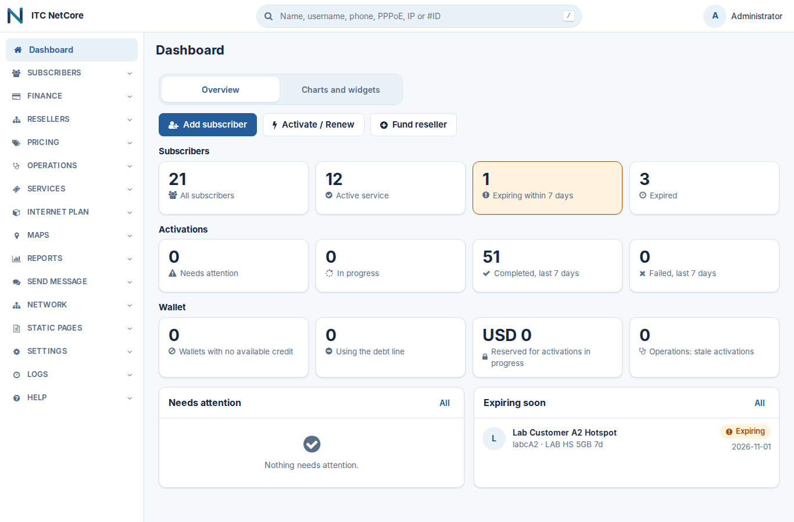
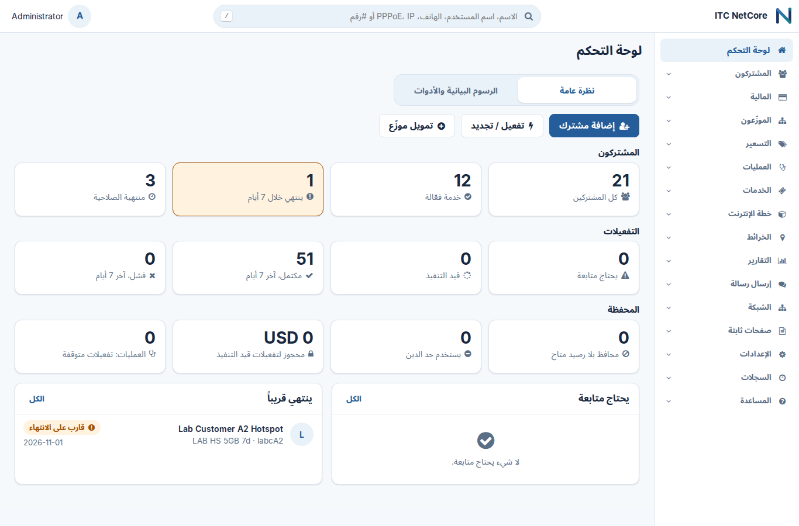
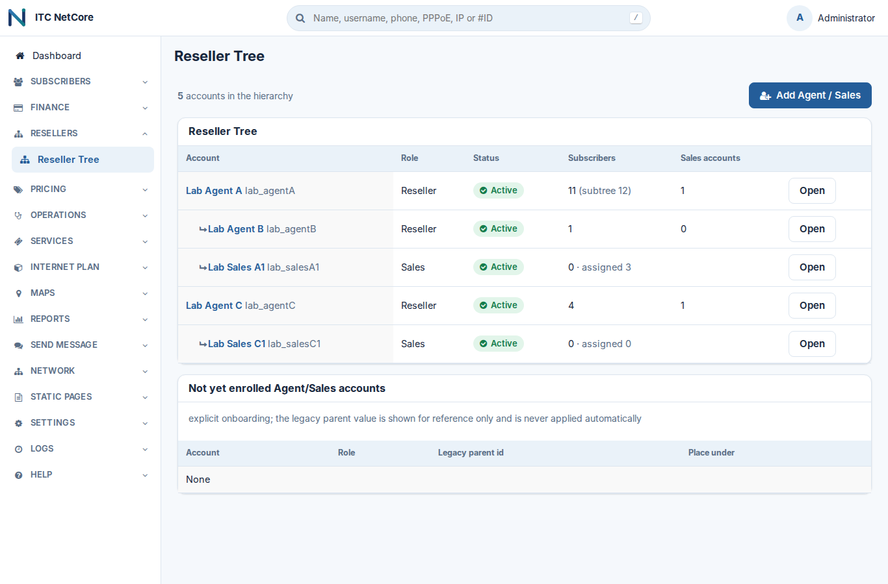
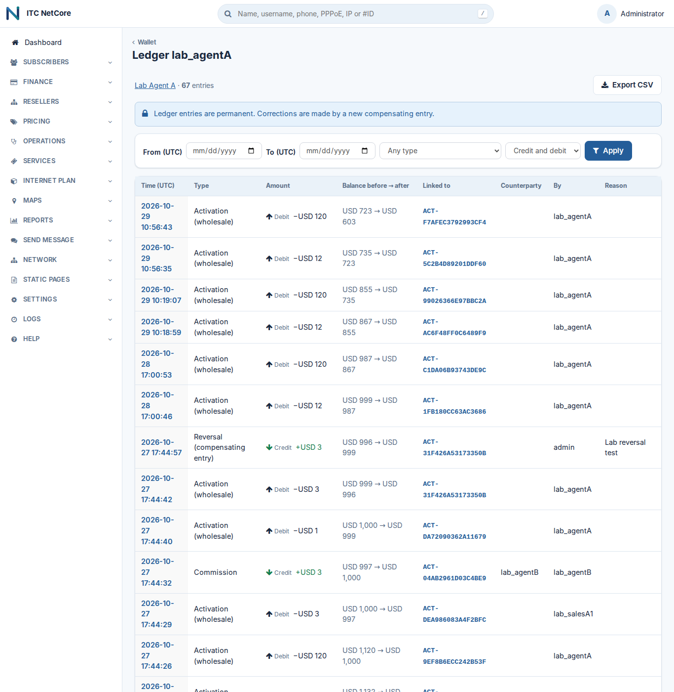
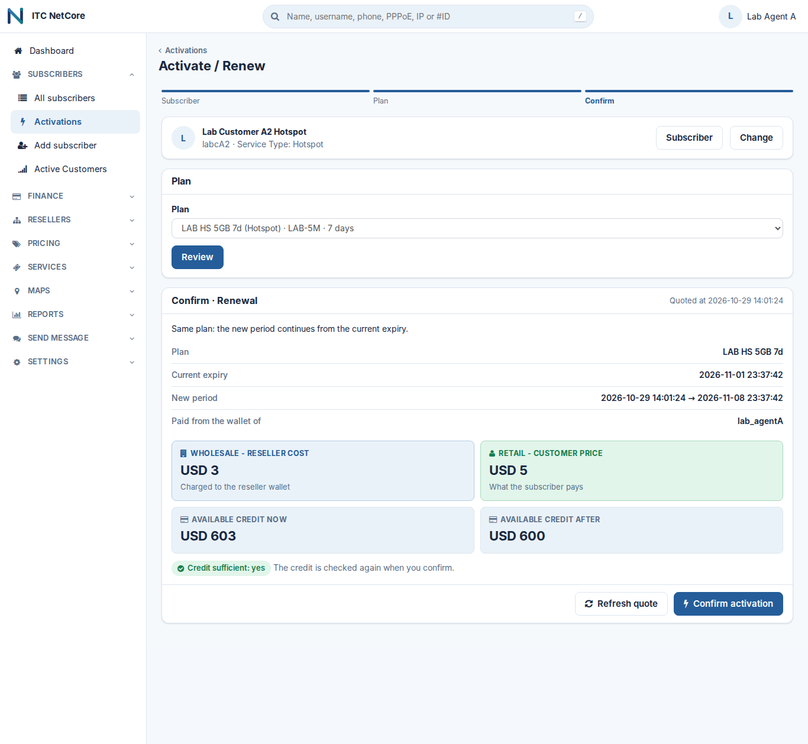
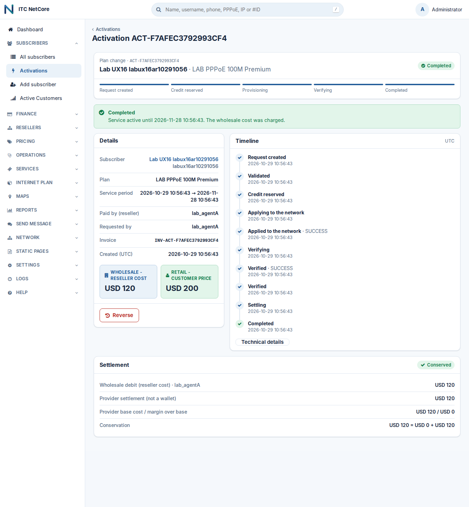
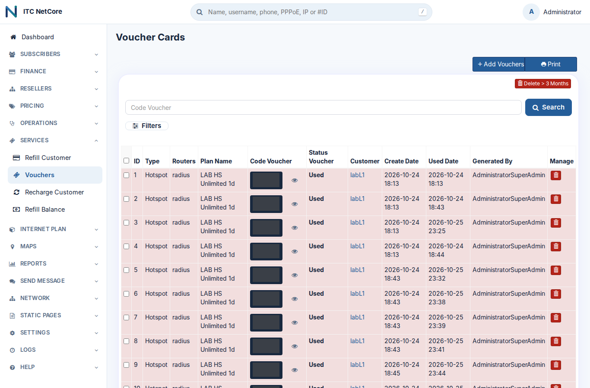
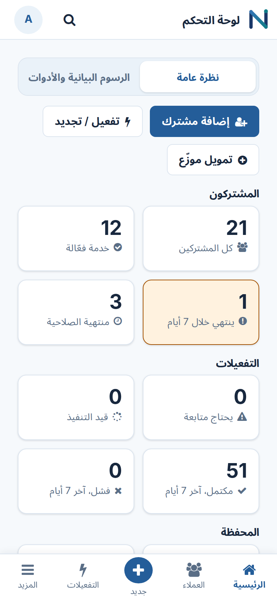
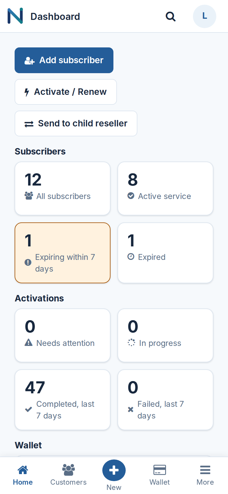
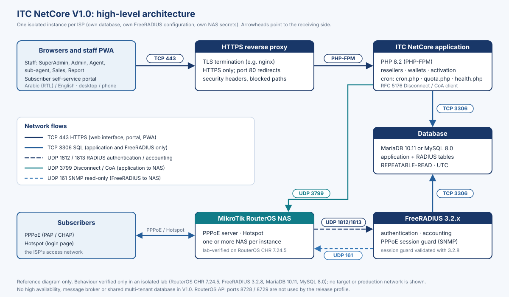

<picture>
  <source media="(prefers-color-scheme: dark)" srcset="ui/ui/images/brand/netcore-wordmark-white.svg">
  
</picture>

# ITC NetCore

**ISP Management & Billing Platform** · منصة إدارة وفوترة مزوّدي خدمة الإنترنت

**V1.0.1 Release Candidate 3** (`v1.0.1-rc.3`) · developed and maintained by **ITC** · not yet production-accepted

ITC – Integrated Technology Company · [www.itc-iq.net](https://www.itc-iq.net)

[العربية](#ar) · [English](#en) · [**Latest release: `v1.0.1-rc.3`**](https://github.com/lucefardeavel/itc-netcore/releases/tag/v1.0.1-rc.3) · [Documentation](docs/README.md) · [Release notes](docs/release/RELEASE_NOTES_V1.0.1.md) · [Release status](#release-status)

> [!IMPORTANT]
> **ITC NetCore V1.0.1 is a Release Candidate. It is not production-accepted.** The lab verdict is
> `LAB_ACCEPTED_WITH_LIMITATIONS` and the release state is `RELEASE_BLOCKED_WITH_EVIDENCE`: the target-environment
> acceptance tests have not been run, and the legal review (LIC-1) is `BLOCKED — COUNSEL REQUIRED`.
> See [Release status](#release-status).

## نظرة عامة

<bdi>ITC NetCore</bdi> منصة لإدارة وفوترة مزوّدي خدمة الإنترنت، من تطوير وصيانة <bdi>ITC</bdi>. تربط المنصة الجانب التجاري لمزوّد الخدمة (الموزّعون، والمحافظ، والأسعار، والمشتركون، والتقارير) بالجانب التقني للشبكة (خادم <bdi>FreeRADIUS</bdi> وأجهزة <bdi>MikroTik RouterOS</bdi> بخدمتي <bdi>PPPoE</bdi> و<bdi>Hotspot</bdi>). الواجهة عربية أولاً من اليمين إلى اليسار، وتدعم الإنجليزية، وتعمل على الحاسوب والجهاز اللوحي والهاتف، مع تطبيق ويب قابل للتثبيت (<bdi>PWA</bdi>) للموظفين.

**ما الذي تقدّمه المنصة:**

- **شبكة الموزّعين:** مدير النظام، والمدير، والموزّع (<bdi>Agent</bdi>) والموزّع الفرعي، وحساب المبيعات (<bdi>Sales</bdi>)، ودور التقارير (<bdi>Report</bdi>). يرى كل حساب مشتركيه فقط، ويُتحقّق من الصلاحيات ونطاق البيانات في الخادم.
- **المحافظ والسجل المالي:** محافظ مسبقة الدفع للموزّعين، وسجل محاسبي مزدوج القيد لا يُعدَّل (التصحيح بقيد معاكس)، وتحويلات من الموزّع إلى أبنائه المباشرين، وعمولات، وحجز للرصيد قبل التنفيذ، وعكس للعمليات، وفحوص سلامة.
- **التفعيل والتجديد وتغيير الباقة:** عرض سعر يحسبه الخادم ومراجعة قبل التأكيد، وتنفيذ قابل للتدقيق مع إعادة المحاولة والمطابقة والاستعادة اليدوية المُدقّقة.
- **الشبكة:** سياسات <bdi>FreeRADIUS 3.2</bdi> (انتهاء الصلاحية، والجلسات المتزامنة، وحدود السرعة، ومجمّعات العناوين)، وأوامر الفصل وتغيير التفويض (<bdi>Disconnect / CoA</bdi>) لأجهزة <bdi>MikroTik</bdi>.
- **حصص البيانات:** يُفصل الاستخدام الفعلي عن الاستخدام المحتسب؛ والتجاوز لا يُحتسب ولا يُرحَّل. الإنفاذ **محدود الدقة وليس دقيقاً بالبايت**، ولا يجوز تسويقه على أنه حدّ دقيق بالبايت.
- **القسائم والتقارير:** قسائم برموز مُقنّعة في الواجهة واسترداد لمرة واحدة، وتقارير المعاملات وسجل التفعيلات وكشوف المحافظ.

**آخر إصدار:** <bdi>[`v1.0.1-rc.3`](https://github.com/lucefardeavel/itc-netcore/releases/tag/v1.0.1-rc.3)</bdi>، الإصدار المرشّح الثالث من <bdi>V1.0.1</bdi> · [ملاحظات الإصدار](docs/release/RELEASE_NOTES_V1.0.1.md)

**الجديد في <bdi>V1.0.1</bdi>:** واجهة باسم <bdi>ITC</bdi> فقط وقائمة مبسّطة؛ صفحة دخول للهوتسبوت تُنزَّل من الإعدادات وتُرفع إلى الراوتر؛ كروت هوتسبوت باسم مستخدم وكلمة مرور؛ طباعة الكروت على طابعة حرارية 80 مم؛ أوقات الشاشات المالية بتوقيت بغداد؛ إعدادات العراق الافتراضية عند التثبيت الجديد (الدينار، وتوقيت بغداد، والعربية، ورمز 964).

**حالة الإصدار:** <bdi>V1.0.1</bdi> إصدار مرشّح (<bdi>Release Candidate</bdi>) لم يُقبل بعد للإنتاج. اجتاز اختبارات المختبر المعزول فقط؛ ولم تُجرَ اختبارات البيئة المستهدفة (<bdi>staging</bdi>)؛ وحالة المراجعة القانونية <bdi>LIC-1</bdi> هي <bdi>`BLOCKED — COUNSEL REQUIRED`</bdi>.

**التثبيت الأول** تثبيت جديد على قاعدة بيانات جديدة فارغة، بحزمة التثبيت الجديد [`install/fresh/`](install/fresh/). راجع [دليل التثبيت](docs/guides/install/) و[دليل <bdi>MikroTik</bdi> و<bdi>FreeRADIUS</bdi>](docs/guides/radius-mikrotik/) و[الملف التعريفي للمنتج](docs/guides/product-profile/) و[فهرس الوثائق](docs/README.md).

**الدعم والتواصل:** <bdi>ITC – Integrated Technology Company</bdi> · <bdi>[www.itc-iq.net](https://www.itc-iq.net)</bdi> · <bdi>07702686402</bdi> · <bdi>07833056405</bdi>. تُحدَّد شروط الدعم في اتفاقية كل عميل.

## Overview

ITC NetCore runs the business side of an internet service provider and connects it to the network. Resellers sell
from prepaid wallets, every money movement is written to a ledger, and each activation, renewal or plan change is
applied to MikroTik RouterOS routers through FreeRADIUS. The interface is Arabic-first (RTL) with English, adapts to
desktop, tablet and phone, and the staff interface installs as a web app (PWA).

Each ISP gets **one isolated instance**: its own database, its own FreeRADIUS configuration and its own NAS secrets.
There is no shared multi-tenant database.

  
  

SuperAdmin dashboard in English and Arabic (synthetic lab data).

## What it does

| Area | In V1.0.1 |
|---|---|
| Resellers | A hierarchy of Agents and sub-agents to any depth, with Sales accounts as leaves; each account sees and acts only on its own scope |
| Subscribers | Created by Admins, Agents and Sales accounts; PPPoE, Hotspot and RADIUS-device plans |
| Money | Prepaid reseller wallets, a double-entry ledger, a pricing chain with commissions and provider settlement |
| Activation | New, renew, reactivate and change plan, with a server-calculated quote and a review step before confirmation |
| Network | FreeRADIUS 3.2 policy and RFC 5176 Disconnect / CoA to MikroTik RouterOS (PPPoE and Hotspot) |
| Usage | Data and time quotas per billing period, with actual usage kept separate from billable usage |
| Vouchers and reports | Admin-generated vouchers with masked codes; transaction, activation and ledger reports |
| Operations | Migration runner, health checks, release preflight, backup / restore and recovery runbooks, least-privilege database accounts |

## New in V1.0.1

Latest pre-release: [`v1.0.1-rc.3`](https://github.com/lucefardeavel/itc-netcore/releases/tag/v1.0.1-rc.3). Full list and upgrade steps: [V1.0.1 release notes](docs/release/RELEASE_NOTES_V1.0.1.md).

- **ITC-only interface** and a simple menu of 11 groups organised around daily work; technical pages are under *Advanced*.
- **Hotspot sign-in page:** download the router's `login.html` from Settings > General > Voucher. It opens the ITC NetCore
  card page, activates the card and signs the device in.
- **Username-and-password hotspot cards** (migration R0008) and **80 mm thermal card printing** (the A4 sheet stays).
- **Baghdad time:** finance and reseller screens and CSV exports show times in the application time zone; the from / to
  filters are local days. Storage stays UTC.
- **Get started card** on the administrator dashboard after a fresh install, and **Iraq defaults** (dinar,
  Asia/Baghdad, Arabic, 964).
- **No requests to other sites:** jQuery, DataTables, CodeMirror and jsPDF are served locally, each checked against its SRI hash.

The finance, activation, pricing and reseller logic is unchanged from V1.0.

## Key verified capabilities

Everything below was verified **in an isolated lab only** (on candidate `a6b02eba`; MariaDB 10.11 and MySQL 8.0,
FreeRADIUS 3.2.8, RouterOS CHR 7.24.5). None of it has been verified on a target or production system.

- Full test harness: **1680 / 1680** tests passed on each database engine (the 132 router-only tests run in the CHR window).
- Real-router window on RouterOS CHR: **145 passed, 1 blocked** per engine. The blocked two-NAS test later passed on both engines in the lab on a second CHR (lab only; staging case X-1 is still required).
- Browser matrix: **208 pages, 0 failures, 0 console errors** across 7 roles × Arabic / English × desktop / mobile × light / dark.
- Backup / restore drill, bounded load, deadlock study and accounting load through FreeRADIUS: passed on both engines.
- Final-prep work of 2026-10-29 (after the candidate), each on both engines: the [`install/fresh/`](install/fresh/) package on a disposable instance (install exit 0, post-install verify 67 / 0 / 0, 8 / 8 refusal cases; the proof is run on every release candidate on MariaDB 10.11 and MySQL 8.0, and the result for this release is in the handover package, `08_Acceptance_Handover/FRESH_INSTALL_PROOF`); the [`install/backup/`](install/backup/) point-in-time recovery drill on a small synthetic database (identical copy at the chosen time, 0 rows lost after a dropped database); R-HF-CARRY-01 rounds 1–3, the UI / Arabic-label fixes and the preflight fixes G-4 and G-1 through targeted harness runs (the browser matrix and CHR suites were not re-run on them).

V1.0.1 (2026-11-09): unit suite 207 tests, 0 failures. Docker suites on MariaDB 10.11 and MySQL 8.0: 1,729 tests per
engine for rc.2, with 3 failures fixed and re-run (2 more tests fail only on the Windows test host, which reports file mode
0777); the finance, activation and interface tests of rc.3, 747 per engine, 0 failures. **Not yet run:** a real MikroTik
router for the new hotspot sign-in page and cards, and a real 80 mm printer.

The lab workstation does not prove production capacity. Production sizing is an output of the target acceptance test TA-09.

## Roles and access

Permissions and data scope are checked on the server for every request. Anything not granted is denied.

| Role | Data scope | What it can do in V1.0.1 |
|---|---|---|
| **SuperAdmin** | Whole instance | Everything an Admin can do, plus the web backup download and the system settings reserved to SuperAdmin. Restore is done at database level (`install/backup/nuxr-restore.sh`); the web restore is refused on reseller installations |
| **Admin** | Whole instance | Subscribers, plans, pricing, vouchers, reseller tree, wallet funding and withdrawal, debt limits, adjustments, activation reversal, reports. No backup / restore and no code-execution surfaces |
| **Agent** (reseller) | Own subtree | Creates subscribers; activates and renews its own subscribers from its own wallet; transfers credit to its direct children; sets its children's wholesale prices and its own retail price; reads its subtree's wallets, ledger and activations |
| **Sub-agent** | Own subtree | An Agent placed under another Agent: the same capabilities inside its own branch, funded by its parent |
| **Sales** | Subscribers explicitly assigned to it | Creates and activates its assigned subscribers; the cost is charged to its parent Agent's wallet |
| **Report** | Self only | Signs in, sees an empty dashboard and its own profile. **No data views in V1.0.1** |
| Subscriber (portal) | Own account | Self-service portal pages, voucher redemption |

Agents and Sales accounts cannot edit, deactivate, delete or re-sync subscribers after creation, and cannot generate
vouchers; those are Admin actions. Agents are disabled, never deleted. Details: [WP2 permission model](docs/WP2_PERMISSION_MODEL.md).

  

## Resellers and subscribers

- Admins place Agents and Sales accounts in the reseller tree. Onboarding is explicit; a legacy parent value is shown for reference and never applied automatically.
- Each Agent sees its own branch only: subscribers, child accounts, wallets, ledger and activations.
- Sales accounts work only on the subscribers assigned to them.
- Subscriber identities are unique per instance: a second service type on the same RADIUS identity is refused.

## Wallets, billing and financial operations

- **Prepaid wallets** for resellers, with an optional debt limit set by an Admin.
- **Provider funding and withdrawal** (Admin only), shown on a review screen with the balances before and after, then confirmed.
- **Transfers** from a reseller to its direct children, also reviewed before confirmation.
- **Pricing chain:** provider base cost, wholesale price per child account, retail price; commissions and provider settlement are recorded for every activation.
- **Ledger:** double-entry and insert-only. Entries are permanent; a correction is a new compensating entry. Statements export to CSV.
- **Reservations:** the cost is reserved before the network change and charged once the activation settles. A reservation whose outcome is uncertain is held for an operator and **never released automatically**.
- **Integrity checks:** `system/reseller/health.php --finance` runs the finance consistency checks.

There is no automatic customer refund on a reversal, and no payment-gateway plugin ships with the product.
Details: [WP3A finance model](docs/WP3A_FINANCE_MODEL.md), [WP3B pricing model](docs/WP3B_PRICING_MODEL.md).

  

## Activation, renewal and plan changes

- Activation types: **new**, **renew**, **reactivate** and **change plan**.
- The server calculates the quote: plan, new period, wholesale cost, retail price and the wallet credit before and after. The credit is checked again on confirmation.
- A renewal of the same plan continues from the current expiry. A plan change takes effect immediately with a new full period and **no proration**; the screen warns how much paid time will be lost and requires an acknowledgement.
- Every activation follows an auditable state machine (request → credit reserved → applied to the network → verified → settled), with bounded retry, reconciliation and audited operator recovery.
- An Admin can reverse a completed activation; the ledger records a compensating entry.

Details: [WP5A activation model](docs/WP5A_ACTIVATION_MODEL.md).

  
  

## MikroTik PPPoE and Hotspot

- MikroTik RouterOS is the NAS. RouterOS 7.15 or later is required; behaviour was verified on RouterOS CHR 7.24.5 in the lab. Target router models and versions are verified by acceptance tests TA-03 / TA-04, which have not been run.
- PPPoE (PAP / CHAP) and Hotspot are supported. The NAS type must be `mikrotik_snmp`.
- The application sends RFC 5176 **Disconnect / CoA** to the NAS (UDP 3799) to end or update sessions after renewals, plan changes and quota exhaustion.
- RouterOS limits that apply: a CoA that changes a byte limit mid-session is not applied by RouterOS, and a CoA that changes the address pool is ignored (the policy is changed, then the session is disconnected).
- The legacy RouterOS API drivers are disabled in the release profile; API ports 8728 / 8729 stay closed.

Details: [NAS onboarding and secret rotation](docs/NAS_ONBOARDING_AND_SECRET_ROTATION.md), [WP8 integration model](docs/WP8_INTEGRATION_MODEL.md).

## FreeRADIUS

- FreeRADIUS 3.2.x with the configuration in [`install/freeradius/`](install/freeradius/README.md) (site, SQL module, counters, PPPoE session guard, Hotspot slot verifier).
- Policy: PAP / CHAP, expiration, simultaneous use, rate limits and IP pools.
- PPPoE session guard (read-only SNMP to the NAS, UDP 161) and PPPoE admission reservation; Hotspot admission slots. The session guard is validated with FreeRADIUS 3.2.8 only.
- Accounting history is kept intact: the application never deletes or rewrites accounting rows.

Details: [WP4 RADIUS model](docs/WP4_RADIUS_MODEL.md), [time contract](docs/TIME_CONTRACT.md).

## Data quotas and usage accounting

ITC NetCore keeps two numbers for each billing period:

- **Actual usage**: what the network recorded (download + upload).
- **Billable usage**: actual usage capped at the plan's quota. An overshoot is shown for information, is **not charged** and is **not carried** into the next period.

How enforcement works, and how precise it is:

- Data quotas are whole MB or GB (decimal: 1 GB = 10^9 bytes); time quotas are whole minutes or hours.
- At each login the session receives its share of the remaining quota. Hotspot sessions get a hard cap per session (lab overshoot 0.3–4.4 % past the share). PPPoE caps each direction, and the quota enforcer closes the combined total.
- The enforcer (`quota.php enforce`) runs every minute and checks every 5 seconds; accounting interim updates default to 30 s.
- If the enforcer, FreeRADIUS, the database or the NAS link is down, only the router's limits apply (PPPoE worst case: twice the remaining quota).

> [!WARNING]
> Quota enforcement is **bounded, not byte-exact**. It must never be sold or advertised as a byte-exact cap.

Details: [commercial quota contract](owner-review/WP10/N1_G_COMMERCIAL_QUOTA_CONTRACT.md) (source repository only (not in the release artifact)).

## Vouchers and reports

- Admins generate vouchers; codes are masked in the interface, and each voucher is redeemed exactly once. Grants that cannot be proven are listed for review.
- Subscribers redeem vouchers in the self-service portal.
- Reports: transactions, activation history, reseller wallet statements and the activation list with its timeline; dashboards per role.

  

## Arabic, English and mobile

- Arabic-first right-to-left interface, with English; the product name stays in Latin script.
- One adaptive staff interface for desktop, tablet and phone, with a bottom navigation bar on phones.
- The staff interface installs as a **PWA**. When the connection is lost it shows an offline page and stops sending changes; nothing is queued or replayed later.
- The brand typefaces Inter and Noto Sans Arabic are self-hosted with the product.

  
  &nbsp;
  

Details: [WP6C adaptive UX model](docs/WP6C_ADAPTIVE_UX_MODEL.md), [WP7 PWA model](docs/WP7_PWA_MODEL.md).

## Architecture

  

V1.0 does not include database or RADIUS high availability, a message broker or worker queue, microservices, or a
shared multi-tenant database. Architecture decisions: [owner architecture lock](docs/architecture/owner-lock-2026-10-09/OWNER_ARCHITECTURE_LOCK.md).

## System requirements

| Component | Requirement |
|---|---|
| PHP | 8.2 with `pdo_mysql`, `curl`, `gd`, `mbstring`, `zip` (PHP-FPM behind an HTTPS front) |
| Database | MariaDB 10.11 or MySQL 8.0, `REPEATABLE-READ`, UTC |
| RADIUS | FreeRADIUS 3.2.x with the configuration in `install/freeradius/`; net-snmp tools for the session guard |
| NAS | MikroTik RouterOS 7.15 or later, NAS type `mikrotik_snmp` |
| Time | NTP on every host and on every NAS ([time contract](docs/TIME_CONTRACT.md)) |
| Network | HTTPS (TCP 443) to the application only; database, RADIUS and SNMP ports never exposed to the internet |

Representative **staging** minima derived from the lab (not production sizing): application 2 vCPU / 4 GB RAM;
database 4 vCPU / 8 GB RAM on SSD; FreeRADIUS 4 vCPU / 4 GB RAM. See
[staging deployment package](docs/STAGING_DEPLOYMENT_PACKAGE.md).

## Quick start (fresh install)

The first installation of V1.0 is a **fresh install on a new, empty database**. Migrating an existing legacy
database is a separate future path and is not part of the first installation.

Follow the [installation guide](docs/guides/install/) step by step. In outline:

1. Prepare the hosts: UTC and NTP everywhere, the firewall matrix, a DNS name and a certificate, backup storage.
2. Verify and unpack the release artifact with `install/fresh/nuxr-artifact-verify.sh`; keep a verified copy outside the document root.
3. Install the web server from the package examples (nginx, PHP-FPM), generate the env file (`nuxr-fresh-install.sh --generate-secrets`) and run a `--dry-run`.
4. Run `install/fresh/nuxr-fresh-install.sh`. It proves the database is empty (anything else is refused before any change), creates the accounts, loads the base schema, writes `config.php`, applies the schema migrations, loads the RADIUS admission tables, applies the least-privilege grants, removes the web installer (keeping `install/freeradius/` read-only), installs the cron file, and runs `preflight.php --setup` and `health.php --finance`. The web installer is not used.
5. Run `install/fresh/nuxr-post-install-verify.sh`; it must pass.
6. Sign in, change the default administrator password, set the company name, time zone and currency.
7. Set up backups with [`install/backup/`](install/backup/) and run a restore drill.
8. Configure FreeRADIUS and onboard each NAS ([MikroTik and FreeRADIUS guide](docs/guides/radius-mikrotik/)).
9. Run the release preflight (`preflight.php` without `--setup`).

> [!CAUTION]
> A production deployment, a production data migration or a production secret change needs the owner's explicit
> release authorization. This README does not grant it.

## Documentation

The full index is in [docs/README.md](docs/README.md).

| Topic | Where |
|---|---|
| Installation | [docs/guides/install/](docs/guides/install/) |
| MikroTik and FreeRADIUS | [docs/guides/radius-mikrotik/](docs/guides/radius-mikrotik/), [install/freeradius/README.md](install/freeradius/README.md) |
| Operations | [docs/guides/operations/](docs/guides/operations/) |
| Product profile | [docs/guides/product-profile/](docs/guides/product-profile/) |
| Deployment and upgrade | [docs/DEPLOYMENT_AND_UPGRADE_RUNBOOK.md](docs/DEPLOYMENT_AND_UPGRADE_RUNBOOK.md), [docs/PRODUCTION_CONFIGURATION_CHECKLIST.md](docs/PRODUCTION_CONFIGURATION_CHECKLIST.md) |
| Domain models | [docs/WP1_SCHEMA_CONTRACT.md](docs/WP1_SCHEMA_CONTRACT.md) … [docs/WP8_INTEGRATION_MODEL.md](docs/WP8_INTEGRATION_MODEL.md) |
| Brand and naming | [docs/BRAND_IDENTITY.md](docs/BRAND_IDENTITY.md) |

## Training

The illustrated training manual for every role is in [docs/guides/training/](docs/guides/training/) (Arabic primary,
English), with exercises, a competency checklist and an assessment. The administrator quick start and the reseller and
subscriber onboarding guides are in [docs/guides/operations/](docs/guides/operations/), in Arabic and English.

## Security and operations

| Topic | Where |
|---|---|
| Fresh installation | Fresh-install package in [install/fresh/](install/fresh/) |
| Backup and restore | [docs/BACKUP_RESTORE_RUNBOOK.md](docs/BACKUP_RESTORE_RUNBOOK.md), backup and point-in-time recovery tooling in [install/backup/](install/backup/) |
| Operator recovery (held activations and reservations) | [docs/OPERATOR_RECOVERY_RUNBOOK.md](docs/OPERATOR_RECOVERY_RUNBOOK.md) |
| NAS onboarding and secret rotation | [docs/NAS_ONBOARDING_AND_SECRET_ROTATION.md](docs/NAS_ONBOARDING_AND_SECRET_ROTATION.md) |
| Production configuration checklist | [docs/PRODUCTION_CONFIGURATION_CHECKLIST.md](docs/PRODUCTION_CONFIGURATION_CHECKLIST.md) |
| Daily checks, monitoring, incidents, upgrade and rollback, hardening | [docs/guides/operations/](docs/guides/operations/) |
| Target acceptance tests TA-01 … TA-10 | [docs/V1_TARGET_ACCEPTANCE.md](docs/V1_TARGET_ACCEPTANCE.md) |

Built-in login throttling is not provided; rate-limit sign-in at the HTTPS front (the nginx example in `install/fresh/`
includes a login rate limit). There is no high-availability claim for V1.0. R-HF-CARRY-01 is accepted by the owner as a documented V1
residual (see the release notes).

## Release notes and changelog

- [V1.0.1 release notes](docs/release/RELEASE_NOTES_V1.0.1.md), **latest pre-release [`v1.0.1-rc.3`](https://github.com/lucefardeavel/itc-netcore/releases/tag/v1.0.1-rc.3)** (maintenance release candidate: ITC-only interface, simple menu, hotspot sign-in page, thermal and username-and-password cards, Baghdad time, Iraq defaults, upgrade steps)
- [V1.0 release notes](docs/release/RELEASE_NOTES_V1.0.md) (Release Candidate)
- [V1.0 changelog entry](docs/release/CHANGELOG_V1.0_entry.md)
- [CHANGELOG.md](CHANGELOG.md): the history of the code base, followed by the Git history of this repository

## Release status

| Gate | State |
|---|---|
| Version | **V1.0.1 Release Candidate 3**, pre-release [`v1.0.1-rc.3`](https://github.com/lucefardeavel/itc-netcore/releases/tag/v1.0.1-rc.3), on `maint/v1.0.1-itc-only` (built on the frozen V1.0 code `0a8b9d58`, pre-release `v1.0.0-rc.1`); no `v1.0.0` tag |
| Lab acceptance | `LAB_ACCEPTED_WITH_LIMITATIONS` (isolated lab only) |
| Target staging, acceptance tests TA-01 … TA-10 | **Not run**: no authorized staging target exists |
| Legal review LIC-1 | **`BLOCKED — COUNSEL REQUIRED`** |
| Owner decisions | Decided 2026-11-03 (A1–A8): residuals accepted as documented, recovery option 2 with target RTO 4 h / RPO 15 min (targets, to be validated on the customer target) |
| WP9 / WP10 acceptance | Pending |
| Production | **Not production-accepted; not deployed to production** |

Supported capabilities and known limitations are listed in the operations guides ([docs/guides/operations/](docs/guides/operations/)).
Current state and open items: [owner-review/CURRENT_STATE_AND_OPEN_NOTES.md](owner-review/CURRENT_STATE_AND_OPEN_NOTES.md) (source repository only (not in the release artifact)).

## Support

**ITC – Integrated Technology Company** · [www.itc-iq.net](https://www.itc-iq.net) · 07702686402 · 07833056405

Support terms are defined per customer agreement. ITC is the only support channel for ITC NetCore.

## Naming note

The product name is ITC NetCore. Internal identifiers keep their original names: database and table names, routes, API
fields, the FreeRADIUS site and dictionary (`phpnuxbill`), file paths and the Composer package name. They are not part of
the visible identity, and renaming them would break existing installations.

## Licence

ITC NetCore is developed and maintained by **ITC – Integrated Technology Company**. It is distributed under the GNU
General Public License version 2: see [LICENSE](LICENSE), [NOTICE](NOTICE) and
[docs/THIRD_PARTY_LICENSES.md](docs/THIRD_PARTY_LICENSES.md).
