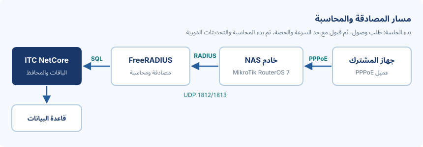

# مقدمة

يشرح هذا الدليل كيف يدير المشغّل اشتراكات PPPoE في **ITC NetCore V1.0** باستخدام خادم FreeRADIUS 3.2 للمصادقة
وأجهزة MikroTik بنظام RouterOS 7 بوصفها خوادم NAS. ويغطي مسار الاتصال، والباقات مع حصص البيانات، ومحافظ الوكلاء،
والفحوص المطلوبة قبل التشغيل الفعلي.

> [!NOTE]
> هذه وثيقة نموذجية أنتجها خط إنتاج وثائق ITC NetCore. القيم الواردة فيها مثل الأسعار والعناوين وكلمات السر
> توضيحية، ويجب استبدالها بإعدادات المشغّل الفعلية.

## النطاق والجمهور

الدليل موجّه إلى مدير الشبكة لدى المشغّل وإلى موظفي الفوترة، ويفترض معرفة أساسية بنظام RouterOS وبيئة Linux
وبواجهة الموظفين في ITC NetCore.

# المتطلبات

قبل إعداد المشتركين تأكّد من الآتي:

- خادم يعمل عليه ITC NetCore مع قاعدة بيانات *MariaDB* وخادم FreeRADIUS على المضيف نفسه أو على مضيف يمكن الوصول إليه.
- نظام RouterOS 7.x على كل جهاز NAS، مع تفعيل خادم PPPoE على منفذ الوصول.
- فتح منفذ UDP رقم `1812` للمصادقة و`1813` للمحاسبة من كل NAS إلى خادم RADIUS، مثلًا العنوان `10.10.0.5`.
- سرّ مشترك (shared secret) مختلف لكل NAS، لا يقل طوله عن 24 حرفًا عشوائيًا.
- مزامنة الوقت على جميع الأجهزة عبر NTP، لأن قرارات المحاسبة والحصص تعتمد على صحة الطوابع الزمنية:
  - خادم RADIUS ومضيف قاعدة البيانات؛
  - كل جهاز NAS من MikroTik.

## مسار الاتصال

يفتح جهاز المشترك (CPE) جلسة PPPoE على جهاز NAS، فيسأل NAS خادم FreeRADIUS الذي يقرأ بيانات المشترك والباقة
والحصة المتبقية من قاعدة بيانات ITC NetCore ثم يردّ بحد السرعة المناسب.



# الباقات والحصص

تحدّد كل باقة السرعة وحصة البيانات الشهرية والسلوك بعد استهلاك الحصة (سياسة الاستخدام العادل FUP). يعرض الجدول
الآتي مجموعة باقات نموذجية.

| الباقة | السرعة (تنزيل/رفع) | الحصة الشهرية | السعر (IQD) | بعد استهلاك الحصة | ردّ RADIUS |
|---|---|---|---|---|---|
| Home 25 | 25/5 Mbps | 200 GB | 25,000 | خفض السرعة إلى 4 Mbps حتى تاريخ التجديد التالي | `Mikrotik-Rate-Limit = 25M/5M` |
| Home 50 | 50/10 Mbps | 400 GB | 40,000 | خفض السرعة إلى 8 Mbps | `Mikrotik-Rate-Limit = 50M/10M` |
| Business 100 | 100/30 Mbps | غير محدودة | 120,000 | لا توجد سياسة FUP؛ عنوان IPv4 ثابت من مجمّع الأعمال `pool-biz-01` | `Framed-IP-Address` و`Mikrotik-Rate-Limit = 100M/30M` |
| Night Saver | 30/5 Mbps | 150 GB (لا تُحتسب الفترة من 00:00 إلى 08:00) | 18,000 | خفض السرعة إلى 2 Mbps | `Mikrotik-Rate-Limit = 30M/5M` |

لإنشاء باقة جديدة:

1. افتح **الخدمات › باقات PPPoE** واختر «إضافة باقة».
2. أدخل الاسم والسرعة والحصة، ثم اختر الراوتر أو مجموعة الراوترات.
3. احفظ الباقة، ثم أسندها إلى مشترك تجريبي واتصل مرة واحدة من جهاز CPE تجريبي.
4. تحقّق في **التقارير › الجلسات المتصلة** من أن الجلسة تُظهر حد السرعة المتوقع.

> [!WARNING]
> تغيير سرعة الباقة يُطبَّق على الجلسات الجديدة فقط. يحتفظ المشتركون المتصلون بحد السرعة القديم حتى يعيدوا الاتصال أو
> حتى يُرسَل أمر CoA أو قطع الاتصال من جهاز NAS.

# محافظ الوكلاء والفوترة

يشتري الوكلاء الاشتراكات والقسائم من محفظة مسبقة الدفع. تُسجَّل كل عملية شحن أو شراء أو استرداد في دفتر المحفظة مع
اسم الموظف والمبلغ والرصيد بعد العملية، بحيث يمكن دائمًا مطابقة الرصيد من الدفتر.

| العملية | الأثر على محفظة الوكيل | قيد الدفتر |
|---|---|---|
| شحن من المشغّل | + المبلغ | `topup` مع رقم الإيصال |
| شراء اشتراك | − سعر الباقة | `purchase` مع المشترك والباقة |
| دفعة قسائم | − السعر × العدد | `voucher_batch` مع رقم الدفعة |
| استرداد (بعد الموافقة) | + المبلغ المسترد | `refund` مرتبط بالقيد الأصلي |

> [!FINANCE-WARNING]
> لا تصحّح رصيد المحفظة مباشرة في قاعدة البيانات أبدًا. استخدم الاسترداد أو التسوية من واجهة الموظفين ليبقى الدفتر
> كاملًا؛ فالتعديل المباشر يُفسد المطابقة وسجل التدقيق.

## الفواتير

تطبع الفواتير ورسائل الفواتير اسم الشركة المحفوظ في إعدادات المشغّل (`CompanyName`). اضبط هذا الإعداد قبل التشغيل
الفعلي حتى تحمل المستندات المالية المطبوعة اسم المشغّل نفسه.

<!-- pagebreak -->

# الأمان

احمِ رابط RADIUS وحسابات الموظفين قبل اتصال أول مشترك حقيقي.

> [!SECURITY-WARNING]
> استبدل السرّ المشترك الافتراضي `testing123` على كل NAS وفي قائمة عملاء FreeRADIUS. اقصر منافذ RADIUS على عناوين
> أجهزة NAS فقط، وفعّل موافقة شخصين على عمليات استرداد المحافظ.

اختبر المصادقة من خادم RADIUS نفسه:

```
radtest test-user 'Test-Password-1' 127.0.0.1 0 'local-secret'
echo "User-Name=test-user" | radclient -x 10.10.0.5:1813 acct 'nas-secret'
```

## استكشاف الأخطاء

| العَرَض | السبب المحتمل | الإجراء |
|---|---|---|
| ردّ `Access-Reject` لكل المستخدمين | سرّ مشترك خاطئ أو أن NAS غير مُضاف إلى قائمة العملاء | قارن السرّ على NAS وفي الملف `clients.conf` وراجع سجل RADIUS |
| الجلسة تتصل بسرعة غير صحيحة | تغيّرت الباقة أثناء نشاط الجلسة | اقطع الجلسة وتحقّق من ردّ `Mikrotik-Rate-Limit` |
| الحصة لا تتناقص | حزم المحاسبة لا تصل | افتح منفذ UDP 1813 وفعّل التحديث الدوري (interim-update) كل 5 دقائق على NAS |

للاستفسار عن هذه الوثيقة تواصل مع مالك الوثيقة المذكور في صفحة الغلاف.
