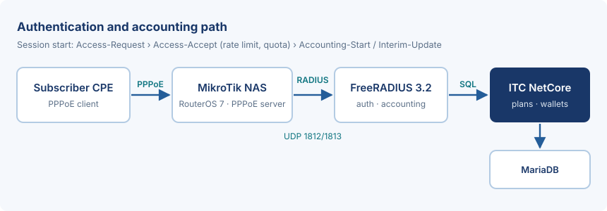

# Introduction

This guide explains how an operator runs PPPoE subscribers with **ITC NetCore V1.0**, using FreeRADIUS 3.2 as the
authentication server and MikroTik RouterOS 7 devices as the NAS. It covers the connection path, service plans with
data quotas, reseller wallets and the checks to run before go-live.

> [!NOTE]
> This is a sample document produced by the ITC NetCore document pipeline. Values such as prices, addresses and
> secrets are illustrative and must be replaced with the operator's own configuration.

## Scope and audience

The guide is written for the operator's network administrator and the billing staff. It assumes basic familiarity
with RouterOS, Linux and the ITC NetCore staff interface.

# Requirements

Before configuring subscribers, confirm the following:

- A server running ITC NetCore with *MariaDB* and FreeRADIUS installed on the same host or on a reachable host.
- RouterOS 7.x on every NAS, with the PPPoE server enabled on the access interface.
- UDP port `1812` (authentication) and `1813` (accounting) open from each NAS to the RADIUS server, for example
  `10.10.0.5`.
- A unique shared secret per NAS (at least 24 random characters).
- Time synchronised on all devices (NTP); accounting and quota decisions depend on correct timestamps:
  - the RADIUS server and the database host;
  - every MikroTik NAS.

## Connection path

The subscriber's CPE opens a PPPoE session on the NAS. The NAS asks FreeRADIUS, which reads the subscriber, the plan
and the remaining quota from the ITC NetCore database and answers with the rate limit.



# Plans and quotas

Each plan defines a speed, a monthly data quota and the behaviour after the quota is used (fair-usage policy, FUP).
The table below shows an example plan set.

| Plan | Speed (down/up) | Monthly quota | Price (IQD) | After the quota | RADIUS reply |
|---|---|---:|---:|---|---|
| Home 25 | 25/5 Mbps | 200 GB | 25,000 | FUP at 4 Mbps until the next renewal date | `Mikrotik-Rate-Limit = 25M/5M` |
| Home 50 | 50/10 Mbps | 400 GB | 40,000 | FUP at 8 Mbps | `Mikrotik-Rate-Limit = 50M/10M` |
| Business 100 | 100/30 Mbps | Unlimited | 120,000 | No FUP; static IPv4 address from the business pool `pool-biz-01` | `Framed-IP-Address`, `Mikrotik-Rate-Limit = 100M/30M` |
| Night Saver | 30/5 Mbps | 150 GB (00:00–08:00 not counted) | 18,000 | FUP at 2 Mbps | `Mikrotik-Rate-Limit = 30M/5M` |

To create a plan:

1. Open **Services › PPPoE plans** and choose *Add plan*.
2. Enter the name, the speed and the quota; select the router or router group.
3. Save, then assign the plan to a test subscriber and connect once from a test CPE.
4. Confirm in **Reports › Online sessions** that the session shows the expected rate limit.

> [!WARNING]
> Changing the speed of a plan applies to new sessions only. Active subscribers keep the old rate limit until they
> reconnect or until a CoA / disconnect is sent from the NAS.

# Reseller wallets and billing

Resellers buy subscriptions and vouchers from a prepaid wallet. Every top-up, purchase and refund is written to the
wallet ledger with the staff member, the amount and the balance after the operation, so the balance can always be
reconciled from the ledger.

| Operation | Effect on the reseller wallet | Ledger entry |
|---|---:|---|
| Top-up by the operator | + amount | `topup`, with the receipt reference |
| Subscription purchase | − plan price | `purchase`, with the subscriber and the plan |
| Voucher batch | − price × count | `voucher_batch`, with the batch id |
| Refund (approved) | + refunded amount | `refund`, linked to the original entry |

> [!FINANCE-WARNING]
> Never correct a wallet balance directly in the database. Use a refund or an adjustment from the staff interface so
> the ledger stays complete; a direct change breaks reconciliation and the audit trail.

## Invoices

Invoices and invoice e-mails print the company name stored in the operator settings (`CompanyName`). Set it before
go-live so printed financial documents carry the operator's own name.

<!-- pagebreak -->

# Security

Protect the RADIUS link and the staff accounts before the first real subscriber connects.

> [!SECURITY-WARNING]
> Replace the default shared secret `testing123` on every NAS and in the FreeRADIUS client list. Restrict the RADIUS
> ports to the NAS addresses only, and enable two-person approval for wallet refunds.

Test the authentication from the RADIUS server itself:

```
radtest test-user 'Test-Password-1' 127.0.0.1 0 'local-secret'
echo "User-Name=test-user" | radclient -x 10.10.0.5:1813 acct 'nas-secret'
```

## Troubleshooting

| Symptom | Likely cause | Action |
|---|---|---|
| `Access-Reject` for every user | Wrong shared secret or NAS not in the client list | Compare the secret on the NAS and in `clients.conf`; check the RADIUS log |
| Session connects at the wrong speed | Plan changed while the session was active | Disconnect the session; check the `Mikrotik-Rate-Limit` reply |
| Quota not decreasing | Accounting packets do not arrive | Open UDP 1813; enable *interim-update* (5 minutes) on the NAS |

For questions about this document, contact the document owner named on the cover.
