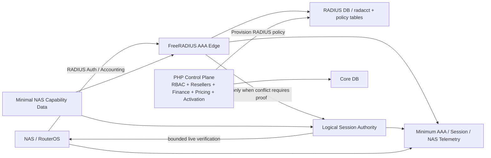

# TARGET_ARCHITECTURE

## Status

Revision: **First-Principles Review 2 — 2026-10-07**.

**Owner-locked architecture envelope — 2026-10-09.** Mandatory V1 safety/reliability and conditional modules are separated explicitly. This is not release acceptance or deployment authorization. Each independent ISP gets **Option A: its own isolated instance**; diagrams describe *one such instance*, not a shared-tenant installation.

## 1. Governing Philosophy

- SAS4 is a non-authoritative clean-room reference.
- Keep the accepted business core unless evidence proves it must change.
- Solve proven production defects before speculative scale/product expansion.
- Add infrastructure only when a product requirement, failure mode, SLO or measurement justifies it.
- Prefer the smallest design that preserves correctness and operability.

## 2. Mandatory Core Target



Mandatory near-term architecture is deliberately small:

1. current PHP modular monolith;
2. FreeRADIUS protocol edge;
3. current relational data model;
4. production-safe Session Authority behavior;
5. minimal NAS capability knowledge required by real evidence;
6. least-privilege verifier/RADIUS secret boundary;
7. minimum operational telemetry.

## 3. FreeRADIUS AAA Edge

Keep responsibility for:

- RADIUS protocol handling;
- Message-Authenticator enforcement;
- current PAP/CHAP scope;
- SQL policy lookup;
- accounting ingestion;
- base expiry/quota modules;
- calling Session Authority only where a conflicting session requires additional proof.

Do not move business finance/reseller/activation logic into FreeRADIUS.

## 4. PHP Control Plane

Keep current accepted authorities:

- human identity/RBAC/data scope;
- reseller hierarchy;
- customer ownership;
- finance/ledger/reservations;
- pricing;
- activation/reversal/reconciliation;
- administrative workflows;
- RADIUS policy provisioning;
- audit.

The modular monolith remains the default deployment model.

## 5. Accounting Authority

### Current authoritative structure

`radacct` is the FreeRADIUS-managed accounting history/projection used by current RADIUS accounting and quota logic.

Important correction:

- it is **not literally immutable**;
- FreeRADIUS legitimately updates rows as Interim/Stop data arrives;
- application/business code must not delete/rewrite it to repair session admission or reset quota.

If a future compliance/debug requirement needs an append-only raw accounting packet/event journal, that is a **separate optional component**, not a reinterpretation of `radacct`.

## 6. Logical Session Authority

Owns one question:

> Given a potential session conflict, do we have enough evidence to admit another session safely?

Inputs can include:

- open accounting evidence;
- exact current/candidate RADIUS identity;
- live NAS evidence;
- verifier health/deadline;
- vendor/service/version capability;
- freshness metadata.

Core result:

- `PROVEN_SAFE`
- `PROVEN_LIVE`
- `UNKNOWN`

Admission rule:

- PROVEN_SAFE -> may proceed;
- PROVEN_LIVE -> reject conflicting login;
- UNKNOWN -> reject/fail closed.

Age/freshness alone never proves offline.

V1 may be implemented inside/adjacent to FreeRADIUS. “Authority” describes responsibility and contract, not deployment topology.

## 7. Simultaneous-Use Safety

Mandatory evidence model:

- SQL/open-accounting remains the fast conflict detector;
- Hotspot Port-Limit is only defense-in-depth where verified;
- PPPoE does not rely on Port-Limit;
- live verification is required when an open PPPoE conflict is ambiguous;
- stock checkrad failure must not be interpreted as SAFE;
- multi-NAS outcomes aggregate fail-closed.

### Concurrent-first-login gate

Before production-safe signoff, explicitly test two same-subscriber Access-Requests arriving before the first Accounting-Start exists.

Only if the test proves a race should V1 add a short-lived admission reservation/serialization mechanism.

## 8. Customer and RADIUS Identity

Current internal customer identity already exists as `tbl_customers.id`.

Target relationship:

```text
customer_id
  -> current application customer record
  -> one or more exact RADIUS/service identities over time
  -> sessions identified by NAS + Acct-Session-Id + exact edge identity
```

A rename changes an edge identity, not the meaning of the customer id.

No new UUID/subscriber id is mandatory unless a future integration/tenancy requirement proves current IDs insufficient.

## 9. Minimal NAS Capability Model

Do not build a giant vendor inventory in advance.

Model only what current safety decisions require, such as:

- vendor/service/firmware evidence scope;
- Port-Limit/session-limit behavior;
- liveness-verification mechanism;
- CoA rate-change support;
- Disconnect support;
- management/verifier transport;
- supported timeout/deadline assumptions.

Capabilities are evidence-backed and versioned. “MikroTik” alone is not enough to infer behavior across all services/versions.

## 10. CoA / Disconnect

Keep the current native RFC5176 client and explicit SUCCESS/FAILED/UNKNOWN result model.

- rate/policy change by CoA only where empirically/vendor-documented as effective;
- changes that require a fresh session use Disconnect + re-auth;
- ACK does not override known vendor behavior where the requested semantic is unsupported.

## 11. Secret Boundary

Mandatory property:

- only the runtime actor that needs a RADIUS/SNMP/management credential can obtain it;
- values do not enter logs, audit payloads or process argv;
- rotation is possible;
- management path stays private/restricted.

The storage implementation is intentionally undecided. It may be protected config, encrypted material, or an external secret service depending on deployment. Encryption is not useful if decryption authority is equally broad, so the access boundary matters more than the product label.

## 12. Minimum Observability

Required for fail-closed session operations:

- auth/session verdict category;
- Session Authority latency;
- verifier failure/timeout;
- NAS health relevant to verification;
- accounting freshness/timezone anomaly;
- CoA/Disconnect result category;
- safe correlation ID without credentials.

A full tracing stack, SLO platform or time-series architecture is **not mandatory** unless deployment complexity justifies it.

## 13. Conditional Architecture Modules

None of the following are part of the mandatory target today.

### 13.1 Advanced FUP / Runtime Policy Engine

Activate only if the owner defines business rules for daily/total usage, throttle/cutoff, free traffic, carry-over or runtime transitions.

### 13.2 Durable Outbox / Enforcement Worker

Activate only if required network work must survive process/request failure and retry asynchronously.

### 13.3 Shared-Database Multi-Tenancy (NOT SELECTED)

The owner selected **Option A: independent isolated instance per ISP**, not a `tenant_id` shared database. Any future replacement must be an explicit product/architecture change, with end-to-end cross-tenant isolation proof. Reseller hierarchy stays within an ISP instance.

### 13.4 Redis / Fast Online Session Index

Activate only for measured lookup/load pressure. Always derived/rebuildable.

### 13.5 External Broker

Activate only when DB-backed durability/worker design is no longer sufficient for volume or isolation.

### 13.6 DB HA / Multiple FreeRADIUS Nodes

Backup/restore is operationally mandatory. Active HA topology depends on availability/SLO requirements.

### 13.7 Finer-Grained Reseller Tree Concurrency

Activate only if metrics prove the current global lock causes material contention.

## 14. Failure Semantics

### Authentication/session admission

- invalid/missing required security proof -> reject/no response as protocol requires;
- conflicting-session liveness UNKNOWN -> reject;
- verifier failure is never SAFE;
- first login without conflict should avoid unnecessary verifier dependency.

### Accounting

- lost Stop/Interim records create uncertainty;
- business code does not fabricate accounting history to make admission work;
- current liveness is a derived state.

### External network action

- confirmed response/effect -> SUCCESS;
- confirmed refusal -> FAILED;
- timeout/ambiguous commit -> UNKNOWN.

### Finance

Current accepted ledger/reservation/reversal invariants remain unchanged.

## 15. Deployment Evolution

### Stage 1 — Required near-term

- existing PHP app in a per-ISP isolated runtime;
- FreeRADIUS for that ISP and its scoped NAS clients;
- independently scoped Core/RADIUS databases and backup/restore material per ISP;
- productionized Session Authority v1;
- minimal NAS capability data;
- minimum session/NAS observability;
- release blocker closure.

### Stage 2 — Only after owner requirement or measurement

Choose individual modules as needed:

- durable worker/outbox;
- advanced FUP;
- encrypted/alternative management transport;
- HA;
- session cache;
- reporting scale;
- future shared-DB tenancy only by explicit owner change to Option A.

### Stage 3 — Only under demonstrated scale/organizational pressure

Potential selective service extraction or broker use.

No Kubernetes or microservices requirement is created by this document.

## 16. Non-Goals

- no SAS4 source reproduction;
- no licensing/ionCube bypass work;
- no full rewrite;
- no automatic adoption of SAS4 features;
- no automatic broker/Redis/microservices/HA mandate;
- no shared-DB tenant model (Option A is selected);
- no destructive accounting repair to solve sessions;
- no fail-open live verification.


## 17. Owner-Approved V1 Correctness and Recovery Contract — 2026-10-09

- **Session safety:** Option G behavioral contract + concurrent first-login acceptance test before production; `UNKNOWN` never authorizes an unsafe conflicting login.
- **Quotas:** Q1–Q4 must prove proper period-boundary and active-session treatment, accounting freshness, and single-source/non-destructive usage.
- **Commercial transitions:** preserve existing paid `ActivationService` workflow; P1–P3 must verify old live session policy after change/renewal and bandwidth terms sealed at confirmation. Automatic next FUP profiles are not part of V1.
- **NAS:** N1–N7 include source identity, SQL-client Message-Authenticator, service/version capability, CoA outcome semantics, verifier failure and secret boundary, onboarding/rotation.
- **Reliability:** REL-01–REL-05 include real isolated restore, business/external-state reconciliation, dependency fault/recovery, measured load, operations telemetry/alerts. REL-06 active HA is conditional.
- **Deployment:** the Option A isolation boundary includes data, runtime, NAS/AAA routing, credentials, backup/restore and administrative operations; it does not require one physical machine per ISP.
- No preselected Redis, event broker, Kubernetes, microservices or DB HA before independently measured need.
