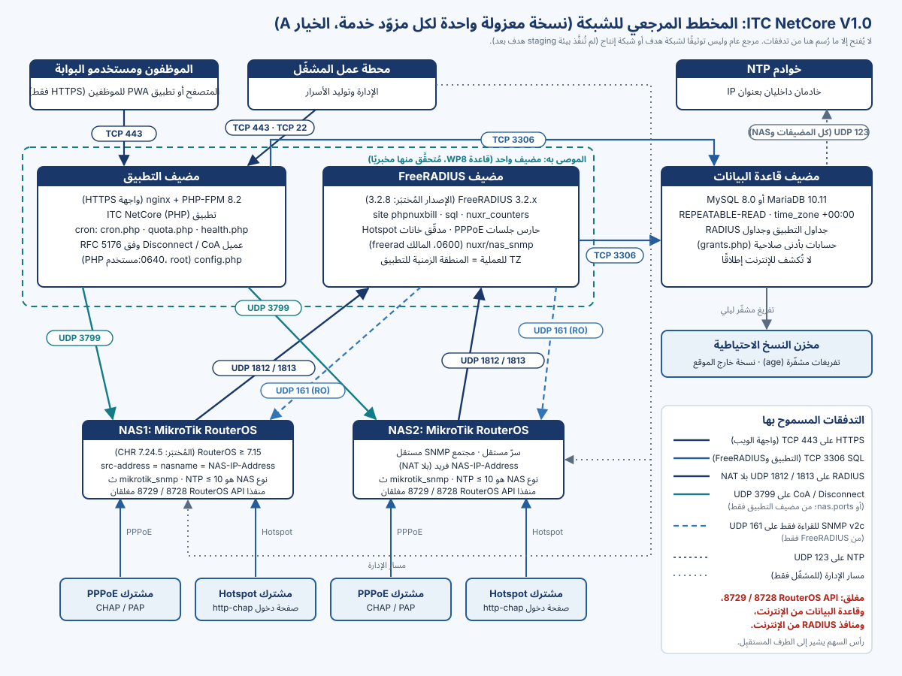

# حول هذا الدليل

يرافق هذا الدليلُ فنيَّ التثبيت المؤهَّل، ممن لم يشارك في تطوير ITC NetCore، من خوادم خالية إلى نسخة عاملة مُتحقَّق منها من **ITC NetCore V1.0** (منصة إدارة وفوترة مزوّدي خدمة الإنترنت). كل تعليمة فيه مأخوذة من أدلة التشغيل المعتمدة للمنتج ومن ملفات الإعداد وأدوات سطر الأوامر الشاحنة معه، ومن حزمة التثبيت الجديد `install/fresh/`. وإذا اختلف هذا الدليل عن وثيقة المنتج فالمرجع هو وثيقة المنتج، ومصدر كل قسم مذكور في الملف `TECH_DOCS_SOURCES.md`.

> [!WARNING]
> ‏ITC NetCore V1.0 **إصدار مرشَّح (Release Candidate)**، وحالة الإصدار `RELEASE_BLOCKED_WITH_EVIDENCE`. لم تُنفَّذ اختبارات القبول في بيئة الهدف TA-01 … TA-10 (جميعها `NOT_RUN`)، والمراجعة القانونية LIC-1 ما زالت مفتوحة، وعدد من قرارات المالك معلَّق. ويستلزم النشر في الإنتاج، وترحيل بيانات الإنتاج، وأي تغيير في أسرار الإنتاج، تفويضًا صريحًا من المالك بالإصدار، وهذا الدليل لا يمنح ذلك التفويض.

> [!NOTE]
> **قرار المالك (2026-10-29):** التثبيت الأول **تثبيت جديد على قاعدة بيانات جديدة فارغة**، دون استيراد أي بيانات قديمة. أما الترحيل من قاعدة بيانات PHPNuxBill قائمة فمسار مستقبلي منفصل، له دليله الخاص، و**غير مقبول للتثبيت الأول من V1**.

## النطاق والجمهور

| البند | القيمة |
|---|---|
| المنتج | ‏ITC NetCore V1.0، وهو نسخة معدَّلة من PHPNuxBill أُضيف إليها نظام الموزّعين والمحافظ |
| نموذج النشر | نسخة معزولة واحدة لكل مزوّد خدمة («الخيار A»): قاعدة بيانات خاصة، وإعداد FreeRADIUS خاص، وأسرار NAS خاصة. لا قاعدة بيانات مشتركة ولا تعدد مستأجرين |
| بيئة التشغيل | ‏PHP 8.2 · MariaDB 10.11 أو MySQL 8.0 · FreeRADIUS 3.2.x · أجهزة MikroTik RouterOS بوصفها NAS |
| إجراء التثبيت | حزمة التثبيت الجديد `install/fresh/`: التحقق من حزمة الإصدار، ثم `nuxr-fresh-install.sh`، ثم `nuxr-post-install-verify.sh` |
| القارئ المستهدف | مدير أنظمة Linux يستطيع تثبيت الحزم وتحرير ملفات الإعداد وتشغيل عميل SQL وقراءة مصفوفة جدار ناري |
| الدليل المرافق | *دليل تكامل MikroTik وFreeRADIUS* (جانب خادم RADIUS وأجهزة NAS بالتفصيل) |

## مستويات التحقق

يحمل كل إجراء أحد الوسوم الآتية، وهي تصف ما نُفِّذ فعلًا، لا ما يُتوقَّع أن يعمل.

| الوسم | المعنى |
|---|---|
| **مُتحقَّق منه مخبريًا (نسخة مؤقتة قابلة للإزالة، MariaDB 10.11 وMySQL 8.0)** | نُفِّذ من أوله إلى آخره بحزمة `install/fresh/` في 2026-10-29 على نسخة Docker معزولة مؤقتة، مرةً مع MariaDB 10.11.19 ومرةً مع MySQL 8.0.46، ثم أُزيلت النسخة. حاوية التطبيق: Ubuntu 24.04 مع PHP 8.2.35 (CLI وFPM) من `ppa:ondrej/php`، وnginx 1.24.0، وعميل MariaDB 10.11، بمجموعة الحزم الواردة في هذا الدليل نفسها؛ وشهادة موقَّعة ذاتيًا؛ ودون أي منفذ منشور؛ و**دون FreeRADIUS ودون NAS**. المصدر: الإيداع `228f01c9`، وبصمة SHA-256 لحزمة الإصدار `4c233573…` (بناء قابل للتكرار). وهذا دليل مخبري، **وليس** قبولًا في بيئة الهدف |
| **مُتحقَّق منه مخبريًا** | نفّذته سكربتات المختبر في مختبر WSL المعزول وسُجِّل دليلًا. وهذا المختبر هو: Ubuntu 24.04 ‏(WSL2)، وPHP 8.2 من المستودع `ppa:ondrej/php`، وnginx مع PHP-FPM على عنوان loopback عبر **HTTP صريح غير مشفّر**، وMariaDB 10.11.14، وFreeRADIUS 3.2.5 (حزمة Ubuntu) مع إعداد المشروع، وصورة FreeRADIUS 3.2.8 الرسمية التي تستخدمها حزمة الاختبار، وموجّهات MikroTik CHR RouterOS 7.24.5 افتراضية. أما MySQL 8.0 فقد غطّته هناك حزمة الاختبار الآلية |
| **موثَّق (لم يُنفَّذ بعد على بيئة الهدف)** | منصوص عليه في وثائق المنتج المعتمدة، لكنه لم يُنفَّذ في المختبر بهذه الصورة، ولم يُنفَّذ على أي نظام هدف |

> [!WARNING]
> لم يُنفَّذ أي إجراء في هذا الدليل على بيئة staging هدف ولا في الإنتاج. ووسما «مُتحقَّق منه مخبريًا» كلاهما دليلٌ من مختبر معزول، لا إثبات على موجّه أو خادم إنتاجي لم يُختبر. التحقق في بيئة الهدف هو مهمة الاختبارات TA-01 … TA-10، وتبقى جميعها `NOT_RUN`.

## الاصطلاحات

| الرمز | المعنى |
|---|---|
| `<app-root>` | مجلد الإصدار المنشور، وهو نفسه جذر مستندات الويب (جذر المستودع هو جذر الويب). وهو في هذا الدليل `/srv/itcnc/app/current`، أي رابط رمزي إلى الإصدار النشط |
| `<artifact-dir>` | نسخة مُتحقَّق منها من حزمة الإصدار مفكوكة **خارج** جذر الويب، مثل `/srv/itcnc/artifact/<name>`. ومن مجلدها `<artifact-dir>/install/fresh/` تُشغَّل سكربتات حزمة التثبيت الجديد، ومن `<artifact-dir>/install/freeradius/` تؤخذ سكربتات SQL الخاصة بـRADIUS وملفات FreeRADIUS |
| `<env-file>` | ملف المعاملات والأسرار الخاص بالمثبِّت، مثل `/root/itc-netcore-install.env` (بصلاحية 0600، وخارج جذر الويب) |
| `<php-user>` | الحساب الذي يعمل به PHP-FPM (وهو `www-data` في أمثلة الحزمة) |
| `${confdir}` | مجلد إعداد FreeRADIUS: ‏`/etc/freeradius/3.0` في حزم Ubuntu وDebian، و`/etc/freeradius` في الصورة الرسمية |
| `<...>` | قيمة بديلة تضعها أنت. ولا يمثّل أي منها قيمة يجوز لصقها في تذكرة دعم أو محادثة |

تعمل سكربتات الحزمة بصلاحية root على مضيف التطبيق. وتُنفَّذ أدوات المنتج من `<app-root>` ما لم يُذكر غير ذلك.

> [!NOTE]
> **الأسماء الداخلية لم تتغير.** اسم المنتج ITC NetCore، لكن أسماء قواعد البيانات والجداول (`tbl_*` و`radcheck` …) وموقع FreeRADIUS وقاموسه (`phpnuxbill`) ومسارات الملفات وحزمة Composer احتفظت بأسمائها الأصلية من PHPNuxBill. لا تغيّرها: فمشغّل الترحيلات يتعرّف على المخطط المثبَّت من بصمة SHA-256 للملف `install/phpnuxbill.sql`، وإعادة التسمية تُفسد التثبيت.

<!-- pagebreak -->

# قائمة البدء السريع

استخدم هذه القائمة لتخطيط العمل ومتابعته. يشير كل سطر إلى القسم الذي يحوي الإجراء وطريقة التحقق منه. لا تؤشّر على سطر إلا بعد نجاح التحقق الخاص به، وأي تحقق فاشل يوقف التثبيت.

| # | المرحلة | الخطوة | القسم | مستوى التحقق |
|---|---|---|---|---|
| 1 | التفويض | تفويض مكتوب من المالك يسمّي المضيفات ونافذة العمل والمشغّل، مع ذكر SHA الإصدار | *المتطلبات الأمنية المسبقة* | موثَّق (لم يُنفَّذ بعد على بيئة الهدف) |
| 2 | التجهيز | تحديد سعة المضيفات، وتثبيت نظام التشغيل، وضبط UTC وNTP على كل مضيف، وتطبيق مصفوفة الجدار الناري، وتجهيز اسم DNS والشهادة، وتجهيز مخزن النسخ الاحتياطية | *التجهيز* | موثَّق (لم يُنفَّذ بعد على بيئة الهدف) |
| 3 | التجهيز | ‏PHP 8.2 مع الامتدادات المطلوبة، وnginx وPHP-FPM، وعميل قاعدة البيانات، ومحرّك قاعدة البيانات بإعداداته الإلزامية، وFreeRADIUS 3.2.x وأدوات net-snmp | *التجهيز* | مُتحقَّق منه مخبريًا (نسخة مؤقتة قابلة للإزالة، MariaDB 10.11 وMySQL 8.0) لمضيف التطبيق والمحرّك؛ وFreeRADIUS: مُتحقَّق منه مخبريًا |
| 4 | التثبيت | التحقق من حزمة الإصدار بـ`nuxr-artifact-verify.sh` (بصمة SHA-256، وسلامة الأرشيف، و`RELEASE_SHA`، وقواعد المحتوى)، والاحتفاظ بنسخة مُتحقَّق منها في `<artifact-dir>` | *الحصول على حزمة الإصدار والتحقق منها* | مُتحقَّق منه مخبريًا (نسخة مؤقتة قابلة للإزالة، MariaDB 10.11 وMySQL 8.0) |
| 5 | التثبيت | فكّ الإصدار في مجلد إصدار خاص به، والرابط `current` هو `<app-root>` | *نشر الشيفرة* | مُتحقَّق منه مخبريًا (نسخة مؤقتة قابلة للإزالة، MariaDB 10.11 وMySQL 8.0) |
| 6 | التثبيت | ضبط nginx وPHP-FPM من أمثلة الحزمة، ونجاح `php-fpm8.2 -t` و`nginx -t` | *خادم الويب: nginx وPHP-FPM* | مُتحقَّق منه مخبريًا (نسخة مؤقتة قابلة للإزالة، MariaDB 10.11 وMySQL 8.0) |
| 7 | التثبيت | توليد `<env-file>` بالخيار `--generate-secrets` وإكماله | *المعاملات والأسرار* | مُتحقَّق منه مخبريًا (نسخة مؤقتة قابلة للإزالة، MariaDB 10.11 وMySQL 8.0) |
| 8 | التثبيت | التشغيل التجريبي `--dry-run` يطبع `dry_run=PASS` ولا يكتب شيئًا | *التشغيل التجريبي* | مُتحقَّق منه مخبريًا (نسخة مؤقتة قابلة للإزالة، MariaDB 10.11 وMySQL 8.0) |
| 9 | التثبيت | ‏`nuxr-fresh-install.sh` ينتهي بالرمز 0: اجتياز بوابة قاعدة البيانات (إثبات أن القاعدة الجديدة **فارغة**)، والحسابات، والمخطط الأساسي، و`config.php`، والترحيلات، وجداول القبول READY ×3، والصلاحيات، وتجريد المثبِّت، وتثبيت cron، ونجاح الفحص المسبق للإعداد وفحص السلامة | *تشغيل التثبيت الجديد* | مُتحقَّق منه مخبريًا (نسخة مؤقتة قابلة للإزالة، MariaDB 10.11 وMySQL 8.0) |
| 10 | التثبيت | ‏`nuxr-post-install-verify.sh` ينتهي بالرمز 0 (حدود الويب، والملفات، والأدوات، وcron) | *التحقق بعد التثبيت* | مُتحقَّق منه مخبريًا (نسخة مؤقتة قابلة للإزالة، MariaDB 10.11 وMySQL 8.0)، بشهادة موقَّعة ذاتيًا |
| 11 | الإعداد | الدخول الأول، والتغيير الإلزامي لكلمة مرور `admin` الافتراضية | *الدخول الأول وكلمة مرور المسؤول* | مُتحقَّق منه مخبريًا (مختبر WSL، المتصفح)؛ وعلى بيئة الهدف: موثَّق |
| 12 | الإعداد | ‏`CompanyName`، والمنطقة الزمنية، والعملة (أما RADIUS فقد فعّله المثبِّت مسبقًا) | *الإعدادات الأساسية* | مُتحقَّق منه مخبريًا (مختبر WSL، واجهة المستخدم)؛ وعلى بيئة الهدف: موثَّق |
| 13 | الإعداد | التحقق على بيئة الهدف من HTTPS بالشهادة الحقيقية، ومن الترويسات والمسارات المحجوبة | *التحقق من HTTPS وحدود الويب* | موثَّق (لم يُنفَّذ بعد على بيئة الهدف)، الاختبار TA-10 |
| 14 | الخدمات | إعداد FreeRADIUS وتشغيله، وربط أجهزة NAS (الدليل المرافق) | *الخدمات* | مُتحقَّق منه مخبريًا (مختبر WSL، CHR)؛ وعلى بيئة الهدف: موثَّق |
| 15 | الخدمات | تشغيل المهام المجدولة، والفحص الذاتي للحارس، وتقرير Hotspot، والنسخ الاحتياطي (`install/backup/`)، والتنبيهات، وتدوير السجلات، والإشراف على الخدمات | *الخدمات* | cron وتدوير السجلات: مُتحقَّق منه مخبريًا (نسخة مؤقتة قابلة للإزالة، MariaDB 10.11 وMySQL 8.0)؛ والنسخ الاحتياطي: تمرين مخبري؛ والتشغيل على مدى أيام: موثَّق |
| 16 | الفحص | الفحص المسبق للإصدار (`preflight.php` دون `--setup`) ينتهي بالرمز 0 | *الفحص المسبق للإصدار* | مُتحقَّق منه مخبريًا (مختبر WSL، CHR)؛ وعلى بيئة الهدف: موثَّق (TA-01) |
| 17 | التحقق | إكمال قائمة التحقق بهويات اصطناعية فقط | *قائمة التحقق* | موثَّق (لم يُنفَّذ بعد على بيئة الهدف) |
| 18 | الاعتماد | جمع بنود اعتماد التشغيل وتسجيل قرار المالك بالإصدار | *اعتماد بدء التشغيل* | موثَّق (لم يُنفَّذ بعد على بيئة الهدف) |

<!-- pagebreak -->

# التجهيز

## مخطط الشبكة

يعمل ITC NetCore V1.0 بوصفه **نسخة معزولة واحدة لكل مزوّد خدمة**. وللنسخة أربعة أدوار: مضيف التطبيق (خادم الويب وPHP والمهام المجدولة)، ومضيف FreeRADIUS، ومضيف قاعدة البيانات، وأجهزة MikroTik NAS الخاصة بالمزوّد. يجوز أن يتشارك التطبيق وFreeRADIUS جهازًا واحدًا، أما قاعدة البيانات فيجب أن تكون مثيل محرّك مستقلًا، منفصلًا عن الإنتاج وعن نسخ المزوّدين الآخرين.

{width=100%}

> [!NOTE]
> **الترتيب الموصى به:** شغّل التطبيق على المضيف نفسه وبالعنوان نفسه الذي يعمل عليه FreeRADIUS. فنظام RouterOS لا يقبل طلبات Disconnect / CoA إلا من عنوان أحد مداخل `/radius` المعرَّفة لديه، وحين يتشارك التطبيق عنوان FreeRADIUS لا يلزم أي مدخل إضافي على الموجّه. هذه هي قاعدة الإنتاج في نموذج التكامل (WP8)، وهي الترتيب المستخدم في المختبر. أما البديل (مدخل `/radius` ثانٍ لعنوان التطبيق بالسرّ نفسه) فقد ورد في وثائق الربط الأحدث، لكنه لم يُتحقَّق منه في المختبر.

تضم قاعدة البيانات جداول التطبيق وجداول RADIUS في **قاعدة واحدة**. وهذا هو التخطيط الذي تثبّته حزمة التثبيت الجديد (إذ تحمّل `install/radius.sql` في قاعدة النسخة نفسها)، كما أن `grants.php` يولّد الصلاحيات لقاعدة واحدة في كل مرة. أما قاعدة RADIUS المنفصلة فلا تدعمها الحزمة.

## نظام التشغيل

لا تحدد وثائق المنتج توزيعة Linux بعينها، لكنها تفترض Linux مع systemd وchrony. واستخدم المختبرُ والإثباتُ على النسخة المؤقتة **Ubuntu 24.04**، وتثبّت صورة اختبار FreeRADIUS أدوات net-snmp على Ubuntu 22.04. سجّل التوزيعة وإصدارها لكل مضيف في سجل التثبيت.

يعمل كل مضيف بتوقيت **UTC**، ويضبط ساعته **وكيل وقت واحد** فقط (تفترض الوثائق chrony؛ وكيل واحد لكل مضيف، و`makestep` عند الإقلاع فقط، دون وكيل ثانٍ).

## تقدير السعة

الأرقام الوحيدة للسعة في وثائق المنتج **حدود دنيا مستخلصة من المختبر لبيئة staging تمثيلية**. أما سعة الإنتاج فهي ناتج اختبار القبول TA-09 على عتاد الهدف، وفق ذروة المشتركين ذوي الحصص المتصلين في آن واحد.

| المضيف | الحد الأدنى التمثيلي | الأساس |
|---|---|---|
| التطبيق | ‏2 vCPU، و4 GB RAM، وSSD | كانت عمليات PHP خفيفة في اختبارات الحمل المخبرية |
| قاعدة البيانات (MariaDB 10.11 أو MySQL 8.0) | ‏4 vCPU، و8 GB RAM، وSSD مدعوم بقرص فعلي، و`innodb_buffer_pool_size` لا يقل عن 1 GB، و`max_connections` لا يقل عن 151 | نحو 3 أنوية لقاعدة البيانات عند 250 رسالة Interim-Update في الثانية في المختبر |
| ‏FreeRADIUS | ‏4 vCPU، و4 GB RAM، و`thread pool max_servers` = 32، و`sql pool max` = 32 (كما شُحن) | نحو نواتين عند 250 رسالة Interim-Update في الثانية في المختبر |

> [!WARNING]
> أرقام المختبر (ومنها مثلًا انعدام فقد المحاسبة مع 7,500 مشترك حصص محاكى) **ليست وعدًا بأداء عتادك**. حدّد حجم مجمّع اتصالات SQL في FreeRADIUS وقيمة `max_connections` كما يشرح الدليل المرافق، وأكّدهما بالاختبار TA-09.

## ‏PHP 8.2 والامتدادات

‏PHP **8.2** هي بيئة التشغيل المُختبَرة. والامتدادات الإلزامية هي `pdo_mysql` و`curl` و`gd` و`mbstring` و`zip`. ويحتاج مضيف التطبيق أيضًا إلى PHP-FPM وnginx وعميل محرّك قاعدة البيانات (`mariadb-client` أو عميل MySQL)، ويتحقق المثبِّت منها جميعًا في مرحلته الأولى.

> [!NOTE]
> ما زالت صفحة متطلبات مثبِّت الويب تقول «PHP 7.2 على الأقل»، وما زال ملف `Dockerfile` في المستودع مبنيًّا على PHP 7.4. ولا يمثّل أيٌّ منهما بيئة التشغيل المعتمدة: استخدم PHP 8.2. ولا يُستخدم مثبِّت الويب في V1 (انظر *الانحرافات عن دليل تشغيل المنتج*)، ولا يُستخدم ملف Dockerfile في أي نشر لإصدار V1.

على Ubuntu 24.04 ثبّت PHP 8.2 وnginx من المستودع `ppa:ondrej/php` بهذه المجموعة من الحزم (تشمل الامتدادات الإلزامية وبضعة امتدادات إضافية اختارها المختبر):

```bash
sudo apt-get install -y software-properties-common ca-certificates curl gnupg
sudo add-apt-repository -y ppa:ondrej/php
sudo apt-get update
sudo apt-get install -y --no-install-recommends \
  php8.2-cli php8.2-fpm php8.2-mysql php8.2-curl php8.2-mbstring php8.2-xml php8.2-zip \
  php8.2-gd php8.2-intl php8.2-bcmath php8.2-sqlite3 php8.2-opcache php8.2-readline \
  unzip nginx mariadb-client
sudo update-alternatives --set php /usr/bin/php8.2
```

(مع MySQL 8.0 نجحت مصادقة عميل MariaDB 10.11 دون مشكلات في الإثبات، ويصلح عميل MySQL كذلك.)

**التحقق:** يُظهر `php -v` الإصدار 8.2، ويسرد `php -m` الامتدادات `pdo_mysql` و`curl` و`gd` و`mbstring` و`zip`، ولا يوجد امتداد تنقيح (Xdebug) مثبَّت.

**مستوى التحقق:** مُتحقَّق منه مخبريًا (نسخة مؤقتة قابلة للإزالة، MariaDB 10.11 وMySQL 8.0): استُخدمت قائمة الحزم هذه دون تعديل في حاوية Ubuntu 24.04 نظيفة (PHP 8.2.35، وnginx 1.24.0، وmariadb-client 10.11.14، دون Xdebug). وهي أيضًا مُتحقَّق منها مخبريًا على مضيف مختبر WSL. التوزيعات الأخرى: موثَّق (لم يُنفَّذ بعد على بيئة الهدف).

> [!NOTE]
> **الاعتماديات.** مكتبات PHP التي يحتاجها التطبيق مشحونة داخل الإصدار في `system/vendor/`. ولا يعلن `composer.json` أي متطلبات، وليست هناك خطوة Composer ضمن التثبيت.

## محرّك قاعدة البيانات

استخدم **MariaDB 10.11** أو **MySQL 8.0** (يفرض مشغّل الترحيلات حدًّا أدنى هو MariaDB 10.11 وMySQL 8.0.16، والإصدارات الرئيسية الأحدث غير مُختبَرة). ويجب أن يحقق المحرّك هذه الإعدادات قبل بدء التثبيت، وإلا رفض المثبِّت المتابعة:

| الإعداد | القيمة المطلوبة | يتحقق منه |
|---|---|---|
| مستوى عزل المعاملات العام | `REPEATABLE-READ` | المثبِّت (A3)، وفحص preflight ‏`isolation` |
| المنطقة الزمنية العامة | `time_zone = '+00:00'` (كل جلسة SQL للتطبيق ولـFreeRADIUS بتوقيت UTC) | المثبِّت (A4)، وفحص preflight ‏`time.sql_session_zone` |
| انحراف الساعة بين قاعدة البيانات والتطبيق | أقل من 5 ثوانٍ | المثبِّت (A5)، وفحص preflight ‏`time.clock_skew` |
| مجموعة المحارف | `utf8mb4`؛ ويُنشئ المثبِّت القاعدة نفسها بترتيب `utf8mb4_general_ci` | المثبِّت (بوابة قاعدة البيانات)، والملف `radius.sql` |
| ‏MariaDB فقط | `check_constraint_checks = ON` على المستوى العام | المثبِّت (A6)، وفحص preflight ‏`radius_checks` |
| `max_connections` | لا يقل عن مجموع قيم `pool.max` لكل مثيلات FreeRADIUS على هذا الخادم + التطبيق + جلسات المشغّل والنسخ الاحتياطي + هامش | الدليل المرافق وTA-09 |
| الشبكة | لا يصل إليها إلا مضيفا التطبيق وFreeRADIUS، ولا تُكشف للإنترنت إطلاقًا | مراجعة الجدار الناري |
| حساب الإدارة | حساب DBA قائم يستخدمه المثبِّت، بصلاحيات `SELECT` العامة و`CREATE USER` و`GRANT OPTION` (و`CREATE` مع `--create-db`). لا يُستخدم إلا أثناء التشغيل ولا يُخزَّن أبدًا | المثبِّت (المتطلبات المسبقة وبوابة قاعدة البيانات) |

يمكن لخادم MariaDB مشترك مع التطبيق في المضيف نفسه (مربوط بعنوان loopback) أن يستخدم ملف الإعداد الإضافي هذا، مثل `/etc/mysql/mariadb.conf.d/60-itcnc.cnf`:

```ini
[mysqld]
bind-address            = 127.0.0.1
port                    = 3306
skip-name-resolve
transaction_isolation   = REPEATABLE-READ
default_time_zone       = '+00:00'
max_connections         = 200
innodb_buffer_pool_size = 256M
character-set-server    = utf8mb4
collation-server        = utf8mb4_general_ci
```

إذا كانت قاعدة البيانات على مضيف مستقل، فاربطها بالعنوان الخاص الذي يستخدمه مضيفا التطبيق وFreeRADIUS، وحدّد `innodb_buffer_pool_size` و`max_connections` وفق الجدول السابق (قيم هذا المثال صغيرة عمدًا).

> [!NOTE]
> الخيار `--check-constraint-checks=ON` **ليس** خيار بدء صالحًا لـ`mariadbd`. والمتغير مفعَّل (ON) افتراضيًا، فأبقِه كذلك، ويتحقق منه المثبِّت والفحص المسبق.

**التحقق:** بعد إعادة التشغيل يُعيد الاستعلام `SELECT @@global.tx_isolation, @@global.time_zone;` (في MariaDB 10.11) أو `SELECT @@global.transaction_isolation, @@global.time_zone;` (في MySQL 8.0) القيمتين `REPEATABLE-READ` و`+00:00`. ويتحقق المثبِّت والفحص المسبق من القيم نفسها.

**مستوى التحقق:** مُتحقَّق منه مخبريًا (نسخة مؤقتة قابلة للإزالة، MariaDB 10.11 وMySQL 8.0): ‏MariaDB 10.11.19 وMySQL 8.0.46 ‏(`caching_sha2_password`)، كلاهما بـREPEATABLE-READ و`+00:00` و`utf8mb4_general_ci` و`skip-name-resolve`، وكلٌّ منهما محرّكًا لنسخة مثبَّتة حديثًا. على بيئة الهدف: موثَّق (لم يُنفَّذ بعد على بيئة الهدف).

> [!WARNING]
> **ترتيب المحارف في MySQL 8.0.** الترتيب الافتراضي لخادم MySQL 8 هو `utf8mb4_0900_ai_ci`. ويجب أن تستخدم قاعدة ITC NetCore الترتيب `utf8mb4_general_ci`؛ ومع `--create-db` يُنشئها المثبِّت كذلك، ويرفض أي قاعدة فارغة قائمة بترتيب آخر. فجدول RADIUS يختلف ترتيبه عن ترتيب `radacct` يُفشل كل محاولة دخول بالخطأ 1267 (ملاحظة المختبر B-L09). التثبيتات الجديدة من الملف المشحون `install/radius.sql` سليمة، ويؤكد ذلك سكربت الجاهزية `nuxr_nasreload_collation_check.sql`.

## ‏FreeRADIUS

| البند | المتطلب |
|---|---|
| الإصدار | ‏FreeRADIUS **3.2.x**. إعداد المشروع مُختبَر مع **3.2.8** فقط، وأي إصدار آخر يجب أن يجتاز بوابة «Option G» الخاصة بـWP8 من جديد (اختباراتها في شجرة المصدر) قبل استخدامه |
| الحزم (Ubuntu / Debian) | `freeradius` و`freeradius-mysql` و`freeradius-utils` (المختبر، FreeRADIUS 3.2.5) |
| أدوات net-snmp | `snmpget` و`snmpbulkwalk` (حزمة `snmp` في Ubuntu / Debian). ومن دونها تُرفض كل محاولة دخول PPPoE تصادف سجل محاسبة مفتوحًا |
| العملية | متعددة الخيوط تحت مدير الخدمات، ولا تُشغَّل أبدًا بالخيار `-X` في الإنتاج |
| المنطقة الزمنية للعملية | `TZ` = المنطقة الزمنية للتطبيق (Settings › Time zone)، وتبقى جلسات SQL الخاصة بها بتوقيت UTC |

> [!WARNING]
> كان FreeRADIUS الأصلي في المختبر بالإصدار **3.2.5** لا 3.2.8، واحتاج إلى أربعة انحرافات موثَّقة (عناوين الاستماع، ونسخة من `checkrad` بلا SNMP، و`TZ` للعملية، وتفعيل الوحدة القياسية `date`). وأي حزمة توزيعة ليست 3.2.8 يجب أن تجتاز حالات البوابة الخاصة بحالة القبول X-4 على إصدار الهدف نفسه. التفاصيل في الدليل المرافق. ولم يكن FreeRADIUS ولا أجهزة NAS جزءًا من الإثبات على النسخة المؤقتة.

## الوقت وNTP

الوقت عقد ملزِم لا مجرد توصية، ونصه المرجعي في `docs/TIME_CONTRACT.md`.

| المضيف | المتطلب | يتحقق منه |
|---|---|---|
| التطبيق وقاعدة البيانات وFreeRADIUS | ‏UTC، ومزامنة NTP، وأقصى انحراف بينها **5 ثوانٍ**، وساعة قاعدة البيانات تُضبط تدريجيًا ولا ترجع إلى الوراء قفزًا | المثبِّت (A5)، وفحوص preflight ‏`time.sql_session_zone` و`time.clock_skew`، والأمر `chronyc tracking` |
| كل جهاز NAS | عميل NTP مفعَّل مع خادمين داخليين بعنوان IP، ومنطقة زمنية UTC أو إزاحة ثابتة يعرفها المشغّل، و**حد صارم 10 ثوانٍ** (والمعتاد أقل من ثانيتين) | فحص preflight ‏`time.nas_clock` (تحذير WARN إذا تقدّمت الساعة أكثر من 5 ثوانٍ، وفشل FAIL فوق 10 ثوانٍ)، وفحص health ‏`nas_clock` |

**التحقق:** على كل مضيف يُظهر `chronyc tracking` (أو `timedatectl`) إزاحة صغيرة و`System clock synchronized: yes`.

**مستوى التحقق:** مُتحقَّق منه مخبريًا على مضيفات المختبر (انتقل المختبر إلى مصدر chrony واحد بعد خلل في ساعة البيئة). على بيئة الهدف: موثَّق (TA-02).

## الجدار الناري والمنافذ

افتح هذه التدفقات ولا شيء غيرها.

| من | إلى | المنفذ | الغرض |
|---|---|---|---|
| متصفحات الموظفين والعملاء، والمشغّل | التطبيق | ‏TCP 443 | واجهة الويب وبوابة العملاء (HTTPS فقط، والمنفذ 80 للتحويل إلى HTTPS لا غير) |
| التطبيق وFreeRADIUS | قاعدة البيانات | ‏TCP 3306 | ‏SQL، من هذين المضيفين فقط |
| كل جهاز NAS | ‏FreeRADIUS | ‏UDP 1812 / 1813 | المصادقة والمحاسبة، بلا NAT: عنوان مصدر NAS هو `nas.nasname` |
| التطبيق | كل جهاز NAS | ‏UDP 3799 (أو قيمة `nas.ports` للجهاز) | ‏Disconnect / CoA |
| ‏FreeRADIUS | كل جهاز NAS | ‏UDP 161 | ‏SNMP v2c للقراءة فقط لحارس جلسات PPPoE ومدقّق خانات Hotspot |
| كل مضيف وكل جهاز NAS | خوادم NTP | ‏UDP 123 | الوقت |
| المشغّل | المضيفات | ‏TCP 22 | الإدارة |
| (لا أحد) | ‏RouterOS API على NAS ‏8728 / 8729 | — | **لا يستخدمه ملف تعريف الإصدار، ويبقى مغلقًا** |

لا تُكشف قاعدة البيانات للإنترنت إطلاقًا، ولا يُكشف أي منفذ RADIUS أو API للإنترنت.

**مستوى التحقق:** موثَّق (لم يُنفَّذ بعد على بيئة الهدف). عمل المختبر معزولًا بمصفوفة مقيَّدة مكافئة.

## ‏DNS وHTTPS

- اختر الاسم العام للنسخة واجعله يشير إلى واجهة HTTPS. ويجب أن يكون عنوان التطبيق (`NUXR_APP_URL` في `<env-file>`، ثم `APP_URL` في `config.php`) هو عنوان `https://` دون شرطة مائلة في آخره.
- احصل على شهادة صالحة لهذا الاسم عبر الإجراء المعتاد في مؤسستك (لا تحدد وثائق المنتج جهة إصدار أو أداة بعينها).
- ‏HTTPS فقط: يُحوَّل HTTP إلى HTTPS، ويضبط خادم الويب الترويسة HSTS. ويفعل مثال nginx في الحزمة الأمرين كليهما.
- **خلف وكيل عكسي ينهي TLS** (أي أن الوكيل يخاطب خادم PHP عبر HTTP صريح): لا يكتشف التطبيق HTTPS إلا من `$_SERVER['HTTPS']`، ولا يعتمد أبدًا على `X-Forwarded-Proto`. في nginx / PHP-FPM اضبط `fastcgi_param HTTPS on;` على الخادم الخلفي (انظر ملاحظات B9 في مثال nginx بالحزمة)، وفي Apache استخدم `SetEnvIf X-Forwarded-Proto https HTTPS=on` **فقط** إذا كان الخادم الخلفي لا يُبلغ إلا من الوكيل. ويثبّت المثبِّت `APP_URL` على عنوان `https://` داخل `config.php`. ومن دون اكتشاف HTTPS تفقد ملفات تعريف الجلسة السمة `Secure`، ويُصدر فحص preflight ‏`stage.https` تحذيرًا.

**مستوى التحقق:** مُتحقَّق منه مخبريًا (نسخة مؤقتة قابلة للإزالة، MariaDB 10.11 وMySQL 8.0) بشهادة **موقَّعة ذاتيًا** خلف مثال nginx في الحزمة (نجاح `stage.https`). أما الشهادة الحقيقية والوكيل العكسي وبيئة الهدف: موثَّق (لم يُنفَّذ بعد على بيئة الهدف)، الاختبار TA-10.

## مخزن النسخ الاحتياطية

جهّز تخزينًا مشفّرًا لمجموعات النسخ الاحتياطية وللسجلات الثنائية المؤرشفة الخاصة بالنسخة (`install/backup/`، انظر *النسخ الاحتياطي*)، مع مدة احتفاظ متفق عليها ونسخة واحدة على الأقل خارج المضيف. لا تذكر وثائق المنتج سعة محددة، فاحسبها من أحجام المجموعات الفعلية وحجم السجلات الثنائية ومدة الاحتفاظ. ويقتصر الوصول على مشغّلي النسخة.

> [!SECURITY-WARNING]
> النسخة الاحتياطية مادة سرّية: فهي تحوي أسرار NAS المشتركة (`nas.secret`)، وكلمات مرور العملاء (المخزّنة بصورة قابلة للاسترجاع لأجل CHAP)، وبصمات كلمات مرور الموظفين، والبيانات الشخصية، وكل السجلات المالية. شفّرها في التخزين وأثناء النقل، ولا ترفقها أبدًا بتذكرة أو محادثة، واحفظ نسخة من `config.php` منفصلة ومشفّرة (فهو يحوي `$app_secret`؛ ويفعل `nuxr-backup.sh` ذلك في ملفه المشفّر `secrets.tar`).

## المتطلبات الأمنية المسبقة

| # | المتطلب |
|---|---|
| 1 | **تفويض مكتوب من المالك** يسمّي المضيفات وقاعدة البيانات وأجهزة NAS ونافذة العمل والمشغّل. ويحتاج الإنتاج إلى تفويض المالك بالإصدار |
| 2 | **مخزن للأسرار**: كل سرّ (كلمات مرور قاعدة البيانات، و`$app_secret`، و`$api_secret`، وأسرار NAS، ومجتمعات SNMP، وكلمات مرور الموظفين) يُحفظ فيه، ولا يصل إلى المضيفات إلا ملفاتٍ بصلاحية 0600 أو عبر متغيرات البيئة |
| 3 | تُولَّد الأسرار في جهة المشغّل (يكتبها `nuxr-fresh-install.sh --generate-secrets` في ملف جديد بصلاحية 0600)، لا في محادثة مشتركة أو تذكرة |
| 4 | **لا سرّ على سطر الأوامر**، ولا في سجل أوامر الصدفة، ولا في التذاكر أو السجلات أو الأدلة. تقرأ سكربتات الحزمة وأدوات المنتج كلمات المرور من ملفات بصلاحية 0600 أو من `config.php` أو من متغير بيئة |
| 5 | حسابات قاعدة بيانات منفصلة: حساب DBA القائم الذي لا يستخدمه المثبِّت إلا أثناء التشغيل (ولا يُخزَّن أبدًا)، وحساب الترحيل (DDL)، وحساب تشغيل التطبيق، وحساب FreeRADIUS، وحساب النسخ الاحتياطي. ويُنشئ المثبِّت حسابات الترحيل والتطبيق وFreeRADIUS، و**يرفض** أي حساب موجود مسبقًا |
| 6 | لا إضافات (plugins) إلا المراجَعة. التثبيت الجديد بلا إضافات، فأبقِه كذلك ما لم يعتمد المالك قائمة إضافات |

<!-- pagebreak -->

# تثبيت التطبيق

يُثبَّت التطبيق بـ**حزمة التثبيت الجديد `install/fresh/`**. وهي تحل محل مثبِّت الويب التفاعلي بتشغيل واحد من سطر الأوامر، وتنفّذ كذلك الخطوات التالية للمثبِّت في `docs/DEPLOYMENT_AND_UPGRADE_RUNBOOK.md` §2 والأسطر المقابلة في `docs/PRODUCTION_CONFIGURATION_CHECKLIST.md`. والترتيب ثابت:

1. التحقق من حزمة الإصدار وفكّها (`nuxr-artifact-verify.sh`).
2. ضبط خادم الويب من أمثلة الحزمة.
3. توليد ملف المعاملات والأسرار وإكماله.
4. التشغيل التجريبي.
5. التثبيت الجديد (`nuxr-fresh-install.sh`).
6. التحقق بعد التثبيت (`nuxr-post-install-verify.sh`).

ملف README الخاص بالحزمة (`install/fresh/README.md`) هو المرجع لكل خيار.

| ملف الحزمة | الغرض |
|---|---|
| `nuxr-artifact-verify.sh` | يتحقق من أرشيف الإصدار قبل فكّه، ثم يفكّه اختياريًا في مجلد جديد فارغ |
| `nuxr-fresh-install.sh` | التثبيت الجديد، مع الخيارين `--dry-run` و`--generate-secrets` |
| `nuxr-post-install-verify.sh` | فحوص غير مُتلِفة لحدود الويب، والملفات وصلاحياتها، والأدوات، والمهام المجدولة |
| `templates/config.php.tmpl` و`lib/render-config.php` | قالب `config.php` ومولِّده (القيم من البيئة فقط، ومن سطر الأوامر فقط) |
| `templates/install.env.example` | ملف المعاملات والأسرار، وكل مفتاح فيه موثَّق |
| `nginx/itc-netcore.conf.example` و`php-fpm/pool.conf.example` | أمثلة خادم الويب للإنتاج |
| `logrotate/itc-netcore.example` و`cron/itc-netcore.cron.example` | تدوير السجلات والمهام المجدولة |

> [!NOTE]
> **الإثبات المخبري (2026-10-29).** نُفِّذ تسلسل هذا الفصل كاملًا على نسخة مؤقتة مع MariaDB 10.11 ثم مع MySQL 8.0: انتهى التثبيت بالرمز 0؛ وانتهى تشغيل ثانٍ بالرمز 0 مع قاعدة بيانات مطابقة؛ وأعطى التحقق بعد التثبيت **67 PASS / 0 WARN / 0 FAIL** على كل محرّك؛ ورُفضت 8 من 8 حالات رفض على كل محرّك دون أي تغيير. وهذا ليس قبولًا في بيئة الهدف ولا تفويضًا بالإصدار.

> [!NOTE]
> **موقع الحزمة.** ‏`install/fresh/` مُجهَّزة للإصدار ولم تُودَع بعد، فحزمة إصدار مبنية قبل ذلك الإيداع لا تحتويها. في هذه الحالة انسخ الحزمة المراجَعة بجوار نسخة حزمة الإصدار المُتحقَّق منها، في `<artifact-dir>/install/fresh/` (وهذا ما فعله الإثبات بالضبط). وبعد إيداعها تصبح داخل حزمة الإصدار. ويرفض المثبِّت دائمًا العمل من النسخة الموجودة داخل جذر الويب.

## الحصول على حزمة الإصدار والتحقق منها

1. احصل على حزمة الإصدار المبنية من **الإيداع الذي قبله المالك** (`itc-netcore-v1.0-<sha12>.tar.gz`)، وعلى ملف `SHA256SUMS` الخاص بها، وعلى SHA الإيداع المسجَّل في ملاحظات الإصدار (SHA الإصدار المسجَّل عند البناء). والبناء هو `git archive` لذلك الإيداع مع ملف `RELEASE_SHA` مضاف، وهو قابل للتكرار: الإيداع نفسه يعطي بصمة SHA-256 نفسها (`install/fresh/README.md`، قسم «Release build»).
2. تحقق من الحزمة **على مضيف الهدف قبل فكّها**، ثم فكّها مرتين: مرةً نسخةً محفوظة `<artifact-dir>` خارج جذر الويب، ومرةً إصدارًا يصبح جذر الويب.

```bash
nuxr-artifact-verify.sh --artifact=<name>.tar.gz --expected-sha=<sha from the release notes> \
  --extract-to=/srv/itcnc/artifact/<name>
cd /srv/itcnc/artifact/<name>/install/fresh
./nuxr-artifact-verify.sh --artifact=/path/<name>.tar.gz --expected-sha=<sha> \
  --extract-to=/srv/itcnc/app/releases/<sha8>-<UTC timestamp>
```

(استخدم السكربت من نسخة مراجَعة من الحزمة في التشغيل الأول، ومن `<artifact-dir>/install/fresh/` بعد ذلك.)

يتحقق السكربت بهذا الترتيب، ويتوقف عند أول إخفاق:
1. أن بصمة SHA-256 للحزمة تساوي سطرها في `SHA256SUMS`؛
2. أن الأرشيف آمن للفك: مجلد أعلى واحد، ولا مسار مطلق، ولا `..`، ولا مدخل رابط أو جهاز؛
3. أن `RELEASE_SHA` داخل الأرشيف يساوي `--expected-sha`، وكذلك معرّف الإيداع الذي خزّنه `git archive` في ترويسة tar إذا كان git مثبَّتًا؛
4. قواعد المحتوى في دليل التشغيل: أنها **تستثني** `.git/` و`dev/` و`tests/` و`owner-review/` و`docs/claude-development-pack/` والملف `system/vendor/yosiazwan/php-facedetection/lena512color.jpg` وأي `config.php`؛ وأنها **تتضمن** `LICENSE` و`docs/THIRD_PARTY_LICENSES.md` ومصادر المثبِّت.

ومع `--extract-to` لا يفكّ الأرشيف إلا بعد نجاح كل الفحوص، في مجلد غير موجود بعد (أو فارغ)، دون ملكيات الأرشيف، ثم يتحقق من `RELEASE_SHA` مرة أخرى في الشجرة المفكوكة. رموز الخروج: ‏0 تم التحقق · ‏1 خطأ داخلي · ‏2 فشل التحقق (لم يُفكّ شيء) · ‏5 خطأ استخدام.

> [!NOTE]
> النشر من نسخة مصدرية (checkout) ليس إجراء V1. أما فحص بيان حزمة التطوير الوارد في حزمة staging ‏(`sha256sum -c docs/claude-development-pack/MANIFEST.sha256`، بنتيجة 42 / 42) فلا يمكن تشغيله إلا على نسخة مصدرية، لأن ذلك المجلد مستثنى من حزمة الإصدار.

**مستوى التحقق:** مُتحقَّق منه مخبريًا (نسخة مؤقتة قابلة للإزالة، MariaDB 10.11 وMySQL 8.0): فشل أرشيف معبوث به وقيمة `--expected-sha` خاطئة كلاهما بالرمز 2؛ ونجح التحقق من النسخة المحفوظة ومن الإصدار وفكّهما، وطابق معرّفُ الإيداع في ترويسة tar. وأعاد بناءُ حزمة الإثبات (الإيداع `228f01c9`، ‏8,260,760 بايت، و2,135 ملفًا) البصمةَ نفسها.

## نشر الشيفرة

استخدم تخطيط «مجلد لكل إصدار» مع رابط رمزي، مما يجعل التراجع لاحقًا مجرد تبديل للرابط:

```bash
ln -sfn /srv/itcnc/app/releases/<sha8>-<UTC timestamp> /srv/itcnc/app/current   # /srv/itcnc/app/current هو <app-root>
```

يضبط المثبِّت ملكية الشجرة وصلاحياتها (المرحلة 6)، ويتحقق منها التحقق بعد التثبيت:

| المسار | المالك / الصلاحية بعد التثبيت |
|---|---|
| شجرة الشيفرة | يملكها root، وهي للقراءة فقط لـ`<php-user>` |
| `config.php` | صلاحية 0640، والمالك `root:<php-user>` |
| `pages/` و`system/uploads/` و`ui/compiled/` و`system/cache/` و`ui/cache/` | قابلة للكتابة لـ`<php-user>` (البند B7 من القائمة؛ فالمهمة المجدولة تحفظ ملف القفل في `system/cache/`، ومحرّك القوالب يستخدم `ui/cache/` و`ui/compiled/`) |
| كل شيء | لا شيء قابل للكتابة لأي مستخدم كان |

**مستوى التحقق:** مُتحقَّق منه مخبريًا (نسخة مؤقتة قابلة للإزالة، MariaDB 10.11 وMySQL 8.0): شجرة شيفرة يملكها root وللقراءة فقط، والمسارات الخمسة قابلة للكتابة لـ`www-data`، ولا شيء قابل للكتابة لأي مستخدم كان.

## خادم الويب: nginx وPHP-FPM

ثبّت `php-fpm/pool.conf.example` و`nginx/itc-netcore.conf.example` من الحزمة، وعدّل اسم المضيف والشهادة والمسارات، ثم افحص الإعداد وأعد تحميله:

```bash
php-fpm8.2 -t && systemctl reload php8.2-fpm
nginx -t && systemctl reload nginx
```

ما يوفره المثالان:

| المثال | المحتوى |
|---|---|
| موقع nginx | ‏HTTPS فقط؛ وتحويل HTTP بالرمز 301 إلى HTTPS؛ وHSTS؛ وترويسات B6 (كل منها مرة واحدة بالضبط) و`Referrer-Policy`؛ و`$realpath_root` لتخطيط الإصدارات ذي الرابط الرمزي؛ وقواعد حجب (404) لـ`install/` و`system/` (عدا ملفات الرفع التي تستخدمها الواجهة) و`dev/` و`tests/` و`docs/` و`owner-review/` و`pages/` والملفات المبدوءة بنقطة و`*.sql` و`*.sh` و`*.tpl` وما شابهها وملفات الإعداد و`RELEASE_SHA` و`radius.php`؛ ويجيب `update.php` بـ403؛ ولا يُنفَّذ PHP إلا لقائمة سماح من نقاط الدخول (`index.php` و`admin/` و`scan/` و`qrcode/`)؛ وتقييد لمعدّل طلبات POST على صفحة الدخول؛ وملاحظات B9 للوكيل المنهي لـTLS |
| مجمّع PHP-FPM | مقبس Unix بصلاحية 0660 لـ`www-data`؛ و`display_errors` معطَّل؛ وسجل الأخطاء في `/var/log/itcnc`؛ و`date.timezone = UTC`؛ وسمات ملف تعريف الجلسة `HttpOnly` و`Secure` و`SameSite=Lax`؛ و`.php` فقط |

ينفّذ المثالان المتطلبات الآتية؛ تحقق من كل سطر على خادمك:

| # | المتطلب |
|---|---|
| B1 | ‏HTTPS فقط بشهادة صالحة، ويُحوَّل HTTP إلى HTTPS، ويضبط خادم الويب HSTS |
| B3 | لا يقدّم جذر الويب إلا التطبيق. ولا يُبلغ من الويب: `config.php` و`install/` (بما فيه `install/freeradius/` الذي يبقى على القرص) و`dev/` و`tests/` و`docs/` و`owner-review/` و`.git/` وأي ملف `*.sql` أو `*.sh`، ولا `system/` إلا ما تستخدمه الواجهة فعلًا (فقوالب الفواتير مثلًا تحمّل `system/uploads/paid.png`) |
| B5 | ‏`update.php` يجيب بـ403 (أداة التحديث عبر الويب معطَّلة في الشيفرة) |
| B6 | تحمل الاستجابات `X-Frame-Options: SAMEORIGIN` و`Content-Security-Policy: frame-ancestors 'self'` و`X-Content-Type-Options: nosniff`، ويكون ملف تعريف الجلسة `HttpOnly; SameSite=Lax; Secure` |
| B8 | ‏`display_errors = Off`، وتُسجَّل أخطاء PHP في ملف خارج جذر الويب |
| B9 | خلف وكيل ينهي TLS: ‏`fastcgi_param HTTPS on;` على الخادم الخلفي، وتثبيت `APP_URL` على `https://` |

**مستوى التحقق:** مُتحقَّق منه مخبريًا (نسخة مؤقتة قابلة للإزالة، MariaDB 10.11 وMySQL 8.0): نجح `php-fpm8.2 -t` و`nginx -t`، ومقبس المجمّع `srw-rw---- www-data`، وأكّد التحقق بعد التثبيت كل متطلب أعلاه بشهادة موقَّعة ذاتيًا. أما الشهادة الحقيقية والوكيل العكسي: موثَّق (لم يُنفَّذ بعد على بيئة الهدف)، الاختبار TA-10.

## المعاملات والأسرار

دع المثبِّت يُنشئ ملف المعاملات والأسرار بكلمات مرور جديدة، ثم أكمل بقية الأسطر:

```bash
cd <artifact-dir>/install/fresh
./nuxr-fresh-install.sh --generate-secrets=/root/itc-netcore-install.env
```

يكتب هذا الأمر ملفًا **جديدًا** بصلاحية 0600 فيه ثلاث كلمات مرور مولَّدة (لحسابات الترحيل والتطبيق وFreeRADIUS)، ولا يطبع أي سرّ. أكمل المفاتيح الموثَّقة في `templates/install.env.example`:

| المفتاح | المعنى |
|---|---|
| `NUXR_DB_HOST` | مضيف قاعدة البيانات الذي يستخدمه التطبيق والأدوات (`localhost` = المقبس المحلي)، ويُكتب في `config.php` |
| `NUXR_DB_NAME` | قاعدة النسخة الجديدة. يجب ألا تكون موجودة (وعندها مرّر `--create-db`)، أو أن تكون موجودة وفيها **صفر** من الجداول والعروض والإجراءات المخزّنة والأحداث والقوادح، وبترتيب `utf8mb4_general_ci` |
| `NUXR_DB_ADMIN_USER` و`NUXR_DB_ADMIN_PASSWORD` | حساب DBA القائم (صلاحيات `SELECT` العامة و`CREATE USER` و`GRANT OPTION`، و`CREATE` مع `--create-db`). لا يستخدمه إلا المثبِّت، ولا يُخزَّن أبدًا |
| `NUXR_DB_MIG_USER` و`NUXR_DB_APP_USER` و`NUXR_DB_RADIUS_USER` | الحسابات التي يُنشئها المثبِّت، ويجب **ألا** تكون موجودة بعد |
| `NUXR_DB_CLIENT_HOST` | الجزء الخاص بالمضيف في حسابَي الترحيل والتطبيق: العنوان الذي يتصل منه مضيف التطبيق كما تراه قاعدة البيانات (`localhost` للمقبس المحلي) |
| `NUXR_DB_RADIUS_HOSTS` | الجزء (أو الأجزاء) الخاص بالمضيف في حساب FreeRADIUS، تفصل بينها مسافات |
| `NUXR_APP_URL` | عنوان `https://` العام، دون شرطة مائلة في آخره |

القواعد: يجب أن تكون صلاحية الملف 0600 أو 0400 وأن يملكه المستخدم الذي يشغّل المثبِّت؛ وهو **يُحلَّل ولا يُنفَّذ (source) أبدًا**؛ واحفظه خارج جذر الويب.

> [!SECURITY-WARNING]
> بعد التثبيت انقل كل سرّ من `<env-file>` إلى مخزن أسرار النسخة واحذف الملف (أو على الأقل السطر `NUXR_DB_ADMIN_PASSWORD`). ولا تُكتب كلمة مرور الترحيل في `config.php` أبدًا (البند D3).

**مستوى التحقق:** مُتحقَّق منه مخبريًا (نسخة مؤقتة قابلة للإزالة، MariaDB 10.11 وMySQL 8.0): صلاحية الملف 0600، وثلاث كلمات مرور مولَّدة لم تُعرض قط.

## التشغيل التجريبي

```bash
./nuxr-fresh-install.sh --app-root=/srv/itcnc/app/current --env-file=/root/itc-netcore-install.env \
  --create-db --install-cron --dry-run
```

التشغيل التجريبي للقراءة فقط: يفحص المتطلبات المسبقة، ويشغّل بوابة قاعدة البيانات وفحص الحسابات، ويطبع الخطة. **المتوقع:** ‏`dry_run=PASS` ورمز خروج 0؛ وبعده تبقى القاعدة غير موجودة، ولا يوجد `config.php` ولا مجلد حالة.

**مستوى التحقق:** مُتحقَّق منه مخبريًا (نسخة مؤقتة قابلة للإزالة، MariaDB 10.11 وMySQL 8.0).

## تشغيل التثبيت الجديد

شغّل الأمر نفسه دون `--dry-run`:

```bash
./nuxr-fresh-install.sh --app-root=/srv/itcnc/app/current --env-file=/root/itc-netcore-install.env \
  --create-db --install-cron
```

> [!WARNING]
> **لا تثبّت أبدًا فوق قاعدة بيانات قائمة أو مجهولة.** يبدأ ملفا المخطط الأساسي `install/phpnuxbill.sql` و`install/radius.sql` كل جدول بالأمر `DROP TABLE IF EXISTS`. وتُثبت **بوابة قاعدة البيانات** في المثبِّت، عبر حساب DBA بصلاحية `SELECT` العامة (ليظهر كل كائن)، أن القاعدة الهدف إما غير موجودة (مع `--create-db`) وإما خالية من الجداول والعروض والإجراءات المخزّنة والأحداث والقوادح وبترتيب `utf8mb4_general_ci`. ثم يتحقق من خلوّها **مرة أخرى** مباشرة قبل تحميل المخطط الأساسي. وأي حالة أخرى تُرفض بالرمز 3 قبل أي تغيير. ولا تحذف قاعدة أبدًا ولا تُعِد استخدامها ولا «تنظّفها» لتجتاز البوابة.

ينفّذ المثبِّت هذه المراحل بهذا الترتيب:

| # | المرحلة | ما تفعله وما تتحقق منه |
|---|---|---|
| 1 | المتطلبات المسبقة | ‏PHP 8.2 بالامتدادات الخمسة، وPHP-FPM، وعميل قاعدة البيانات، ومستخدم الويب، والأدوات؛ والمحرّك وإعداداته العامة (A3 العزل، وA4 المنطقة الزمنية، وA5 الانحراف، وA6 ‏`check_constraint_checks`)؛ وصلاحيات حساب DBA |
| 2 | بوابة قاعدة البيانات | إثبات الخلوّ المذكور أعلاه؛ ورفض الحسابات الموجودة مسبقًا (فقد تحمل صلاحيات في أماكن أخرى، ISO-01)، وملف `<env-file>` بصلاحية أو مالك خاطئ، وملف `config.php` بلا حالة للمثبِّت |
| 3 | القاعدة والحسابات | إنشاء القاعدة (مع `--create-db` فقط) بـ`utf8mb4` / `utf8mb4_general_ci`، ثم حسابات الترحيل والتطبيق وFreeRADIUS |
| 4 | المخطط الأساسي | بعد فحص الخلوّ الثاني، يحمّل حسابُ الترحيل (DDL) الملفين `install/phpnuxbill.sql` و`install/radius.sql`، ويُنسخ `pages_template/` إلى `pages/` |
| 5 | `config.php` | يُولَّد من `templates/config.php.tmpl`: حساب تشغيل التطبيق منذ البداية، وقيمتان جديدتان لـ`$app_secret` و`$api_secret` من 64 محرفًا ست عشريًا من `random_bytes`، والمرحلة `Live`، وتعريف ثابت `define('APP_URL', '<https URL>')` |
| 6 | الملكية والصلاحيات | الجدول الوارد في *نشر الشيفرة* |
| 7 | الترحيلات | ‏`migrate.php` بالأوامر `status` و`preflight` (يُشترط المتغير `V1_FRESH_INSTALL`) و`migrate` و`verify`، ثم `migrate` ثانٍ يجب ألا يفعل شيئًا |
| 8 | جداول قبول RADIUS | تحميل `nuxr_admission.sql` و`nuxr_hs_admission.sql` واشتراط فحوص READY الثلاثة |
| 9 | إعداد RADIUS | تخزين `radius_enable = 1` (وهي القيمة نفسها التي يخزّنها إعداد SuperAdmin ‏«Enable Radius: Yes»)؛ ويتخطاه الخيار `--no-enable-radius` |
| 10 | الصلاحيات | ‏`grants.php` مع مراجعة آلية، ثم تطبيق العبارات |
| 11 | حذف المثبِّت وcron | حذف مثبِّت الويب (الافتراضي `--installer=strip`)، ومع `--install-cron` تثبيت `/etc/cron.d/itc-netcore` |
| 12 | الفحوص | ‏`preflight.php --setup` و`health.php --finance`، كلاهما باسم مستخدم الويب |
| 13 | الخطوات التالية | تُطبع: الدخول الأول، والإعدادات، وتدوير السجلات، وFreeRADIUS وأجهزة NAS، والفحص المسبق للإصدار، والنسخ الاحتياطي، وتنظيف الأسرار |

تُقرأ بيانات الاعتماد من ملفات خيارات بصلاحية 0600 في مجلد مؤقت خاص (يُحذف عند الخروج)؛ وتمر عبارات SQL دائمًا عبر الدخل القياسي؛ ولا تصل كلمة مرور الترحيل إلى PHP إلا عبر `--db-password-env`. ولا يظهر أي سرّ على سطر الأوامر أو على الشاشة أو في السجل.

**قابل للتكرار والاستئناف.** يسجّل ملفُ حالة مع قفل (`/var/lib/itc-netcore/fresh-install/<host>__<db>.state`، في مجلد بصلاحية 0700) كلَّ مرحلة.
- إعادة التشغيل بعد النجاح لا تغيّر شيئًا في قاعدة البيانات، بل تعيد تطبيق الصلاحيات وتعيد التحقق من حذف المثبِّت وتعيد الفحوص.
- إعادة التشغيل بعد إخفاق تستأنف بعد المخطط الأساسي.
- أما الإخفاق **أثناء** تحميل المخطط الأساسي فلا يُستأنف أبدًا: ابدأ من جديد على قاعدة جديدة فارغة.

| رمز الخروج | المعنى |
|---|---|
| 0 | ثُبِّت وتُحقِّق منه (نجح الفحص المسبق للإعداد و`health.php --finance`) |
| 1 | خطأ داخلي |
| 2 | متطلبات مسبقة ناقصة (لم يتغير شيء) |
| 3 | مرفوض (لم يتغير شيء): قاعدة غير فارغة أو مجهولة، أو ترتيب محارف خاطئ، أو حسابات موجودة، أو ملف غير آمن، أو تثبيت قائم |
| 4 | فشلت خطوة (المخطط، أو الترحيل، أو الصلاحيات، أو الفحص المسبق، أو فحص السلامة) |
| 5 | خطأ استخدام |

**مستوى التحقق:** مُتحقَّق منه مخبريًا (نسخة مؤقتة قابلة للإزالة، MariaDB 10.11 وMySQL 8.0): رمز خروج 0 على المحرّكين (4.7 ثانية على MariaDB)؛ وانتهى تشغيل ثانٍ بالرمز 0 عبر مسار الاستئناف مع تخطي كل مراحل قاعدة البيانات، وجاءت لقطة القواعد والحسابات والأعمدة و`CHECKSUM TABLE` لـ46 جدولًا **مطابقة**. وحالات الرفض، كلٌّ منها بالرمز 3 مع بقاء القواعد والحسابات والمخطط والبيانات وشجرة التطبيق مطابقة قبل التشغيل وبعده: قاعدة قائمة فيها بيانات (R1)، وقاعدة النسخة المثبَّتة نفسها من مجلد إصدار جديد (R2)، وإجراء مخزّن وحده (R3)، واسم مجهول دون `--create-db` (R4)، وترتيب `utf8mb4_unicode_ci` (R5)، وحساب تطبيق موجود (R6)، و`<env-file>` بصلاحية 0644 (R7)، و`config.php` بلا حالة (R8). ورُفض تحميل مخطط أساسي مقطوع («never resumed»)، وتصرّف الاستئناف بعد إخفاق والعطل المحقون (الرمز 4، إغلاق عند الشك) كما صُمِّما.

### ما يكتبه المثبِّت: نقاط المراجعة

يؤدي المثبِّت العمل، ويراجع المشغّل النتيجة وفق هذه القواعد.

**`config.php`**

| البند | القاعدة | يتحقق منه |
|---|---|---|
| `$app_secret` | ‏32 محرفًا عشوائيًا أو أكثر، فريد لهذه النسخة، ومختلف عن كل سرّ آخر (يكتب المثبِّت 64 محرفًا ست عشريًا). ومن دونه يفشل دخول الموظفين وملفات تعريف «تذكّرني» وروابط الدخول وروابط الفواتير وOTP فشلًا مغلقًا | فحص preflight ‏`keys` |
| `$api_secret` | ‏32 محرفًا عشوائيًا أو أكثر، ومختلف عن كل سرّ آخر (ومن دونه تبقى واجهة API معطَّلة) | فحص preflight ‏`keys` |
| `$_app_stage` | `'Live'` | فحص preflight ‏`stage` |
| `$legacy_devices_enabled` | **غير موجود** (أو `false`). أجهزة MikroTik-API وrlm_rest القديمة معطَّلة في ملف تعريف الإصدار | فحص preflight ‏`profile` |
| `$radius_rest_secret` | **غير موجود** (ملف تعريف الإصدار: FreeRADIUS SQL فقط) | فحص preflight ‏`profile` |
| `APP_URL` | تعريف ثابت `define('APP_URL', 'https://<your-host>');` (البند B9) | فحص preflight ‏`stage.https` |
| حساب قاعدة البيانات | حساب تشغيل التطبيق، ولا يكون أبدًا حساب DBA أو root أو حساب الترحيل (البندان C3 وD3) | فحص preflight ‏`grants` |
| الملف | صلاحية 0640، والمالك `root:<php-user>` | التحقق بعد التثبيت |

> [!SECURITY-WARNING]
> تغيير `$app_secret` لاحقًا يُبطل كل جلسات الموظفين والعملاء وملفات «تذكّرني» وروابط الدخول وروابط الفواتير العامة، وتغيير `$api_secret` يُبطل كل رموز API. ولتوليد مفتاح جديد في جهة المشغّل: `php -r 'echo bin2hex(random_bytes(32)), PHP_EOL;'`. إجراءات التدوير في الدليل المرافق، قسم *التعامل مع الأسرار*.

**المخطط الأساسي والترحيلات.** يأتي المخطط الأساسي (القديم) من `install/phpnuxbill.sql`. لا تعدّل ذلك الملف: فمشغّل الترحيلات يتعرّف على المخطط الأساسي المثبَّت بمقارنته بمتغيرات مسجّلة، ويجب أن يُعرَف التثبيت الجديد بوصفه `V1_FRESH_INSTALL`. ويُضاف نطاق الموزّعين (شجرة المديرين، والتسعير، والتفعيلات، والمحافظ ودفتر الأستاذ، وملكية العملاء، والتدقيق، وحالات العكس) بواسطة **مشغّل ترحيلات المشروع**، وهو الآلية الوحيدة المعتمدة لهذه التغييرات في المخطط. ويشغّله المثبِّت بحساب الترحيل، مع `--db-host` مساويًا لـ`NUXR_DB_HOST`، وكلمة المرور عبر `--db-password-env`. المتوقع في سجل المثبِّت:
- يُبلغ `status` و`preflight` عن `variant: V1_FRESH_INSTALL` وعن سبعة ترحيلات معلَّقة من `R0001_manager_tree` إلى `R0007_activation_reversal_states`؛
- يُبلغ `migrate` بأن السبعة كلها `APPLIED`؛
- يُبلغ `verify` بالعبارة «7 applied migration(s) verified against their contracts»؛
- يُبلغ `migrate` الثاني بالعبارة «nothing to do».

| رمز خروج `migrate.php` | المعنى | الإجراء |
|---|---|---|
| 0 | ‏OK | — |
| 2 | ‏NOT_READY: رُفض قبل أي تغيير (مخطط أساسي مجهول، أو خادم غير مدعوم، أو صلاحيات ناقصة، أو قفل محجوز، أو حالة جزئية تستلزم `rollback`) | عالج السبب ثم أعد تشغيل المثبِّت. ولا يوجد أي تجاوز لمخطط أساسي مجهول |
| 3 | ‏FAILED: سُجِّلت الحالة الجزئية، وهي تمنع كل شيء إلا `rollback` | توقّف، وانظر *استكشاف الأعطال* |
| 4 | ‏DRIFT: كائن مطبَّق أو ملف ترحيل لم يعد يطابق عقده | توقّف وصعّد الأمر |
| 5 | ‏USAGE | — |

**جداول قبول RADIUS.** يجب أن تطبع سكربتات الفحص `nuxr_admission=READY` و`nuxr_hs_admission=READY` و`nasreload_collation=READY`. ولا تشغّل `nuxr_nasreload_collation.sql` على تثبيت جديد، فهو سكربت تحويل للقواعد القديمة.

**حسابات أدنى الصلاحيات.** يستنتج `grants.php` عبارات GRANT من الجداول الموجودة، ولذا يشغّله المثبِّت بعد الترحيلات وجداول القبول. ويجب أن تُظهر المراجعة ما يلي:
- حساب التطبيق: لا صلاحيات عامة؛ و`SELECT, INSERT` فقط على `tbl_manager_ledger` و`tbl_reseller_audit_events` و`tbl_reseller_activation_events` (إضافة فقط)؛ ولا `DELETE` على الجداول المالية؛ و`SELECT` فقط على `radacct` وسجل الترحيلات؛
- حساب FreeRADIUS: ‏`SELECT` على `radcheck` و`radreply` و`radusergroup` و`radgroupcheck` و`radgroupreply` و`nas`؛ و`SELECT, INSERT, UPDATE` على `radacct` و`nasreload` و`nuxr_admission` و`nuxr_hs_admission`؛ و`INSERT` على `nuxr_hs_admission_audit`؛ ولا شيء على جداول الفوترة `tbl_*`؛ ومدخل واحد لكل عنوان في `NUXR_DB_RADIUS_HOSTS`.

لا يولّد `grants.php` حسابًا للنسخ الاحتياطي ولا للمراقبة. أنشئ **حساب النسخ الاحتياطي** كما يصف `install/backup/backup.my.cnf.example` (الصلاحيات لكل محرّك)، وحسابًا للمراقبة للقراءة فقط لأجل تقرير Hotspot (انظر *مراقبة الجلسات*).

> [!SECURITY-WARNING]
> لا يجوز لأي حساب قاعدة بيانات غير FreeRADIUS والتطبيق أن يقرأ الجدول `nas`، فهو يحوي أسرار NAS المشتركة نصًا صريحًا (يحتاجها RADIUS). ولا يجوز لأي حساب تطبيق أو FreeRADIUS أن يقرأ قاعدة نسخة أخرى.

**حذف المثبِّت.** مع الخيار الافتراضي `--installer=strip` يحذف المثبِّت مثبِّت الويب (`install/*.php` و`install/*.sql` و`css` و`img` ونسخة الحزمة)، ويُبقي `install/freeradius/` للقراءة فقط.

> [!WARNING]
> **أبقِ `install/freeradius/` داخل جذر الويب، للقراءة فقط ومحجوبًا عن الويب** (يجيب مثال nginx في الحزمة بـ404 لكل مسار تحت `/install/`). فالفحص المسبق `radius_checks` يقرأ تعابير CHECK المتوقعة من `install/freeradius/*.sql` داخل جذر الويب. وحين تغيب هذه الملفات تصبح المجموعة المتوقعة فارغة، فيجتاز قيدُ CHECK **معبوثٌ به** في جداول القبول الفحصَ المسبق (أُثبت مخبريًا، الملاحظة G-1). أما `--installer=remove` فيتبع نص دليل التشغيل حرفيًا ويحذف `install/` كله: لا تستخدمه إلا بعد صدور إصلاح المنتج للملاحظة G-1.

**مستوى التحقق:** مُتحقَّق منه مخبريًا (نسخة مؤقتة قابلة للإزالة، MariaDB 10.11 وMySQL 8.0): ‏30 جدولًا أساسيًا بعد إعادة فحص الخلوّ؛ و`migrate` بسبعة `APPLIED` و`verify` بالرمز 0 على الخادمين؛ وأسطر READY الثلاثة على المحرّكين؛ وصلاحيات بـ68 عبارة رُوجعت وطُبِّقت مع مضيفَي FreeRADIUS (MariaDB) و57 عبارة مع مضيف واحد (MySQL)، وحساب تطبيق بلا صلاحيات عامة وبـ`SELECT, INSERT` فقط على جداول دفتر الأستاذ والتدقيق وأحداث التفعيل؛ وحُذفت ملفات المثبِّت مع إبقاء `install/freeradius` للقراءة فقط.

## التحقق بعد التثبيت

```bash
./nuxr-post-install-verify.sh --app-root=/srv/itcnc/app/current --base-url=https://<your-host>
```

السكربت غير مُتلِف: يقرأ الملفات، ويرسل طلبات GET / HEAD، ويشغّل أدوات المنتج التي للقراءة فقط. استخدم `--resolve=<host:port:addr>` للوصول إلى الموقع قبل أن يشير إليه DNS. أما `--insecure` فيقبل شهادة موقَّعة ذاتيًا، وهو للنسخ الاختبارية المؤقتة وحدها، و**لا يُستخدم أبدًا على بيئة الهدف**.

| المجال | الفحوص |
|---|---|
| الويب | صفحة الدخول 200 وفيها نموذج؛ و`/admin/` يصل إلى مسار الإدارة (200)؛ وترويسات B6 كل منها مرة واحدة بالضبط؛ وملف تعريف الجلسة `HttpOnly; Secure; SameSite=Lax`؛ وHSTS؛ ويجيب HTTP بـ301 إلى HTTPS؛ و`system/uploads/paid.png` ‏200؛ و`update.php` ‏403؛ والمسارات الحساسة تجيب بـ404 (ومنها `/install/` و`/install/freeradius/*.sql` و`/config.php` و`/.git/config` و`/system/` و`/system/reseller/migrate.php` و`/system/api.php` و`/init.php` و`/radius.php` و`/ui/compiled/` و`*.tpl` و`/pages/` و`/RELEASE_SHA`) |
| الملفات | لا ملف للمثبِّت على القرص؛ و`config.php` بصلاحية 0640 و`root:<php-user>`؛ والمسارات الخمسة قابلة للكتابة لـ`<php-user>` وبقية شجرة الشيفرة ليست كذلك؛ ولا شيء قابل للكتابة لأي مستخدم كان |
| الأدوات | ‏`preflight.php --setup` و`health.php --finance` ينتهيان بالرمز 0 |
| ‏cron (دون تنفيذ) | ملف cron يحوي الأسطر الموثَّقة؛ و`cron.php` يعمل من `system/`؛ وفحص صياغة PHP ناجح؛ و`../init.php` يُحَل؛ و`quota.php report` ينتهي بالرمز 0 |

رموز الخروج: ‏0 نجاح PASS لكل فحص (مع جواز أسطر WARN) · ‏1 فشل FAIL واحد على الأقل · ‏5 خطأ استخدام. وبعد ربط أجهزة NAS شغّله مرة أخرى مع `--release` (انظر *الفحص المسبق للإصدار*).

**مستوى التحقق:** مُتحقَّق منه مخبريًا (نسخة مؤقتة قابلة للإزالة، MariaDB 10.11 وMySQL 8.0): ‏**67 PASS / 0 WARN / 0 FAIL** على كل محرّك، بشهادة موقَّعة ذاتيًا؛ وأجاب 28 مسارًا حساسًا بـ404. على بيئة الهدف: موثَّق (لم يُنفَّذ بعد على بيئة الهدف)، الاختبار TA-10.

## الانحرافات عن دليل تشغيل المنتج

تختلف الحزمة عمدًا عن النص الحرفي لدليل التشغيل في النقاط الآتية (`install/fresh/README.md`، قسم «Differences»):

| دليل التشغيل / مثبِّت الويب | الحزمة | السبب |
|---|---|---|
| خطوات مثبِّت الويب 1–5 في متصفح (`install/index.php` … `step5.php`) | تشغيل واحد من سطر الأوامر ينجز العمل نفسه: يكتب `config.php`، ويستورد `phpnuxbill.sql` و`radius.sql`، وينسخ `pages_template/` إلى `pages/` | قابل للتكرار، ولا كلمة مرور تُكتب في نموذج ويب، وتعمل بوابة الخلوّ قبل الاستيراد. فمثبِّت الويب لا يتحقق أبدًا من خلوّ القاعدة، وتحذف عبارات SQL فيه الجداول، ويكتب حساب المثبِّت في `config.php` (الملاحظة G-7). **لا تستخدم مثبِّت الويب في V1** |
| حساب المثبِّت يكتب المخطط ثم يُستبدل لاحقًا | يحمّل حسابُ الترحيل (DDL) المخطط الأساسي؛ ولا حساب مثبِّت منفصل؛ ويحمل `config.php` حساب التشغيل منذ البداية | حساب إداري أقل؛ ولا تكون كلمة مرور الترحيل في `config.php` أبدًا (D3) |
| ‏`migrate.php` دون `--db-host` | ‏`--db-host` مساوٍ لـ`NUXR_DB_HOST` | يجب أن يطابق الجزء الخاص بالمضيف في الحساب طريقةَ الاتصال |
| تفعيل RADIUS لاحقًا من واجهة المستخدم | تخزين `radius_enable = 1` افتراضيًا (`--no-enable-radius` لتخطيه) | المشكلة المعروفة ACC-1؛ انظر *الإعدادات الأساسية* |
| حذف `install/` (دليل التشغيل §2 الخطوة 4) | الافتراضي `--installer=strip`: يبقى `install/freeradius/` للقراءة فقط ويحجبه nginx | الملاحظة G-1 (أعلاه) |
| ‏`APP_URL` مستنتج من الطلب | تعريف ثابت `define('APP_URL', '<https URL>')` | البند B9؛ ويزيل أيضًا تحذيرات سطر الأوامر |
| `php system/cron.php` (البند I1) | `cd <app-root>/system && php cron.php` | الملاحظة G-2 (انظر *المهام المجدولة*) |

## الدخول الأول وكلمة مرور المسؤول

1. افتح `https://<your-host>/admin` وادخل بحساب المسؤول المزروع: اسم المستخدم `admin` وكلمة المرور `admin`.
2. يتعرّف التطبيق على بيانات الدخول الافتراضية المزروعة، فيقفل كل صفحات الموظفين عدا صفحة تغيير كلمة المرور (SEC-18). اضبط كلمة مرور قوية وفريدة من مخزن الأسرار.
3. اخرج ثم ادخل من جديد بكلمة المرور الجديدة.

**التحقق:** بعد التغيير تُفتح صفحات الموظفين طبيعيًا، ولم تعد بيانات الدخول المزروعة صالحة.

**مستوى التحقق:** مُتحقَّق منه مخبريًا (مختبر WSL، في المتصفح: التغيير الإلزامي، ورفض كلمة مرور حالية خاطئة، وإعادة الدخول). وليس جزءًا من الإثبات على النسخة المؤقتة. على بيئة الهدف: موثَّق (لم يُنفَّذ بعد على بيئة الهدف).

## الإعدادات الأساسية

اضبط ما يلي، بصفتك SuperAdmin، في إعدادات التطبيق قبل أي شيء آخر:

| الإعداد | السبب |
|---|---|
| **اسم الشركة** (`CompanyName`) | يزرع المخطط الأساسي القيمة المؤقتة `PHPNuxBill` (وتبقى كذلك بعد التثبيت الجديد). وتطبع الفواتير ورسائل الفواتير والإشعارات القيمة المخزّنة، فاضبط اسم المزوّد قبل صدور أول مستند مالي |
| **المنطقة الزمنية** | يزرع المخطط الأساسي `Asia/Jakarta` (وتبقى كذلك بعد التثبيت الجديد). اضبط المنطقة التي ستعمل بها. ويجب أن يعمل FreeRADIUS بالقيمة نفسها لـ`TZ` (فالحقل `Expiration` يُكتب بهذه المنطقة) |
| **العملة وتنسيق الأرقام** | يزرع المخطط الأساسي `Rp.` مع الفاصلين `,` و`.` |
| **‏RADIUS** (`radius_enable`، لـSuperAdmin وحده) | خزّنه المثبِّت مسبقًا (`radius_enable = 1`) ما لم تمرّر `--no-enable-radius`، وتحتاجه ميزات RADIUS في التطبيق. أما المشكلة المعروفة ACC-1 (فشل FAIL في فحوص RADIUS بالفحص المسبق بدل «RADIUS غير مفعَّل») فلم **تتكرر** عند الإيداع `228f01c9` مع تخطيط القاعدة الواحدة، لأن الفحص المسبق يعود إلى الاتصال الرئيسي (الملاحظة G-3) |

**مستوى التحقق:** تخزين `radius_enable` بواسطة المثبِّت: مُتحقَّق منه مخبريًا (نسخة مؤقتة قابلة للإزالة، MariaDB 10.11 وMySQL 8.0). اسم الشركة والمنطقة الزمنية والعملة عبر واجهة المستخدم: مُتحقَّق منه مخبريًا (مختبر WSL)؛ وعلى بيئة الهدف: موثَّق (لم يُنفَّذ بعد على بيئة الهدف).

## التحقق من HTTPS وحدود الويب

يغطي التحقق بعد التثبيت حدود الويب. وعلى بيئة الهدف، بعد تركيب الشهادة الحقيقية وأي وكيل عكسي، افحص يدويًا أيضًا عيّنةً من النقاط:

```bash
curl -sI http://<your-host>/                 # 301 إلى https://
curl -sI https://<your-host>/                # HSTS و X-Content-Type-Options: nosniff و X-Frame-Options: SAMEORIGIN
curl -sI "https://<your-host>/?_route=login" # ملف تعريف الجلسة HttpOnly; Secure; SameSite
curl -sI https://<your-host>/update.php      # 403
curl -sI https://<your-host>/install/        # 404
curl -sI https://<your-host>/config.php      # 404
curl -sI https://<your-host>/system/         # 404
```

**مستوى التحقق:** مُتحقَّق منه مخبريًا (نسخة مؤقتة قابلة للإزالة، MariaDB 10.11 وMySQL 8.0) بشهادة موقَّعة ذاتيًا خلف مثال nginx في الحزمة: HSTS، والتحويل، وترويسات B6، وسمات ملف تعريف الجلسة، و`update.php` ‏403، والمسارات المحجوبة، وتقييد معدّل POST على صفحة الدخول (12 طلب POST وهميًا أجيبت بـ`302` ×6 ثم `429` ×6). أما الشهادة الحقيقية والوكيل وبيئة الهدف: موثَّق (لم يُنفَّذ بعد على بيئة الهدف)، الاختبار TA-10.

## الفحص المسبق وفحص السلامة في مرحلة الإعداد

يشغّل المثبِّت الفحص المسبق للإعداد وفحص السلامة المالية باسم مستخدم الويب (المرحلة 12)، ثم يشغّلهما التحقق بعد التثبيت مرة أخرى. ولإعادة تشغيلهما يدويًا:

```bash
cd <app-root>
sudo -u <php-user> php system/reseller/preflight.php --setup
sudo -u <php-user> php system/reseller/health.php --finance
```

الأداة `preflight.php` للقراءة فقط. وفي وضع **الإعداد** تُبلغ عن غياب NAS بالتحذير `WARN NOT_CONFIGURED` بدل الفشل.

**المتوقع:** نجاح PASS لكل فحوص preflight (ومنها `stage.https` و`grants` و`radius_checks` و`schema`)، عدا `nas.verification` بتحذير WARN NOT_CONFIGURED (لا NAS بعد)، ورمز خروج 0. وينتهي `health.php --finance` بالرمز 0 مع حالة OK لـ`db` و`schema` و`finance`.

| فحص preflight | ما يثبته |
|---|---|
| `keys` | صلاحية `$app_secret` و`$api_secret` واختلافهما |
| `stage` | المرحلة `Live`، و`display_errors` معطَّل، وعنوان `https://` (وإلا فتحذير) |
| `engine` و`isolation` | محرّك مُختبَر، و`REPEATABLE-READ` على المستوى العام وللجلسة |
| `time` | منطقة جلسة SQL هي UTC، وانحراف قاعدة البيانات عن PHP أقل من 5 ثوانٍ، وساعات NAS (`time.nas_clock`) |
| `schema` | جاهزية مخطط الموزّعين، بما في ذلك كل تعابير CHECK وتطبيقها |
| `radius_checks` | قيود CHECK في جداول القبول مطابقة ومطبَّقة (في MariaDB: ‏`check_constraint_checks` العام)؛ وتُقرأ التعابير المتوقعة من `install/freeradius/` ‏(G-1) |
| `quota.plans` | لا خطة Limited مفعَّلة بحصة غير صالحة |
| `identity` | لا هوية RADIUS لها أكثر من حائز (ينجح دائمًا على قاعدة فارغة) |
| `profile` | ملف تعريف الإصدار المعتمد على FreeRADIUS وحده |
| `plugins` | ملفات الإضافات المثبَّتة (لا شيء في التثبيت الجديد) |
| `grants` | الحساب الموجود في `config.php` بأدنى الصلاحيات (يفشل مع root أو أي حساب إداري) |
| `mac` | أسماء مستخدمي RADIUS التي تبدو عناوين MAC بأحرف صغيرة |
| `nas.verification` | كل جهاز NAS من النوع `mikrotik_snmp`؛ وغياب NAS فشلٌ في وضع الإصدار، وتحذيرٌ مع `--setup` |

**مستوى التحقق:** مُتحقَّق منه مخبريًا (نسخة مؤقتة قابلة للإزالة، MariaDB 10.11 وMySQL 8.0): نجاح PASS لكل الفحوص، عدا `nas.verification` بتحذير WARN NOT_CONFIGURED؛ ونجح `stage.https` (وكان تحذيرًا في مختبر WSL العامل عبر HTTP صريح).

> [!WARNING]
> الخيار `--setup` للتثبيت الأولي وحده، و**ليس أبدًا** بوابة الإصدار. بوابة الإصدار هي الفحص المسبق دون `--setup` بعد ربط أجهزة NAS (انظر *الفحص المسبق للإصدار*).

<!-- pagebreak -->

# الخدمات

## ‏FreeRADIUS وأجهزة NAS

ثبّت FreeRADIUS واضبطه بإعداد المشروع (من `<artifact-dir>/install/freeradius/`)، وسجّل كل جهاز NAS (بالنوع `mikrotik_snmp`)، وثبّت ملف بيانات اعتماد SNMP، واضبط RouterOS كما يصف **دليل تكامل MikroTik وFreeRADIUS** المرافق. ويتناول ذلك الدليل أيضًا المحاسبة، وDisconnect / CoA، وسياسة القبول، والحصص، والاستعادة. ثم عُد إلى هنا لإعداد المهام المجدولة والفحص المسبق للإصدار.

## المهام المجدولة

تعمل كل مهام التطبيق باسم `<php-user>`. ومع الخيار `--install-cron` يثبّت المثبِّت مثال الحزمة `cron/itc-netcore.cron.example` بالاسم `/etc/cron.d/itc-netcore`، بعد استبدال جذر الويب ومجلد السجلات والمستخدم. وأسطره الفعّالة (بمسارات المثال):

```cron
SHELL=/bin/bash
PATH=/usr/local/sbin:/usr/local/bin:/usr/sbin:/usr/bin:/sbin:/bin
MAILTO=""
*/5 * * * * www-data cd /srv/itcnc/app/current/system && php cron.php >> /var/log/itcnc/cron.log 2>&1
15 3 * * *  www-data cd /srv/itcnc/app/current/system && php cron_reminder.php >> /var/log/itcnc/cron_reminder.log 2>&1
* * * * *   www-data cd /srv/itcnc/app/current && php system/reseller/quota.php enforce --loop=55 --every=5 >> /var/log/itcnc/quota.log 2>&1
*/5 * * * * www-data cd /srv/itcnc/app/current && php system/reseller/health.php --json >> /var/log/itcnc/health.jsonl 2>> /var/log/itcnc/health.err
7 * * * *   www-data cd /srv/itcnc/app/current && php system/reseller/health.php --json --finance >> /var/log/itcnc/health_finance.jsonl 2>> /var/log/itcnc/health.err
```

ويحوي المثال أيضًا، في أسطر معلَّقة، فحوص المطابقة اليومية للقراءة فقط، وتذكيرًا بأن النسخ الاحتياطي الليلي خاص بكل موقع، وسطر الفحص الذاتي للحارس لمضيف FreeRADIUS. وحذف الملف يوقف كل المهام (افعل ذلك قبل أي ترقية). يُنشئ المثبِّت المجلد `/var/log/itcnc`؛ وتأكد من أن خدمة cron مفعَّلة.

| المهمة | الجدولة | الغرض |
|---|---|---|
| `cron.php` | كل 5 دقائق | انتهاء الاشتراكات والتجديدات (البند I1) |
| `cron_reminder.php` | يوميًا | تذكيرات انتهاء الاشتراك (I2) |
| `quota.php enforce --loop=55 --every=5` | كل دقيقة | منفّذ حصص البيانات والوقت في V1 ‏(I6). **إلزامي منذ بيع أول خطة Limited** |
| `health.php --json` | كل 5 دقائق | بيانات تشغيلية لنظام المراقبة (I3) |
| `health.php --json --finance` | كل ساعة | يضيف فحص السلامة المالية للقاعدة كاملة (I4، فحص مكلف) |

> [!WARNING]
> **شغّل `cron.php` من داخل المجلد `system/`:** ‏`cd <app-root>/system && php cron.php`، لأنه يضمّن `../init.php` نسبةً إلى مجلد العمل. أما الصيغة `php system/cron.php` من الجذر، الواردة في قائمة الإعداد الإنتاجي (I1) وفي ترويسة الملف نفسه، **فتنتهي بالرمز 0 مع تحذير PHP فقط ولا تفعل شيئًا** (الملاحظة G-2). يستخدم ملف cron في الحزمة الصيغة الصحيحة، فلا «تصحّحه».

**التحقق:** يُنهي تشغيلٌ يدوي واحد لكل مهمة باسم `<php-user>` عملَه بالرمز 0:

```bash
cd <app-root>/system && sudo -u <php-user> php cron.php
cd <app-root>/system && sudo -u <php-user> php cron_reminder.php
cd <app-root> && sudo -u <php-user> php system/reseller/quota.php enforce --loop=0 --every=5
cd <app-root> && sudo -u <php-user> php system/reseller/health.php --json
```

وبعدها يُبلغ `health.php` في الفحص `quota_enforcer` عن تمريرة حديثة للمنفّذ («enforcer last pass»).

> [!NOTE]
> يرفض `quota.php` أي قيمة لـ`--every` أقل من 5 (الرمز 5، الملاحظة G-5). استخدم `--every=5` أو أكثر في التشغيل اليدوي أيضًا.

**مستوى التحقق:** مُتحقَّق منه مخبريًا (نسخة مؤقتة قابلة للإزالة، MariaDB 10.11 وMySQL 8.0): ثُبِّت ملف cron وفُحص دون تنفيذ؛ وانتهى تشغيل يدوي واحد لكل مهمة بالرمز 0، ثم أبلغ `health` بالعبارة «enforcer last pass 0s ago». أما عمل المهام دون إشراف على مدى أيام: موثَّق (لم يُنفَّذ بعد على بيئة الهدف).

## ‏RADIUS والمحاسبة

يكتب FreeRADIUS سجل المحاسبة (`radacct`)، ولا يفعل التطبيق سوى قراءته. ولا يُحذف سجل المحاسبة **أبدًا**، ولا تُغلق الجلسات المتقادمة قسرًا. أبقِ FreeRADIUS مفعَّلًا عند الإقلاع تحت مدير الخدمات، متعدد الخيوط، ودون الخيار `-X` أبدًا، وأعد تشغيله بعد كل تغيير في أجهزة NAS (فهو يقرأ عملاء `nas` عند البدء). التفاصيل في الدليل المرافق.

## منفّذ الحصص

تُنهي المهمة السابقة، اعتمادًا على المحاسبة، جلساتِ المشتركين الذين بلغ استهلاكهم في الفترة الحالية حصةَ البيانات أو الوقت (طلب Disconnect ثم تأكيد Accounting-Stop). ولا يعمل إلا منفّذ واحد في الوقت نفسه. وإذا توقف بينما مشتركو الحصص متصلون، يُبلغ `health.php` عن `quota_enforcer` بحالة CRITICAL بعد 3 دقائق، وإلى أن يعود لا تسري إلا حدود الموجّه لكل جلسة.

> [!FINANCE-WARNING]
> الاستهلاك الذي يتجاوز الحصة بسبب تأخر الاكتشاف أو تأخر Disconnect **لا يُحتسب على المشترك** و**لا يُرحَّل إلى الفترة التالية**. ويُحتفظ بالاستهلاك الفعلي والاستهلاك المفوتَر رقمين منفصلين (`php system/reseller/quota.php usage <user>`)، ولا ينشأ عن التجاوز أي قيد في المحفظة أو دفتر الأستاذ. والحصة ليست سقفًا دقيقًا بالبايت؛ انظر الدليل المرافق.

## مراقبة الجلسات

| ما يُراقَب | الطريقة | الجدولة | مستوى التحقق |
|---|---|---|---|
| جاهزية حارس PPPoE ومدقّق Hotspot | يجب أن ينتهي `sudo -u freerad ${confdir}/nuxr/nuxr_guard_selfcheck` بالسطر `guard_selfcheck=OK`، مع تنبيه عند أي رمز خروج غير صفري (مثال السطر في ملف cron بالحزمة وفي الدليل المرافق) | كل بضع دقائق، وبعد كل تغيير في NAS، وعند بدء FreeRADIUS | مُتحقَّق منه مخبريًا (حِزم تكامل CHR) |
| خانات Hotspot العالقة والمحاسبة اليتيمة | ‏`install/freeradius/nuxr_hs_admission_report.sql` للقراءة فقط بحساب مراقبة، مع تنبيه عند `ALERT pending_over_1_minute` و`ALERT orphan_accounting` | كل دقيقة | موثَّق (لم يُنفَّذ بعد على بيئة الهدف) |
| المشتركون المقفول دخولهم، والتفعيلات المتوقفة، وإخفاقات CoA، وساعة NAS، وحداثة المحاسبة | فحوص `health.php`: ‏`admission_pending` و`activations_stale` و`coa_failures` و`nas_clock` و`accounting` | كل 5 دقائق (المهمة أعلاه) | مُتحقَّق منه مخبريًا |
| الفحوص الكاشفة اليومية | `php system/reseller/reconcile.php drift` و`finance-check` و`stale --seconds=300` و`admission-pending` و`voucher-review` و`balance-held` (السليم منها لا يطبع شيئًا أو يطبع `CONSISTENT` وينتهي بالرمز 0)؛ وفي ملف cron بالحزمة سطر معلَّق لها | يوميًا | موثَّق (لم يُنفَّذ بعد على بيئة الهدف) |

> [!NOTE]
> لا يولّد `grants.php` حسابًا للمراقبة. ولأجل تقرير Hotspot أنشئ حسابًا للقراءة فقط بصلاحية `SELECT` على `nuxr_hs_admission` و`nuxr_hs_admission_audit` (الجدولان اللذان يقرأهما التقرير)، واحفظ كلمة مروره في ملف عميل بصلاحية 0600.

## السلامة المالية

يُجري `health.php --finance` (كل ساعة) فحص السلامة المالية للقاعدة كاملة، ويعطي `reconcile.php finance-check` النتيجة التفصيلية. والنتيجة السليمة هي `{"finance_check":"CONSISTENT"}` مع رمز خروج 0.

> [!FINANCE-WARNING]
> رمز الخروج **4 من `finance-check` حادثة أمنية**: فقد وقعت كتابة من خارج الخدمات المالية (عبث، أو إضافة، أو خلل برمجي). لا «تصحّح» الأرقام. احفظ لقطة من قاعدة البيانات والسجلات، وصعّد الأمر. ولا تشغّل SQL على دفتر الأستاذ أو المحافظ أبدًا، ولا تحذف صفوفًا من دفتر الأستاذ أو التحويلات أو المعاملات أو `radacct` أو أي جدول تدقيق.

## النسخ الاحتياطي

يعتمد النسخ الاحتياطي على أدوات النسخ الاحتياطي والاستعادة إلى نقطة زمنية `install/backup/` (الإجراء في `install/backup/README.md` وفي *دليل النسخ الاحتياطي والاستعادة*):

| الأداة | الجدولة | الغرض |
|---|---|---|
| `nuxr-backup.sh` | كل ليلة، وقبل كل ترقية مباشرة | تفريغ منطقي متسق (`--single-transaction`) ومضغوط ومشفّر مع إحداثيات السجل الثنائي؛ ونسخة مشفّرة من `config.php` وبقية ملفات الأسرار؛ وبيان بصمات SHA-256؛ ووصلة للنسخ خارج المضيف؛ وتقليم مدة الاحتفاظ |
| `nuxr-binlog-archive.sh` | كل 5 دقائق | أرشفة السجلات الثنائية المغلقة (فحص الحجم، وSHA-256، والضغط، والتشفير، والنسخ خارج المضيف) لأجل الاستعادة إلى نقطة زمنية |
| `nuxr-backup-verify.sh` | أسبوعيًا | اختبار استعادة دوري في قاعدة تجريبية، مع فحوص دليل التشغيل |

ثبّت الأدوات وإعدادها كما يصف ملف README ‏(`backup.conf.example`، و`backup.my.cnf.example` بصلاحيات حساب النسخ الاحتياطي لكل محرّك، و`binlog.cnf.example` لإعدادات الخادم، ومؤقتات `systemd/` أو `cron.example`)، ثم شغّل `nuxr-binlog-archive.sh --check-only`، وتشغيلًا واحدًا لـ`nuxr-backup.sh`، وآخر لـ`nuxr-backup-verify.sh`.

القواعد:
- احفظ نسخة مختومة من مفتاح التشفير **خارج المضيف**؛ فمن دونه لا يمكن استعادة أي نسخة، ولا يوضع أبدًا في مخزن النسخ الاحتياطية؛
- يجب تفعيل السجل الثنائي (`binlog_format=ROW`، و`server_id` فريد، و`sync_binlog=1`)؛ وهو معطَّل افتراضيًا في MariaDB؛
- لا تحمي الاستعادة إلى نقطة زمنية من فقد المضيف إلا بقدر النسخ خارج المضيف لكل دورة أرشفة؛
- لا تشغّل الترحيلات أثناء النسخ الاحتياطي؛
- تبقى ميزة «النسخ الاحتياطي / الاستعادة» القديمة بصيغة JSON في واجهة الويب معطَّلة، فهي لا تستطيع استعادة نطاق الموزّعين.

> [!NOTE]
> ‏RTO ‏4 ساعات وRPO ‏15 دقيقة **أهداف تصميم هندسية مؤقتة**، وليست مستويات خدمة معتمدة من المالك، ولا تضمن الأدوات أيًّا منهما. وسلسلة النسخ الاحتياطي في بيئة الهدف (TA-08) ‏`NOT_RUN`.

**مستوى التحقق:** مُتحقَّق منه مخبريًا (تمرين النسخ الاحتياطي والاستعادة إلى نقطة زمنية، MariaDB 10.11.19 وMySQL 8.0.46، قاعدة اصطناعية صغيرة في حاويات Docker): أعطى النسخ والاستعادة وإعادة التشغيل حتى وقت أو موضع مختار نسخةً مطابقة للمصدر، وعملت حالات الرفض الوقائية. أما وحدات `systemd` وأسطر cron ففُحصت صياغتها فقط. على بيئة الهدف: موثَّق (لم يُنفَّذ بعد على بيئة الهدف)، الاختبار TA-08.

## التنبيهات

تقوم المراقبة على رموز الخروج، ولم يُدمج أي منتج مراقبة. ينتهي `health.php` بالرموز **0 ‏OK، و1 ‏WARNING، و2 ‏CRITICAL، و3 ‏UNKNOWN**. نبّه المشغّل عند CRITICAL، وعند أي WARNING يستمر أكثر من 30 دقيقة.

| الفحص | المعنى والإجراء الأول |
|---|---|
| `db` و`schema` و`finance` | ‏CRITICAL: أوقف البيع وتحقق (دليل استعادة المشغّل) |
| `activations_stale` و`reconciliation` و`reservations` | هناك أموال محجوزة؛ اتبع دليل استعادة المشغّل |
| `admission_pending` | مشتركو PPPoE / Hotspot مقفول دخولهم (الدليل المرافق، قسم *الاستعادة*) |
| `vouchers_review` و`balance_held` | قائمة مراجعة المشغّل |
| `accounting` | توقفت المحاسبة بينما الجلسات مفتوحة (مشكلة في FreeRADIUS أو NAS) |
| `coa_failures` | لم يُؤكَّد طلب Disconnect / CoA، وقد تبقى جلسة على السياسة القديمة (`SESSION_POLICY_STALE`) |
| `nas_clock` | جهاز NAS يرسل طوابع محاسبة تسبق الحاضر بأكثر من 5 ثوانٍ: افحص NTP على ذلك الجهاز |
| `quota_enforcer` | ‏CRITICAL: المنفّذ لا يعمل بينما مشتركو الحصص متصلون. ‏WARNING: ما زالت جلسة متجاوزة للحصة مفتوحة (`quota.php report`) |

ونبّه كذلك عند أي رمز خروج غير صفري من `nuxr_guard_selfcheck`، وعند أسطر `ALERT` في تقرير Hotspot، وعند أي رمز خروج غير صفري من أدوات النسخ الاحتياطي، وعلى عمر أحدث مجموعة نسخ احتياطي وأحدث سجل ثنائي مؤرشف.

## تدوير السجلات

لا يشحن المنتج نفسه أي إعداد لتدوير السجلات، وتوفر الحزمة المثال `logrotate/itc-netcore.example`. ثبّته بالاسم `/etc/logrotate.d/itc-netcore`. وهو يدوّر `/var/log/itcnc/*.log` و`*.jsonl` و`*.err` (سجلات المهام المجدولة وسجل أخطاء مجمّع PHP-FPM) يوميًا، ويحتفظ بـ30 نسخة مدوَّرة، ويدوّر مبكرًا عند 100 MB، ويضغط، ويعمل باسم `www-data`، ولا يحتاج إلى إعادة تحميل. أما سجلات nginx وسجل العملية الرئيسية لـPHP-FPM فتدوّرها ملفات التوزيعة نفسها. ودوّر سجل FreeRADIUS بأداة التوزيعة. ومدة الاحتفاظ البالغة 30 يومًا مثال فقط: احتفظ بالسجلات المدوَّرة المدة التي تتطلبها سياسة الحوادث والتدقيق لديك، وأبقِ صلاحية المجلد 0750 (فالسجلات تحوي أسماء المشتركين).

```bash
logrotate -d /etc/logrotate.d/itc-netcore     # فحص الصياغة دون تغيير أي شيء
```

**مستوى التحقق:** مُتحقَّق منه مخبريًا (نسخة مؤقتة قابلة للإزالة، MariaDB 10.11 وMySQL 8.0): يحلّل `logrotate -d` المثال دون خطأ. ولم يُرصد تدوير فعلي على مدى عدة أيام: موثَّق (لم يُنفَّذ بعد على بيئة الهدف).

## الإشراف على الخدمات

فعّل كل خدمة عند الإقلاع تحت systemd وتحقق من حالتها بعد كل تغيير: ‏nginx و`php8.2-fpm` ومحرّك قاعدة البيانات وFreeRADIUS وcron. يعمل FreeRADIUS متعدد الخيوط تحت مدير الخدمات، وتحمل بيئته المنطقة الزمنية للتطبيق في `TZ` (الدليل المرافق). وراقب توقفات المضيف أو الآلة الافتراضية وحيوية FreeRADIUS: فتوقّف عملية FreeRADIUS بكاملها أكثر من 9 ثوانٍ تقريبًا يخلّف مطالبات قبول تحتاج إلى تدخل المشغّل (الدليل المرافق، قسم *الاستعادة*).

**مستوى التحقق:** تفعيل nginx وPHP-FPM وMariaDB وcron عند الإقلاع: مُتحقَّق منه مخبريًا. تفعيل FreeRADIUS عند الإقلاع: موثَّق (شغّله المختبر عند الطلب).

## الفحص المسبق للإصدار

بعد ربط كل أجهزة NAS والتحقق منها، شغّل الفحص المسبق للإصدار **دون** `--setup`، ثم التحقق بعد التثبيت في وضع الإصدار:

```bash
cd <app-root> && sudo -u <php-user> php system/reseller/preflight.php
<artifact-dir>/install/fresh/nuxr-post-install-verify.sh --app-root=/srv/itcnc/app/current --base-url=https://<your-host> --release
```

ويجب أن ينتهي الفحص المسبق بالرمز **0**: نجاح PASS لكل الفحوص (والتحذير WARN مقبول فقط مع تفسير مكتوب، أما تحذير `stage.https` فغير مقبول على بيئة الهدف). ومن الفحوص الإلزامية: `keys.app_secret` و`isolation` و`time.sql_session_zone` و`time.clock_skew` و`time.nas_clock` و`schema` و`radius_checks` و`identity.collisions` و`grants` و`nas.verification`. ثم يجب أن ينتهي `php system/reseller/health.php --finance` بالرمز 0.

**مستوى التحقق:** مُتحقَّق منه مخبريًا مع جهاز CHR في مختبر WSL. ولم يكن الفحص المسبق للإصدار جزءًا من الإثبات على النسخة المؤقتة (لا NAS). على بيئة الهدف: موثَّق (TA-01).

<!-- pagebreak -->

# قائمة التحقق

استخدم **هويات اصطناعية فقط** (مثل أسماء مستخدمين تبدأ بـ`tgt_`)، لا عميلًا حقيقيًا أبدًا، ولا جهاز NAS يحمل حركة عملاء أثناء الاختبار. وسجّل مخرجات كل سطر (بعد حذف الأسرار) دليلًا.

| # | البند | الطريقة | المتوقع | مستوى التحقق |
|---|---|---|---|---|
| V1 | دخول الموظفين | ادخل مرة لكل دور ستستخدمه (SuperAdmin وAdmin وAgent وSales وReport) | يصل كل دور إلى لوحته، ولا يرى إلا نطاقه | مُتحقَّق منه مخبريًا |
| V2 | الإدارة | حفظ الإعدادات (اسم الشركة، والمنطقة الزمنية، وRADIUS)، ثم فتح جهاز NAS للتحرير | القيم محفوظة، وحقل سرّ NAS فارغ (لا يُعرض السرّ مرة أخرى) | الإعدادات: مُتحقَّق منه مخبريًا. نموذج تحرير NAS: موثَّق (لم يُنفَّذ بعد على بيئة الهدف) |
| V3 | بوابة العملاء | ادخل إلى البوابة بعميل اصطناعي | تظهر الصفحة الرئيسية والخطة والسجل، واسم الشركة هو اسم المزوّد | مُتحقَّق منه مخبريًا |
| V4 | خطة اختبار | أنشئ خطة Hotspot وخطة PPPoE بالجهاز **Radius** (ولاختبارات الحصص حصة بيانات صغيرة مثل 20 MB). وأي مجمّع عناوين تسمّيه خطة (`Framed-Pool`) يجب أن يوجد على NAS | حُفظت الخطتان، ولا يمكن حفظ خطة Limited بحصة صفرية أو غير صالحة | مُتحقَّق منه مخبريًا |
| V5 | القسيمة | ولّد قسيمة واحدة لخطة Hotspot، واستردّها مرة من بوابة عميل اصطناعي، ثم حاول مجددًا | تُستخدم القسيمة مرة واحدة ويُرفض الاسترداد الثاني. وعلى صفحة دخول Hotspot يجب كتابة الرمز كما صدر تمامًا (مع مراعاة حالة الأحرف) | مُتحقَّق منه مخبريًا |
| V6 | مشترك اصطناعي | أنشئ عميلًا `tgt_*` وفعّل له خطة (عبر موزّع بمحفظة ممولة إن كنت تستخدم سلسلة الموزّعين) | التفعيل `COMPLETED`، وكُتبت صفوف RADIUS، وقيد خصم واحد في دفتر الأستاذ | مُتحقَّق منه مخبريًا |
| V7 | المصادقة على الشبكة | أدخِل المشترك الاصطناعي عبر PPPoE وعبر Hotspot | ‏Access-Accept، والجلسة قائمة بسرعة الخطة | مُتحقَّق منه مخبريًا (CHR 7.24.5) |
| V8 | المحاسبة | افحص `radacct` لتلك الجلسة | صف Accounting-Start فيه `nasipaddress` = `nas.nasname`، ورسائل Interim-Update بالفاصل المتوقع | مُتحقَّق منه مخبريًا (CHR 7.24.5) |
| V9 | ‏Disconnect | أنهِ الجلسة من التطبيق (مثلًا بتجديد، أو بالأمر `reconcile.php session-end <ACT>` لتفعيل من نوع RENEW / CHANGE_PLAN) | ‏CoA ACK، ثم Accounting-Stop خلال نحو 6 ثوانٍ | مُتحقَّق منه مخبريًا (CHR 7.24.5) |
| V10 | الانتهاء | امنح مشتركًا اصطناعيًا صلاحية قصيرة | يتلقى NAS قيمة `Session-Timeout` محدودة بموعد الانتهاء، ويرسل Stop بسبب `Session-Timeout`، ويُرفض الدخول التالي | مُتحقَّق منه مخبريًا (CHR 7.24.5) |
| V11 | السلامة المالية | `php system/reseller/health.php --finance` و`php system/reseller/reconcile.php finance-check` | رمز الخروج 0، و`{"finance_check":"CONSISTENT"}` | مُتحقَّق منه مخبريًا |
| V12 | النسخ الاحتياطي والاستعادة | ‏`nuxr-backup.sh`، ثم `nuxr-restore.sh --set latest --target-db <new>` في قاعدة **جديدة** (أو `nuxr-backup-verify.sh`). وتفحص الأداة النسخة: البصمة، وأعداد صفوف الجداول المالية، و`migrate.php verify`، و`health.php --finance` | رمز الخروج 0؛ والنسخة مطابقة؛ وحالة OK لـ`db` و`schema` و`finance` | مُتحقَّق منه مخبريًا (تمرين النسخ الاحتياطي والاستعادة إلى نقطة زمنية) |
| V13 | ما بعد النشر | دخول موظف واحد لكل دور؛ تفعيل واحد لعميل تجريبي (وعكسه إن سمحت السياسة)؛ دخول PPPoE وآخر Hotspot مع المحاسبة وطلب Disconnect واحد؛ و`health.php --finance` ينتهي بالرمز 0 | ينجح كل شيء | مُتحقَّق منه مخبريًا (في المختبر) / موثَّق على بيئة الهدف |

> [!NOTE]
> إجراء القبول في بيئة الهدف (TA-01 … TA-10، مع معايير نجاح وفشل دقيقة وأدوات تقييم) موجود في `docs/V1_TARGET_ACCEPTANCE.md`. وكل صف فيه `NOT_RUN` إلى أن يُنفَّذ على بيئة staging الهدف المعتمدة مع ملف الدليل الخاص به.

# اعتماد بدء التشغيل

اجمع هذه البنود قبل قرار المالك بالإصدار:

- [ ] مخرجات `nuxr-artifact-verify.sh` لحزمة الإصدار المنشورة (مع تسجيل SHA الإصدار وبصمة SHA-256)
- [ ] ‏`nuxr-fresh-install.sh` انتهى بالرمز 0 و`nuxr-post-install-verify.sh` انتهى بالرمز 0 (السجلات مرفقة بعد حذف الأسرار)
- [ ] الفحص المسبق للإصدار انتهى بالرمز 0 (الدليل مرفق)
- [ ] ‏`health.php --finance` انتهى بالرمز 0 (الدليل مرفق)
- [ ] مؤقتات النسخ الاحتياطي تعمل؛ وسجل تمرين الاستعادة (قبل التشغيل، ثم كل ربع سنة)
- [ ] التحقق من ربط كل جهاز NAS (الهوية، وCoA، وإعدادات Message-Authenticator والمهلة)
- [ ] ‏`nuxr_guard_selfcheck` يُبلغ بـ`guard_selfcheck=OK` لكل جهاز NAS
- [ ] ضُبط اسم الشركة وغُيِّرت كلمة مرور المسؤول الافتراضية
- [ ] نُقلت أسرار `<env-file>` إلى مخزن الأسرار وحُذف الملف
- [ ] سُجِّل قرار المالك بالإصدار في سجل القبول

<!-- pagebreak -->

# الملحق أ: استكشاف الأعطال

| العَرَض | السبب المرجَّح | الإجراء |
|---|---|---|
| ‏`nuxr-artifact-verify.sh` ينتهي بالرمز 2 | عدم تطابق بصمة SHA-256، أو مدخل أرشيف غير آمن، أو `RELEASE_SHA` يخالف `--expected-sha`، أو إخفاق في قاعدة محتوى؛ ولم يُفكّ شيء | احصل على الحزمة من جديد من مصدر الإصدار، ولا تفكّ أبدًا حزمة فشل التحقق منها |
| ‏`nuxr-fresh-install.sh` ينتهي بالرمز 2 | متطلب مسبق ناقص (إصدار PHP أو امتداد، أو PHP-FPM، أو العميل، أو إعداد المحرّك، أو صلاحية حساب DBA)؛ ولم يتغير شيء | عالج المتطلب وأعد التشغيل التجريبي |
| ‏`nuxr-fresh-install.sh` ينتهي بالرمز 3 مع «REFUSED … NOT EMPTY» أو رفض آخر، و«nothing was changed by this run» | القاعدة غير فارغة أو غير معروفة (دون `--create-db`)، أو بترتيب غير `utf8mb4_general_ci`، أو أن حسابًا موجود مسبقًا، أو أن `<env-file>` ليس بصلاحية 0600 / 0400 أو ليس ملكك، أو أن `config.php` موجود بلا حالة للمثبِّت | اختر قاعدة جديدة فارغة أو أسماء حسابات جديدة، أو صحّح صلاحية الملف. ولا تحذف قاعدة أو «تنظّفها» **أبدًا** لتجتاز البوابة |
| ‏`nuxr-fresh-install.sh` ينتهي بالرمز 3 لأن تحميل المخطط الأساسي انقطع («never resumed») | فشل تشغيل سابق أثناء تحميل المخطط الأساسي | ابدأ من جديد على قاعدة جديدة فارغة |
| ‏`nuxr-fresh-install.sh` ينتهي بالرمز 4 | فشلت خطوة (المخطط، أو الترحيل، أو الصلاحيات، أو الفحص المسبق، أو فحص السلامة)، ويسمّيها السجل | عالج السبب وشغّل الأمر نفسه مجددًا: يستأنف بعد المخطط الأساسي |
| ينتهي الفحص المسبق للإعداد بخطأ PHP فادح وتتبّع للمكدّس (الرمز 255) بدل سطر FAIL، ويُبلغ المثبِّت بالرمز 4 | حساب التشغيل لا يستطيع الاتصال بقاعدة البيانات (الملاحظة G-4؛ وإصلاح المنتج قيد التنفيذ) | تحقق من حساب التطبيق والجزء الخاص بالمضيف فيه (`NUXR_DB_CLIENT_HOST`) وكلمة مروره، ثم أعد التشغيل |
| ‏`migrate.php` ينتهي بالرمز 2 مع خطأ صلاحيات | الجزء الخاص بالمضيف في الحساب لا يطابق الاتصال (حساب `'<user>'@'localhost'` مع مضيف TCP) | اضبط `NUXR_DB_CLIENT_HOST` على العنوان الذي تراه قاعدة البيانات، أو `localhost` لاتصال عبر المقبس |
| ‏`migrate.php preflight` ينتهي بالرمز 2: مخطط أساسي مجهول أو غير متوافق | القاعدة ليست المخطط الأساسي الجديد (ملف `phpnuxbill.sql` معدَّل، أو قاعدة متبقية، أو قاعدة خاطئة) | توقّف؛ لا يوجد أي تجاوز. ابدأ من جديد على قاعدة جديدة فارغة |
| ‏`migrate.php` ينتهي بالرمز 3 | فشلت خطوة أو فحص لاحق، وسُجِّلت الحالة الجزئية | لا يجوز إلا `rollback`. في تثبيت جديد بلا بيانات: `php system/reseller/migrate.php rollback --all` بخيارات اتصال حساب الترحيل، ثم عالج السبب وأعد التشغيل. وإن فشل أي شيء مجددًا فتخلَّ عن القاعدة وابدأ على قاعدة جديدة |
| ‏`health.php` يُبلغ UNKNOWN مع «SELECT command denied … tbl_reseller_…» | وُلِّدت الصلاحيات قبل الترحيلات، فغابت جداول الموزّعين عنها | أعد توليد الصلاحيات بعد الترحيلات وطبّقها |
| فشل `radius_checks` أو `mac` في preflight بعبارة «check could not run» | ‏RADIUS غير مفعَّل (استُخدم `--no-enable-radius`)، أو إعدادات اتصال RADIUS في `config.php` خاطئة | فعّل RADIUS (SuperAdmin) وتحقق من `$radius_*`، ثم أعد التشغيل |
| نجاح `radius_checks` في preflight رغم غياب `install/freeradius/` من جذر الويب | مجموعة CHECK المتوقعة فارغة، فلا يثبت الفحص شيئًا (الملاحظة G-1) | أعد `install/freeradius/` للقراءة فقط من `<artifact-dir>` وأعد الفحص المسبق |
| فشل `nas.verification` بالقيمة `NOT_CONFIGURED` | لا NAS بعد (وضع الإصدار) | متوقع قبل الربط؛ استخدم `--setup` حتى تُسجَّل أجهزة NAS |
| فشل `nas.verification` لجهاز NAS | نوع NAS ليس `mikrotik_snmp` | اضبط RADIUS › NAS › Type على `mikrotik_snmp` |
| تحذير `stage.https` | ‏`APP_URL` بعنوان `http://` | قدّم التطبيق عبر HTTPS؛ وخلف الوكيل اضبط `HTTPS on` على الخادم الخلفي؛ ويجب أن يكون `APP_URL` القيمة الثابتة `https://` (البند B9) |
| فشل `grants` | عُدِّل `config.php` ليستخدم root أو حسابًا إداريًا آخر | أعد حساب التشغيل الذي كتبه المثبِّت |
| فشل `time.clock_skew` | ساعتا التطبيق وقاعدة البيانات تختلفان 5 ثوانٍ أو أكثر | أصلح NTP على المضيفين |
| تحذير أو فشل `time.nas_clock` | ساعة جهاز NAS متقدّمة (تحذير فوق 5 ثوانٍ، وفشل فوق 10) | دليل استعادة المشغّل §4c: أصلح NTP على NAS وأعد الفحص بعد رسالة Interim التالية |
| أدوات سطر الأوامر تطبع «Undefined array key SERVER_PORT / HTTP_HOST» | ملف `config.php` لم تكتبه الحزمة يستنتج `APP_URL` من متغيرات خادم الويب | ثبّت `APP_URL` على قيمة `https://` ثابتة (B9) |
| فشل كل دخول RADIUS بالخطأ 1267 (illegal mix of collations) | أحد جداول RADIUS، وعادةً `nasreload`، بترتيب محارف غير ترتيب `radacct` (الافتراضي في MySQL 8) | شغّل `nuxr_nasreload_collation_check.sql`؛ وفي التثبيت الجديد ابدأ من جديد على قاعدة جديدة منشأة بترتيب `utf8mb4_general_ci` |
| ‏FreeRADIUS يرفض البدء: «Unknown module» لساعة حارس المطالبات المتأخرة | الوحدة القياسية `date` غير مفعَّلة (حزمة Ubuntu 3.2.5 لا تفعّلها) | اربط `mods-available/date` داخل `mods-enabled/` |
| رفض المشترك برسالة «Session verification failed» | رفضه حارس الجلسات أو سياسة القبول (تعذّر التحقق عبر SNMP، أو مطالبة `PENDING`، أو مهلة الجلسة الحديثة) | الدليل المرافق، قسم *الاستعادة*. ولا تعدّل `radacct` أو جداول القبول يدويًا أبدًا |
| ‏Access-Accept لكن عميل PPPoE لا يحصل على عنوان IPv4 | مجمّع الخطة (`Framed-Pool`) غير موجود على NAS | أنشئ المجمّع على NAS أو صحّح الخطة |
| ‏`quota_enforcer` بحالة CRITICAL | مهمة المنفّذ لا تعمل | افحص `/etc/cron.d/itc-netcore` و`/var/log/itcnc/quota.log` |
| ‏`quota.php enforce` ينتهي بالرمز 5 | قيمة `--every` أقل من 5 (الملاحظة G-5) أو خطأ استخدام آخر | استخدم `--every=5` أو أكثر |
| ‏`finance-check` ينتهي بالرمز 4 | كتابة من خارج الخدمات المالية | حادثة أمنية: احفظ الأدلة، وصعّد، ولا «تصحّح» الأرقام أبدًا |
| ملف تعريف الجلسة بلا `Secure` خلف الوكيل | الخادم الخلفي لا يرى HTTPS | البند B9 |
| ‏`cron.php` لا يفعل شيئًا عند تشغيله من `<app-root>` (الرمز 0 مع تحذير PHP) | يضمّن `../init.php` نسبةً إلى مجلد العمل (الملاحظة G-2) | شغّله بالصيغة `cd <app-root>/system && php cron.php` (كما يفعل ملف cron في الحزمة) |
| ‏`nuxr-post-install-verify.sh` ينتهي بالرمز 1 | سطر FAIL واحد على الأقل (ترويسة، أو مسار محجوب، أو صلاحية ملف، أو أداة، أو cron) | عالج البند الذي يسمّيه، ثم أعد التشغيل |

# الملحق ب: رموز خروج أدوات سطر الأوامر

| الأداة | رموز الخروج |
|---|---|
| `install/fresh/nuxr-artifact-verify.sh` | ‏0 تم التحقق · ‏1 خطأ داخلي · ‏2 فشل التحقق (لم يُفكّ شيء) · ‏5 خطأ استخدام |
| `install/fresh/nuxr-fresh-install.sh` | ‏0 ثُبِّت وتُحقِّق منه · ‏1 خطأ داخلي · ‏2 متطلبات مسبقة ناقصة · ‏3 مرفوض (لم يتغير شيء) · ‏4 فشلت خطوة · ‏5 خطأ استخدام |
| `install/fresh/nuxr-post-install-verify.sh` | ‏0 نجاح PASS لكل فحص · ‏1 فشل FAIL واحد على الأقل · ‏5 خطأ استخدام |
| `install/backup/*` | انظر `install/backup/README.md` §8 (مثلًا 6 رفض بقاعدة وقائية، و7 عدم تطابق بصمة، و75 القفل محجوز، و78 خطأ في الإعداد) |
| `system/reseller/migrate.php` | ‏0 ‏OK · ‏2 ‏NOT_READY · ‏3 ‏FAILED · ‏4 ‏DRIFT · ‏5 ‏USAGE |
| `system/reseller/preflight.php` | ‏0 لا يفشل أي فحص · ‏4 فشل فحص واحد على الأقل (والخطأ الفادح في PHP يعطي 255، انظر G-4) |
| `system/reseller/health.php` | ‏0 ‏OK · ‏1 ‏WARNING · ‏2 ‏CRITICAL · ‏3 ‏UNKNOWN |
| `system/reseller/reconcile.php` | ‏0 ‏OK · ‏2 مرفوض (لم يتغير شيء) · ‏3 فشل · ‏4 وُجدت مشكلات أو حالة خارجية ملتبسة · ‏5 خطأ استخدام |
| `system/reseller/quota.php` | ‏0 تم (أو أن منفّذًا آخر يعمل) · ‏3 قاعدة RADIUS غير متاحة · ‏5 خطأ استخدام (ومنه `--every` أقل من 5) |
| `system/reseller/grants.php` | ‏0 طُبعت العبارات · ‏5 خطأ استخدام |
| `${confdir}/nuxr/nuxr_guard_selfcheck` | ‏0 كل أجهزة NAS سليمة · ‏2 خلاف ذلك |

# الملحق ج: وثائق المنتج المعتمدة

| الموضوع | الوثيقة في شجرة المنتج |
|---|---|
| حزمة التثبيت الجديد | `install/fresh/README.md` |
| أدوات النسخ الاحتياطي والاستعادة إلى نقطة زمنية | `install/backup/README.md` |
| النشر والترقية والتراجع | `docs/DEPLOYMENT_AND_UPGRADE_RUNBOOK.md` |
| قائمة الإعداد (البنود A–K) | `docs/PRODUCTION_CONFIGURATION_CHECKLIST.md` |
| النسخ الاحتياطي والاستعادة | `docs/BACKUP_RESTORE_RUNBOOK.md` |
| استعادة المشغّل | `docs/OPERATOR_RECOVERY_RUNBOOK.md` |
| ربط NAS وتدوير الأسرار | `docs/NAS_ONBOARDING_AND_SECRET_ROTATION.md` |
| إعداد FreeRADIUS | `install/freeradius/README.md` |
| عقد الوقت | `docs/TIME_CONTRACT.md` |
| القبول في بيئة الهدف (TA-01 … TA-10) | `docs/V1_TARGET_ACCEPTANCE.md` |
| حزمة نشر staging | `docs/STAGING_DEPLOYMENT_PACKAGE.md` |
| مشغّل الترحيلات | `system/reseller/README.md` |
| قواعد العلامة والتسمية | `docs/BRAND_IDENTITY.md` |
