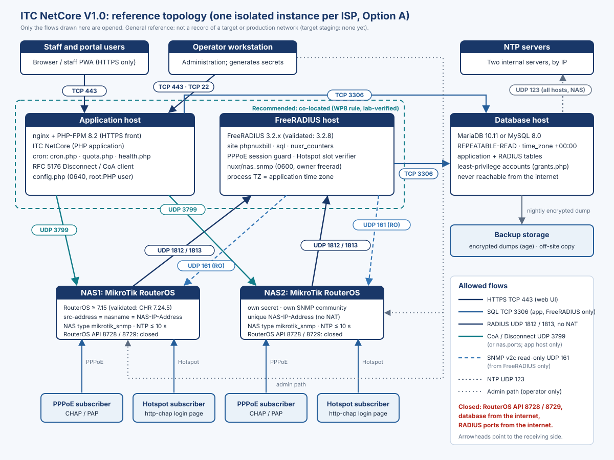

# About this manual

This manual takes a qualified technician who did not take part in the development of ITC NetCore from bare servers to a verified, running instance of **ITC NetCore V1.0** (ISP Management & Billing Platform). Every instruction is taken from the product's own runbooks, configuration files and command-line tools, and from the fresh-install package `install/fresh/`. Where those documents and this manual differ, the product document wins; the source of every section is listed in `TECH_DOCS_SOURCES.md`.

> [!WARNING]
> ITC NetCore V1.0 is a **Release Candidate**. Its release state is `RELEASE_BLOCKED_WITH_EVIDENCE`. The target-environment acceptance tests TA-01 … TA-10 have not been run (every row is `NOT_RUN`), the legal review LIC-1 is `BLOCKED — COUNSEL REQUIRED`, and several owner decisions are pending. A production deployment, a production data migration and any production secret change need the owner's explicit release authorization. This manual does not grant it.

> [!NOTE]
> **Owner decision (2026-10-29):** the first installation is a **fresh install on a new, empty database**. No legacy data is imported. Migration from an existing PHPNuxBill database is a separate future path, described in its own guide and **not accepted for V1's first installation**.

## Scope and audience

| Item | Value |
|---|---|
| Product | ITC NetCore V1.0, a modified version of PHPNuxBill with a reseller / wallet extension |
| Deployment model | One isolated instance per ISP ("Option A"): its own database, its own FreeRADIUS configuration, its own NAS secrets. No shared database, no multi-tenancy |
| Runtime | PHP 8.2 · MariaDB 10.11 or MySQL 8.0 · FreeRADIUS 3.2.x · MikroTik RouterOS as the NAS |
| Installation procedure | The fresh-install package `install/fresh/`: artifact verification, then `nuxr-fresh-install.sh`, then `nuxr-post-install-verify.sh` |
| Reader | A Linux administrator who can install packages, edit configuration files, run a SQL client and read a firewall matrix |
| Companion manual | *MikroTik and FreeRADIUS Integration Manual* (the RADIUS server and NAS side in full detail) |

## Verification levels

Each procedure carries one of these labels. They describe what has really been executed, not what is expected to work.

| Label | Meaning |
|---|---|
| **Lab-verified (disposable instance, MariaDB 10.11 + MySQL 8.0)** | Executed end to end with the `install/fresh/` package on 2026-10-29 on an isolated, disposable Docker instance, once against MariaDB 10.11.19 and once against MySQL 8.0.46, then torn down. App container: Ubuntu 24.04 with PHP 8.2.35 (CLI and FPM) from `ppa:ondrej/php`, nginx 1.24.0 and the MariaDB 10.11 client, using exactly this manual's package set; a self-signed certificate; no published port; **no FreeRADIUS and no NAS**. The proof is run on every release candidate on MariaDB 10.11 and MySQL 8.0; the result for this release is in the handover package (`08_Acceptance_Handover/FRESH_INSTALL_PROOF`). This is lab evidence, **not** a target acceptance |
| **Lab-verified** | Executed by the project's lab scripts on the isolated WSL lab and recorded as evidence. That lab is: Ubuntu 24.04 (WSL2), PHP 8.2 from the `ppa:ondrej/php` repository, nginx with PHP-FPM on a loopback address over **plain HTTP**, MariaDB 10.11.14, FreeRADIUS 3.2.5 (Ubuntu package) with the project configuration, the official FreeRADIUS 3.2.8 image used by the test harness, and MikroTik CHR RouterOS 7.24.5 virtual routers. MySQL 8.0 was exercised there by the automated test harness |
| **Documented (not yet executed on target)** | Specified by the authoritative product documents but not executed in the lab in this form, and not executed on any target system |

> [!WARNING]
> No procedure in this manual has been executed on a target staging system or in production. Both "Lab-verified" labels are evidence from an isolated lab; they are not proof for an untested production router or server. Target verification is the job of TA-01 … TA-10, which all stay `NOT_RUN`.

## Conventions

| Notation | Meaning |
|---|---|
| `<app-root>` | The deployed release directory, which is also the web document root (the repository root is the web root). In this manual: `/srv/itcnc/app/current`, a symbolic link to the active release |
| `<artifact-dir>` | A verified, unpacked copy of the release artifact kept **outside** the document root, for example `/srv/itcnc/artifact/<name>`. The package scripts run from `<artifact-dir>/install/fresh/`, and the RADIUS SQL scripts and FreeRADIUS files are taken from `<artifact-dir>/install/freeradius/` |
| `<env-file>` | The installer's parameter and secret file, for example `/root/itc-netcore-install.env` (mode 0600, outside the document root) |
| `<php-user>` | The account PHP-FPM runs as (`www-data` in the package examples) |
| `${confdir}` | The FreeRADIUS configuration directory: `/etc/freeradius/3.0` on Ubuntu / Debian packages, `/etc/freeradius` in the official image |
| `<...>` | A placeholder you replace. Placeholders never stand for a value that may be pasted into a ticket or chat |

The package scripts run as root on the application host. Product tools are run from `<app-root>` unless stated otherwise.

> [!NOTE]
> **Internal names are unchanged.** The product is called ITC NetCore, but database and table names (`tbl_*`, `radcheck` …), the FreeRADIUS site and dictionary (`phpnuxbill`), file paths and the Composer package keep their original PHPNuxBill names. Do not rename them: the migration runner recognises the installed core schema by comparing its structure with registered variants (a fresh installation must be recognised as `V1_FRESH_INSTALL`), and renaming breaks the installation.

<!-- pagebreak -->

# Quick-start checklist

Use this list to plan and track the work. Each line points to the section that holds the procedure and its verification. Tick a line only when its verification has passed; a failed verification stops the installation.

| # | Phase | Step | Section | Verification level |
|---|---|---|---|---|
| 1 | Authorize | Written owner authorization for the hosts, the window and the operator; the release SHA named | *Security prerequisites* | Documented (not yet executed on target) |
| 2 | Prepare | Hosts sized, OS installed, UTC and NTP on every host, firewall matrix applied, DNS name and certificate ready, backup storage ready | *Preparation* | Documented (not yet executed on target) |
| 3 | Prepare | PHP 8.2 with the required extensions, nginx and PHP-FPM, a database client, the database engine with the required settings, FreeRADIUS 3.2.x and the net-snmp tools | *Preparation* | Lab-verified (disposable instance, MariaDB 10.11 + MySQL 8.0) for the application host and the engine; FreeRADIUS: Lab-verified |
| 4 | Install | Manual first-run check (`sha256sum -c SHA256SUMS`; `RELEASE_SHA` in the archive equals the release SHA from ITC), then release artifact verified with `nuxr-artifact-verify.sh` (SHA-256, archive safety, `RELEASE_SHA`, content rules); verified copy kept in `<artifact-dir>` | *Obtain and verify the release artifact* | Lab-verified (disposable instance, MariaDB 10.11 + MySQL 8.0) |
| 5 | Install | Release unpacked into its own release directory; `current` link is `<app-root>` | *Deploy the code* | Lab-verified (disposable instance, MariaDB 10.11 + MySQL 8.0) |
| 6 | Install | nginx and PHP-FPM configured from the package examples; `php-fpm8.2 -t` and `nginx -t` pass | *Web server: nginx and PHP-FPM* | Lab-verified (disposable instance, MariaDB 10.11 + MySQL 8.0) |
| 7 | Install | `<env-file>` generated with `--generate-secrets` and completed | *Parameters and secrets* | Lab-verified (disposable instance, MariaDB 10.11 + MySQL 8.0) |
| 8 | Install | `--dry-run` prints `dry_run=PASS` and writes nothing | *Dry run* | Lab-verified (disposable instance, MariaDB 10.11 + MySQL 8.0) |
| 9 | Install | `nuxr-fresh-install.sh` exits 0: database gate passed (new database **proven empty**), accounts, base schema, `config.php`, migrations, admission tables READY ×3, grants, installer stripped, cron installed, setup preflight and health passed | *Run the fresh install* | Lab-verified (disposable instance, MariaDB 10.11 + MySQL 8.0) |
| 10 | Install | `nuxr-post-install-verify.sh` exits 0 (web boundary, files, tools, cron) | *Post-install verification* | Lab-verified (disposable instance, MariaDB 10.11 + MySQL 8.0), self-signed certificate |
| 11 | Configure | First login, forced change of the default `admin` password | *First login and administrator password* | Lab-verified (WSL lab, browser); on target: documented |
| 12 | Configure | `CompanyName`, time zone, currency (RADIUS is already enabled by the installer) | *Basic settings* | Lab-verified (WSL lab, user interface); on target: documented |
| 13 | Configure | HTTPS with the real certificate, headers and blocked paths verified on the target | *Verify HTTPS and the web boundary* | Documented (not yet executed on target), TA-10 |
| 14 | Services | FreeRADIUS configured and running; NAS onboarded (companion manual) | *Services* | Lab-verified (WSL lab, CHR); on target: documented |
| 15 | Services | Scheduled jobs running, guard self-check, Hotspot report, backups (`install/backup/`), alerting, log rotation, supervision | *Services* | Cron and log rotation: Lab-verified (disposable instance, MariaDB 10.11 + MySQL 8.0); backups: lab-drilled; operation over days: documented |
| 16 | Check | Release preflight (`preflight.php` without `--setup`) exits 0 | *Release preflight* | Lab-verified (WSL lab, CHR); on target: documented (TA-01) |
| 17 | Verify | Verification checklist completed with synthetic identities only | *Verification checklist* | Documented (not yet executed on target) |
| 18 | Sign off | Go-live sign-off items collected; owner release decision recorded | *Go-live sign-off* | Documented (not yet executed on target) |

<!-- pagebreak -->

# Preparation

## Topology

ITC NetCore V1.0 runs as **one isolated instance per ISP**. An instance has four roles: the application host (web server, PHP, scheduled jobs), the FreeRADIUS host, the database host and the ISP's MikroTik NAS devices. The application and FreeRADIUS may share one machine; the database must be its own engine instance, separate from production and from every other ISP instance.

{width=100%}

> [!NOTE]
> **Recommended arrangement:** run the application on the same host and address as FreeRADIUS. RouterOS accepts a Disconnect / CoA request only from the address of one of its `/radius` entries. When the application shares the FreeRADIUS address, no extra RouterOS entry is needed. This is the production rule of the integration model (WP8) and the arrangement used in the lab. The alternative (a second `/radius` entry for the application address with the same secret) is described in the newer onboarding documents but has not been verified in the lab.

The database holds the application tables and the RADIUS tables in **one database**. The fresh-install package installs this single-database layout (it loads `install/radius.sql` into the instance database), and `grants.php` generates grants for one database at a time; a separate RADIUS database is not supported by the package.

## Operating system

The product documents do not prescribe a Linux distribution. They assume Linux with systemd and chrony. The lab and the disposable proof used **Ubuntu 24.04**; the FreeRADIUS test image pins the net-snmp tools on Ubuntu 22.04. State the distribution and version of every host in your installation record.

Every host runs in **UTC** and is synchronised by **one** time agent (chrony is assumed by the documents; one agent per host, `makestep` only at boot, no second agent).

## Sizing

The only sizing figures in the product documents are **lab-derived minima for a representative staging**. Production sizing is the output of acceptance test TA-09 on the target hardware for the planned peak of simultaneously online quota subscribers.

| Host | Representative minimum | Basis |
|---|---|---|
| Application | 2 vCPU, 4 GB RAM, SSD | PHP workers were light in the lab load tests |
| Database (MariaDB 10.11 or MySQL 8.0) | 4 vCPU, 8 GB RAM, disk-backed SSD, `innodb_buffer_pool_size` of at least 1 GB, `max_connections` of at least 151 | Up to about 3 database cores at 250 Interim-Updates/s in the lab |
| FreeRADIUS | 4 vCPU, 4 GB RAM, `thread pool max_servers` 32, `sql pool max` 32 (as shipped) | Up to about 2 cores at 250 Interim-Updates/s in the lab |

> [!WARNING]
> The lab figures (for example zero accounting loss with 7,500 simulated quota subscribers) are **not a promise for your hardware**. Size the FreeRADIUS SQL pool and the database `max_connections` as described in the companion manual and confirm them with TA-09.

## PHP 8.2 and extensions

PHP **8.2** is the tested runtime. The required extensions are `pdo_mysql`, `curl`, `gd`, `mbstring` and `zip`. The application host also needs PHP-FPM, nginx and the database engine's client (`mariadb-client` or the MySQL client); the installer checks all of them in its first phase.

> [!NOTE]
> The web installer's requirement page still says "at least PHP 7.2", and the repository `Dockerfile` is based on PHP 7.4. Neither is the supported runtime: use PHP 8.2. The web installer is not used in V1 (see *Deviations from the product runbook*), and the Dockerfile is not used for any V1 deployment.

On Ubuntu 24.04 install PHP 8.2 and nginx from the `ppa:ondrej/php` repository with this package set (it includes the required extensions and a few more that the lab chose):

```bash
sudo apt-get install -y software-properties-common ca-certificates curl gnupg
sudo add-apt-repository -y ppa:ondrej/php
sudo apt-get update
sudo apt-get install -y --no-install-recommends \
  php8.2-cli php8.2-fpm php8.2-mysql php8.2-curl php8.2-mbstring php8.2-xml php8.2-zip \
  php8.2-gd php8.2-intl php8.2-bcmath php8.2-sqlite3 php8.2-opcache php8.2-readline \
  unzip nginx mariadb-client
sudo update-alternatives --set php /usr/bin/php8.2
```

(With MySQL 8.0 the MariaDB 10.11 client authenticated without problems in the proof; the MySQL client works too.)

**Verification:** `php -v` shows 8.2; `php -m` lists `pdo_mysql`, `curl`, `gd`, `mbstring` and `zip`. No debugger extension (Xdebug) is installed.

**Verification level:** Lab-verified (disposable instance, MariaDB 10.11 + MySQL 8.0): this package list was used unchanged in a clean Ubuntu 24.04 container (PHP 8.2.35, nginx 1.24.0, mariadb-client 10.11.14, no Xdebug). Also Lab-verified on the WSL lab host. Other distributions: documented (not yet executed on target).

> [!NOTE]
> **Dependencies.** The PHP libraries the application needs are shipped inside the release in `system/vendor/`. `composer.json` declares no requirements, and no Composer step is part of the installation.

## Database engine

Use **MariaDB 10.11** or **MySQL 8.0** (the migration runner enforces the minimums MariaDB 10.11 and MySQL 8.0.16; newer major versions are untested). The engine must satisfy these settings before the installation starts; the installer refuses to continue otherwise:

| Setting | Required value | Checked by |
|---|---|---|
| Global transaction isolation | `REPEATABLE-READ` | installer (A3), preflight `isolation` |
| Global time zone | `time_zone = '+00:00'` (every application and FreeRADIUS SQL session is UTC) | installer (A4), preflight `time.sql_session_zone` |
| Clock skew database / application | under 5 s | installer (A5), preflight `time.clock_skew` |
| Character set | `utf8mb4`; the database itself is created with `utf8mb4_general_ci` by the installer | installer (database gate), `radius.sql` |
| MariaDB only | `check_constraint_checks = ON` globally | installer (A6), preflight `radius_checks` |
| `max_connections` | At least the sum of every FreeRADIUS `pool.max` on this server + the application + operator and backup sessions + margin | companion manual, TA-09 |
| Network | Reachable only from the application and FreeRADIUS hosts, never from the internet | firewall review |
| Administrator | One existing DBA account for the installer, with global `SELECT`, `CREATE USER` and `GRANT OPTION` (and `CREATE` for `--create-db`). It is used only during the run and never stored | installer (prerequisites, database gate) |

A co-located MariaDB (bound to loopback) can use this drop-in file, for example `/etc/mysql/mariadb.conf.d/60-itcnc.cnf`:

```ini
[mysqld]
bind-address            = 127.0.0.1
port                    = 3306
skip-name-resolve
transaction_isolation   = REPEATABLE-READ
default_time_zone       = '+00:00'
max_connections         = 200
innodb_buffer_pool_size = 256M
character-set-server    = utf8mb4
collation-server        = utf8mb4_general_ci
```

On a separate database host, bind to the private address that the application and FreeRADIUS hosts use, and size `innodb_buffer_pool_size` and `max_connections` per the table above (these example values are deliberately small).

> [!NOTE]
> `--check-constraint-checks=ON` is **not** a valid `mariadbd` startup option. The variable is ON by default; leave it so. The installer and the preflight verify it.

**Verification:** after a restart, `SELECT @@global.tx_isolation, @@global.time_zone;` (MariaDB 10.11) or `SELECT @@global.transaction_isolation, @@global.time_zone;` (MySQL 8.0) returns `REPEATABLE-READ` and `+00:00`. The installer and the preflight check the same values.

**Verification level:** Lab-verified (disposable instance, MariaDB 10.11 + MySQL 8.0): MariaDB 10.11.19 and MySQL 8.0.46 (`caching_sha2_password`), both REPEATABLE-READ, `+00:00`, `utf8mb4_general_ci`, `skip-name-resolve`, each as the engine of a freshly installed instance. On target: documented (not yet executed on target).

> [!WARNING]
> **MySQL 8.0 collation.** The MySQL 8 server default collation is `utf8mb4_0900_ai_ci`. The ITC NetCore database must use `utf8mb4_general_ci`; with `--create-db` the installer creates it so, and it refuses an existing empty database with another collation. A RADIUS table whose collation differs from `radacct` makes every login fail with error 1267 (lab finding B-L09). New installations from the shipped `install/radius.sql` are correct; the readiness script `nuxr_nasreload_collation_check.sql` confirms it.

## FreeRADIUS

| Item | Requirement |
|---|---|
| Version | FreeRADIUS **3.2.x**. The project configuration is validated with **3.2.8** only. Any other version must pass the WP8 "Option G" gate again (tests in the source tree) before it is used |
| Packages (Ubuntu / Debian) | `freeradius`, `freeradius-mysql`, `freeradius-utils` (lab, FreeRADIUS 3.2.5) |
| net-snmp tools | `snmpget` and `snmpbulkwalk` (Ubuntu / Debian package `snmp`). Without them every PPPoE login that meets an open accounting row is rejected |
| Process | Threaded, under the service manager; never `-X` in production |
| Process time zone | `TZ` = the application time zone (Settings › Time zone); its SQL sessions stay UTC |

> [!WARNING]
> The lab's native FreeRADIUS was **3.2.5**, not 3.2.8, and needed four documented deviations (listen addresses, an SNMP-less `checkrad`, the process `TZ`, and enabling the stock `date` module). A distribution package that is not 3.2.8 must pass the gate cases of acceptance case X-4 on the target build. Details are in the companion manual. FreeRADIUS and the NAS were **not** part of the disposable-instance proof.

## Time and NTP

Time is a contract, not a recommendation. The canonical text is `docs/TIME_CONTRACT.md`.

| Host | Requirement | Checked by |
|---|---|---|
| Application, database, FreeRADIUS | UTC, NTP-synchronised, maximum drift between them **5 s**; the database clock must slew, never step backwards | installer (A5); preflight `time.sql_session_zone`, `time.clock_skew`; `chronyc tracking` |
| Every NAS | NTP client enabled with two internal servers by IP; clock zone UTC or a fixed offset known to the operator; **10 s hard limit**, typically under 2 s | preflight `time.nas_clock` (WARN above 5 s ahead, FAIL above 10 s); health `nas_clock` |

**Verification:** on every host, `chronyc tracking` (or `timedatectl`) shows a small offset and `System clock synchronized: yes`.

**Verification level:** Lab-verified for the lab hosts (the lab moved to a single chrony source after an environment clock defect). On target: documented (TA-02).

## Firewall and ports

Open these flows and nothing else.

| From | To | Port | Purpose |
|---|---|---|---|
| Staff and customer browsers, operator | Application | TCP 443 | Web interface and customer portal (HTTPS only; port 80 only to redirect to HTTPS) |
| Application, FreeRADIUS | Database | TCP 3306 | SQL, from these two hosts only |
| Each NAS | FreeRADIUS | UDP 1812 / 1813 | Authentication / accounting. No NAT: the NAS source address is `nas.nasname` |
| Application | Each NAS | UDP 3799 (or the NAS's `nas.ports` value) | Disconnect / CoA |
| FreeRADIUS | Each NAS | UDP 161 | Read-only SNMP v2c for the PPPoE session guard and the Hotspot slot verifier |
| Every host and every NAS | NTP servers | UDP 123 | Time |
| Operator | Hosts | TCP 22 | Administration |
| (none) | NAS RouterOS API 8728 / 8729 | — | **Not used by the release profile. Keep closed** |

The database is never reachable from the internet, and no RADIUS or API port is exposed to the internet.

**Verification level:** Documented (not yet executed on target). The lab ran isolated with an equivalent restricted matrix.

## DNS and HTTPS

- Choose the public name of the instance and make it resolve to the HTTPS front. The application URL (`NUXR_APP_URL` in `<env-file>`, then `APP_URL` in `config.php`) must be the `https://` address, without a trailing slash.
- Obtain a valid certificate for that name through your organisation's usual certificate process (the product documents do not prescribe a certificate authority or tool).
- HTTPS only: HTTP redirects to HTTPS, and the web server sets HSTS. The package nginx example does both.
- **Behind a TLS-terminating reverse proxy** (the proxy talks plain HTTP to the PHP server): the application detects HTTPS only from `$_SERVER['HTTPS']`, never from `X-Forwarded-Proto`. With nginx / PHP-FPM set `fastcgi_param HTTPS on;` on the backend (B9 notes in the package nginx example); with Apache, `SetEnvIf X-Forwarded-Proto https HTTPS=on` **only** when the backend is reachable from the proxy alone. The installer pins `APP_URL` to the `https://` address in `config.php`. Without HTTPS detection, session cookies lose `Secure` and preflight `stage.https` warns.

**Verification level:** Lab-verified (disposable instance, MariaDB 10.11 + MySQL 8.0) with a **self-signed** certificate behind the package nginx example (`stage.https` PASS). A real certificate, a reverse proxy and the target: documented (not yet executed on target), TA-10.

## Backup storage

Prepare encrypted storage for the backup sets and archived binary logs of the instance (`install/backup/`, see *Backups*), with an agreed retention and at least one off-host copy. The product documents do not state a capacity; size it from your measured set sizes, binlog volume and retention. Access is limited to the instance operators.

> [!SECURITY-WARNING]
> A backup is secret material. It contains the NAS shared secrets (`nas.secret`), customer passwords (stored recoverably for CHAP), staff password hashes, personal data and every financial record. Encrypt it at rest and in transit, never attach it to a ticket or chat, and back up `config.php` separately and encrypted (it holds `$app_secret`; `nuxr-backup.sh` does this in its encrypted `secrets.tar`).

## Security prerequisites

| # | Prerequisite |
|---|---|
| 1 | **Written owner authorization** naming the hosts, the database, the NAS, the time window and the operator. Production needs the owner's release authorization |
| 2 | A **secret store**. Every secret (database passwords, `$app_secret`, `$api_secret`, NAS secrets, SNMP communities, staff passwords) lives there and reaches the hosts only as files with mode 0600 or through the environment |
| 3 | Secrets are generated on the operator side (`nuxr-fresh-install.sh --generate-secrets` writes them into a new 0600 file), never in a shared chat or ticket |
| 4 | **No secret on a command line**, in shell history, in tickets, in logs or in evidence. The package scripts and the product tools read passwords from 0600 files, from `config.php` or from an environment variable |
| 5 | Separate database accounts: the existing DBA account used by the installer only during the run (never stored), the migration (DDL) account, the application runtime account, the FreeRADIUS account and a backup account. The installer creates the migration, application and FreeRADIUS accounts and **refuses** accounts that already exist |
| 6 | Only reviewed plugins. A fresh installation has none; keep it that way unless the owner approves a plugin inventory |

<!-- pagebreak -->

# Application installation

The application is installed with the **fresh-install package `install/fresh/`**. It replaces the interactive web installer with one command-line run and also performs the post-installer steps of `docs/DEPLOYMENT_AND_UPGRADE_RUNBOOK.md` §2 and the matching lines of `docs/PRODUCTION_CONFIGURATION_CHECKLIST.md`. The order is fixed:

1. Verify the release artifact and unpack it (`nuxr-artifact-verify.sh`).
2. Configure the web server from the package examples.
3. Generate and complete the parameter and secret file.
4. Dry run.
5. Fresh install (`nuxr-fresh-install.sh`).
6. Post-install verification (`nuxr-post-install-verify.sh`).

The package README (`install/fresh/README.md`) is the reference for every option.

| Package file | Purpose |
|---|---|
| `nuxr-artifact-verify.sh` | Verifies a release tarball before it is unpacked, then optionally unpacks it into a new, empty directory |
| `nuxr-fresh-install.sh` | The fresh install, with `--dry-run` and `--generate-secrets` |
| `nuxr-post-install-verify.sh` | Non-destructive checks of the web boundary, files and permissions, the tools and the scheduled jobs |
| `templates/config.php.tmpl`, `lib/render-config.php` | `config.php` template and its renderer (values from the environment only; CLI only) |
| `templates/install.env.example` | The parameter and secret file, every key documented |
| `nginx/itc-netcore.conf.example`, `php-fpm/pool.conf.example` | Production web server examples |
| `logrotate/itc-netcore.example`, `cron/itc-netcore.cron.example` | Log rotation and scheduled jobs |

> [!NOTE]
> **Lab proof (2026-10-29).** The whole sequence of this chapter ran on a disposable instance against MariaDB 10.11 and against MySQL 8.0: install exit 0; a second run exit 0 with an identical database; post-install verification **67 PASS / 0 WARN / 0 FAIL** on each engine; 8 of 8 refusal cases refused on each engine with nothing changed. The proof is run on every release candidate on MariaDB 10.11 and MySQL 8.0; the result for this release is in the handover package (`08_Acceptance_Handover/FRESH_INSTALL_PROOF`). It is not a target acceptance and not a release authorization.

> [!NOTE]
> **Package location.** `install/fresh/` is part of the release commit and of every artifact built from it. Run it from the verified artifact copy, `<artifact-dir>/install/fresh/`. The installer always refuses to run from the copy inside the document root.

## Obtain and verify the release artifact

1. Obtain the release artifact built from the **owner-accepted commit** (`itc-netcore-v1.0-<sha12>.tar.gz`), its `SHA256SUMS` file, the standalone `nuxr-artifact-verify.sh` delivered next to the tarball (handover folder `07_Release_Artifacts`), and the **40-character release SHA**, which ITC gives you out-of-band (not with the download) and which the handover index lists. The build is `git archive` of that commit with a `RELEASE_SHA` file added, and it is reproducible: the same commit gives the same SHA-256 (`install/fresh/README.md`, "Release build").
2. Run the **manual first-run check** below, then verify the artifact with `nuxr-artifact-verify.sh` **on the target, before unpacking**, and unpack it twice: once as the kept copy `<artifact-dir>` outside the document root, and once as the release that becomes the document root.

**Manual first-run check** (in the folder that holds the tarball and `SHA256SUMS`, before any script from the delivery is run):

```bash
sha256sum -c SHA256SUMS
# expected: itc-netcore-v1.0-<sha12>.tar.gz: OK
tar -xzOf itc-netcore-v1.0-<sha12>.tar.gz itc-netcore-v1.0-<sha12>/RELEASE_SHA
# expected: the 40-character release SHA from ITC (handover index)
```

This check needs only `sha256sum` and `tar` from the operating system, not the verifier inside the tarball. If `sha256sum` does not print `OK`, or the printed `RELEASE_SHA` differs from the SHA that ITC gave you by even one character, stop: do not unpack the tarball and do not run anything from it.

**Verify and unpack:**

```bash
./nuxr-artifact-verify.sh --artifact=<name>.tar.gz --expected-sha=<40-character release SHA> \
  --extract-to=/srv/itcnc/artifact/<name>
cd /srv/itcnc/artifact/<name>/install/fresh
./nuxr-artifact-verify.sh --artifact=/path/<name>.tar.gz --expected-sha=<40-character release SHA> \
  --extract-to=/srv/itcnc/app/releases/<sha8>-<UTC timestamp>
```

(For the first run, use the standalone `nuxr-artifact-verify.sh` from `07_Release_Artifacts`, after the manual check above; afterwards, use the copy in `<artifact-dir>/install/fresh/`.)

> [!NOTE]
> **Where the release SHA is recorded.** A commit cannot contain its own SHA, so the release SHA is not written in the release notes or in any other file of the source tree. It is recorded in the `RELEASE_SHA` file, which the build adds to the archive, in the archive itself (the commit id that `git archive` stores in the tar header), and in the handover index.

The script checks, in this order, and stops at the first failure:
1. the artifact's SHA-256 equals its line in `SHA256SUMS`;
2. the archive is safe to unpack: one top-level directory, no absolute path, no `..`, no link or device entry;
3. `RELEASE_SHA` inside the archive equals `--expected-sha`, and, when git is installed, so does the commit id that `git archive` stored in the tar header;
4. the content rules of the runbook: it **excludes** `.git/`, `dev/`, `tests/`, `owner-review/`, `docs/claude-development-pack/`, `system/vendor/yosiazwan/php-facedetection/lena512color.jpg` and any `config.php`; it **includes** `LICENSE`, `docs/THIRD_PARTY_LICENSES.md` and the installer sources.

With `--extract-to` it unpacks only after every check passed, into a directory that does not exist yet (or is empty), without the archive's owners, and checks `RELEASE_SHA` again in the unpacked tree. Exit codes: 0 verified · 1 internal error · 2 verification failed (nothing unpacked) · 5 usage.

> [!NOTE]
> Deploying from a source checkout is not the V1 procedure. The development-pack manifest check of the staging package (`sha256sum -c docs/claude-development-pack/MANIFEST.sha256`, 42 / 42) can only run on a source checkout, because that directory is excluded from the release artifact.

**Verification level:** Lab-verified (disposable instance, MariaDB 10.11 + MySQL 8.0): a tampered tarball and a wrong `--expected-sha` both failed with exit 2; the kept copy and the release verified and unpacked, and the git tar-header commit id matched. The proof artifact rebuilt to the same SHA-256; the result for this release is in `08_Acceptance_Handover/FRESH_INSTALL_PROOF`. The manual `sha256sum` / `tar` check: documented (not yet executed on target).

## Deploy the code

Use a release-directory layout with a symbolic link, which makes a later rollback a link switch:

```bash
ln -sfn /srv/itcnc/app/releases/<sha8>-<UTC timestamp> /srv/itcnc/app/current   # /srv/itcnc/app/current is <app-root>
```

The installer sets the ownership and modes of the tree (phase 6) and the post-install verification checks them:

| Path | Owner / mode after installation |
|---|---|
| Code tree | owned by root; read-only for `<php-user>` |
| `config.php` | mode 0640, owner `root:<php-user>` |
| `pages/`, `system/uploads/`, `ui/compiled/`, `system/cache/`, `ui/cache/` | writable by `<php-user>` (checklist B7; the scheduled job keeps its lock file in `system/cache/`, and the template engine uses `ui/cache/` and `ui/compiled/`) |
| Everything | nothing world-writable |

**Verification level:** Lab-verified (disposable instance, MariaDB 10.11 + MySQL 8.0): read-only, root-owned code tree; the five writable paths writable by `www-data`; nothing world-writable.

## Web server: nginx and PHP-FPM

Install `php-fpm/pool.conf.example` and `nginx/itc-netcore.conf.example` from the package, adapt the host name, the certificate and the paths, then test and reload:

```bash
php-fpm8.2 -t && systemctl reload php8.2-fpm
nginx -t && systemctl reload nginx
```

What the examples provide:

| Example | Content |
|---|---|
| nginx site | HTTPS only; HTTP 301 to HTTPS; HSTS; the B6 headers (each exactly once) and `Referrer-Policy`; `$realpath_root` for the symlinked release layout; deny rules (404) for `install/`, `system/` (except the upload files the UI uses), `dev/`, `tests/`, `docs/`, `owner-review/`, `pages/`, dot-files, `*.sql`, `*.sh`, `*.tpl` and similar, config files, `RELEASE_SHA` and `radius.php`; `update.php` answers 403; PHP executes only for an allowlist of entry points (`index.php`, `admin/`, `scan/`, `qrcode/`); a login-POST rate limit; B9 notes for a TLS-terminating proxy |
| PHP-FPM pool | Unix socket mode 0660 for `www-data`; `display_errors` off; error log in `/var/log/itcnc`; `date.timezone = UTC`; session cookie flags `HttpOnly`, `Secure`, `SameSite=Lax`; `.php` only |

The examples implement these requirements; verify every line on your server:

| # | Requirement |
|---|---|
| B1 | HTTPS only with a valid certificate; HTTP redirects to HTTPS; HSTS set by the web server |
| B3 | The document root serves the application only. Not reachable from the web: `config.php`, `install/` (including `install/freeradius/`, which stays on disk), `dev/`, `tests/`, `docs/`, `owner-review/`, `.git/`, any `*.sql` / `*.sh` file, and `system/` except what the user interface really uses (for example the invoice templates load `system/uploads/paid.png`) |
| B5 | `update.php` answers 403 (the web updater is disabled in the code) |
| B6 | Responses carry `X-Frame-Options: SAMEORIGIN`, `Content-Security-Policy: frame-ancestors 'self'` and `X-Content-Type-Options: nosniff`, and the session cookie is `HttpOnly; SameSite=Lax; Secure` |
| B8 | `display_errors = Off`; PHP errors logged to a file outside the document root |
| B9 | Behind a TLS-terminating proxy: `fastcgi_param HTTPS on;` on the backend, `APP_URL` pinned to `https://` |

**Verification level:** Lab-verified (disposable instance, MariaDB 10.11 + MySQL 8.0): `php-fpm8.2 -t` and `nginx -t` OK, pool socket `srw-rw---- www-data`, and every requirement above confirmed by the post-install verification with a self-signed certificate. A real certificate and a reverse proxy: documented (not yet executed on target), TA-10.

## Parameters and secrets

Let the installer create the parameter and secret file with new passwords, then fill in the remaining lines:

```bash
cd <artifact-dir>/install/fresh
./nuxr-fresh-install.sh --generate-secrets=/root/itc-netcore-install.env
```

This writes a **new** file with mode 0600 and three generated passwords (migration, application and FreeRADIUS accounts). No secret is printed. Complete the keys documented in `templates/install.env.example`:

| Key | Meaning |
|---|---|
| `NUXR_DB_HOST` | Database host the application and the tools use (`localhost` = the local socket); written into `config.php` |
| `NUXR_DB_NAME` | The new instance database. It must not exist (then pass `--create-db`) or exist with **zero** tables, views, routines, events and triggers and the collation `utf8mb4_general_ci` |
| `NUXR_DB_ADMIN_USER`, `NUXR_DB_ADMIN_PASSWORD` | The existing DBA account (global `SELECT`, `CREATE USER`, `GRANT OPTION`, and `CREATE` for `--create-db`). Used only by the installer; never stored |
| `NUXR_DB_MIG_USER`, `NUXR_DB_APP_USER`, `NUXR_DB_RADIUS_USER` | The accounts the installer creates. They must **not** exist yet |
| `NUXR_DB_CLIENT_HOST` | Host part of the migration and application accounts: the address the application host connects from, as the database sees it (`localhost` for a local socket) |
| `NUXR_DB_RADIUS_HOSTS` | Host part(s) of the FreeRADIUS account, separated by spaces |
| `NUXR_APP_URL` | The public `https://` address, without a trailing slash |

Rules: the file must have mode 0600 or 0400 and be owned by the user running the installer; it is **parsed, never sourced**; keep it outside the document root.

> [!SECURITY-WARNING]
> After the installation, move every secret from `<env-file>` into the instance secret store and delete the file (at least the `NUXR_DB_ADMIN_PASSWORD` line). The migration password is never written into `config.php` (checklist D3).

**Verification level:** Lab-verified (disposable instance, MariaDB 10.11 + MySQL 8.0): file mode 0600, three passwords generated and never shown.

## Dry run

```bash
./nuxr-fresh-install.sh --app-root=/srv/itcnc/app/current --env-file=/root/itc-netcore-install.env \
  --create-db --install-cron --dry-run
```

The dry run is read-only: it checks the prerequisites, runs the database gate and the account check, and prints the plan. **Expected:** `dry_run=PASS`, exit 0; afterwards the database still does not exist, there is no `config.php` and no state directory.

**Verification level:** Lab-verified (disposable instance, MariaDB 10.11 + MySQL 8.0).

## Run the fresh install

Run the same command without `--dry-run`:

```bash
./nuxr-fresh-install.sh --app-root=/srv/itcnc/app/current --env-file=/root/itc-netcore-install.env \
  --create-db --install-cron
```

> [!WARNING]
> **Never install over an existing or unknown database.** The base schema files `install/phpnuxbill.sql` and `install/radius.sql` begin each table with `DROP TABLE IF EXISTS`. The installer's **database gate** proves, through the DBA account with global `SELECT` (so that every object is visible), that the target database either does not exist (and `--create-db` is given) or holds zero tables, views, routines, events and triggers with the collation `utf8mb4_general_ci`. It checks the emptiness **again** immediately before the base schema is loaded. Anything else is refused with exit 3 before any change. Never drop, reuse or "clean" a database to get past the gate.

Before phase 1 the installer checks `<env-file>`: a mode other than 0600 / 0400, an owner other than the invoking user, or a location inside the document root is refused (exit 3) before anything else. It then runs these phases, in this order:

| # | Phase | What it does and checks |
|---|---|---|
| 1 | Prerequisites | PHP 8.2 with the five extensions, PHP-FPM, a database client, the web user and the tools; the engine and its global settings (A3 isolation, A4 time zone, A5 skew, A6 `check_constraint_checks`); the DBA account's privileges |
| 2 | Database gate | The emptiness proof above; refuses pre-existing accounts (they may hold privileges elsewhere, ISO-01), a target database on which another account already holds database, table, column or routine privileges (revoke them first), and a `config.php` without installer state |
| 3 | Database and accounts | Creates the database (only with `--create-db`) as `utf8mb4` / `utf8mb4_general_ci`, then the migration, application and FreeRADIUS accounts |
| 4 | Base schema | After the second emptiness check, the migration (DDL) account loads `install/phpnuxbill.sql` and `install/radius.sql` |
| 5 | `config.php` | Rendered from `templates/config.php.tmpl`: the application runtime account from the start, new 64-hex `$app_secret` and `$api_secret` from `random_bytes`, stage `Live`, and a pinned `define('APP_URL', '<https URL>')` |
| 6 | Ownership and modes | Creates `pages/` from `pages_template/` and then removes `pages_template/`; applies the table in *Deploy the code* |
| 7 | Migrations | `migrate.php` `status`, `preflight` (variant `V1_FRESH_INSTALL` required), `migrate`, `verify`, and a second `migrate` that must do nothing |
| 8 | RADIUS admission tables | Loads `nuxr_admission.sql` and `nuxr_hs_admission.sql` and requires the three READY checks |
| 9 | RADIUS setting | Stores `radius_enable = 1` (the value of the SuperAdmin setting "Enable Radius: Yes"); `--no-enable-radius` skips it |
| 10 | Grants | `grants.php` with an automated review, then applies the statements |
| 11 | Installer removal and cron | Removes the web installer (default `--installer=strip`, keeping `install/freeradius/` read-only) and, with `--install-cron`, installs `/etc/cron.d/itc-netcore` |
| 12 | Checks | `preflight.php --setup` and `health.php --finance`, both as the web user |
| 13 | Next steps | Printed: first login, settings, log rotation, FreeRADIUS and NAS, release preflight, backups, secret clean-up |

Credentials are read from 0600 option files in a private temporary directory (removed on exit); SQL always goes through standard input; the migration password reaches PHP only through `--db-password-env`. Nothing secret appears on a command line, on the screen or in the log.

**Idempotent and resumable.** A state file and a lock (`/var/lib/itc-netcore/fresh-install/<host>__<db>.state`, directory mode 0700) record each phase.
- A re-run after success changes nothing in the database; it re-applies permissions, re-checks the installer removal and re-runs the checks.
- A re-run after a failure resumes after the base schema.
- A failure **during** the base-schema load is never resumed: start again on a new, empty database.

| Exit code | Meaning |
|---|---|
| 0 | Installed and verified (setup preflight and `health.php --finance` passed) |
| 1 | Internal error |
| 2 | Prerequisites missing (nothing changed) |
| 3 | Refused (nothing changed): database not empty or unknown, wrong collation, accounts exist, another account holds privileges on the target database, unsafe file, existing installation |
| 4 | A step failed (schema, migration, grants, preflight, health) |
| 5 | Usage |

**Verification level:** Lab-verified (disposable instance, MariaDB 10.11 + MySQL 8.0): exit 0 on both engines (4.7 s on MariaDB); a second run exited 0 through the resume path with every database phase skipped and a snapshot of databases, accounts, columns and `CHECKSUM TABLE` of 46 tables **identical**. Refusal cases, each exit 3 with databases, accounts, schema, data and application tree identical before and after: existing database with data (R1), the installed instance's own database from a new release directory (R2), a stored routine only (R3), unknown name without `--create-db` (R4), `utf8mb4_unicode_ci` (R5), existing application account (R6), `<env-file>` mode 0644 (R7), `config.php` without state (R8). An interrupted base-schema load was refused ("never resumed"); a resume after a failure and an injected fault (exit 4, fail closed) behaved as designed.

### What the installer writes: review points

The installer does the work; the operator reviews the result with these rules.

**`config.php`**

| Item | Rule | Checked by |
|---|---|---|
| `$app_secret` | 32+ random characters, unique to this instance, different from every other secret (the installer writes 64 hex characters). Without it, staff login, remember cookies, login links, invoice links and OTP fail closed | preflight `keys` |
| `$api_secret` | 32+ random characters, different from every other secret (the API stays disabled without it) | preflight `keys` |
| `$_app_stage` | `'Live'` | preflight `stage` |
| `$legacy_devices_enabled` | **absent** (or `false`). The legacy MikroTik-API and rlm_rest devices are disabled in the release profile | preflight `profile` |
| `$radius_rest_secret` | **absent** (release profile: FreeRADIUS SQL only) | preflight `profile` |
| `APP_URL` | A fixed `define('APP_URL', 'https://<your-host>');` (checklist B9) | preflight `stage.https` |
| Database account | The application runtime account, never the DBA, root or migration account (checklist C3, D3) | preflight `grants` |
| File | Mode 0640, owner `root:<php-user>` | post-install verification |

> [!SECURITY-WARNING]
> Changing `$app_secret` later invalidates every staff and customer session, remember cookie, login link and public invoice link; changing `$api_secret` invalidates every API token. To generate a new key on the operator side: `php -r 'echo bin2hex(random_bytes(32)), PHP_EOL;'`. Rotation procedures: companion manual, *Secret handling*.

**Base schema and migrations.** The base (legacy) schema comes from `install/phpnuxbill.sql`. Do not edit that file: the migration runner recognises the installed core schema by comparing it with registered variants, and a fresh installation must be recognised as `V1_FRESH_INSTALL`. The reseller domain (manager tree, pricing, activations, wallets and ledger, customer ownership, audit, reversal states) is added by the **project migration runner**, the only authoritative mechanism for these schema changes. The installer runs it with the migration account, `--db-host` equal to `NUXR_DB_HOST` and the password through `--db-password-env`. Expected, in the installer log:
- `status` and `preflight` report `variant: V1_FRESH_INSTALL` and seven pending migrations `R0001_manager_tree` … `R0007_activation_reversal_states`;
- `migrate` reports all seven `APPLIED`;
- `verify` reports "7 applied migration(s) verified against their contracts";
- a second `migrate` reports "nothing to do".

| `migrate.php` exit code | Meaning | Action |
|---|---|---|
| 0 | OK | — |
| 2 | NOT_READY: refused before any change (unknown core schema, unsupported server, missing privileges, lock held, a partial state that needs `rollback`) | Fix the cause and re-run the installer. There is **no** override for an unknown core schema |
| 3 | FAILED: the partial state is recorded and blocks everything except `rollback` | Stop; see *Troubleshooting* |
| 4 | DRIFT: an applied object or migration file no longer matches its contract | Stop and escalate |
| 5 | USAGE | — |

**RADIUS admission tables.** The check scripts must print `nuxr_admission=READY`, `nuxr_hs_admission=READY` and `nasreload_collation=READY`. Do **not** run `nuxr_nasreload_collation.sql` on a fresh installation; it is the conversion for older databases.

**Least-privilege accounts.** `grants.php` derives the GRANT statements from the tables that exist, so the installer runs it after the migrations and the admission tables. What the review must find:
- application account: no global privileges; `SELECT, INSERT` only on `tbl_manager_ledger`, `tbl_reseller_audit_events` and `tbl_reseller_activation_events` (append-only); no `DELETE` on the finance tables; `SELECT` only on `radacct` and the migration registry;
- FreeRADIUS account: `SELECT` on `radcheck`, `radreply`, `radusergroup`, `radgroupcheck`, `radgroupreply`, `nas`; `SELECT, INSERT, UPDATE` on `radacct`, `nasreload`, `nuxr_admission`, `nuxr_hs_admission`; `INSERT` on `nuxr_hs_admission_audit`; nothing on the `tbl_*` billing tables; one entry per address in `NUXR_DB_RADIUS_HOSTS`.

`grants.php` generates no backup or monitoring account. Create the **backup account** as described in `install/backup/backup.my.cnf.example` (grants per engine), and a read-only monitoring account for the Hotspot report (see *Session monitoring*).

> [!SECURITY-WARNING]
> No database account other than FreeRADIUS and the application may read the `nas` table: it holds the NAS shared secrets in plaintext (RADIUS needs them). No application or FreeRADIUS account may read another instance's database.

**Installer removal.** With the default `--installer=strip` the installer deletes the web installer (`install/*.php`, `install/*.sql`, `css`, `img` and the package copy) and keeps `install/freeradius/` read-only.

> [!WARNING]
> **Keep `install/freeradius/` in the document root, read-only and blocked from the web** (the package nginx example answers 404 for every path under `/install/`). The preflight check `radius_checks` reads its expected CHECK expressions from `install/freeradius/*.sql` in the document root. Since commit `33624129` (the fix of finding G-1) the check **FAILs** when either file is missing or unreadable ("reference definitions … missing or unreadable"). `--installer=remove` deletes all of `install/`, so the setup preflight of phase 12 FAILs and the installer stops with exit 4. **Do not use `--installer=remove`**; keep the default `--installer=strip`.

**Verification level:** Lab-verified (disposable instance, MariaDB 10.11 + MySQL 8.0): 30 base tables after the emptiness re-check; `migrate` 7 APPLIED and `verify` exit 0 on both servers; three READY lines on both engines; grants 68 statements reviewed and applied with 2 FreeRADIUS hosts (MariaDB) and 57 with 1 host (MySQL), application account with no global privilege and ledger / audit / activation-events `SELECT, INSERT` only; installer files removed with `install/freeradius` kept read-only.

## Post-install verification

```bash
./nuxr-post-install-verify.sh --app-root=/srv/itcnc/app/current --base-url=https://<your-host>
```

The script is non-destructive: it reads files, sends GET / HEAD requests and runs the read-only product tools. Use `--resolve=<host:port:addr>` to reach the site before DNS points to it. `--insecure` accepts a self-signed certificate and is for disposable test instances only, **never on a target**.

| Area | Checks |
|---|---|
| Web | Login page 200 with a form; `/admin/` redirects (30x) to the admin route `?_route=admin/`, which answers 200; the B6 headers present (a header sent more than once is a WARN); cookie `HttpOnly; Secure; SameSite=Lax`; HSTS; HTTP answers 301 to HTTPS; `system/uploads/paid.png` 200; `update.php` 403; 27 sensitive paths answer 403 or 404 (among them `/install/`, `/install/freeradius/*.sql`, `/config.php`, `/.git/config`, `/system/`, `/system/reseller/migrate.php`, `/system/api.php`, `/init.php`, `/radius.php`, `/ui/compiled/`, `*.tpl`, `/pages/`, `/RELEASE_SHA`) |
| Files | No installer file on disk; `config.php` 0640 `root:<php-user>`; the five writable paths writable by `<php-user>`, the rest of the code tree not; nothing world-writable |
| Tools | `preflight.php --setup` and `health.php --finance` exit 0 |
| Cron (dry) | The cron file has the documented lines; `cron.php` runs from `system/`; PHP lint passes; `../init.php` resolves; `quota.php report` exits 0 |

Exit codes: 0 every check PASS (WARN lines allowed) · 1 at least one FAIL · 5 usage. After the NAS are onboarded, run it again with `--release` (see *Release preflight*).

**Verification level:** Lab-verified (disposable instance, MariaDB 10.11 + MySQL 8.0): **67 PASS / 0 WARN / 0 FAIL** on each engine, with a self-signed certificate; 27 sensitive paths answered 403 / 404. On target: documented (not yet executed on target), TA-10.

## Deviations from the product runbook

The package deliberately differs from the literal runbook text in these points (`install/fresh/README.md`, "Differences"):

| Runbook / web installer | Package | Reason |
|---|---|---|
| Web installer steps 1–5 in a browser (`install/index.php` … `step5.php`) | One CLI run doing the same work: writes `config.php`, imports `phpnuxbill.sql` and `radius.sql`, copies `pages_template/` to `pages/` | Reproducible, no password typed into a web form, and the emptiness gate runs before the import. The web installer never checks that the database is empty, its SQL drops tables, and it writes the installer account into `config.php` (finding G-7). **Do not use the web installer for V1** |
| Installer account writes the schema and is replaced later | The migration (DDL) account loads the base schema; no separate installer account; `config.php` holds the runtime account from the start | One administrative account fewer; the migration password is never in `config.php` (D3) |
| `migrate.php` without `--db-host` | `--db-host` equal to `NUXR_DB_HOST` | The account host part must match the connection |
| RADIUS enabled later in the user interface | `radius_enable = 1` stored by default (`--no-enable-radius` to skip) | Known issue ACC-1; see *Basic settings* |
| `APP_URL` derived from the request | `define('APP_URL', '<https URL>')` pinned | Checklist B9; also removes the CLI warnings |

The runbook and the checklist were corrected in commit `c550d6b8`: runbook §2 step 4 now keeps `install/freeradius/` read-only (the package default `--installer=strip`), and checklist I1 / I2 and the `cron.php` header now give `cd <app>/system && php cron.php`. On these two points the package and the product documents agree; they are no longer deviations.

## First login and administrator password

1. Open `https://<your-host>/admin` and sign in with the seeded administrator: user name `admin`, password `admin`.
2. The application recognises the seeded default credential and locks every staff page except the password change (SEC-18). Set a strong, unique password from the secret store.
3. Sign out and sign in again with the new password.

**Verification:** after the change, staff pages open normally; the seeded credential no longer works.

**Verification level:** Lab-verified (WSL lab, browser: forced change, wrong current password refused, re-login). Not part of the disposable-instance proof. On target: documented (not yet executed on target).

## Basic settings

As SuperAdmin, set these in the application settings before anything else:

| Setting | Why |
|---|---|
| **Company name** (`CompanyName`) | The base schema seeds the placeholder `PHPNuxBill` (still the value after the fresh install). Invoices, invoice e-mails and notifications print the stored value, so set the ISP's name before the first financial document exists |
| **Time zone** | The base schema seeds `Asia/Jakarta` (still the value after the fresh install). Set the zone you will operate in. FreeRADIUS must run with the same `TZ` (`Expiration` is written in this zone) |
| **Currency and number format** | The base schema seeds `Rp.` with `,` / `.` separators |
| **RADIUS** (`radius_enable`, SuperAdmin only) | Already stored by the installer (`radius_enable = 1`) unless you passed `--no-enable-radius`. The application's RADIUS features need it. Known issue ACC-1 (the preflight RADIUS checks FAIL instead of reporting "RADIUS not enabled") was **not** reproduced at commit `228f01c9` with the single-database layout, because the preflight falls back to the main connection (finding G-3) |
| **Update check** (`new_version_notify`, SuperAdmin) | Stored as `disable` by the fresh installer: the dashboard's upstream PHPNuxBill update check, which contacts `raw.githubusercontent.com`, is off by default. SuperAdmin can enable it under Settings > Miscellaneous. It is the upstream PHPNuxBill check, not an ITC NetCore release channel; leave it off unless your outbound policy allows that host |

**Verification level:** `radius_enable` stored by the installer: Lab-verified (disposable instance, MariaDB 10.11 + MySQL 8.0). Company name, time zone and currency through the user interface: Lab-verified (WSL lab); on target: documented (not yet executed on target).

## Verify HTTPS and the web boundary

The post-install verification covers the web boundary. On the target, with the real certificate and any reverse proxy in place, also spot-check by hand:

```bash
curl -sI http://<your-host>/                 # 301 to https://
curl -sI https://<your-host>/                # HSTS, X-Content-Type-Options: nosniff, X-Frame-Options: SAMEORIGIN
curl -sI "https://<your-host>/?_route=login" # session cookie HttpOnly; Secure; SameSite
curl -sI https://<your-host>/update.php      # 403
curl -sI https://<your-host>/install/        # 404
curl -sI https://<your-host>/config.php      # 404
curl -sI https://<your-host>/system/         # 404
```

**Verification level:** Lab-verified (disposable instance, MariaDB 10.11 + MySQL 8.0) with a self-signed certificate behind the package nginx example: HSTS, redirect, B6 headers, cookie flags, `update.php` 403, blocked paths, and the login-POST rate limit (12 bogus POSTs answered `302` ×6, then `429` ×6). A real certificate, a proxy and the target: documented (not yet executed on target), TA-10.

## Setup preflight and health

The installer runs the setup preflight and the finance health check as the web user (phase 12), and the post-install verification runs them again. To re-run them by hand:

```bash
cd <app-root>
sudo -u <php-user> php system/reseller/preflight.php --setup
sudo -u <php-user> php system/reseller/health.php --finance
```

`preflight.php` is read-only. In **setup** mode it reports the missing NAS as `WARN NOT_CONFIGURED` instead of a FAIL.

**Expected:** every preflight check PASS (including `stage.https`, `grants`, `radius_checks` and `schema`), except `nas.verification` WARN NOT_CONFIGURED (no NAS yet). Exit 0. `health.php --finance` exits 0 with `db`, `schema` and `finance` OK.

| Preflight check | What it proves |
|---|---|
| `db.connect` | Printed only when the runtime account in `config.php` cannot connect: FAIL with the cause (access denied, unknown database, server not reachable) and the MySQL error number; no other check runs; exit 4 (G-4, fixed in `bd1e03cc`) |
| `keys` | `$app_secret` and `$api_secret` are valid and distinct |
| `stage` | stage `Live`, `display_errors` off, `https://` URL (WARN otherwise) |
| `engine`, `isolation` | tested engine, REPEATABLE-READ globally and for the session |
| `time` | SQL session zone UTC; database / PHP clock skew (`time.clock_skew`: PASS up to 5 s, WARN 6–30 s, FAIL above 30 s); NAS clocks (`time.nas_clock`: WARN above 5 s, FAIL above 10 s) |
| `schema` | reseller schema ready, including every CHECK expression and its enforcement |
| `radius_checks` | admission-table CHECK constraints exact and enforced (MariaDB: global `check_constraint_checks`); the expected expressions are read from `install/freeradius/`; FAIL when those reference files are missing or unreadable (G-1, fixed in `33624129`) |
| `quota.plans` | no enabled Limited plan with an unusable quota |
| `identity.collisions`, `identity.non_canonical` | no RADIUS identity with more than one holder (FAIL otherwise; always passes on an empty database); stored names with edge whitespace or control characters (WARN) |
| `shared_key` | customers with an active Hotspot and an active PPPoE service on one RADIUS key (WARN; set a distinct PPPoE username) |
| `profile` | FreeRADIUS-only release profile |
| `plugins` | installed plugin files (none on a fresh install) |
| `grants` | the account in `config.php` is least-privilege (FAILs for root or an administrative account) |
| `mac` | RADIUS user names that look like lower-case MAC addresses |
| `nas.verification` | every NAS of type `mikrotik_snmp`; no NAS = FAIL in release mode, WARN with `--setup` |

**Verification level:** Lab-verified (disposable instance, MariaDB 10.11 + MySQL 8.0): every check PASS, only `nas.verification` WARN NOT_CONFIGURED; `stage.https` PASS (it was WARN in the plain-HTTP WSL lab).

> [!WARNING]
> `--setup` is for the initial installation only. It is **never** the release gate. The release gate is the preflight without `--setup`, after the NAS are onboarded (see *Release preflight*).

<!-- pagebreak -->

# Services

## FreeRADIUS and the NAS

Install and configure FreeRADIUS with the project configuration (from `<artifact-dir>/install/freeradius/`), register every NAS (type `mikrotik_snmp`), install the SNMP credential file and configure RouterOS as described in the companion **MikroTik and FreeRADIUS Integration Manual**. That manual also covers accounting, Disconnect / CoA, the admission policy, quotas and recovery. Return here for the scheduled jobs and the release preflight.

## Scheduled jobs

All application jobs run as `<php-user>`. With `--install-cron`, the installer installs the package example `cron/itc-netcore.cron.example` as `/etc/cron.d/itc-netcore`, with the document root, the log directory and the user substituted. Its active lines (shown with the example's paths):

```cron
SHELL=/bin/bash
PATH=/usr/local/sbin:/usr/local/bin:/usr/sbin:/usr/bin:/sbin:/bin
MAILTO=""
*/5 * * * * www-data cd /srv/itcnc/app/current/system && php cron.php >> /var/log/itcnc/cron.log 2>&1
15 3 * * *  www-data cd /srv/itcnc/app/current/system && php cron_reminder.php >> /var/log/itcnc/cron_reminder.log 2>&1
* * * * *   www-data cd /srv/itcnc/app/current && php system/reseller/quota.php enforce --loop=55 --every=5 >> /var/log/itcnc/quota.log 2>&1
*/5 * * * * www-data cd /srv/itcnc/app/current && php system/reseller/health.php --json >> /var/log/itcnc/health.jsonl 2>> /var/log/itcnc/health.err
7 * * * *   www-data cd /srv/itcnc/app/current && php system/reseller/health.php --json --finance >> /var/log/itcnc/health_finance.jsonl 2>> /var/log/itcnc/health.err
```

The example also contains, as commented lines, the daily read-only reconcile checks, a reminder that the nightly backup is site-specific, and the guard self-check line for the FreeRADIUS host. Removing the file stops every job (do so before an upgrade). The installer creates `/var/log/itcnc`; make sure the cron service is enabled.

| Job | Schedule | Purpose |
|---|---|---|
| `cron.php` | every 5 minutes | Expiry and renewals (checklist I1) |
| `cron_reminder.php` | daily | Expiry reminders (I2) |
| `quota.php enforce --loop=55 --every=5` | every minute | V1 data / time quota enforcer (I6). **Required as soon as one Limited plan is sold** |
| `health.php --json` | every 5 minutes | Operational telemetry for monitoring (I3) |
| `health.php --json --finance` | hourly | Adds the whole-database finance integrity check (I4, expensive) |

> [!WARNING]
> **Run `cron.php` from the `system/` directory:** `cd <app-root>/system && php cron.php`. This is the documented form: the production checklist (I1, I2), the file's own header and the package cron file all use it; keep it. In this release `cron.php` resolves `init.php` from its own directory, so it also works when started from another working directory (finding G-2 is fixed).

**Verification:** one manual run of each as `<php-user>` exits 0:

```bash
cd <app-root>/system && sudo -u <php-user> php cron.php
cd <app-root>/system && sudo -u <php-user> php cron_reminder.php
cd <app-root> && sudo -u <php-user> php system/reseller/quota.php enforce --loop=0 --every=5
cd <app-root> && sudo -u <php-user> php system/reseller/health.php --json
```

Afterwards `health.php` reports `quota_enforcer` with a recent "enforcer last pass".

> [!NOTE]
> `quota.php` refuses `--every` below 5 (exit 5, finding G-5). Use `--every=5` or more for manual runs too.

**Verification level:** Lab-verified (disposable instance, MariaDB 10.11 + MySQL 8.0): the cron file was installed and dry-checked; one manual run of each job exited 0 and `health` then reported "enforcer last pass 0s ago". The jobs running unattended over days: documented (not yet executed on target).

## RADIUS and accounting

FreeRADIUS writes the accounting history (`radacct`); the application only reads it. Accounting history is **never deleted** and stale sessions are never "zapped". Keep FreeRADIUS enabled at boot under the service manager, threaded, never with `-X`, and restart it after every NAS change (it reads the `nas` clients at start). Details: companion manual.

## Quota enforcer

The enforcer job above ends, from accounting, the sessions of subscribers whose current-period usage reached the data or time quota (Disconnect-Request and a confirmed Accounting-Stop). Only one enforcer runs at a time. If it stops while quota subscribers are online, `health.php` reports `quota_enforcer` CRITICAL after 3 minutes; until it is back, only the router's own per-session limits apply.

> [!FINANCE-WARNING]
> Usage above the quota that is caused by detection or Disconnect delay is **not charged** and **not carried into the next period**. Actual and billable usage are kept as separate numbers (`php system/reseller/quota.php usage <user>`), and no wallet or ledger movement results from an overshoot. The quota is not a byte-exact cap; see the companion manual.

## Session monitoring

| What | How | Schedule | Verification level |
|---|---|---|---|
| PPPoE guard / Hotspot verifier readiness | `sudo -u freerad ${confdir}/nuxr/nuxr_guard_selfcheck` must end with `guard_selfcheck=OK`; alert on a non-zero exit (example line in the package cron file and in the companion manual) | every few minutes, after every NAS change and at FreeRADIUS start | Lab-verified (CHR integration suites) |
| Stuck Hotspot slots, orphan accounting | `install/freeradius/nuxr_hs_admission_report.sql`, read-only, with a monitoring account; alert on `ALERT pending_over_1_minute` and `ALERT orphan_accounting` | every minute | Documented (not yet executed on target) |
| Locked-out subscribers, stale activations, CoA failures, NAS clock, accounting freshness | `health.php` checks `admission_pending`, `activations_stale`, `coa_failures`, `nas_clock`, `accounting` | every 5 minutes (job above) | Lab-verified |
| Daily detective checks | `php system/reseller/reconcile.php drift`, `finance-check`, `stale --seconds=300`, `admission-pending`, `voucher-review`, `balance-held` (each healthy when it prints nothing / `CONSISTENT` and exits 0); commented line in the package cron file | daily | Documented (not yet executed on target) |

> [!NOTE]
> `grants.php` does not generate a monitoring account. For the Hotspot report, create a read-only account with `SELECT` on `nuxr_hs_admission` and `nuxr_hs_admission_audit` (the tables the report reads) and keep its password in a 0600 client file.

## Finance health

`health.php --finance` (hourly) runs the whole-database finance integrity check; `reconcile.php finance-check` gives the detailed result. A healthy result is `{"finance_check":"CONSISTENT"}` with exit 0.

> [!FINANCE-WARNING]
> `finance-check` **exit 4 is a security incident**: a write happened outside the finance services (tampering, a plugin, or a bug). Do not "fix" the numbers. Preserve a database snapshot and the logs, and escalate. Never run SQL against the ledger or the wallets, and never delete rows from the ledger, transfers, transactions, `radacct` or any audit table.

## Backups

Backups use the backup and point-in-time recovery tooling `install/backup/` (procedure: `install/backup/README.md` and the *Backup and Restore Guide*):

| Tool | Schedule | Purpose |
|---|---|---|
| `nuxr-backup.sh` | nightly and immediately before every upgrade | Consistent (`--single-transaction`), compressed, encrypted logical dump with the binlog coordinates; encrypted copy of `config.php` and the other secret files; SHA-256 manifest; off-host hook; retention pruning |
| `nuxr-binlog-archive.sh` | every 5 minutes | Archives closed binary logs (size check, SHA-256, compress, encrypt, off-host copy) for point-in-time recovery |
| `nuxr-backup-verify.sh` | weekly | Periodic restore test into a scratch database, with the runbook checks |

Install the tools and their configuration as the README describes (`backup.conf.example`, `backup.my.cnf.example` with the backup account's grants per engine, `binlog.cnf.example` for the server settings, and either the `systemd/` timers or `cron.example`), then run `nuxr-binlog-archive.sh --check-only`, one `nuxr-backup.sh` and one `nuxr-backup-verify.sh`.

Rules:
- keep a sealed copy of the encryption key **off the host**; without it no backup can be restored, and it never sits in the backup store;
- binary logging must be on (`binlog_format=ROW`, unique `server_id`, `sync_binlog=1`); MariaDB has it OFF by default;
- point-in-time recovery against host loss is only as good as the off-host copy of every archive run. An off-host copy that failed is retried automatically by the next run (one marker per item in `$BACKUP_DIR/.offhost/`); the run keeps exiting 5 while such a backlog remains, so alert on **any** exit 5;
- the encrypted copy of the manifest is mandatory at restore: a set without it is refused. With `age` encryption, keep the recipients file private and the backup store write-protected;
- do not run migrations during a backup;
- the legacy JSON "backup / restore" of the web interface stays disabled; it cannot restore the reseller domain.

> [!NOTE]
> RTO 4 h and RPO 15 min are **provisional engineering design targets**, not owner-approved service levels; the tooling guarantees neither. The target backup chain (TA-08) is `NOT_RUN`.

**Verification level:** Lab-verified (backup and PITR drill, MariaDB 10.11.19 + MySQL 8.0.46, small synthetic database in Docker containers): backup, restore and replay to a chosen time or position gave a copy identical to the source; the safety refusals worked. The `systemd` units and cron lines were syntax-checked only. On target: documented (not yet executed on target), TA-08.

## Alerting

Monitoring is driven by exit codes; no monitoring product is integrated. `health.php` exits **0 OK, 1 WARNING, 2 CRITICAL, 3 UNKNOWN**. Page the operator on CRITICAL, and on any WARNING that lasts more than 30 minutes.

| Check | Meaning and first action |
|---|---|
| `db`, `schema`, `finance` | CRITICAL: stop selling and investigate (operator recovery runbook) |
| `activations_stale`, `reconciliation`, `reservations` | Money is held; follow the operator recovery runbook |
| `admission_pending` | Locked-out PPPoE / Hotspot subscribers (companion manual, *Recovery*) |
| `vouchers_review`, `balance_held` | Operator review queue |
| `accounting` | Accounting stopped while sessions are open (FreeRADIUS / NAS problem) |
| `coa_failures` | A Disconnect / CoA was not confirmed; a session may still run the old policy (`SESSION_POLICY_STALE`) |
| `nas_clock` | A NAS sends accounting stamps more than 5 s in the future: check NTP on that NAS |
| `quota_enforcer` | CRITICAL: the enforcer is not running while quota subscribers are online. WARNING: an over-quota session is still open (`quota.php report`) |

Also alert on a non-zero exit of `nuxr_guard_selfcheck`, on the Hotspot report's `ALERT` lines, on a non-zero exit of the backup tools, and on the age of the newest backup set and of the newest archived binary log.

## Log rotation

The product itself ships no log-rotation configuration; the package provides `logrotate/itc-netcore.example`. Install it as `/etc/logrotate.d/itc-netcore`. It rotates `/var/log/itcnc/*.log`, `*.jsonl` and `*.err` (the scheduled-job logs and the PHP-FPM pool error log) daily, keeps 30 rotations, rotates early at 100 MB, compresses, and runs as `www-data`; no reload is needed. nginx and the PHP-FPM master log are rotated by the distribution's own files. Rotate the FreeRADIUS log with your distribution's facility. The 30-day retention is an example: keep rotated logs as long as your incident and audit policy requires, and keep the directory mode 0750 (the logs contain subscriber names).

```bash
logrotate -d /etc/logrotate.d/itc-netcore     # syntax check, changes nothing
```

**Verification level:** Lab-verified (disposable instance, MariaDB 10.11 + MySQL 8.0): `logrotate -d` parses the example. Real rotation over several days was not observed: documented (not yet executed on target).

## Supervision

Enable every service at boot under systemd and check its state after each change: nginx, `php8.2-fpm`, the database engine, FreeRADIUS and cron. FreeRADIUS runs threaded under the service manager; its environment carries the application `TZ` (companion manual). Monitor host or VM stalls and FreeRADIUS liveness: a whole-process FreeRADIUS stall longer than about 9 seconds leaves admission claims that need an operator (companion manual, *Recovery*).

**Verification level:** nginx, PHP-FPM, MariaDB and cron enabled at boot: Lab-verified. FreeRADIUS enabled at boot: documented (the lab started it on demand).

## Release preflight

After every NAS is onboarded and verified, run the release preflight **without** `--setup`, then the post-install verification in release mode:

```bash
cd <app-root> && sudo -u <php-user> php system/reseller/preflight.php
<artifact-dir>/install/fresh/nuxr-post-install-verify.sh --app-root=/srv/itcnc/app/current --base-url=https://<your-host> --release
```

The preflight must exit **0**: every check PASS (a WARN only with a written explanation; a `stage.https` WARN is not acceptable on a target). The required checks include `keys.app_secret`, `isolation`, `time.sql_session_zone`, `time.clock_skew`, `time.nas_clock`, `schema`, `radius_checks`, `identity.collisions`, `grants` and `nas.verification`. Then `php system/reseller/health.php --finance` must exit 0.

**Verification level:** Lab-verified with the lab CHR NAS (WSL lab). The release preflight was not part of the disposable-instance proof (no NAS). On target: documented (TA-01).

<!-- pagebreak -->

# Verification checklist

Use **synthetic identities only** (for example user names starting with `tgt_`), never a real customer, and never a NAS that carries customer traffic during the test. Record the output of every line (secrets removed) as evidence.

| # | Item | How | Expected | Verification level |
|---|---|---|---|---|
| V1 | Staff login | Sign in once per staff role you will use (SuperAdmin, Admin, Agent, Sales, Report) | Each lands on its own dashboard; each sees only its own scope | Lab-verified |
| V2 | Administration | Settings saved (company name, time zone, RADIUS); open the NAS for editing | Values stored; the NAS secret field is empty (the secret is never shown again) | Settings: Lab-verified. NAS edit form: documented (not yet executed on target) |
| V3 | Customer portal | Sign in to the portal as a synthetic customer | Portal home, plan and history show; the company name is the ISP's | Lab-verified |
| V4 | Test plan | Create a Hotspot plan and a PPPoE plan with device **Radius** (and, for quota tests, a small data quota such as 20 MB). Any IP pool a plan names (`Framed-Pool`) must exist on the NAS | Plans saved; a Limited plan with a zero / invalid quota cannot be saved | Lab-verified |
| V5 | Voucher | Generate one voucher for the Hotspot plan; redeem it once from the customer portal of a synthetic customer, then try again | The voucher becomes used once; a second redemption is refused. On the Hotspot login page the code must be typed exactly as issued (case-sensitive) | Lab-verified |
| V6 | Synthetic subscriber | Create a `tgt_*` customer, activate a plan (through a reseller with a funded wallet if you use the reseller chain) | Activation `COMPLETED`; RADIUS rows written; one ledger debit | Lab-verified |
| V7 | Network authentication | Log in the synthetic subscriber by PPPoE and by Hotspot | Access-Accept; session up with the plan's rate | Lab-verified (CHR 7.24.5) |
| V8 | Accounting | Inspect `radacct` for the session | An Accounting-Start row with `nasipaddress` = `nas.nasname`; Interim-Updates at the expected interval | Lab-verified (CHR 7.24.5) |
| V9 | Disconnect | End the session from the application (for example a renewal, or `reconcile.php session-end <ACT>` for a RENEW / CHANGE_PLAN activation) | CoA ACK, then the Accounting-Stop within about 6 s | Lab-verified (CHR 7.24.5) |
| V10 | Expiry | Give a synthetic subscriber a short validity | The NAS receives a `Session-Timeout` capped at the expiry, sends Stop `Session-Timeout`; the next login is rejected | Lab-verified (CHR 7.24.5) |
| V11 | Financial integrity | `php system/reseller/health.php --finance`; `php system/reseller/reconcile.php finance-check` | Exit 0; `{"finance_check":"CONSISTENT"}` | Lab-verified |
| V12 | Backup and restore | `nuxr-backup.sh`, then `nuxr-restore.sh --set latest --target-db <new>` into a **new** database (or `nuxr-backup-verify.sh`). The tool checks the copy: fingerprint, finance row counts, `migrate.php verify`, `health.php --finance` | Exit 0; the copy matches; `db`, `schema` and `finance` OK | Lab-verified (backup and PITR drill) |
| V13 | Post-deployment | One staff login per role; one activation on a test customer (and its reversal if the policy allows); one PPPoE and one Hotspot login with accounting and one Disconnect; `health.php --finance` exits 0 | All pass | Lab-verified (lab) / documented on target |

> [!NOTE]
> The target-environment acceptance procedure (TA-01 … TA-10, with exact pass / fail criteria and evaluators) is in `docs/V1_TARGET_ACCEPTANCE.md`. Every row is `NOT_RUN` until it is executed on the approved staging target with its evidence file.

# Go-live sign-off

Collect these items before the owner's release decision:

- [ ] `nuxr-artifact-verify.sh` output for the deployed artifact (release SHA and SHA-256 recorded)
- [ ] `nuxr-fresh-install.sh` exit 0 and `nuxr-post-install-verify.sh` exit 0 (logs attached, secrets removed)
- [ ] Release preflight exit 0 (evidence attached)
- [ ] `health.php --finance` exit 0 (evidence attached)
- [ ] Backup timers active; restore drill record (before go-live, then quarterly)
- [ ] NAS onboarding verification per NAS (identity, CoA, Message-Authenticator and timeout settings)
- [ ] `nuxr_guard_selfcheck` reports `guard_selfcheck=OK` for every NAS
- [ ] Company name set; the default administrator password changed
- [ ] `<env-file>` secrets moved to the secret store and the file deleted
- [ ] The owner's release decision recorded in the acceptance ledger

<!-- pagebreak -->

# Appendix A: Troubleshooting

| Symptom | Likely cause | Action |
|---|---|---|
| `nuxr-artifact-verify.sh` exit 2 | SHA-256 mismatch, unsafe archive entry, `RELEASE_SHA` differs from `--expected-sha`, or a content rule failed; nothing was unpacked | Obtain the artifact again from the release source; never unpack an artifact that failed |
| `nuxr-fresh-install.sh` exit 2 | A prerequisite is missing (PHP version or extension, PHP-FPM, client, engine setting, DBA privilege); nothing changed | Fix the prerequisite and re-run the dry run |
| `nuxr-fresh-install.sh` exit 3, "REFUSED … NOT EMPTY" or another refusal; "nothing was changed by this run" | The database is not empty or not known (without `--create-db`), has another collation than `utf8mb4_general_ci`, an account already exists, another account already holds database, table, column or routine privileges on the target database, `<env-file>` is not 0600 / 0400 or not yours, or a `config.php` without installer state exists | Choose a new, empty database or new account names, revoke the other account's privileges on the target database (`SHOW GRANTS`, then `REVOKE`), or correct the file mode. **Never** drop or clean a database to pass the gate |
| `nuxr-fresh-install.sh` exit 3, the base-schema load was interrupted ("never resumed") | A previous run failed during the base-schema load | Start again on a new, empty database |
| `nuxr-fresh-install.sh` exit 4 | A step failed (schema, migration, grants, preflight, health); the log names it | Fix the cause and run the same command again: it resumes after the base schema |
| Setup preflight prints `FAIL db.connect` (access denied, unknown database or server not reachable, with the MySQL error number) and exits 4; the installer reports exit 4 | The runtime account in `config.php` cannot connect to the database (finding G-4, fixed in `bd1e03cc`: no PHP fatal error and no stack trace) | Check the application account, its host part (`NUXR_DB_CLIENT_HOST`) and its password; re-run |
| `migrate.php` exits 2 with an access error | The account's host part does not match the connection (`'<user>'@'localhost'` used with a TCP host) | Set `NUXR_DB_CLIENT_HOST` to the address the database sees, or `localhost` for a socket connection |
| `migrate.php preflight` exits 2: unknown or incompatible core schema | The database is not the fresh base schema (edited `phpnuxbill.sql`, a leftover database, or the wrong database) | Stop. There is no override. Start again on a new, empty database |
| `migrate.php` exits 3 | A step or postflight failed; the partial state is recorded | Only `rollback` may run. On a fresh install with no data: `php system/reseller/migrate.php rollback --all` with the migration account's connection options, fix the cause, rerun. If anything fails again, discard the database and start over on a new one |
| `health.php` UNKNOWN with "SELECT command denied … tbl_reseller_…" | Grants were generated before the migrations, so the reseller tables were missing | Regenerate the grants after the migrations and apply them |
| Preflight `radius_checks` or `mac` FAIL "check could not run" | The RADIUS connection settings in `config.php` (`$radius_*`) are wrong, or the RADIUS tables are missing or not readable by the runtime account. `radius_enable` is not the cause: the preflight falls back to the main connection (G-3) | Check `$radius_*`, the RADIUS tables and their grants; rerun |
| Preflight `radius_checks` FAIL "reference definitions install/freeradius/… missing or unreadable" | `install/freeradius/` is missing from the document root or not readable by the web user (for example after `--installer=remove`) | Restore `install/freeradius/` read-only from `<artifact-dir>` and rerun the preflight (G-1) |
| Preflight `nas.verification` FAIL `NOT_CONFIGURED` | No NAS yet (release mode) | Expected before onboarding; use `--setup` until the NAS are registered |
| Preflight `nas.verification` FAIL for a NAS | NAS type is not `mikrotik_snmp` | Set RADIUS › NAS › Type to `mikrotik_snmp` |
| Preflight `stage.https` WARN | `APP_URL` is `http://` | Serve over HTTPS; behind a proxy set `HTTPS on` on the backend; `APP_URL` must be the pinned `https://` value (B9) |
| Preflight `grants` FAIL | `config.php` was edited to use root or another administrative account | Restore the runtime account the installer wrote |
| Preflight `time.clock_skew` WARN / FAIL | Application and database clocks differ (WARN 6–30 s, FAIL above 30 s) | Repair NTP on both hosts |
| Preflight `time.nas_clock` WARN / FAIL | A NAS clock is ahead (WARN above 5 s, FAIL above 10 s) | Operator recovery runbook §4c: repair NTP on the NAS, recheck after the next Interim |
| CLI tools print "Undefined array key SERVER_PORT / HTTP_HOST" | A `config.php` not written by the package derives `APP_URL` from web-server variables | Pin `APP_URL` to a fixed `https://` value (B9) |
| Every RADIUS login fails with error 1267 (illegal mix of collations) | A RADIUS table, normally `nasreload`, has another collation than `radacct` (MySQL 8 default) | Run `nuxr_nasreload_collation_check.sql`; on a fresh install start again on a new database created with `utf8mb4_general_ci` |
| FreeRADIUS refuses to start: "Unknown module" for the late-claim clock | The stock `date` module is not enabled (the Ubuntu 3.2.5 package does not enable it) | Link `mods-available/date` into `mods-enabled/` |
| Subscriber rejected with "Session verification failed" | Session guard or admission policy refused (SNMP unverifiable, `PENDING` claim, fresh-session hold) | Companion manual, *Recovery*. Never edit `radacct` or the admission tables by hand |
| Access-Accept but the PPPoE client gets no IPv4 address | The plan's pool (`Framed-Pool`) does not exist on the NAS | Create the pool on the NAS or correct the plan |
| `health.php` `quota_enforcer` CRITICAL | The enforcer job is not running | Check `/etc/cron.d/itc-netcore` and `/var/log/itcnc/quota.log` |
| `quota.php enforce` exits 5 | `--every` is below 5 (finding G-5) or another usage error | Use `--every=5` or more |
| `finance-check` exit 4 | A write outside the finance services | Security incident: preserve, escalate, never "fix" the numbers |
| Session cookie without `Secure` behind a proxy | The backend does not see HTTPS | Checklist B9 |
| Customers no longer expire or renew | The `cron.php` job does not run (cron file missing, wrong user, a PHP error in the cron log) | Check `/etc/cron.d/itc-netcore` and the cron log; run `cd <app-root>/system && sudo -u <php-user> php cron.php` once by hand (exit 0) |
| `nuxr-post-install-verify.sh` exit 1 | At least one FAIL line (header, blocked path, file mode, tool or cron) | Fix the item it names; rerun |

# Appendix B: Exit codes of the command-line tools

| Tool | Exit codes |
|---|---|
| `install/fresh/nuxr-artifact-verify.sh` | 0 verified · 1 internal error · 2 verification failed (nothing unpacked) · 5 usage |
| `install/fresh/nuxr-fresh-install.sh` | 0 installed and verified · 1 internal error · 2 prerequisites missing · 3 refused (nothing changed) · 4 a step failed · 5 usage |
| `install/fresh/nuxr-post-install-verify.sh` | 0 every check PASS · 1 at least one FAIL · 5 usage |
| `install/backup/*` | see `install/backup/README.md` §8 (for example 6 refused by a safety rule, 7 checksum mismatch, 75 lock held, 78 configuration error) |
| `system/reseller/migrate.php` | 0 OK · 2 NOT_READY · 3 FAILED · 4 DRIFT · 5 USAGE |
| `system/reseller/preflight.php` | 0 no check FAILs · 4 at least one FAIL (including `db.connect`) |
| `system/reseller/health.php` | 0 OK · 1 WARNING · 2 CRITICAL · 3 UNKNOWN |
| `system/reseller/reconcile.php` | 0 OK · 2 refused (nothing changed) · 3 failed · 4 issues found / external state ambiguous · 5 usage |
| `system/reseller/quota.php` | 0 done (or another enforcer is running) · 3 RADIUS database unavailable · 5 usage (including `--every` below 5) |
| `system/reseller/grants.php` | 0 printed · 5 usage |
| `${confdir}/nuxr/nuxr_guard_selfcheck` | 0 every NAS OK · 2 otherwise |

# Appendix C: Authoritative product documents

| Topic | Document in the product tree |
|---|---|
| Fresh-install package | `install/fresh/README.md` |
| Backup and point-in-time recovery tooling | `install/backup/README.md` |
| Deployment, upgrade, rollback | `docs/DEPLOYMENT_AND_UPGRADE_RUNBOOK.md` |
| Configuration checklist (items A–K) | `docs/PRODUCTION_CONFIGURATION_CHECKLIST.md` |
| Backup and restore | `docs/BACKUP_RESTORE_RUNBOOK.md` |
| Operator recovery | `docs/OPERATOR_RECOVERY_RUNBOOK.md` |
| NAS onboarding and secret rotation | `docs/NAS_ONBOARDING_AND_SECRET_ROTATION.md` |
| FreeRADIUS configuration | `install/freeradius/README.md` |
| Time contract | `docs/TIME_CONTRACT.md` |
| Target acceptance (TA-01 … TA-10) | `docs/V1_TARGET_ACCEPTANCE.md` |
| Staging deployment package | `docs/STAGING_DEPLOYMENT_PACKAGE.md` |
| Migration runner | `system/reseller/README.md` |
| Brand and naming rules | `docs/BRAND_IDENTITY.md` |
