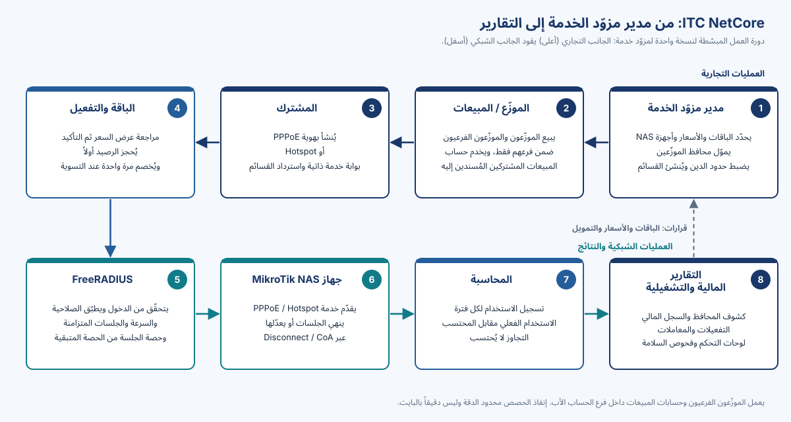

# ITC NetCore V1.0 في لمحة

**ITC NetCore**، من تطوير وصيانة ITC، تدير الجانب التجاري لمزوّد خدمة الإنترنت (الموزّعون، والمحافظ المسبقة الدفع، والباقات، والمشتركون، والقسائم، والتقارير) وتطبّق كل عملية بيع على الشبكة عبر FreeRADIUS وأجهزة MikroTik. عربية أولاً مع الإنجليزية؛ للحاسوب والهاتف؛ ونسخة معزولة لكل مزوّد خدمة.

{width=62%}

| المجال | ما يوفّره V1.0 |
|---|---|
| المستخدمون | مدير النظام، والمدير، والموزّعون، والمبيعات؛ ودور التقارير (بلا عرض للبيانات في V1.0) |
| الموزّعون | فروع بأي عمق؛ ولا يرى كل حساب إلا فرعه، ويتحقّق الخادم من ذلك |
| المال | محافظ مسبقة الدفع، وحدود دين، وتحويلات، وسجل مالي للإضافة فقط، وعمولات وتسوية |
| التفعيل | جديد وتجديد وتغيير باقة؛ مراجعة عرض السعر؛ والخصم بعد تغيير الشبكة |
| الشبكة | FreeRADIUS 3.2؛ وخدمتا PPPoE وHotspot على MikroTik؛ وDisconnect / CoA |
| الاستخدام | الفعلي مقابل المحتسب؛ والتجاوز لا يُحتسب؛ **محدود الدقة وليس دقيقاً بالبايت** |
| التقارير | قسائم برموز مُقنّعة؛ وتقارير السجل المالي والتفعيلات والمعاملات |
| الثقة | ضوابط موثّقة وأدلة للنسخ والاستعادة؛ بلا ادّعاء شهادة أو اتفاقية خدمة أو إتاحة عالية |

> [!WARNING]
> **V1.0 إصدار مرشّح، لم يُقبل بعد للإنتاج.** اجتاز اختبارات المختبر مع قيود؛ ولم يُجرَ اختبار البيئة المستهدفة بعد؛ والمراجعة القانونية LIC-1 مفتوحة لدى المستشار القانوني. التثبيت الأول: تثبيت جديد بقاعدة بيانات فارغة.

تُحدَّد شروط الدعم في اتفاقية كل عميل. مبنية على PHPNuxBill من Ibnu Maksum (iBNuX) والمساهمين في PHPNuxBill.
