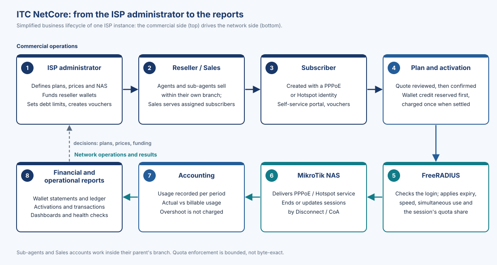

# ITC NetCore V1.0 at a glance

**ITC NetCore**, developed and maintained by ITC, runs the business side of an ISP (resellers, prepaid wallets, plans, subscribers, vouchers, reports) and applies every sale to the network through FreeRADIUS and MikroTik routers. Arabic-first with English; desktop and phone; one isolated instance per ISP.

{width=62%}

| Area | What V1.0 provides |
|---|---|
| Users | SuperAdmin, Admin, Agents and sub-agents, Sales; Report role (no data views in V1.0) |
| Resellers | Branches to any depth; each account sees only its own branch, checked by the server |
| Money | Prepaid wallets, debt limits, transfers, insert-only ledger, commissions, settlement |
| Activation | New, renew, change plan; quote reviewed; charged after the network change |
| Network | FreeRADIUS 3.2; MikroTik PPPoE and Hotspot; Disconnect / CoA |
| Usage | Actual vs billable usage; overshoot not charged; **bounded, not byte-exact** |
| Reports | Vouchers with masked codes; ledger, activation and transaction reports |
| Trust | Documented controls and backup / recovery runbooks; no certification, SLA or HA claim |

> [!WARNING]
> **V1.0 Release Candidate, not production-accepted.** Lab testing passed with limitations; target-environment testing not yet run; legal review LIC-1 `BLOCKED — COUNSEL REQUIRED`. First installation: fresh install on an empty database.

Support terms are defined per customer agreement. Developed and maintained by ITC – Integrated Technology Company (www.itc-iq.net).
