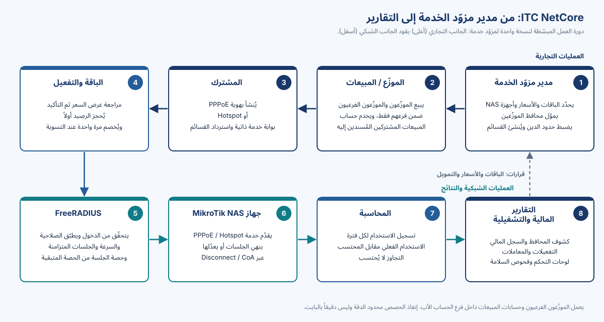

# حول هذا الملف التعريفي

يشرح هذا الملف منصة **ITC NetCore V1.0** لمالكي ومديري شركات مزوّدي خدمة الإنترنت. ويبيّن ما تفعله المنصة، ومن يعمل عليها، وما المشكلات اليومية التي تعالجها، وكيف تربط الجانب التجاري لمزوّد الخدمة بشبكته. وقد كُتب لقرّاء ليسوا مبرمجين، ويُشرح كل مصطلح تقني عند أول ظهور له.

> [!WARNING]
> إن ITC NetCore V1.0 **إصدار مرشّح** (Release Candidate). اجتاز الاختبارات في مختبر معزول فقط، **ولم يُختبر** بعدُ في البيئة المستهدفة لدى العميل، وحالة المراجعة القانونية (LIC-1) هي `BLOCKED — COUNSEL REQUIRED`، **ولم يُقبل بعدُ للاستخدام الإنتاجي**. ويوضّح القسم 10 ما يلزم قبل التشغيل الإنتاجي.

كل ما يرد في هذا الملف مأخوذ من وثائق المنتج نفسه ومن تقرير الإصدار النهائي لـ V1.0 بتاريخ 2026-10-29. وحيثما كانت لقدرةٍ ما حدود، ذُكرت هذه الحدود.

# ما هي ITC NetCore

ITC NetCore **منصة إدارة وفوترة مزوّدي خدمة الإنترنت**، من تطوير وصيانة ITC. وهي النظام الذي يستخدمه مزوّد الخدمة من أجل:

- إدارة **المشتركين** و**باقات الإنترنت** التي يشترونها؛
- تشغيل شبكة من **الموزّعين** (موزّعون وموزّعون فرعيون وموظفو مبيعات) يبيعون هذه الباقات من **محافظ مسبقة الدفع**؛
- تسجيل كل حركة مالية في **سجل مالي** لا يمكن تعديله خفيةً؛
- **تفعيل** خدمة المشترك أو **تجديدها** أو **تغيير باقتها** على أجهزة MikroTik لدى المزوّد، تلقائياً ومع سجل تدقيق كامل؛
- قياس **استخدام البيانات والوقت** مقارنةً بحصة كل باقة؛
- إصدار **القسائم** وإنتاج **التقارير المالية والتشغيلية**.

تعمل المنصة **بالعربية والإنجليزية**، والعربية هي اللغة الأولى (من اليمين إلى اليسار)، وعلى **الحاسوب والجهاز اللوحي والهاتف**. ويمكن للموظفين تثبيتها على الهاتف أو الحاسوب كتطبيق.

يحصل كل مزوّد خدمة على **نسخة معزولة خاصة به** من المنصة، بقاعدة بيانات خاصة وأسرار شبكة خاصة. ولا يتشارك مزوّدان قاعدة بيانات واحدة.

> [!NOTE]
> إن ITC NetCore نسخة معدّلة من المشروع مفتوح المصدر PHPNuxBill (من iBNuX والمساهمين فيه). ويرد الإسناد في نهاية هذا الملف.

# من يستخدم المنصة

| المستخدم | ما يفعله في ITC NetCore |
|---|---|
| **مدير النظام** (SuperAdmin، مالك المزوّد أو كبير المسؤولين) | كل ما يفعله المدير، إضافةً إلى إعدادات النظام وتنزيل النسخة الاحتياطية من الويب. أما الاستعادة فيجريها المشغّل على مستوى قاعدة البيانات (`install/backup/nuxr-restore.sh`)، إذ تُرفض الاستعادة من الويب في تثبيتات الموزّعين |
| **المدير** (Admin، من موظفي المزوّد) | يدير المشتركين والباقات والأسعار والقسائم وشبكة الموزّعين ومحافظهم (التمويل، والسحب، وحدود الدين، والتصحيحات)؛ ويعكس التفعيلات عند الحاجة؛ ويطّلع على جميع التقارير |
| **الموزّع** (Agent) | يبيع لمشتركيه من محفظته المسبقة الدفع؛ ويحوّل الرصيد إلى الموزّعين الفرعيين التابعين له مباشرة؛ ويحدّد أسعار الجملة لهم وسعر البيع الخاص به؛ ولا يرى إلا فرعه |
| **الموزّع الفرعي** | موزّع موضوع تحت موزّع آخر. يعمل بالطريقة نفسها داخل فرعه الأصغر، ويموّله الحساب الأب |
| **حساب المبيعات** (Sales) | يخدم المشتركين المُسندين إليه فقط؛ وتُخصم كلفة تفعيلاته من محفظة الموزّع الذي يتبع له |
| **حساب التقارير** (Report) | في V1.0 يستطيع هذا الدور تسجيل الدخول وإدارة ملفه الشخصي فقط. **ولا يملك أي عرض للبيانات في هذا الإصدار** |
| **المشترك** | يستخدم بوابة الخدمة الذاتية ويسترد القسائم |

يرى كل حساب **الجزء الخاص به فقط** من العمل ويتصرّف فيه وحده. ويتحقّق الخادم من ذلك في كل طلب، ولا يقتصر الأمر على إخفاء عناصر القوائم.

<!-- pagebreak -->

# المشكلات التي تعالجها

| مشكلة يومية لدى مزوّد الخدمة | كيف تعالجها ITC NetCore |
|---|---|
| الموزّعون يبيعون بالدَّين والأرصدة محلّ خلاف | محافظ مسبقة الدفع للموزّعين مع حدود دين اختيارية؛ وتُسجَّل كل حركة مع الرصيد قبلها وبعدها |
| يمكن تعديل السجلات المالية بعد وقوعها | لا يقبل السجل المالي إلا قيوداً جديدة؛ ويُصحَّح الخطأ بقيد معاكس جديد ظاهر |
| يُخصم من الموزّع ولا يحصل المشترك على الخدمة، أو العكس | كل تفعيل يحجز الرصيد أولاً، ثم يطبّق التغيير على الشبكة، ثم يتحقّق منه، وبعدها فقط يخصم الكلفة، وكل ذلك على خط زمني مسجَّل. والحالات غير المؤكّدة تُحتجز لمشغّل بدلاً من تخمين نتيجتها |
| يطّلع الموظفون على بيانات عملاء أكثر مما ينبغي | تحقّق في الخادم يقصر كل حساب على فرعه أو على المشتركين المُسندين إليه |
| إعدادات الشبكة تبتعد عمّا بيع للمشترك | تُطبَّق الباقات على أجهزة التوجيه عبر FreeRADIUS؛ والتجديد وتغيير الباقة يحدّثان الجلسة القائمة أو ينهيانها |
| يُحاسَب العملاء على استخدام لا يرونه | تحتفظ المنصة بالاستخدام **الفعلي** والاستخدام **المحتسب** رقمين منفصلين (القسم 6) |
| موظفون ناطقون بالعربية يعملون على أداة إنجليزية فقط | واجهة عربية أولاً مع الإنجليزية، على الحاسوب والهاتف |

# كيف يرتبط الجانب التجاري بالشبكة

يبيّن المخطط المسار من مدير مزوّد الخدمة إلى التقارير. الصف العلوي هو **الجانب التجاري**، والصف السفلي هو **الجانب الشبكي** ونتائجه.

{width=100%}

1. **مدير مزوّد الخدمة** يُعدّ الباقات والأسعار، ويسجّل أجهزة التوجيه، ويموّل محافظ الموزّعين.
2. **الموزّعون وحسابات المبيعات** يبيعون الباقات داخل فرعهم من شبكة الموزّعين.
3. **المشترك** يُنشأ بهوية PPPoE (اسم مستخدم وكلمة مرور لخط ثابت أو لاسلكي) أو بهوية Hotspot (صفحة دخول، كما في شبكات Wi-Fi العامة).
4. **التفعيل:** يختار البائع الباقة ويرى عرض سعر يحسبه الخادم: الفترة، وكلفة الجملة، وسعر البيع، ورصيد المحفظة قبل العملية وبعدها. وبعد التأكيد يُحجز الرصيد، ويُطبَّق التغيير على الشبكة، وتُخصم الكلفة عند تأكيد التغيير.
5. **FreeRADIUS** (خادم المصادقة) يتحقّق من كل دخول ويمنح الجلسة قواعدها: تاريخ الانتهاء، والسرعة، وعدد الجلسات المتزامنة، وحصتها من الحصة المتبقية.
6. **جهاز MikroTik** (ويُسمّى NAS، أي خادم الوصول إلى الشبكة) يقدّم خدمة PPPoE أو Hotspot. وعند تجديد الباقة أو تغييرها أو نفاد الحصة، تطلب ITC NetCore من الجهاز تحديث الجلسة أو إنهاءها.
7. **المحاسبة:** يُبلغ الجهاز عن الاستخدام، فتسجّله ITC NetCore لكل فترة فوترة.
8. **التقارير:** كشوف المحافظ والسجل المالي، وسجل التفعيلات والمعاملات، ولوحات التحكم وفحوص السلامة. ويعتمد عليها المدير في قراراته بشأن الباقات والأسعار والتمويل، فتتكرّر الدورة.

<!-- pagebreak -->

# الاستخدام الفعلي والاستخدام المحتسب بوضوح

تحتفظ ITC NetCore لكل فترة فوترة **برقمين**:

| الرقم | معناه |
|---|---|
| **الاستخدام الفعلي** | ما سجّلته الشبكة فعلاً (التنزيل والرفع معاً، أو وقت الاتصال) |
| **الاستخدام المحتسب** | الاستخدام الفعلي بحدّ أقصى يساوي حصة الباقة |

إذا تجاوز المشترك الحصة، يُعرض المقدار الزائد (**التجاوز**) للعلم فقط؛ فهو **لا يُحتسب** و**لا يُرحَّل** إلى الفترة التالية.

**مثال.** باقة تتضمن 50 GB. سجّلت الشبكة خلال الفترة 50.8 GB. الاستخدام المحتسب 50 GB، والتجاوز 0.8 GB يُعرض ولا يُحتسب.

**لماذا قد يحدث التجاوز.** تُبلغ أجهزة التوجيه عن الاستخدام على فترات (كل 30 ثانية افتراضياً)، ويفحص منفّذ الحصص في ITC NetCore كل بضع ثوانٍ. وبين بلاغين يمكن لاتصال سريع أن يمرّر بعض البيانات. وعند دخول المشترك تحصل الجلسة على حصتها من الحصة المتبقية: جلسات Hotspot مقيّدة بحدّ صارم لكل جلسة (وفي المختبر كان التجاوز بين 0.3 و4.4 % فوق تلك الحصة)، وجلسات PPPoE مقيّدة في كل اتجاه بينما يُغلق المنفّذ المجموع الكلي. وإذا توقّف المنفّذ أو خادم RADIUS أو قاعدة البيانات أو الاتصال بالجهاز، تُطبَّق حدود الجهاز وحدها؛ وأسوأ حالة في PPPoE هي ضعف الحصة المتبقية.

> [!WARNING]
> إنفاذ الحصص **محدود الدقة وليس دقيقاً بالبايت**. ولا يجوز بيع ITC NetCore أو الإعلان عنها على أنها توفّر حدّاً للبيانات دقيقاً بالبايت.

تُضبط الحصص بالميغابايت أو الغيغابايت الكاملة (بالنظام العشري: 1 GB = 1,000,000,000 بايت) أو بالدقائق أو الساعات الكاملة. والتجديد أو تغيير الباقة أو إعادة التفعيل يبدأ فترة جديدة من الصفر.

# المكوّنات الرئيسية

| المكوّن | دوره بلغة بسيطة |
|---|---|
| **تطبيق ITC NetCore** | نظام الويب الذي يستخدمه الموظفون والموزّعون: المشتركون، والباقات، والمحافظ، والتفعيل، والقسائم، والتقارير |
| **قاعدة البيانات** (MariaDB 10.11 أو MySQL 8.0) | تحفظ السجلات التجارية وسياسة الشبكة التي يقرؤها FreeRADIUS |
| **FreeRADIUS 3.2** | خادم المصادقة بين أجهزة التوجيه وقاعدة البيانات؛ يوافق على الدخول ويسجّل الاستخدام |
| **MikroTik RouterOS** | أجهزة التوجيه لدى المزوّد التي تقدّم خدمتي PPPoE وHotspot للمشتركين |
| **واجهة HTTPS** | نقطة الدخول الآمنة للمتصفحات ولتطبيق الموظفين |
| **المهام المجدولة** | معالجة انتهاء الاشتراكات، ومنفّذ الحصص، وفحوص السلامة، وتعمل تلقائياً |

"){width=100%}

<!-- pagebreak -->

# المنصة على الشاشة

جميع لقطات الشاشة مأخوذة من مختبر الاختبار المعزول وتعرض **بيانات اختبار اصطناعية**. والبيانات الشخصية مُقنّعة.

"){width=100%}

"){width=100%}

<!-- pagebreak -->

"){width=88%}

"){width=88%}

<!-- pagebreak -->

وعلى الهاتف، يتكيّف النظام نفسه مع تخطيط مضغوط وشريط تنقّل سفلي.

"){width=26%}

"){width=26%}

"){width=26%}

<!-- pagebreak -->

# الثقة والأمان والاستعادة

يسرد هذا القسم **قدرات موثّقة**. وهو ليس شهادة اعتماد ولا التزاماً بمستوى خدمة.

| المجال | ما يوفّره V1.0 |
|---|---|
| التحكم في الوصول | التحقّق من الصلاحيات ونطاق البيانات في الخادم عند كل طلب؛ ودور التقارير بلا وصول إلى البيانات |
| سلامة البيانات المالية | سجل مالي يقبل الإضافة فقط؛ وشاشات مراجعة قبل التمويل والتحويل؛ ورصيد محجوز لا يُحرَّر تلقائياً أبداً عندما تكون النتيجة غير مؤكّدة؛ وفحوص اتساق مالي |
| سجل التدقيق | خط زمني مسجَّل لكل تفعيل؛ وخطوات استعادة مُدقّقة للمشغّل؛ وتدقيق انتحال المدير لحساب العميل |
| أمان قاعدة البيانات | حسابات منفصلة بأقل الصلاحيات للتطبيق ولـ FreeRADIUS؛ ولا يملك التطبيق صلاحية الحذف على الجداول المالية |
| أمان الويب | HTTPS فقط؛ وحجب المسارات الحساسة عن الويب؛ وإزالة برنامج التثبيت بعد التثبيت؛ وحفظ الأسرار بصلاحيات ملفات مقيّدة |
| أمان الشبكة | سرّ مستقل لكل جهاز توجيه؛ واشتراط مصادقة رسائل RADIUS؛ وإبقاء منافذ الإدارة الخاصة بالواجهة البرمجية القديمة مغلقة |
| النسخ الاحتياطي والاستعادة | دليل تشغيل للنسخ الاحتياطي والاستعادة مع تمارين؛ وأدوات للنسخ الاحتياطي والاستعادة إلى نقطة زمنية والتحقّق من الاستعادة؛ ودليل استعادة للمشغّل؛ وفحوص السلامة والفحص المسبق للإصدار |

ما **لا** نزعمه:

- لا شهادة أمان ولا شهادة تدقيق ولا شهادة امتثال؛
- لا نسبة تشغيل ولا اتفاقية مستوى خدمة؛ ولا يوفّر V1.0 **إتاحة عالية** لقاعدة البيانات أو لخادم RADIUS؛
- قيم زمن الاستعادة ونقطة الاستعادة (4 ساعات / 15 دقيقة) **أهداف تصميم هندسية مؤقتة**، وليست مستويات خدمة معتمدة من المالك؛
- لا تقييد مدمجاً لمحاولات تسجيل الدخول: يُضبط تحديد معدّل الدخول في واجهة HTTPS؛
- لا تصريح قانوني: مسائل الترخيص والتسمية لدى المستشار القانوني (LIC-1).

# حالة الإصدار

| البند | الحالة |
|---|---|
| الإصدار | **V1.0 إصدار مرشّح** (Release Candidate) |
| اختبارات المختبر | ناجحة مع قيود (`LAB_ACCEPTED_WITH_LIMITATIONS`): 1680 من 1680 اختباراً آلياً على كل محرّك قاعدة بيانات، واختبارات على جهاز MikroTik افتراضي، وفحص 208 صفحات من الواجهة باللغتين |
| الاختبار في البيئة المستهدفة لدى العميل | **لم يُجرَ بعد**؛ ويتطلب بيئة staging مصرّحاً بها وأجهزة توجيه غير إنتاجية |
| المراجعة القانونية (LIC-1) | **`BLOCKED — COUNSEL REQUIRED`** |
| قرارات المالك الخاصة بالإصدار | مفتوحة |
| الاستخدام الإنتاجي | **لم يُقبل بعد** |

لا تُثبت نتائج المختبر القدرة الاستيعابية على عتاد العميل؛ إذ تُقاس أحجام التشغيل الإنتاجي أثناء الاختبار في البيئة المستهدفة. والتثبيت الأول لكل مزوّد خدمة **تثبيت جديد بقاعدة بيانات فارغة**؛ أما نقل البيانات من نظام PHPNuxBill قائم فمسار مستقبلي مستقل.

# ما يحتاجه مزوّد الخدمة لتشغيلها

- خوادم للتطبيق وقاعدة البيانات وFreeRADIUS (يمكن أن يتشارك التطبيق وFreeRADIUS خادماً واحداً)؛ ونظام Linux، وPHP 8.2، وMariaDB 10.11 أو MySQL 8.0، وFreeRADIUS 3.2.
- أجهزة MikroTik تعمل بنظام RouterOS 7.15 أو أحدث.
- توقيت دقيق على كل خادم وجهاز توجيه (NTP).
- عنوان HTTPS بشهادة صالحة، ومساحة تخزين للنسخ الاحتياطية المشفّرة.
- مشغّل مسمّى للفحوص اليومية والنسخ الاحتياطي وخطوات الاستعادة.

# الدعم والإسناد

تُحدَّد شروط الدعم في اتفاقية كل عميل.

تطوير وصيانة ITC. والمنصة ITC NetCore نسخة معدّلة من **PHPNuxBill** (<https://github.com/hotspotbilling/phpnuxbill>) التي أنشأها Ibnu Maksum (iBNuX) مع المساهمين في PHPNuxBill، وتُحفظ إشعارات حقوقهم. وتستخدم الواجهة AdminLTE وBootstrap، وجميع مكوّنات الأطراف الثالثة وتراخيصها مدرجة في الملف `docs/THIRD_PARTY_LICENSES.md` من المنتج. ونص الترخيص هو رخصة GNU العمومية الإصدار 2 كما في الملف `LICENSE`؛ ومسائل الترخيص المفتوحة لدى المستشار القانوني ولا يحسمها هذا الملف. و"ITC NetCore" و"ITC" اسما المنتج والعلامة؛ ولا يُذكر هنا أي تسجيل أو تصريح لعلامة تجارية.
