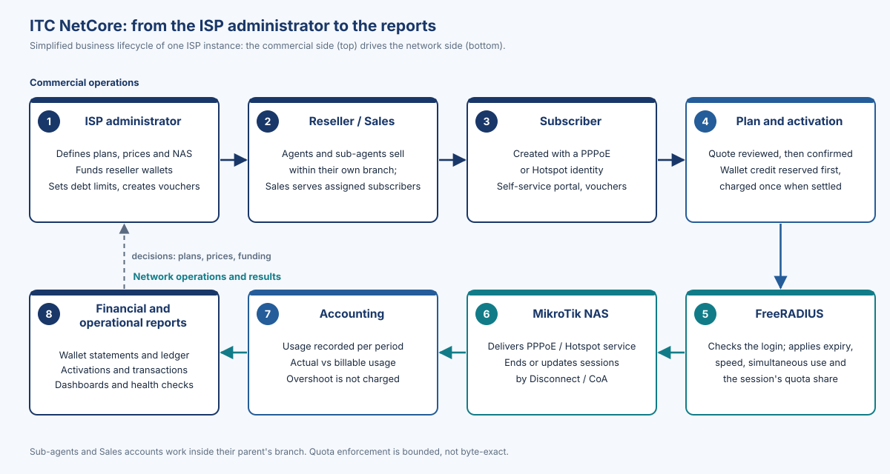

# About this profile

This profile explains **ITC NetCore V1.0** for the owners and managers of internet service providers (ISPs). It describes what the platform does, who works with it, which everyday problems it addresses and how it links the commercial side of an ISP to its network. It is written for readers who are not programmers; technical terms are explained where they first appear.

> [!WARNING]
> ITC NetCore V1.0 is a **Release Candidate**. It has passed testing in an isolated laboratory only. It has **not** been tested on a customer's target environment, the legal review (LIC-1) is still open with counsel, and it is **not yet accepted for production use**. Section 10 explains what remains before a production launch.

Every statement in this profile is taken from the product's own documentation and from the V1.0 final release report of 2026-10-29. Where a capability has limits, the limits are stated.

# What ITC NetCore is

ITC NetCore is an **ISP Management & Billing Platform**, developed and maintained by ITC. It is the system an ISP uses to:

- manage its **subscribers** and the **internet plans** they buy;
- run a network of **resellers** (agents, sub-agents and sales staff) who sell those plans from **prepaid wallets**;
- record every money movement in a **ledger** that cannot be silently changed;
- switch subscribers' service **on, renew it or change it** on the ISP's MikroTik routers, automatically and with a full audit trail;
- measure **data and time usage** against each plan's quota;
- issue **vouchers** and produce **financial and operational reports**.

It works in **Arabic and English**, with Arabic as the first language (right-to-left), and on **desktop, tablet and phone**. Staff can install it on a phone or computer like an app.

Each ISP receives **its own isolated copy** of the platform, with its own database and its own network secrets. No ISP shares a database with another.

> [!NOTE]
> ITC NetCore is a modified version of the open-source project PHPNuxBill (iBNuX and its contributors). Credits are listed at the end of this profile.

# Who uses it

| User | What they do in ITC NetCore |
|---|---|
| **SuperAdmin** (ISP owner or chief administrator) | Everything an Admin does, plus system-level settings and the web backup download. Restore is done at database level by the operator (`install/backup/nuxr-restore.sh`); the web restore is refused on reseller installations |
| **Admin** (ISP staff) | Manages subscribers, plans, prices, vouchers, the reseller network and reseller wallets (funding, withdrawals, debt limits, corrections); reverses activations when needed; reads all reports |
| **Agent** (reseller) | Sells to its own subscribers from its own prepaid wallet; transfers credit to the sub-agents directly below it; sets their wholesale prices and its own retail price; sees only its own branch |
| **Sub-agent** | An agent placed under another agent. Works the same way inside its own, smaller branch and is funded by its parent |
| **Sales** account | Serves only the subscribers assigned to it; the cost of its activations is charged to the wallet of the agent it belongs to |
| **Report** account | In V1.0 this role can sign in and manage its own profile only. **It has no data views in this version** |
| **Subscriber** | Uses the self-service portal and redeems vouchers |

Every account sees and acts **only on its own part** of the business. This is checked by the server on every request, not just hidden in the menus.

<!-- pagebreak -->

# Problems it addresses

| Everyday problem at an ISP | How ITC NetCore addresses it |
|---|---|
| Resellers sell on credit and balances are disputed | Prepaid reseller wallets with optional debt limits; every movement is recorded with the balance before and after |
| Money records can be edited after the fact | The ledger only accepts new entries; a mistake is corrected by a new, visible compensating entry |
| A reseller is charged but the subscriber never gets service, or the other way round | Each activation reserves the credit first, applies the change to the network, checks it, and only then charges, all on a recorded timeline. Uncertain cases are held for an operator instead of being guessed |
| Staff see more customer data than they should | Server-side checks limit each account to its own branch or its assigned subscribers |
| Network settings drift from what was sold | Plans are applied to the routers through FreeRADIUS; renewals and plan changes update or end the live session |
| Customers are billed for usage they cannot see | The platform keeps **actual** usage and **billable** usage as separate numbers (section 6) |
| Arabic-speaking staff work in an English-only tool | Arabic-first interface with English, on desktop and phone |

# How the business side connects to the network

The diagram shows the path from the ISP administrator to the reports. The top row is the **commercial side**; the bottom row is the **network side** and its results.

{width=100%}

1. **The ISP administrator** sets up plans and prices, registers the routers, and funds the resellers' wallets.
2. **Resellers and Sales accounts** sell plans within their own branch of the reseller network.
3. **A subscriber** is created with a PPPoE identity (a username and password for a fixed or wireless line) or a Hotspot identity (a login page, typical for public Wi-Fi).
4. **Activation:** the seller chooses a plan and sees a quote calculated by the server: the period, the wholesale cost, the retail price and the wallet balance before and after. After confirmation, the credit is reserved, the change is applied to the network, and the cost is charged once the change is confirmed.
5. **FreeRADIUS** (the authentication server) checks each login and gives the session its rules: expiry date, speed, the number of simultaneous sessions and its share of the remaining quota.
6. **The MikroTik router** (the "NAS", network access server) delivers the PPPoE or Hotspot service. When a plan is renewed or changed, or a quota runs out, ITC NetCore tells the router to update or end the session.
7. **Accounting:** the router reports usage, which ITC NetCore records for each billing period.
8. **Reports:** wallet statements and the ledger, activation and transaction history, dashboards and health checks. The administrator uses them to decide on plans, prices and funding, and the cycle repeats.

<!-- pagebreak -->

# Actual usage and billable usage, honestly explained

For every billing period ITC NetCore keeps **two numbers**:

| Number | Meaning |
|---|---|
| **Actual usage** | What the network really recorded (download plus upload, or connected time) |
| **Billable usage** | Actual usage, capped at the plan's quota |

If a subscriber goes past the quota, the extra amount (the **overshoot**) is shown for information only. It is **not charged** and **not carried** into the next period.

**Example.** A plan includes 50 GB. During the period the network records 50.8 GB. The billable usage is 50 GB; the overshoot of 0.8 GB is shown but not charged.

**Why an overshoot can happen.** Routers report usage at intervals (every 30 seconds by default), and ITC NetCore's quota enforcer checks every few seconds. Between two reports a fast connection can still pass some data. When a subscriber logs in, the session receives its share of the remaining quota: Hotspot sessions are hard-capped per session (in the lab, the overshoot was 0.3 to 4.4 % past that share), and PPPoE sessions are limited in each direction while the enforcer closes the combined total. If the enforcer, the RADIUS server, the database or the router link is down, only the router's own limits apply; for PPPoE the worst case is twice the remaining quota.

> [!WARNING]
> Quota enforcement is **bounded, not byte-exact**. ITC NetCore must not be sold or advertised as providing a byte-exact data cap.

Quotas are set in whole megabytes or gigabytes (decimal: 1 GB = 1,000,000,000 bytes) or in whole minutes or hours. A renewal, plan change or reactivation starts a new period from zero.

# Main components

| Component | Role in plain words |
|---|---|
| **ITC NetCore application** | The web system staff and resellers use: subscribers, plans, wallets, activation, vouchers, reports |
| **Database** (MariaDB 10.11 or MySQL 8.0) | Stores the business records and the network policy that FreeRADIUS reads |
| **FreeRADIUS 3.2** | The authentication server between the routers and the database; it approves logins and records usage |
| **MikroTik RouterOS** | The ISP's routers that deliver PPPoE and Hotspot service to subscribers |
| **HTTPS web front** | The secure entry point for browsers and the staff app |
| **Scheduled jobs** | Expiry processing, the quota enforcer and health checks, run automatically |

"){width=100%}

<!-- pagebreak -->

# The platform on screen

All screenshots come from the isolated test laboratory and show **synthetic test data**. Personal details are masked.

"){width=100%}

"){width=100%}

<!-- pagebreak -->

"){width=88%}

"){width=88%}

<!-- pagebreak -->

On a phone, the same system adapts to a compact layout with a bottom navigation bar.

"){width=26%}

 dashboard (phone)"){width=26%}

"){width=26%}

<!-- pagebreak -->

# Trust, security and recovery

This section lists **documented capabilities**. It is not a certification and not a service-level commitment.

| Area | What V1.0 provides |
|---|---|
| Access control | Permissions and data scope checked on the server for every request; the Report role has no data access |
| Financial integrity | Insert-only ledger; review screens before funding and transfers; reserved credit that is never released automatically when an outcome is uncertain; finance consistency checks |
| Audit trail | A recorded timeline for every activation; audited operator recovery steps; audited customer impersonation by Admins |
| Database safety | Separate least-privilege database accounts for the application and for FreeRADIUS; no deletion rights on finance tables for the application |
| Web security | HTTPS only; sensitive paths blocked from the web; installer removed after installation; secrets stored with restricted file permissions |
| Network security | Per-router secrets; RADIUS message authentication required; router management ports for the legacy API kept closed |
| Backup and recovery | Backup and restore runbook with drills; backup, point-in-time recovery and restore-verification tooling; operator recovery runbook; health checks and release preflight |

What is **not** claimed:

- no security certification, audit attestation or compliance certificate;
- no uptime figure or service-level agreement; V1.0 has **no high availability** for the database or RADIUS server;
- recovery-time and recovery-point figures (4 hours / 15 minutes) are **provisional engineering design targets**, not owner-approved service levels;
- no built-in login throttling: rate-limiting of sign-in is configured at the HTTPS front;
- no legal clearance: the licence and naming questions are with counsel (LIC-1).

# Release status

| Item | Status |
|---|---|
| Version | **V1.0 Release Candidate** |
| Laboratory testing | Passed with limitations (`LAB_ACCEPTED_WITH_LIMITATIONS`): 1680 of 1680 automated tests on each database engine, real-router tests on a virtual MikroTik router, 208 interface pages checked in both languages |
| Testing on a customer target environment | **Not yet run**; it needs an authorized staging environment with non-production routers |
| Legal review (LIC-1) | **Open, counsel required** |
| Owner release decisions | Open |
| Production use | **Not yet accepted** |

The laboratory results do not prove capacity on a customer's hardware; production sizing is measured during target testing. The first installation for an ISP is a **fresh installation with an empty database**; moving data from an existing PHPNuxBill system is a separate, future path.

# What an ISP needs to run it

- Servers for the application, the database and FreeRADIUS (the application and FreeRADIUS may share one server); Linux, PHP 8.2, MariaDB 10.11 or MySQL 8.0, FreeRADIUS 3.2.
- MikroTik routers running RouterOS 7.15 or later.
- Accurate time on every server and router (NTP).
- An HTTPS address with a valid certificate, and storage for encrypted backups.
- A named operator for daily checks, backups and recovery steps.

# Support and credits

Support terms are defined per customer agreement.

ITC NetCore is developed and maintained by ITC. It is a modified version of **PHPNuxBill** (<https://github.com/hotspotbilling/phpnuxbill>), created by Ibnu Maksum (iBNuX) together with the PHPNuxBill contributors; their copyright notices are kept. The interface uses AdminLTE and Bootstrap; all third-party components and their licences are listed in the product's `docs/THIRD_PARTY_LICENSES.md`. The licence text is the GNU General Public License version 2 as shipped in `LICENSE`; open licence questions are with counsel and are not decided by this profile. "ITC NetCore" and "ITC" are the product and brand names; no trademark registration or clearance is stated.
