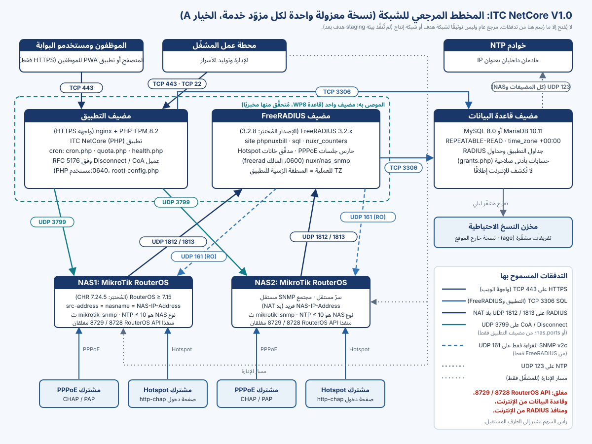

# حول هذا الدليل

يشرح هذا الدليل ربط أجهزة MikroTik RouterOS بوصفها NAS بنسخة من ITC NetCore V1.0 عبر FreeRADIUS، ملتزمًا بمعمارية الإصدار كما يشحنها المنتج تمامًا. ويتناول متطلبات RouterOS، وPPPoE وHotspot، وتسجيل أجهزة NAS، والأسرار، والمحاسبة، وDisconnect / CoA، والجدار الناري، وسياسة قبول الجلسات، وحصص البيانات والوقت، وتثبيت FreeRADIUS وفحوص جاهزيته، والسجلات، والاستعادة.

> [!WARNING]
> ‏ITC NetCore V1.0 **إصدار مرشَّح (Release Candidate)** بحالة `RELEASE_BLOCKED_WITH_EVIDENCE`. سلوك RADIUS وNAS الموصوف هنا قيس في مختبر معزول يضم **MikroTik CHR RouterOS 7.24.5** وFreeRADIUS 3.2.8 (إضافة إلى مضيف مخبري يعمل بـFreeRADIUS 3.2.5 أصليًا). و**لم** يُتحقَّق منه على طراز NAS لديك ولا على إصدار RouterOS لديك ولا على خوادمك: فتلك مهمة اختبارات القبول في بيئة الهدف TA-01 … TA-10، وكلها `NOT_RUN`. ولا تُجرِ أي اختبار أبدًا على موجّه يحمل حركة عملاء.

الوثائق المعتمدة للمنتج هي `install/freeradius/README.md` و`docs/NAS_ONBOARDING_AND_SECRET_ROTATION.md` و`docs/PRODUCTION_CONFIGURATION_CHECKLIST.md` (الأقسام G وH وI وJ) و`docs/TIME_CONTRACT.md` و`docs/WP8_INTEGRATION_MODEL.md`. وإذا اختلفت عن هذا الدليل فهي المرجع، ويسرد الملف `TECH_DOCS_SOURCES.md` مصدر كل قسم والتناقضات التي حُسمت.

## وسوم أمثلة الإعداد

يحمل كل مثال إعداد وسمًا واحدًا بالضبط:

| الوسم | المعنى |
|---|---|
| **قالب عام** | مبني من وثائق المنتج، بقيم بديلة فقط، ولم يُنفَّذ بصورته المعروضة |
| **مُتحقَّق منه مخبريًا (مختبر CHR 7.24.5)** | نُفِّذ في المختبر المعزول (CHR RouterOS 7.24.5، ومضيف FreeRADIUS 3.2.5 أصلي أو صورة الاختبار 3.2.8)، واستُبدلت عناوين المختبر بقيم بديلة |
| **مُتحقَّق منه في staging الهدف** | نُفِّذ على بيئة staging الهدف التي اعتمدها المالك. **لا يوجد بعد** |
| **منشور في الإنتاج** | يعمل في الإنتاج. **لا يوجد بعد** |

تُكتب القيم البديلة بالشكل `<LIKE_THIS>`، ولا يحوي أي مثال سرًّا أو مجتمع SNMP أو عنوانًا حقيقيًا. والرمز `${confdir}` يعني `/etc/freeradius/3.0` في حزم Ubuntu وDebian، و`/etc/freeradius` في صورة FreeRADIUS الرسمية.

> [!NOTE]
> احتفظت الأسماء الداخلية بأصلها من PHPNuxBill: فموقع FreeRADIUS وقاموسه باسم `phpnuxbill`، وسمات السياسة باسم `Nuxr-*`، والجداول باسم `radcheck` و`radacct` و`nas` و`nuxr_admission` … فلا تغيّرها.

<!-- pagebreak -->

# المعمارية ومخطط الشبكة

تتكون نسخة المزوّد الواحدة من مضيف التطبيق، ومضيف FreeRADIUS، ومضيف قاعدة البيانات، وأجهزة NAS الخاصة بالمزوّد. والجدول `nas` في قاعدة RADIUS هو **المصدر الوحيد لأجهزة NAS**: منه يحمّل FreeRADIUS عملاء RADIUS، وإليه يرجع التطبيق لتحديد وجهة Disconnect / CoA.

{width=100%}

| المكوّن | دوره في مسار RADIUS |
|---|---|
| التطبيق (PHP) | يكتب سياسة المشترك (`radcheck` و`radreply` و`radusergroup` و`radgroupreply`)، ويقرأ `radacct`، ويرسل بنفسه طلبات Disconnect / CoA وفق RFC 5176 (بلا `radclient` وبلا صدفة)، ويشغّل منفّذ الحصص |
| ‏FreeRADIUS 3.2.x | يصادق (PAP وCHAP)، ويطبّق عدّادات الفترة وحصص الجلسات، ويشغّل حارس جلسات PPPoE ومدقّق خانات Hotspot، ويدير جداول القبول، ويكتب `radacct` |
| قاعدة البيانات | تحوي جداول التطبيق وجداول RADIUS (قاعدة واحدة في الترتيب الموثَّق) |
| ‏NAS ‏(RouterOS) | خادم PPPoE و/أو Hotspot، وعميل RADIUS، ويقبل Disconnect / CoA، ويجيب على استعلامات SNMP للقراءة فقط من FreeRADIUS |

**التدفقات المسموح بها** (افتحها ولا شيء غيرها):

| من | إلى | المنفذ | الغرض |
|---|---|---|---|
| كل جهاز NAS | ‏FreeRADIUS | ‏UDP 1812 / 1813 | المصادقة والمحاسبة، **بلا NAT** |
| التطبيق | كل جهاز NAS | ‏UDP 3799 (أو `nas.ports`) | ‏Disconnect / CoA، من عنوان معرَّف خادمَ `/radius` على NAS |
| ‏FreeRADIUS | كل جهاز NAS | ‏UDP 161 | ‏SNMP v2c للقراءة فقط (حارس الجلسات ومدقّق الخانات) |
| التطبيق وFreeRADIUS | قاعدة البيانات | ‏TCP 3306 | ‏SQL |
| كل المضيفات وأجهزة NAS | ‏NTP | ‏UDP 123 | الوقت |
| المشغّل | المضيفات وإدارة NAS | ‏TCP 22 / مسار إدارة خاص | الإدارة |
| — | ‏RouterOS API على NAS ‏8728 / 8729 | — | **مغلق**: لا يستخدمه ملف تعريف الإصدار |

> [!NOTE]
> **قاعدة الجمع على مضيف واحد.** لا يقبل RouterOS طلبات Disconnect / CoA إلا من عنوان أحد مداخل `/radius` لديه، ويتجاهل بصمت أي مصدر آخر. وقاعدة الإنتاج في نموذج التكامل هي تشغيل التطبيق على مضيف FreeRADIUS، بالعنوان الذي يعرفه NAS خادمًا لـRADIUS: بلا SNAT وبلا مدخل `/radius` إضافي. وهذا هو ترتيب المختبر. وتجيز وثائق الربط الأحدث أيضًا مدخل `/radius` ثانيًا لعنوان تطبيق منفصل بالسرّ نفسه، غير أن هذا البديل لم يُنفَّذ في المختبر، فالأفضل الجمع على مضيف واحد.

<!-- pagebreak -->

# متطلبات RouterOS

| المتطلب | القيمة | السبب |
|---|---|---|
| أدنى إصدار RouterOS | **7.15** | الإصدارات الأقدم لا ترسل `Message-Authenticator` في Access-Request، والخادم `phpnuxbill` يُسقط هذه الطلبات دون ردّ (تحصين BlastRADIUS). ولوحظ إسقاط طلبات الإصدار 7.12.1 |
| الإصدار المُختبَر | **7.24.5** ‏(CHR) فقط | نتائج القدرات (حدود PPPoE لكل اتجاه، وتجاهل `Mikrotik-Total-Limit` في PPPoE، وعدم تغيير CoA لحدود البايتات أو الفاصل المرحلي) خاصة بالإصدار والطراز. وأي إصدار أو لوحة مختلفة يجب أن تكرر TA-03 / TA-04 |
| الإصدار الرئيسي لـHotspot | **7** | يرفض مدقّق خانات Hotspot أي إصدار رئيسي آخر إلى أن تُعاد المصادقة على بوابات Hotspot الخاصة بـWP8 |
| الساعة | عميل NTP مع خادمين داخليين بعنوان IP؛ **ضمن 10 ثوانٍ** من التطبيق (حد صارم)، والمعتاد أقل من ثانيتين | قطع الجلسات عند التجديد يسمح بـ10 ثوانٍ، وكثير من أجهزة RouterBOARD بلا ساعة حقيقية فتنحرف 2–9 ثوانٍ يوميًا دون NTP |
| الهوية | عنوان مصدر فريد لكل NAS يساوي `nas.nasname`، **بلا NAT** إلى FreeRADIUS | يحدد FreeRADIUS والتطبيق جهاز الجلسة بالمطابقة `radacct.nasipaddress = nas.nasname` |
| مهلة RADIUS | `timeout=3s` | المهلة الافتراضية في RouterOS ‏(1100 ms) أقصر من مسار الحارس، والمهلة القصيرة تجعل الدخول يفشل فشلًا مغلقًا |
| ‏RouterOS API | غير مستخدم؛ أبقِ خدمتَي `api` و`api-ssl` غير قابلتين للوصول | برامج تشغيل API القديمة معطَّلة في ملف تعريف الإصدار |
| مستوى الترخيص | يجب أن يسمح بخادم PPPoE وجلسات Hotspot التي تحتاجها | لا تذكره وثائق المنتج؛ تحقق منه وفق شروط ترخيص MikroTik |

<!-- pagebreak -->

# تثبيت FreeRADIUS

## الإصدار

‏FreeRADIUS **3.2.x**. إعداد المشروع وسياسة القبول مُختبَران مع **3.2.8** فقط (الصورة الرسمية `freeradius/freeradius-server:3.2.8`) على MariaDB 10.11 وMySQL 8.0. وأي إصدار آخر يجب أن يجتاز بوابة Option G الخاصة بـWP8 من جديد (`tests/Integration/Wp8/OptionGGateTest.php` في شجرة المصدر)، وعلى إصدار هدف غير 3.2.8 تصبح حالات البوابة في حالة staging ‏**X-4** إلزامية.

## الحزم

**الوسم:** مُتحقَّق منه مخبريًا (مختبر CHR 7.24.5) — Ubuntu 24.04، حزمة FreeRADIUS 3.2.5.

```bash
sudo apt-get install -y freeradius freeradius-mysql freeradius-utils
sudo apt-get install -y snmp          # snmpget و snmpbulkwalk لحارس الجلسات
```

منع المختبر بدء الخدمة تلقائيًا أثناء التثبيت، وأبقى FreeRADIUS متوقفًا حتى اكتمل إعداد المشروع.

> [!WARNING]
> احتاج FreeRADIUS 3.2.5 الأصلي في المختبر إلى أربعة انحرافات عن التعليمات المشحونة، سجّلها المختبر: **L1** تثبيت عناوين الاستماع بدل `ipaddr = *`؛ و**L2** نسخة من `checkrad` بلا SNMP (انظر *الأداة checkrad القياسية* أدناه)؛ و**L3** ضبط `TZ` للعملية من المنطقة الزمنية للتطبيق عبر ملف بيئة في systemd؛ و**L4** تفعيل الوحدة القياسية `date` (حزمة Ubuntu لا تفعّلها، ومن دونها يرفض FreeRADIUS البدء برسالة «Unknown module»).

## الإعداد المشحون

تؤخذ كل ملفات المشروع من المجلد `install/freeradius/` في حزمة الإصدار المُتحقَّق منها.

| الملف | يُثبَّت بوصفه | الغرض |
|---|---|---|
| `dictionary.phpnuxbill` | `${confdir}/dictionary.phpnuxbill`، مع السطر `$INCLUDE dictionary.phpnuxbill` في `${confdir}/dictionary` | السمات الداخلية `Nuxr-Period-Start` و`Nuxr-Period-Acct-Id` و`Nuxr-Quota-Share` (لا تُرسل أبدًا إلى NAS) |
| `mods-available/nuxr_counters` | رابط داخل `mods-enabled/` | عدّادا `Max-All-Session` و`Max-Data` لفترة الفوترة الحالية |
| `mods-available/sql.example` | يُكيَّف إلى `mods-available/sql` ثم يُربط داخل `mods-enabled/` | وحدة SQL على قاعدة RADIUS |
| `sites-available/phpnuxbill` | `sites-enabled/phpnuxbill`، **بدلًا من `default`** | المراحل authorize وauthenticate ‏(PAP وCHAP) وaccounting وsession وpost-auth |
| الوحدة القياسية `mods-available/date` | أبقِ رابطها في `mods-enabled/` (أو أنشئه) | ‏`%{time_since:}`، وهي ساعة حارس المطالبات المتأخرة |
| `bin/nuxr_pppoe_session_guard` | `${confdir}/nuxr/nuxr_pppoe_session_guard` | مدقّق جلسات PPPoE الحية، يفشل فشلًا مغلقًا |
| `mods-available/nuxr_pppoe_session_guard` | رابط داخل `mods-enabled/` | وحدة exec تستدعي الحارس من post-auth |
| `bin/nuxr_hotspot_slot_verifier` | `${confdir}/nuxr/nuxr_hotspot_slot_verifier` | مدقّق جلسات Hotspot، يفشل فشلًا مغلقًا (SNMP للقراءة فقط، للخانات ACTIVE فقط) |
| `mods-available/nuxr_hotspot_slot_verifier` | رابط داخل `mods-enabled/` | وحدة exec تستدعي المدقّق |
| `bin/nuxr_guard_selfcheck` | `${confdir}/nuxr/nuxr_guard_selfcheck`، **بجوار الحارس** | فحص جاهزية الحارس والمدقّق |
| `nuxr_admission.sql` و`nuxr_hs_admission.sql` | يُشغَّلان مرة في قاعدة RADIUS **قبل** تفعيل الموقع | جداول القبول (إضافية، وتقبل التكرار دون أثر) |
| `nuxr_admission_check.sql` و`nuxr_hs_admission_check.sql` و`nuxr_nasreload_collation_check.sql` | تُشغَّل في قاعدة RADIUS | فحوص جاهزية للقراءة فقط (`=READY`) |
| `nuxr_hs_admission_report.sql` | يشغّله نظام المراقبة كل دقيقة | أسطر `ALERT` لخانات Hotspot العالقة وللمحاسبة اليتيمة |
| `nuxr_admission_release.sql` | للمشغّل وحده، وفق إجراء الاستعادة | يحرر مطالبة PPPoE واحدة بحالة `PENDING` مع سجل تدقيق |
| `nuxr_nasreload_collation.sql` | لقواعد RADIUS **القائمة** فقط | تحويل ترتيب المحارف؛ لا حاجة إليه في التثبيت الجديد |

قواعد مصاحبة للإعداد المشحون:

- `delete_stale_sessions = no` (كما في `sql.example`): لا يجوز أبدًا أن يختلق جوابُ «غير متصل» رسالةَ Accounting-Stop.
- `read_clients = yes` و`client_table = "nas"`: قائمة أجهزة NAS تأتي من قاعدة البيانات. أعد تشغيل FreeRADIUS بعد كل تغيير في NAS.
- يبقى `radpostauth` معطَّلًا (فالاستعلام القياسي يخزّن كلمات المرور نصًا صريحًا).
- ‏EAP: لا يعرّف الخادم `phpnuxbill` قسم EAP. احذف `mods-enabled/eap` (أو أبقِ EAP في خادمك الافتراضي الخاص).
- لا تفعّل `noresetcounter` القياسي مع `nuxr_timecounter` (كلاهما يعرّف `Max-All-Session`).
- طرق المصادقة: **PAP وCHAP** فقط، وتُرفض أي طريقة أخرى (مثل MS-CHAPv2).

## خطوات التثبيت

**الوسم:** مُتحقَّق منه مخبريًا (مختبر CHR 7.24.5) — مكيَّف من مثبِّت المختبر لـUbuntu (`${confdir}` = `/etc/freeradius/3.0`)، و`<F>` هو `<artifact-dir>/install/freeradius`.

```bash
R=/etc/freeradius/3.0
# انسخ الإعداد الحالي احتياطيًا أولًا
sudo tar -C / -cpf /root/etc-freeradius-$(date -u +%Y%m%dT%H%M%SZ).tar etc/freeradius

# القاموس
sudo install -m 0644 -o root -g root <F>/dictionary.phpnuxbill $R/dictionary.phpnuxbill
sudo grep -q '^\$INCLUDE dictionary.phpnuxbill' $R/dictionary || echo '$INCLUDE dictionary.phpnuxbill' | sudo tee -a $R/dictionary

# الوحدات (تُجهَّز وحدة sql في القسم التالي)
sudo install -m 0640 -o root -g freerad <F>/mods-available/nuxr_counters               $R/mods-available/nuxr_counters
sudo install -m 0640 -o root -g freerad <F>/mods-available/nuxr_pppoe_session_guard    $R/mods-available/nuxr_pppoe_session_guard
sudo install -m 0640 -o root -g freerad <F>/mods-available/nuxr_hotspot_slot_verifier  $R/mods-available/nuxr_hotspot_slot_verifier
for m in sql nuxr_counters nuxr_pppoe_session_guard nuxr_hotspot_slot_verifier; do
  sudo ln -sfn ../mods-available/$m $R/mods-enabled/$m
done
sudo rm -f $R/mods-enabled/eap
sudo test -e $R/mods-enabled/date || sudo ln -sfn ../mods-available/date $R/mods-enabled/date

# الحارس والمدقّق والفحص الذاتي
sudo install -d -m 0755 -o root -g root $R/nuxr
sudo install -m 0755 -o root -g root <F>/bin/nuxr_pppoe_session_guard   $R/nuxr/nuxr_pppoe_session_guard
sudo install -m 0755 -o root -g root <F>/bin/nuxr_hotspot_slot_verifier $R/nuxr/nuxr_hotspot_slot_verifier
sudo install -m 0755 -o root -g root <F>/bin/nuxr_guard_selfcheck       $R/nuxr/nuxr_guard_selfcheck

# الموقع: يحل محل default، ولا يُستخدم inner-tunnel
sudo install -m 0640 -o root -g freerad <F>/sites-available/phpnuxbill $R/sites-available/phpnuxbill
sudo rm -f $R/sites-enabled/default $R/sites-enabled/inner-tunnel
sudo ln -sfn ../sites-available/phpnuxbill $R/sites-enabled/phpnuxbill
```

> [!NOTE]
> لم ينسخ مثبِّت المختبر الأداة `nuxr_guard_selfcheck` إلى مضيفه الأصلي (فقد شُغِّل الفحص الذاتي في بيئة اختبار FreeRADIUS 3.2.8 في المختبر). أما README المنتج فيشترط وجودها بجوار الحارس، والسطر أعلاه يتبع README.

**عناوين الاستماع.** يستمع الموقع المشحون على `ipaddr = *` (المنفذان 1812 و1813). وقد ثبّت المختبر كتل `listen` على العناوين التي تصلها أجهزة NAS ‏(L1). وفي الحالتين قيّد UDP 1812 / 1813 في الجدار الناري بعناوين أجهزة NAS.

**الأداة checkrad القياسية.** يشغّل فحص `Simultaneous-Use` القياسي (`session { sql }`) الأداةَ `checkrad` قبل الحارس. وقد صودق عليها **كما هي في الصورة الرسمية 3.2.8**، حيث لا تستطيع `checkrad` تشغيل SNMP فتجيب فورًا. أما إصدار توزيعة تشغّل فيه `checkrad` استعلامات SNMP فقد ينتظر حتى 10 ثوانٍ جهازًا صامتًا، وهي مدة أطول من مهلة RouterOS، فيُرفض الدخول (فشل مغلق، أثره على الإتاحة فقط). ولذا وجّه المختبر الإعداد `checkrad = ${confdir}/nuxr/checkrad-nosnmp` في `radiusd.conf` إلى نسخة من `checkrad` التوزيعة أُفرغ فيها مسارا برنامجَي SNMP ‏(L2). وأيًّا كان اختيارك، أعد تشغيل بوابة Option G ‏(X-4) على إصدار الهدف.

**العملاء الثابتون.** تأتي عملاء NAS من الجدول `nas`. وأبقى المختبر في `clients.conf` عميلًا ثابتًا واحدًا هو `localhost` (مع `require_message_authenticator = yes`) لأدوات الاختبار المحلية.

**مستوى التحقق:** مُتحقَّق منه مخبريًا مع الانحرافات المذكورة؛ وعلى بيئة الهدف: موثَّق (لم يُنفَّذ بعد على بيئة الهدف).

<!-- pagebreak -->

# التكامل مع SQL

## وحدة sql

كيّف `mods-available/sql.example` إلى `mods-available/sql`، ولا تغيّر إلا أسطر الاتصال، وأبقِ كل سطر آخر كما شُحن.

**الوسم:** قالب عام (من `sql.example`؛ وقد غيّر المختبر الأسطر الأربعة نفسها).

```text
sql {
	dialect = "mysql"
	driver = "rlm_sql_${dialect}"
	server = "<DATABASE_HOST>"        # "localhost" = المقبس المحلي
	port = 3306
	login = "<RADIUS_DB_USER>"
	password = "<RADIUS_DB_PASSWORD>"
	radius_db = "<DATABASE>"
	read_groups = yes
	read_profiles = yes
	delete_stale_sessions = no
	read_clients = yes
	client_table = "nas"
	pool {
		start = 0
		min = 0
		max = 32
		spare = 3
		uses = 0
		retry_delay = 30
		lifetime = 0
		idle_timeout = 60
	}
	...                               # البقية كما شُحنت تمامًا
}
```

يحوي الملف كلمة مرور قاعدة البيانات: ثبّته بصلاحية 0640 ومالك `root:freerad`، واكتبه من ملف مؤقت بصلاحية 0600، لا بلصق كلمة المرور على سطر الأوامر.

## صلاحيات قاعدة البيانات

يُولَّد حساب FreeRADIUS بالأمر `php system/reseller/grants.php --radius="'<radius user>'@'<freeradius host>'"` (يولّده المثبّت الجديد `nuxr-fresh-install.sh` ويراجعه ويطبّقه؛ دليل التثبيت، قسم *ما يكتبه المثبِّت: نقاط المراجعة*)، ويحصل على:

| الجدول | الصلاحية |
|---|---|
| `radcheck` و`radreply` و`radusergroup` و`radgroupcheck` و`radgroupreply` و`nas` | `SELECT` |
| `radacct` و`nasreload` | `SELECT, INSERT, UPDATE` |
| `nuxr_admission` و`nuxr_hs_admission` | `SELECT, INSERT, UPDATE` |
| `nuxr_hs_admission_audit` | `INSERT` |
| جداول الفوترة `tbl_*` | لا شيء |

لا `DELETE` في أي موضع. وأنشئ مدخل حساب لكل عنوان يتصل منه FreeRADIUS. ولا يجوز لأي حساب غير FreeRADIUS والتطبيق أن يقرأ `nas`.

## منطقة الجلسة والمجمّع والسعة

- كل جلسة SQL لـFreeRADIUS بتوقيت **UTC** (المنطقة العامة لقاعدة البيانات `time_zone = '+00:00'`).
- يجب أن يغطي `pool.max` ذروة المصادقات المتزامنة مع المحاسبة. وشرط `pool.max` >= `thread pool { max_servers }` (‏32 افتراضيًا) **ضروري لكنه غير كافٍ**. ويجب أن يغطي `max_connections` في قاعدة البيانات مجموع `pool.max` لكل مثيلات FreeRADIUS على ذلك الخادم، مع التطبيق، وجلسات المشغّل والنسخ الاحتياطي، وهامش إضافي.
- يرفض تحصين القبول أي مطالبة كُتبت بتوسعة SQL فارغة، فالأمان **لا** يعتمد على حجم المجمّع، لكن استنفاد المجمّع قد يكلّف الإتاحة. قِس عاصفة إعادة الاتصال لأكبر أجهزة NAS لديك وحِمل الرسائل المرحلية، وأكّد ذلك بالاختبار TA-09.

> [!WARNING]
> لا تُجرِ أبدًا تجارب استنفاد المجمّع أو أعطال SQL على FreeRADIUS يخدم مشتركين، لا في staging ولا في الإنتاج. فإعادة إنتاج هذا السيناريو ممنوعة بقرار المالك.

<!-- pagebreak -->

# مزامنة الوقت

| البند | المتطلب | الفحص |
|---|---|---|
| مضيفات التطبيق وقاعدة البيانات وFreeRADIUS | ‏UTC وNTP، والانحراف بينها لا يزيد على 5 ثوانٍ، وساعة قاعدة البيانات تُضبط تدريجيًا ولا ترجع قفزًا | فحص preflight ‏`time.clock_skew`، و`chronyc tracking` |
| ‏`TZ` لعملية FreeRADIUS | **= المنطقة الزمنية للتطبيق** (Settings > Time zone). فالحقل `Expiration` يُكتب بتلك المنطقة بالصيغة `d M Y H:i:s`، ويفسّره FreeRADIUS بتوقيته المحلي، أما `WISPr-Session-Terminate-Time` فيحمل إزاحة صريحة | ‏`/proc/<pid>/environ` لعملية FreeRADIUS |
| جلسات SQL لـFreeRADIUS | ‏UTC | فحص preflight ‏`time.sql_session_zone` |
| كل جهاز NAS | ‏NTP من خادمين داخليين بعنوان IP، ومنطقة UTC أو إزاحة ثابتة معروفة، و**لا يزيد على 10 ثوانٍ** (حد صارم)، والمعتاد لا يزيد على ثانيتين | ‏`/system clock print` مقابل `date -u`، وفحص preflight ‏`time.nas_clock` (تحذير إذا تقدّمت > 5 ثوانٍ، وفشل > 10)، وفحص health ‏`nas_clock` |

منطقة ساعة المضيف هي UTC، وعملية FreeRADIUS **وحدها** تحمل منطقة التطبيق في بيئتها.

**الوسم:** مُتحقَّق منه مخبريًا (مختبر CHR 7.24.5) — ملف systemd إضافي يمنح FreeRADIUS منطقة التطبيق.

```ini
# /etc/systemd/system/freeradius.service.d/itcnc.conf
[Service]
EnvironmentFile=-/etc/freeradius/3.0/nuxr/tz.env
```

```bash
printf 'TZ=%s\n' '<APPLICATION_TIME_ZONE>' | sudo tee /etc/freeradius/3.0/nuxr/tz.env
sudo chmod 0644 /etc/freeradius/3.0/nuxr/tz.env
sudo systemctl daemon-reload && sudo systemctl restart freeradius
```

حدّث `tz.env` وأعد تشغيل FreeRADIUS كلما تغيرت المنطقة الزمنية للتطبيق. وكان المختبر يستخرج القيمة من إعداد التطبيق قبل كل تشغيل.

**إسناد الحصة لا يعتمد على ساعة NAS.** فكل فترة فوترة تملك صفوف `radacct` التي **وصلت بعد بدئها** (`Nuxr-Period-Acct-Id`). لكن ساعة NAS ما زالت مهمة لقطع الجلسات عند التجديد أو تغيير الخطة (سماح 10 ثوانٍ)، وللعرض والحداثة، وللفترات المجهَّزة قبل V1.1 (القاعدة الزمنية الاحتياطية). ولا يرى الفحصان الآليان إلا ساعة NAS **المتقدّمة**؛ أما الساعة **المتأخرة** فلا تكشفها إلا مراقبة NTP على NAS.

<!-- pagebreak -->

# تسجيل أجهزة NAS

## عقد الهوية

‏`nas.nasname` = قيمة `/radius src-address` في RouterOS = قيمة `NAS-IP-Address` في محاسبته، ولا NAT بين NAS وFreeRADIUS. وإذا أرسل جهازان القيمة نفسها لـ`NAS-IP-Address` (بسبب NAT أو إعداد منسوخ)، فسيُتحقَّق منهما على عنوان واحد، وقد تُعدّ جلسة على أحدهما منتهية على الآخر: لكل جهاز NAS عنوان فريد خاص به.

## تسجيل NAS في التطبيق

الشرط المسبق: أن يكون RADIUS مفعَّلًا في الإعدادات (SuperAdmin). وعنصر القائمة هو **Network > Radius NAS** (لا يظهر إلا عند تفعيل RADIUS). أضف الجهاز:

| حقل النموذج | العمود | القيمة |
|---|---|---|
| ‏Router Name | `shortname` | اسم للجهاز |
| ‏IP Address | `nasname` | عنوان مصدر NAS (= `/radius src-address`) |
| ‏Secret | `secret` | سرّ جديد من 32 محرفًا عشوائيًا أو أكثر، فريد لكل جهاز ولكل نسخة (أدناه). حقل للكتابة فقط: لا يُعرض مرة أخرى، وتركه فارغًا عند التحرير يُبقي السرّ القديم |
| ‏CoA port | `ports` | `3799` (اضبطه صراحة؛ والقيمة الفارغة تعني 3799 أيضًا) |
| ‏Type | `type` | **`mikrotik_snmp`** (الحقل مملوء مسبقًا بالقيمة `other`، فاستبدلها) |
| ‏SNMP community | `community` | **اتركه فارغًا.** فهذا العمود لا يقرؤه الحارس ولا FreeRADIUS، وتعرضه واجهة الإدارة في قائمة NAS |
| ‏Server وDescription وRouters | — | اختيارية |

ولّد السرّ على محطة عمل المشغّل:

```bash
openssl rand -hex 24
```

> [!WARNING]
> مع أي نوع NAS غير `mikrotik_snmp` (والافتراضي `other`) لا يستطيع حارس الجلسات التحقق من الجهاز: فيفشل فحص الإصدار `nas.verification`، ويبقى مشترك PPPoE الذي فُقدت رسالة Stop الخاصة به مقفول الدخول.

ثم أعد تشغيل FreeRADIUS، فهو يقرأ عملاء `nas` عند البدء:

```bash
sudo systemctl restart freeradius
```

**مستوى التحقق:** التسجيل عبر النموذج: موثَّق (لم يُنفَّذ بعد على بيئة الهدف). أنشأ المختبر صف `nas` المكافئ (`type = mikrotik_snmp` و`ports = 3799`) مباشرة في قاعدة البيانات وتحقق منه على CHR 7.24.5.

## ملف بيانات اعتماد الحارس

لا يقرأ حارس جلسات PPPoE ومدقّق خانات Hotspot مجتمعات SNMP إلا من الملف `${confdir}/nuxr/nas_snmp`:

- سطر لكل NAS: ‏`<NAS_IP> <COMMUNITY>` (عنوان NAS تمامًا كما في `nas.nasname`، بصيغة IPv4 العشرية)؛
- محارف المجتمع من `A-Z a-z 0-9 . _ -` فقط (وأي محرف آخر خطأ ERROR)؛
- صلاحية **0600** (ويقبل الفحص الذاتي 0400 أيضًا)، والمالك `freerad`؛ لا يُقرأ من الجميع أبدًا، ولا يوضع في Git، ولا على سطر الأوامر؛
- جزء من إعداد FreeRADIUS لهذه النسخة ومن نسختها الاحتياطية، ولا يُنسخ إلى نسخة أخرى، ويُحفظ على تخزين دائم (الحاوية تحمّله ولا تنشئه)؛
- المجتمع يختلف عن سرّ RADIUS.

**الوسم:** مُتحقَّق منه مخبريًا (مختبر CHR 7.24.5).

```bash
umask 077
TMP=$(mktemp)
printf '%s %s\n' '<NAS1_IP>' "$(cat <0600 file holding the NAS1 community>)" >  "$TMP"
printf '%s %s\n' '<NAS2_IP>' "$(cat <0600 file holding the NAS2 community>)" >> "$TMP"
sudo install -m 0600 -o freerad -g freerad "$TMP" /etc/freeradius/3.0/nuxr/nas_snmp
rm -f "$TMP"
sudo -u freerad /etc/freeradius/3.0/nuxr/nuxr_guard_selfcheck
```

يجب أن ينتهي الفحص الذاتي بالسطر `guard_selfcheck=OK`. والجهاز الذي لا مدخل له لا يمكن التحقق منه: فيُرفض أي دخول PPPoE يصادف عليه صفًّا مفتوحًا، ولا يمكن تحرير خانات Hotspot من نوع `ACTIVE` عليه.

<!-- pagebreak -->

# التعامل مع الأسرار

| السرّ | مكان تخزينه | من يقرؤه | ما يُحظر |
|---|---|---|---|
| سرّ NAS المشترك (`nas.secret`) | قاعدة RADIUS (نصًا صريحًا، لأن RADIUS يوقّع الحزم به) | حساب FreeRADIUS وحساب التطبيق | عرضه في الواجهة، أو تسجيله، أو وضعه على سطر الأوامر (عميل CoA في التطبيق أصلي)، أو كتابته في التدقيق أو الأدلة |
| مجتمعات SNMP | ‏`${confdir}/nuxr/nas_snmp` ‏(0600، `freerad`) | الحارس والمدقّق | وضعها في وسائط الأوامر أو السجلات (يكتب الحارس إعداد net-snmp خاصًا بكل تشغيل ثم يحذفه) |
| كلمة مرور قاعدة البيانات لـFreeRADIUS | ‏`mods-available/sql` ‏(0640، `root:freerad`) | ‏FreeRADIUS | وضعها في تذكرة أو محادثة أو دليل |
| `$db_pass` و`$app_secret` و`$api_secret` | ‏`config.php` ‏(0640) | بيئة PHP | تسجيلها، أو استخدام أحدها قيمةً لآخر |

النسخ الاحتياطية التي تحوي قاعدة البيانات أو إعداد FreeRADIUS مادة سرّية: شفّرها وقصر الوصول إليها على مشغّلي النسخة.

## تدوير سرّ NAS

يجب أن يتغير السرّ على NAS وFreeRADIUS معًا، وأثناء التغيير تُسقط الطلبات الموقّعة بالسرّ القديم (فيعيد المشتركون المحاولة). دوّر السرّ لكل جهاز في نافذة صيانة.

1. ولّد السرّ الجديد (`openssl rand -hex 24`) على محطة عمل المشغّل.
2. في التطبيق حرّر NAS واضبط السرّ الجديد (حقل للكتابة فقط، وتركه فارغًا يُبقي القديم).
3. أعد تشغيل FreeRADIUS.
4. اضبط فورًا السرّ نفسه على RouterOS: ‏`/radius set [find address=<FREERADIUS_ADDRESS>] secret=<NEW_SECRET>` (اكتبه في وحدة تحكم الموجّه، ولا تلصقه أبدًا في تذكرة).
5. تحقق من دخول واحد ومن محاسبته ومن طلب Disconnect واحد.
6. سجّل التدوير (التاريخ، والجهاز، والمشغّل) في سجل العمليات، ولا تسجّل السرّ أبدًا.
7. دوّر سنويًا على الأقل، وفورًا بعد أي تغيير في الموظفين أو اشتباه في تسرّب أو انكشاف نسخة احتياطية.

## تدوير مجتمع SNMP (دون إعادة تشغيل FreeRADIUS)

1. على RouterOS: أضف المجتمع الجديد للقراءة فقط مقيَّدًا بعنوان FreeRADIUS، وأبقِ القديم.
2. اكتب ملف `nas_snmp` الجديد بجوار القديم (`umask 077`، في المجلد نفسه، والمالك `freerad`)، ثم انقله بالأمر `mv` فوق `nas_snmp`.
3. يجب أن ينتهي `sudo -u freerad ${confdir}/nuxr/nuxr_guard_selfcheck` بالسطر `guard_selfcheck=OK`.
4. على RouterOS: احذف المجتمع القديم.

أي خطأ أثناء التدوير ينتج ERROR، أي رفض دخول PPPoE للمشتركين الذين لهم صف مفتوح، ولا ينتج أبدًا قبولًا غير آمن.

**مستوى التحقق:** موثَّق (لم يُنفَّذ بعد على بيئة الهدف).

<!-- pagebreak -->

# إعداد RouterOS

التقط القيم الحالية أولًا حتى تستطيع استعادتها:

```routeros
/radius print detail
/radius incoming print
/ppp aaa print
/ip hotspot profile print detail
/system ntp client print
/system clock print
/system resource print
/snmp print
/snmp community print detail
```

## عميل RADIUS

**الوسم:** قالب عام.

```routeros
/radius add service=ppp,hotspot address=<FREERADIUS_ADDRESS> secret=<NAS_SECRET> src-address=<NAS_SOURCE_ADDRESS> \
  authentication-port=1812 accounting-port=1813 timeout=3s require-message-auth=yes-for-request-resp
```

‏`<NAS_SOURCE_ADDRESS>` هي القيمة المسجلة في `nas.nasname`. اكتب السرّ في وحدة تحكم الموجّه، ولا تضعه أبدًا في ملف سكربت محفوظ أو تذكرة أو سجل.

## ‏Disconnect / CoA

**الوسم:** قالب عام.

```routeros
/radius incoming set accept=yes port=3799
/ip firewall filter add chain=input protocol=udp dst-port=3799 action=drop comment=coa_drop
/ip firewall filter add chain=input protocol=udp dst-port=3799 src-address=<APPLICATION_HOST_ADDRESS> action=accept comment=coa_from_app place-before=[find comment=coa_drop]
```

اضبط المنفذ صراحة. فـMikroTik توثّق المنفذ **1700** قيمةً افتراضية من المصنع لـ`/radius incoming`، ومع موجّه لم يُغيَّر وحقل CoA port فارغ يرسل التطبيق إلى 3799 بينما يستمع الموجّه على 1700. وعدم تطابق المنفذ، و`accept=no`، والإسقاط في الجدار الناري، كلها تبدو للتطبيق شيئًا واحدًا: لا جواب.

وإذا **لم** يكن مضيف التطبيق هو عنوان FreeRADIUS، فإن RouterOS يتجاهل طلباته ما لم يكن هو أيضًا مدخلًا في `/radius`: أضف مدخلًا لعنوان التطبيق بالسرّ نفسه (لم يُتحقَّق منه في المختبر، والجمع على مضيف واحد هو المفضّل):

```routeros
/radius add service=ppp,hotspot address=<APPLICATION_HOST_ADDRESS> secret=<NAS_SECRET> src-address=<NAS_SOURCE_ADDRESS> require-message-auth=yes-for-request-resp
```

## ‏PPPoE

**الوسم:** قالب عام.

```routeros
/ppp aaa set use-radius=yes accounting=yes interim-update=1m
/ppp profile add name=<PPPOE_PROFILE> change-tcp-mss=yes
/interface pppoe-server server add service-name=<SERVICE_NAME> interface=<SUBSCRIBER_INTERFACE> default-profile=<PPPOE_PROFILE> disabled=no
```

- لا يحمل ملف تعريف PPPoE **أي مجمّع عناوين محلي أو عنوان يتجاوز RADIUS**: فالعنوان يأتي من RADIUS ‏(`Framed-Pool` أو `Framed-IP-Address` ثابت، ولا يجتمعان أبدًا).
- يجب أن يكون **عنوان IP الثابت** للمشترك (`pppoe_ip`، ويُرسَل بوصفه `Framed-IP-Address`) عنوان IPv4 صالحًا، وهو **فريد بين جميع المشتركين**: فالتطبيق يرفض عند الحفظ أي عنوان غير صالح أو مُسنَد مسبقًا، ولكل الأدوار (فرع final-prep، ‏`e8260df7`). ومنذ الجولة الثالثة من R-HF-CARRY-01 ‏(`b2f7837b`، وتفاصيل الرفض بالعربية في `9b21ebfe`) تُرفض في كل مسارات الحفظ الفئاتُ الخاصة `0.0.0.0/8` و`127.0.0.0/8` و`169.254.0.0/16` و`224.0.0.0/4` و`240.0.0.0/4` (ويدخل فيها `255.255.255.255`، الذي يعرّفه RFC 2865 بأنه «اترك للمستخدم اختيار العنوان»). ويبقى R-HF-CARRY-01 نفسه **مفتوحًا** بانتظار قرار المالك. أما الصف القديم الذي يحمل مثل هذه القيمة فلا يُعاد فحصه حتى يُغيَّر، وما زال يُرسَل بوصفه `Framed-IP-Address` (البقية R3-1)، فلا تُبقِ عليه أبدًا. ويكتب الإسنادُ التلقائي في VPN والدالةُ `revert()` لإعادة التجهيز عنوانَ IP ثابتًا دون قفل الهوية ودون فحص التفرّد (البقية R3-2). ولا يشمل الفحص عناوين NAS أو البوابة أو المجمّعات: فأبقِ العناوين الثابتة خارج نطاق كل `Framed-Pool` وبعيدة عن عناوين NAS والبوابة. ولم يُختبر سلوك RouterOS مع عنوان `remote-address` مكرّر.
- كل مجمّع تسمّيه خطة (`Framed-Pool`) **يجب أن يوجد على NAS**، وإلا حصل المشترك على Access-Accept دون عنوان IPv4 (ولا يستطيع RADIUS اكتشاف ذلك).
- لا يجوز أن يحمل أي `/ppp secret` محلي اسم مشترك: فـRouterOS لا يرجع إلى RADIUS إلا إذا لم يطابق أي مستخدم محلي، والمستخدم المحلي يحجب هوية RADIUS.

## ‏Hotspot

**الوسم:** قالب عام.

```routeros
/ip hotspot profile add name=<HOTSPOT_PROFILE> use-radius=yes radius-accounting=yes radius-interim-update=received login-by=http-chap
```

أنشئ خادم Hotspot ومجمّع عناوينه على واجهة المشتركين وفق إجراءاتك المعتادة. والقواعد:

- `radius-interim-update=received`: فقيمة مرحلية ثابتة في ملف التعريف تتجاوز الفاصل الذي ترسله الخطة.
- مجمّع NAT الخاص بـHotspot ليس مجمّع DHCP (ضبط المختبر `address-pool=none` على خادم Hotspot).
- لا يجوز أن يحمل أي `/ip hotspot user` محلي اسم مشترك.
- يكتب المستخدمون أسماءهم تمامًا كما خُزّنت (حالة الأحرف والتشكيل مهمة)، والقسائم تمامًا كما صدرت. وفي الدخول بعنوان MAC يرسل RouterOS العنوان بأحرف كبيرة مع نقطتين (`AA:BB:CC:00:11:22`)، فخزّن أسماء المستخدمين من عناوين MAC بهذه الصيغة. ونقطة Hotspot تستخدم `mac-auth-mode=mac-as-username` مع عنوان MAC مخزّن بأحرف صغيرة **تتوقف عن العمل** في ظل قاعدة التهجئة الدقيقة في V1 (يسرد فحص preflight ‏`mac` الحالات المرشحة).

## ‏SNMP للقراءة فقط لحارس الجلسات

**الوسم:** قالب عام.

```routeros
/snmp community set [find default=yes] disabled=yes
/snmp community add name=<SNMP_COMMUNITY> addresses=<FREERADIUS_ADDRESS>/32 read-access=yes write-access=no
/snmp set enabled=yes
/ip firewall filter add chain=input protocol=udp dst-port=161 action=drop comment=snmp_drop
/ip firewall filter add chain=input protocol=udp dst-port=161 src-address=<FREERADIUS_ADDRESS> action=accept comment=snmp_from_fr place-before=[find comment=snmp_drop]
```

يختلف المجتمع عن سرّ RADIUS، ولا يوضع إلا في `nas_snmp`.

## ‏NTP

**الوسم:** قالب عام.

```routeros
/system ntp client set enabled=yes servers=<NTP_SERVER_1>,<NTP_SERVER_2>
/system clock set time-zone-name=UTC
```

الفحص: ‏`/system clock print` مقابل `date -u` على مضيف FreeRADIUS. ولا تضبط الساعة يدويًا أبدًا دون NTP.

## ‏RouterOS API

لا يستخدم ملف تعريف الإصدار واجهة RouterOS API أبدًا. أبقِ TCP 8728 / 8729 مغلقين: يجب ألا تكون خدمتا `api` و`api-ssl` قابلتين للوصول من أي شبكة (تحقق بالأمر `/ip service print`). وإن فُعّلت API يومًا لغرض آخر فلا تعمل إلا عبر مسار إدارة خاص.

## إعداد مرجعي مُتحقَّق منه مخبريًا

**الوسم:** مُتحقَّق منه مخبريًا (مختبر CHR 7.24.5) — الإعداد الذي طبّقه المختبر على جهاز CHR عبر SSH (مع بقاء API معطَّلة). استُبدلت عناوين المختبر وسرّه ومجتمعه بقيم بديلة. ولاحظ فرقين عن القالب العام: استخدم ملف تعريف Hotspot في المختبر `radius-interim-update=1m` (بينما تشترط قاعدة الربط الأحدث `received`)، ولم يضبط المختبر عميل NTP في هذا السكربت.

```routeros
/radius add address=<FREERADIUS_ADDRESS> service=ppp,hotspot src-address=<NAS_SOURCE_ADDRESS> timeout=3s \
  require-message-auth=yes-for-request-resp secret="<NAS_SECRET>" authentication-port=1812 accounting-port=1813
/radius incoming set accept=yes port=3799

/ip pool add name=<PPPOE_POOL> ranges=<PPPOE_POOL_RANGE>
/ppp profile add name=<PPPOE_PROFILE> local-address=<PPPOE_LOCAL_ADDRESS>
/interface pppoe-server server add service-name=<SERVICE_NAME> interface=<PPPOE_INTERFACE> default-profile=<PPPOE_PROFILE> \
  authentication=chap one-session-per-host=no disabled=no
/ppp aaa set use-radius=yes accounting=yes interim-update=1m

/ip hotspot profile add name=<HOTSPOT_PROFILE> hotspot-address=<HOTSPOT_ADDRESS> login-by=http-chap use-radius=yes \
  radius-accounting=yes radius-interim-update=1m
/ip hotspot add name=<HOTSPOT_NAME> interface=<HOTSPOT_INTERFACE> address-pool=none profile=<HOTSPOT_PROFILE> disabled=no
/ip hotspot user profile set [find default=yes] shared-users=10

/snmp community set [find default=yes] disabled=yes
/snmp community add name="<SNMP_COMMUNITY>" addresses=<FREERADIUS_ADDRESS>/32 read-access=yes write-access=no
/snmp set enabled=yes trap-generators="" trap-version=2

/ip firewall filter add chain=input protocol=udp dst-port=3799 src-address=<FREERADIUS_ADDRESS> in-interface=<MGMT_INTERFACE> action=accept
/ip firewall filter add chain=input protocol=udp dst-port=3799 action=drop
/ip firewall filter add chain=input protocol=udp dst-port=161 src-address=<FREERADIUS_ADDRESS> in-interface=<MGMT_INTERFACE> action=accept
/ip firewall filter add chain=input protocol=udp dst-port=161 action=drop
```

في المختبر كان التطبيق مجموعًا مع FreeRADIUS على مضيف واحد، ولذا تقبل قاعدة CoA عنوان FreeRADIUS. والقيمة `shared-users=10` في ملف تعريف مستخدم Hotspot الافتراضي تترك عدد الجلسات لـRADIUS ‏(`Port-Limit` وخانات القبول).

## جهاز NAS الثاني (NAS2)

كرّر التسجيل والإعداد لكل جهاز NAS، بسرّ **خاص به**، وسطر مجتمع **خاص به** في `nas_snmp`، وعنوان مصدر فريد **خاص به**. وحدّ `shared_users` لمشترك Hotspot يسري على **كل** أجهزة NAS لدى المزوّد (خانات القبول). أما حالة الجهازين (حالة staging ‏X-1، أي إعادة تسمية مشترك Hotspot له جلستان على جهازين) فيجب أن تُنفَّذ على جهازين غير إنتاجيين يوفرهما المالك، ولا تُغني عنها أبدًا نتيجة محلية على جهازَي CHR.

> [!NOTE]
> **في المختبر فقط:** في 2026-10-29 **نجح على MariaDB وMySQL 8.0** اختبار الجهازين `RenameOldSessionLabTest::testHotspotOldSessionsOnTwoNasAreBothEnded` مقابل جهاز CHR محلي ثانٍ (CHR2، ‏RouterOS 7.24.5، ونوع NAS ‏`mikrotik_snmp`، على جسر معزول). فقد أُكّدت إعادة التسمية (`CONFIRMED`)، وتلقّت كلٌّ من الجلستين القديمتين `COA_ACK` من جهازها ورسالة Accounting-Stop الخاصة بها. وهذا يزيل عائق المختبر فقط، ولا يغطي العتاد الحقيقي ولا ساعات NAS الحقيقية وNTP ولا مسارات الشبكة الحقيقية ولا نشر FreeRADIUS الإنتاجي: **فحالة staging ‏X-1 تبقى مفتوحة**.

## إزالة جهاز NAS

1. افصل جلساته أو دعها تنتهي.
2. احذف إعداد RADIUS من RouterOS.
3. احذف الجهاز من التطبيق.
4. أعد تشغيل FreeRADIUS، واحذف سطره من `nas_snmp`.

يبقى سجل محاسبته في `radacct`، ولا يُحذف أبدًا.

<!-- pagebreak -->

# المحاسبة

| الحدث | السلوك |
|---|---|
| ‏Start | ينشئ صف `radacct` (مع `nasipaddress` = `nas.nasname`). على RouterOS 7.24.5 يصل بعد 25–160 ms من Access-Accept، ويختمه NAS بطابع يسبق وقت وصوله إلى المضيف بـ1.1–1.7 ثانية |
| ‏Interim-Update | يحدّث العدّادات. والرسالة المرحلية القديمة (بعد Stop الجلسة، أو بعدّادات أصغر مما خُزّن) يُقرّ باستلامها **ولا تُكتب**: فالاستهلاك لا ينقص أبدًا. وتؤكد أول رسالة مرحلية رسالةَ Start المفقودة. والعدّادات 64 بت (مع Gigawords) |
| ‏Stop | يغلق الصف بسبب الإنهاء (`User-Request`، و`NAS-Request` لفصل PPPoE، و`Admin-Reset` لفصل Hotspot، و`Session-Timeout`، و`NAS-Reboot`) |
| ‏Accounting-On | يرسله RouterOS قبل أول سجل له، فيغلق الاستعلام القياسي الصفوف المفتوحة لذلك الجهاز (`NAS-Reboot`) |
| ‏Stop المفقود | **لا يعيد RouterOS إرسال Stop المفقود.** فيبقى الصف مفتوحًا، ويُحسم القبول حينئذ بحارس الجلسات (PPPoE) أو بالخانات (Hotspot)، لا بعمر الصف أبدًا |
| التكرار | تعالج الاستعلامات القياسية تكرار Start / Stop ‏(`acctuniqueid`)، ولا ينتقل صف أبدًا بين فترات الفوترة |

‏`radacct` هو السجل المرجعي: يكتبه FreeRADIUS، ولا يفعل التطبيق سوى قراءته، و**لا شيء يحذفه أو يعيد كتابته**، والجلسات المتقادمة يُبلَّغ عنها فقط.

**الفاصل المرحلي.** يرسل PPP AAA رسالة مرحلية كل دقيقة في القوالب السابقة. ولخطة ذات **حصة بيانات** يكتب التطبيق `Acct-Interim-Interval` (الافتراضي **30 ثانية**) في رد المشترك، ويلتزم به RouterOS 7.24.5 بدل قيمة PPP AAA، ويجب أن يتضمن ملف تعريف Hotspot القيمة `radius-interim-update=received` كي لا تُتجاوز. وطلب CoA الذي يغيّر `Acct-Interim-Interval` أثناء الجلسة يُقرّ به **ولا يُطبَّق** (PPPoE)، فيسري الفاصل الجديد عند الدخول التالي.

> [!NOTE]
> لا تكتب الشيفرة `Acct-Interim-Interval` إلا للخطط ذات حصة البيانات. أما جلسات Hotspot الأخرى مع `radius-interim-update=received` فلا تذكر وثائق المنتج الفاصل الذي يستخدمه RouterOS حينئذ. افحص تباعد `radacct.acctupdatetime` لجلسة Hotspot بلا حصة أثناء TA-03 وسجّله؛ ويحذّر فحص `health.php` ‏`accounting` إذا لم يصل أي تحديث خلال 15 دقيقة والجلسات مفتوحة.

**مستوى التحقق:** مُتحقَّق منه مخبريًا (مختبر CHR 7.24.5).

<!-- pagebreak -->

# ‏Disconnect وCoA

يرسل التطبيق بنفسه رسائل Disconnect-Request وCoA-Request وفق RFC 5176 ‏(`Reseller\Radius\CoAClient`).

| البند | السلوك (على RouterOS CHR 7.24.5 ما لم يُذكر غيره) |
|---|---|
| الوجهة | ‏`nas.nasname` (عنوان IP)، والمنفذ `nas.ports` أو 3799 |
| المصدر | يجب أن يكون عنوانًا معرَّفًا خادمَ `/radius` على ذلك الجهاز. والطلبات من عنوان غير معرَّف تجاهلها RouterOS 7.12.1 بصمت، ولم تُعَد هذه الحالة على 7.24.5، وتبقى القاعدة ملزِمة |
| جلسة حية | ‏ACK، والنتيجة `SUCCESS` |
| الجلسة غير موجودة | **‏NAK بالسبب Error-Cause 406** (لا 503 أبدًا)، والنتيجة `FAILED COA_NAK`، ويبقى إنهاء الجلسة في هذه الحالة **غير مؤكَّد** |
| لا جواب | بعد 3 حزم متطابقة بفاصل نحو ثانيتين، والنتيجة `UNKNOWN COA_NO_RESPONSE`، ولا يُعاد طلبًا جديدًا أبدًا، ولا يتراجع عن التجهيز |
| تغيير السرعة | طلب CoA بالسمة `Mikrotik-Rate-Limit` يُطبَّق فورًا |
| تغيير المجمّع أو العنوان | طلب CoA يغيّر `Framed-Pool` / `Framed-IP-Address` يُقرّ به لكنه **يُتجاهل**: غيّر السياسة ثم افصل الجلسة |
| حدود البايتات أثناء الجلسة | ‏PPPoE: يُقرّ به ولا يُطبَّق؛ Hotspot: يُرفض بـNAK |

**الإنهاء المؤكَّد.** إقرار Disconnect-ACK وحده ليس دليلًا. فالتجديد أو تغيير الخطة (RENEW وCHANGE_PLAN وREACTIVATE) يُنهي الجلسات التي بدأت قبل الفترة الجديدة، ويؤكد كل إنهاء برسالة Accounting-Stop (أو NAK 503). والإنهاء غير المؤكَّد لا يتراجع أبدًا عن التجديد (فهو يُسوّى مرة واحدة فقط)، ويُبلَّغ عنه انحرافًا من نوع `SESSION_POLICY_STALE` وعبر فحص health ‏`coa_failures` إلى أن تصل رسالة Stop.

**مستوى التحقق:** مُتحقَّق منه مخبريًا (مختبر CHR 7.24.5)، عدا بديل عنوان التطبيق المنفصل.

<!-- pagebreak -->

# حدود الجدار الناري

| المضيف | يُقبَل | يُسقَط |
|---|---|---|
| ‏NAS (سلسلة input) | ‏UDP 3799 من عنوان التطبيق فقط، وUDP 161 من عنوان FreeRADIUS فقط، وردود NTP، والإدارة من مسار الإدارة الخاص | ‏UDP 3799 وUDP 161 من أي مصدر آخر، وAPI ‏8728 / 8729 من أي مكان |
| مضيف FreeRADIUS | ‏UDP 1812 / 1813 من عناوين NAS، وSSH من المشغّل | ‏RADIUS من أي مصدر آخر، ولا سيما الإنترنت |
| مضيف قاعدة البيانات | ‏TCP 3306 من مضيفَي التطبيق وFreeRADIUS | كل ما عدا ذلك، ولا سيما الإنترنت |
| مضيف التطبيق | ‏TCP 443 (و80 للتحويل) من المستخدمين، وSSH من المشغّل | كل ما عدا ذلك |

ضع قاعدة `accept` في RouterOS **قبل** قاعدة `drop` الخاصة بها (تستخدم القوالب `place-before`، فلا يعتمد السكربت المستورد على أرقام الطباعة).

<!-- pagebreak -->

# سياسة القبول والجلسات المتزامنة

كل طبقة تفشل فشلًا **مغلقًا**: الخطأ يرفض الدخول ولا يمنحه أبدًا. والرفض الصادر عن الحارس أو سياسة القبول لا يحمل إلا `Reply-Message = "Session verification failed"`.

## ‏Message-Authenticator

أول عبارة في `authorize` تُسقط، دون أي رد، كل Access-Request لا يحمل `Message-Authenticator`. ولا ترث عملاء NAS المحمَّلة من SQL الإعداد `require_message_authenticator = yes` في FreeRADIUS 3.2.8، ولهذا يقع الفحص داخل الموقع. وأي `Message-Authenticator` خاطئ يُتجاهل عند الاستلام. ولا يخضع طلب المحاسبة لهذا الفحص (فـRouterOS لا يرسله في المحاسبة). لا تُرخِ هذا الفحص.

## ‏PPPoE

| الطبقة | السلوك |
|---|---|
| ‏`Simultaneous-Use = 1` | يُكتب لكل مشترك PPPoE، ويحصي الفحص القياسي `session { sql }` صفوف `radacct` المفتوحة |
| حارس جلسات PPPoE | لطلبات PPPoE فقط (`Service-Type = Framed-User` و`Framed-Protocol = PPP` و`NAS-Port-Type = Ethernet`). لا صف مفتوح: لا يُسأل أي NAS. صفوف مفتوحة: يُسأل كل NAS تذكره عبر SNMP للقراءة فقط هل `<pppoe-USERNAME>` حي الآن. ‏`SAFE` يعني القبول، و`LIVE` أو `ERROR` (أي شيء غير مثبت: بيانات اعتماد مفقودة، أو SNMP صامت، أو انتهاء مهلة، أو أداة مفقودة) يعني الرفض. ولا يحذف الحارس `radacct` ولا يعدّله أبدًا |
| حجز القبول | الخطوة الأخيرة قبل Access-Accept مطالبةٌ ذرّية في `nuxr_admission`، صفٌّ واحد لكل مشترك قانوني (تشترك فيه كل تهجئات حالة الأحرف والتشكيل)، مع رمز لكل محاولة يُعاد في `Class` ‏(`nuxr1…`). والمحاسبة الحاملة لهذا الرمز تنقله من `PENDING` إلى `ACTIVE` ثم `ENDED` |
| الوضع الصارم | مطالبة `PENDING` لمحاولة أخرى ترفض الدخول، و**لا** تُحرَّر أبدًا بمرور الوقت أو عبر SNMP |
| حارس المطالبات المتأخرة | الطلب الذي يمضي داخل FreeRADIUS أكثر من **5000 ms** لا ينال مطالبة ولا قبولًا. وهذا يفترض `/radius timeout=3s` (ثلاث إرسالات، ثم التخلي بعد نحو 9.3 ثوانٍ) |
| مهلة الجلسة الحديثة | خلال **10 ثوانٍ** من بدء الجلسة يُرفض الاستيلاء على حجزها `ACTIVE` ‏(`reject:active-fresh`)، وتنتهي المهلة من تلقاء نفسها |
| ‏Stop المفقود | يتحقق الحارس من الدخول التالي للمشترك على جهاز الحجز، فإذا ثبت انتهاء الجلسة استولى الدخول الجديد على الحجز |

القياسات على RouterOS 7.24.5: وسيط زمن الحارس 188 ms وأقصاه نحو 1.1 ثانية، والقبول بعد التحقق نحو 235 ms، والرفض 1.0–1.2 ثانية بما فيه `reject_delay` القياسي البالغ ثانية. والموعد النهائي الداخلي للحارس 1.8 ثانية، ومهلة وحدته 3 ثوانٍ.

## ‏Hotspot

| الطبقة | السلوك |
|---|---|
| التهجئة الدقيقة | لطلبات Hotspot فقط (`Service-Type = Login-User` و`NAS-Port-Type = Wireless-802.11`): يجب أن تساوي بايتات `User-Name` في الطلب بايتاتِ `radcheck.username` المخزّن الوحيد، وأي تهجئة أخرى تُرفض كما تُرفض كلمة المرور الخاطئة |
| ‏`Port-Limit` | سمة رد قيمتها `max(1, shared_users)`، يطبّقها RouterOS لكل جهاز NAS (ولكل تهجئة). ولا يحصل PPPoE عليها (فـRouterOS يتجاهلها هناك) |
| خانات القبول | ‏`shared_users` حدٌّ عبر **كل** أجهزة NAS لدى المزوّد: صف لكل (مشترك قانوني، خانة) في `nuxr_hs_admission`، والخانات من `1` إلى `Simultaneous-Use`، تُطالَب برمز في `Class` ‏(`nuxh1…`). ولا يُشغَّل فحص `Simultaneous-Use` القياسي على `radacct` لـHotspot |
| لا خانة شاغرة | يتحقق مدقّق الخانات من خانات المشترك `ACTIVE` على أجهزتها عبر SNMP للقراءة فقط (مهلة 1.5 ثانية)، فإذا ثبت غياب جلسة خانةٍ (الاسم نفسه وعنوان MAC نفسه) أُنهيت وأُعيدت المطالبة. وأي شيء غير مثبت: لا يُحرَّر شيء، ويُرفض الدخول |
| الوضع الصارم | خانة `PENDING` **لا** تُحرَّر أبدًا بمرور الوقت أو عبر SNMP أو بطلب آخر، ولا يوجد إجراء تحرير يدوي قابل للتنفيذ |
| تغيير الحد | التخفيض لا يُنهي أي جلسة حية، وتُرفض الدخولات الجديدة ما دامت خانات فوق الحد الجديد حية. والزيادة تسري عند الدخول التالي |
| التفعيل | الجلسات الحية لحظة تفعيل الموقع لا تشغل خانات، ففعّله خارج أوقات الذروة |

كل مشترك Hotspot يحتاج إلى `Simultaneous-Use` في `radcheck` (والتطبيق يكتبه دائمًا)، ويُرفض دخول Hotspot دونه.

**مستوى التحقق:** مُتحقَّق منه مخبريًا (مختبر CHR 7.24.5: تجارب سباق بلا جلسة مزدوجة، وتطبيق الخانات عبر جهازَي CHR، وبوابات التهجئة الدقيقة). على بيئة الهدف: موثَّق (TA-03 وX-1 وX-2).

<!-- pagebreak -->

# حصص البيانات والوقت

تحمل الخطط Limited ‏(Hotspot **وكذلك** PPPoE) حصة وقت (`Max-All-Session`)، أو حصة بيانات (`Max-Data`، بوحدات عشرية: 1 GB = 10^9 بايت، تنزيلًا ورفعًا)، أو كلتيهما، لكل فترة فوترة.

## كيف يُطبَّق الحد

عند كل مصادقة يرد FreeRADIUS بحصة الجلسة من الرصيد المتبقي، `share = floor((Max-Data − period usage) / Simultaneous-Use)`، في السمات `Mikrotik-Total-Limit` و`Mikrotik-Recv-Limit` و`Mikrotik-Xmit-Limit` (كلٌّ مع جزئه Gigawords). وتصبح حصة الوقت `Session-Timeout`.

| الآلية (RouterOS CHR 7.24.5) | ‏PPPoE | ‏Hotspot |
|---|---|---|
| ‏`Mikrotik-Total-Limit` في القبول | تُتجاهل | تُطبَّق (سقف صلب لكل جلسة) |
| ‏`Mikrotik-Recv-Limit` / `Xmit-Limit` في القبول | تُطبَّق **لكل اتجاه** | مدعومة |
| ‏`Session-Timeout` | يُطبَّق | يُطبَّق |
| ‏`Acct-Interim-Interval` | يُحترم | يُحترم |
| ‏CoA يغيّر حد البايتات أثناء الجلسة | يُقرّ به ولا يُطبَّق | يُرفض بـNAK |

يُنهي **منفّذ الحصص** (`php system/reseller/quota.php enforce --loop=55 --every=5`، كل دقيقة) جلساتِ المشتركين الذين بلغ استهلاكهم في الفترة الحالية حصتهم: رفعًا وتنزيلًا معًا في PPPoE، وجلسات Hotspot المتزامنة المتعددة. فيرسل Disconnect ويؤكد الإنهاء برسالة Accounting-Stop خلال 6 ثوانٍ (أو NAK 503)، ويعيد طلب Disconnect الذي لم يُجَب بعد 15 ثانية، والذي رُفض بـNAK بعد 60 ثانية، ولا يعمل إلا منفّذ واحد في كل وقت.

## الاستهلاك الفعلي مقابل المفوتَر

> [!FINANCE-WARNING]
> الحصة **ليست سقفًا دقيقًا بالبايت**. فقد يتجاوز الاستهلاك الحصة بقدر تأخر الاكتشاف وتأخر Disconnect. وفي التشغيل العادي يُحَدّ التجاوز بالمقدار `min(share at authentication, rate × (interim + enforcer pass + Disconnect ≤ 6 s))`. وبموجب **الخيار G** الذي قرره المالك فإن هذا التجاوز **لا يُحتسب على المشترك** و**لا يُرحَّل إلى الفترة التالية**: تُحفظ المحاسبة الخام كاملة، ويبقى `actual` و`billable` (= `min(actual, quota)`) رقمين منفصلين، ولا ينشأ عن التجاوز أي قيد في المحفظة أو دفتر الأستاذ، ويبدأ التجديد من الصفر. ولا تُعلن عن الحصة أبدًا على أنها دقيقة بالبايت.

| الحالة | دقة التطبيق |
|---|---|
| ‏Hotspot | يقطع الموجّه الجلسة عند حصتها؛ وعلى CHR 7.24.5 بسرعة نحو 1 Mbps انتهى الاستهلاك المسجَّل متجاوزًا الحصة بنسبة 0.3 %–4.4 % (أي 0.2–0.7 ثانية من سرعة الخط) |
| ‏PPPoE، حركة في اتجاه واحد | يحدّها NAS عند الحصة (بالمرتبة نفسها لـHotspot) |
| ‏PPPoE، رفع وتنزيل معًا | قد يتجاوز الحصة، ويُغلقه المنفّذ خلال مدة الفاصل المرحلي + التمريرة + Disconnect |
| تعطل المنفّذ أو FreeRADIUS أو قاعدة البيانات أو مسار CoA | لا تسري إلا حدود الموجّه نفسه. وأسوأ حالة في PPPoE: الحصة في كل اتجاه، أي حتى ضعف الرصيد المتبقي |

اقرأ الأرقام بالأمر `php system/reseller/quota.php usage <user>` (الفعلي، والمفوتَر، والتجاوز) والأمر `quota.php report` (الجلسات المفتوحة المتجاوزة للحصة).

## الإعدادات

| الإعداد | الافتراضي | ملاحظات |
|---|---|---|
| الفاصل المرحلي لجلسات الحصص (`nuxr_quota_interim_seconds`) | **30 ثانية** | إعداد N1 المؤقت الذي قرره المالك، والمسموح 10–300. الفاصل الأقصر يخفض حد التجاوز ويرفع معدل الكتابة في المحاسبة (رسالة مرحلية لكل مشترك حصص متصل في كل فاصل)، ويسري على الجلسات التي تصادق بعد التغيير. وتُحدَّد القيمة النهائية بالاختبارين TA-05 وTA-09، فأبقِ الافتراضي في التثبيت الأول |
| تمريرة المنفّذ (`--every`) | ‏5 ثوانٍ | ‏5 على الأقل (نطاق التصميم 5–15، والقيمة الأقل من 5 تنتهي بالرمز 5) |

**الفشل المغلق.** لا تُرسل حصة قيمتها 0 أبدًا (فـRouterOS يقرأ 0 على أنها «بلا حد»). والحصة المستنفدة، أو صف حصة مشوّه، أو توسعة SQL فاشلة، ترفض الدخول برسالة «Data quota exhausted or unavailable»، وصفُّ `Max-Data` / `Max-All-Session` لا يطابق تمامًا ما حمّله FreeRADIUS يرفض الدخول برسالة «Quota unavailable». ولا يمكن حفظ خطة Limited بحد صفري أو سالب أو غير رقمي أو بوحدة مجهولة.

**ترتيب التثبيت.** ثبّت `dictionary.phpnuxbill` و`nuxr_counters` وموقع `phpnuxbill` معًا، وأعد تشغيل FreeRADIUS، **قبل** تجهيز أول خطة حصص: فالسمة المجهولة في `radcheck` تجعل FreeRADIUS يرفض المشترك.

**مستوى التحقق:** مُتحقَّق منه مخبريًا (مختبر CHR 7.24.5، بوابة الحصص). على بيئة الهدف: موثَّق (TA-04 وTA-05).

<!-- pagebreak -->

# جداول المحاسبة والسياسة

| الجدول | يكتبه | يقرؤه | المحتوى |
|---|---|---|---|
| `radcheck` | التطبيق | ‏FreeRADIUS | ‏`Cleartext-Password` و`Simultaneous-Use` و`Expiration` و`Max-All-Session` و`Max-Data` و`Nuxr-Period-Start` و`Nuxr-Period-Acct-Id` |
| `radreply` | التطبيق | ‏FreeRADIUS | ‏`Mikrotik-Rate-Limit`، و`Framed-IP-Address` أو `Framed-Pool` ‏(PPPoE)، و`WISPr-Session-Terminate-Time` و`Port-Limit` ‏(Hotspot)، و`Acct-Interim-Interval` (حصة البيانات) |
| `radusergroup` و`radgroupreply` و`radgroupcheck` | التطبيق | ‏FreeRADIUS | مجموعة الخطة `plan_<id>` وسمات سرعتها |
| `radacct` | ‏FreeRADIUS | التطبيق والحارس | سجل المحاسبة، ولا يُحذف أبدًا |
| `nas` | التطبيق | ‏FreeRADIUS (العملاء)، والتطبيق (CoA) | قائمة أجهزة NAS وأسرارها |
| `nasreload` | ‏FreeRADIUS | ‏FreeRADIUS | تتبّع Accounting-On في الاستعلامات القياسية |
| `nuxr_admission` | ‏FreeRADIUS، وتحرير المشغّل | ‏FreeRADIUS و`reconcile.php` | حجز قبول PPPoE |
| `nuxr_admission_audit` | تحرير المشغّل وحده (`reconcile.php`؛ ولا صلاحية لـFreeRADIUS عليه) | المشغّل و`reconcile.php` | تدقيق كل تحرير يجريه المشغّل |
| `nuxr_hs_admission` و`nuxr_hs_admission_audit` | ‏FreeRADIUS | ‏FreeRADIUS والمراقبة | خانات قبول Hotspot وتدقيقها |
| `radpostauth` | — | — | غير مستخدم (لأنه يخزّن كلمات المرور نصًا صريحًا) |

مفتاح RADIUS هو اسم مستخدم PPPoE إن وُجد، وإلا فاسم المستخدم (وفي Hotspot / VPN: اسم المستخدم). وفي `Mikrotik-Rate-Limit` بالصيغة `rx/tx` تعني rx **رفع** العميل، وtx **تنزيل** العميل.

<!-- pagebreak -->

# سكربتات الحارس والجاهزية

## ‏nuxr_guard_selfcheck

```bash
sudo -u freerad ${confdir}/nuxr/nuxr_guard_selfcheck [NAS_IP ...]
```

أداة للقراءة فقط. تُجري لكل NAS (والافتراضي: كل جهاز في `nas_snmp`) استعلام الحارس نفسه: مدخل بيانات الاعتماد، ثم `sysUpTime.0`، ثم جدول أسماء الواجهات في MIKROTIK-MIB. وتتحقق أيضًا من الملف (موجود، وبصلاحية 0600 أو 0400، ومملوك للمستخدم الذي يشغّلها) ومن إمكان تشغيل `snmpget` و`snmpbulkwalk`. ولا تطبع أي مجتمع أبدًا.

```text
nas=<NAS_IP> status=OK rows=<N> ms=<M>
nas=<NAS_IP> status=ERROR:<reason> ms=<M>
guard_selfcheck=OK|ERROR nas=<N> errors=<E>
```

رمز الخروج 0 فقط إذا كانت كل الأجهزة سليمة، و2 خلاف ذلك.

| السبب | المعنى |
|---|---|
| `no-credential-file` | الملف مفقود أو لا يقرؤه هذا المستخدم |
| `credential-file-mode` | يقرؤه أعضاء المجموعة أو الآخرون، أو ليس مملوكًا لهذا المستخدم |
| `no-nas` / `malformed-nas` | لا جهاز مدرج / مدخل ليس عنوان IPv4 عشريًا |
| `credentials` | لا مدخل للجهاز، أو محارف غير صالحة في المجتمع |
| `snmpget-missing` و`snmpbulkwalk-missing` | تعذّر تشغيل أدوات net-snmp |
| `health` | لا جواب SNMP على `sysUpTime.0`: مجتمع خاطئ، أو SNMP معطَّل أو مُرشَّح، أو الجهاز غير قابل للوصول (لا يجيب SNMP v2c إطلاقًا على مجتمع خاطئ، فلا يمكن التمييز بين هذه الأسباب: افحص المجتمع وقيمة `addresses` وقاعدة UDP 161) |
| `health-format` و`walk` و`walk-format` و`walk-empty` | أجوبة غير متوقعة أو فارغة |

شغّلها بعد كل تثبيت أو تدوير، وبعد كل NAS جديد، وعند بدء FreeRADIUS، وكل بضع دقائق من cron أو نظام المراقبة مع تنبيه عند أي رمز خروج غير صفري. ومثال README ‏(crontab للمستخدم root):

**الوسم:** قالب عام.

```cron
*/5 * * * * sudo -u freerad /etc/freeradius/3.0/nuxr/nuxr_guard_selfcheck >/var/log/nuxr-guard-selfcheck.log 2>&1 || logger -p auth.crit -t nuxr-guard "PPPoE session guard cannot verify a NAS (see /var/log/nuxr-guard-selfcheck.log)"
```

وما زال فحص يدوي أقدم صالحًا: يجب أن يطبع `sudo -u freerad ${confdir}/nuxr/nuxr_pppoe_session_guard 70726f6265 1 <NAS_IP>` السطر `Tmp-String-7 = "SAFE"` (فالقيمة `70726f6265` هي التمثيل الست عشري لاسم مستخدم غير متصل)، والنتيجة `ERROR` توجب التوقف والإصلاح.

## تقرير Hotspot

‏`install/freeradius/nuxr_hs_admission_report.sql` (للقراءة فقط)، كل دقيقة، بحساب مراقبة: ‏`ALERT pending_over_1_minute` تسمّي خانة عالقة (المشترك، والخانة، وNAS، وAcct-Session-Id، وMAC، والعمر)، و`ALERT orphan_accounting` تعني أن جلسة حية لا تشغل خانة (تحقق فورًا).

## تسلسل الجاهزية

| # | الفحص | المتوقع |
|---|---|---|
| 1 | ‏`sudo freeradius -XC` (فحص الإعداد؛ استخدم المختبر `-XC`، ويذكر README الخيار `-C`) | «Configuration appears to be OK» |
| 2 | ‏`nuxr_admission_check.sql` و`nuxr_hs_admission_check.sql` و`nuxr_nasreload_collation_check.sql` | كلٌّ منها `=READY` |
| 3 | ‏`sudo -u freerad ${confdir}/nuxr/nuxr_guard_selfcheck` | ‏`guard_selfcheck=OK` |
| 4 | دخول اختباري واحد عبر PPPoE وآخر عبر Hotspot (هوية اصطناعية) | ‏Access-Accept، ويحمل القبول `Class` يبدأ بـ`nuxr1` ‏(PPPoE) أو بـ`0x6e75786831` = `nuxh1` ‏(Hotspot) |
| 5 | ‏`radacct` | صف Start فيه `nasipaddress` = `nas.nasname` |
| 6 | طلب Disconnect واحد من التطبيق | ‏CoA ACK، ثم Stop خلال نحو 6 ثوانٍ |
| 7 | ‏`php system/reseller/preflight.php` (وضع الإصدار) | رمز خروج 0، ونجاح `nas.verification`، ونجاح `time.nas_clock` |

<!-- pagebreak -->

# ملكية الملفات وصلاحياتها

| المسار (في Ubuntu: `${confdir}` = `/etc/freeradius/3.0`) | الصلاحية | المالك | المصدر |
|---|---|---|---|
| `${confdir}/dictionary.phpnuxbill` | ‏0644 | `root:root` | المختبر |
| `${confdir}/mods-available/sql` (يحوي كلمة مرور قاعدة البيانات) | ‏0640 | `root:freerad` | المختبر |
| `${confdir}/mods-available/nuxr_*` و`${confdir}/sites-available/phpnuxbill` | ‏0640 | `root:freerad` | المختبر |
| `${confdir}/nuxr/` | ‏0755 | `root` | ‏README |
| `${confdir}/nuxr/nuxr_pppoe_session_guard` و`nuxr_hotspot_slot_verifier` و`nuxr_guard_selfcheck` | ‏0755 | `root` | ‏README |
| `${confdir}/nuxr/nas_snmp` | ‏0600 (أو 0400) | `freerad` | ‏README |
| `${confdir}/nuxr/tz.env` | ‏0644 | `root` | المختبر |
| `config.php` (التطبيق) | ‏0640 | `root:<php-user>` | قائمة الإعداد |

<!-- pagebreak -->

# السجلات وإدارة الخدمة

| المهمة | الأمر |
|---|---|
| فحص الإعداد | `sudo freeradius -XC` |
| إعادة التشغيل (بعد كل تغيير في NAS، أو تدوير سرّ، أو تغيير `tz.env`) | `sudo systemctl restart freeradius` |
| الحالة | `systemctl is-active freeradius` |
| البدء عند الإقلاع | `sudo systemctl enable freeradius` |
| سجل الخدمة | `journalctl -u freeradius`، وملف السجل المضبوط في `radiusd.conf` |

شغّل FreeRADIUS متعدد الخيوط تحت مدير الخدمات. و**لا تستخدم أبدًا الخيار `-X` (أو `-s`) في الإنتاج**: فوضع التنقيح أحادي الخيط تحت الحمل قد يوقف العملية، وتوقّف العملية بكاملها أكثر من 9 ثوانٍ تقريبًا يخلّف مطالبات قبول بحالة `PENDING` تحتاج إلى تدخل المشغّل.

رسائل ينبغي تمييزها في سجل FreeRADIUS والردود:

| الرسالة | المعنى |
|---|---|
| `Reply-Message = "Session verification failed"` | رفضٌ من الحارس أو سياسة القبول (فشل مغلق) |
| `reject:active-fresh` | مهلة الجلسة الحديثة (خلال 10 ثوانٍ من Start)، وتنتهي من تلقاء نفسها |
| `reject:active-unverified` و`reject:echo` | تعذّر التحقق من حجز `ACTIVE` / اكتُشفت توسعة SQL فارغة |
| «Data quota exhausted or unavailable» | استُنفدت الحصة، أو فشل استعلام الحصة (فشل مغلق) |
| «Quota unavailable» | صف `Max-Data` / `Max-All-Session` مشوّه أو مكرر (كُتب من خارج التطبيق) |
| `No connections available` | استُنفد مجمّع SQL: حادثة إتاحة تستوجب التحقيق |

<!-- pagebreak -->

# الاستعادة

> [!WARNING]
> لا تحذف صفوف `radacct` ولا تغلقها يدويًا أبدًا، ولا تُجرِ `UPDATE` أو `DELETE` على جداول القبول، ولا تحرر أموالًا «لفك» دخول مشترك. فكل إجراء أدناه لا يغيّر شيئًا ما لم تتحقق بواباته، ويسجّل قيد تدقيق.

| الحالة | الاكتشاف | الإجراء |
|---|---|---|
| رفض مشترك PPPoE ومطالبته `PENDING` | فحص health ‏`admission_pending`، و`php system/reseller/reconcile.php admission-pending` (المفتاح بالست عشري، والرمز، وNAS، والعمر، و`releasable`) | اجمع **دليلًا من جهة NAS** على أن المحاولة لم يعد ممكنًا أن تصير جلسة (أُعيد تشغيل NAS بعد `created_at`، أو يُظهر سجله `authentication failed - radius timeout` لذلك المستخدم في ذلك الوقت؛ وخلوّ قائمة الجلسات النشطة وحده ليس دليلًا). ثم `php system/reseller/reconcile.php admission-release <key_hex> <token> --operator=<name> --reason="<why>" --evidence="<NAS, time, log line / reboot record>"`. والبوابات: ما زالت `PENDING` بذلك الرمز، وعمرها 600 ثانية على الأقل، ولا صف محاسبة مفتوح |
| رفض مشترك PPPoE وحجزه `ACTIVE` (Stop مفقود، أو إعادة تشغيل NAS) | سجل FreeRADIUS، واستعلام حالة `nuxr_admission` | ليست حالة تحرير يدوي. شغّل `nuxr_guard_selfcheck <NAS_IP>` وأصلح ما يبلّغ عنه، وافحص `nas.verification` في preflight (نوع NAS ‏`mikrotik_snmp`)، وخلال 10 ثوانٍ من Start تنتهي المهلة تلقائيًا، ثم اطلب من المشترك إعادة الاتصال |
| خانة Hotspot بحالة `PENDING` | ‏`nuxr_hs_admission_report.sql` يطبع `ALERT pending_over_1_minute` | **لا يوجد تحرير قابل للتنفيذ** (قرار المالك). اجمع الأدلة (إعادة تشغيل NAS أو سجله، وغياب جلسة Hotspot لذلك المستخدم وعنوان MAC، وإعادة تشغيل FreeRADIUS منذ ذلك الحين)، وسجّل الحالة وصعّدها إلى المالك. ولا تعدّل `nuxr_hs_admission` أبدًا |
| محاسبة Hotspot يتيمة | ‏`ALERT orphan_accounting` | جلسة حية لا تشغل خانة: تحقق فورًا |
| الحارس لا يستطيع التحقق من NAS | رمز خروج غير صفري من `nuxr_guard_selfcheck` | أصلح مدخل بيانات الاعتماد، أو مجتمع RouterOS وقيمة `addresses` وقاعدة UDP 161، أو أدوات net-snmp، وكرر حتى تحصل على OK. ولا حاجة إلى أي تغيير في قاعدة البيانات، ولا يجوز |
| جلسة بقيت على السياسة القديمة بعد التجديد أو تغيير الخطة | انحراف `SESSION_POLICY_STALE`، وفحص health ‏`coa_failures` | ‏`php system/reseller/reconcile.php session-end <ACT>` (يعيد إرسال Disconnect) أو افصل الجلسة على NAS. وإذا جاء NAK 406 ولا جلسة على NAS فقد فُقدت رسالة Stop: يبقى الانحراف حتى تصل رسالة Stop، فسجّل دليل NAS |
| ساعة NAS متقدّمة | تحذير أو فشل `time.nas_clock` في preflight، وفحص health ‏`nas_clock` | حدّد الجهاز، وقارن `/system clock print` بـ`date -u`، وأصلح NTP، وأعد الفحص بعد الرسالة المرحلية التالية. والجلسات التي غيّرت خطتها والساعة متقدّمة لا يُبلَّغ عنها تلقائيًا، ولا يختارها `session-end`: اسردها على NAS ‏(`/ppp active print` و`/ip hotspot active print`) مقابل تفعيلات الفترة، واحذفها على NAS ‏(`/ppp active remove [find name=<user>]` و`/ip hotspot active remove`) |
| جلسة متجاوزة للحصة ما زالت مفتوحة | تحذير `quota_enforcer` في health، و`quota.php report` | يعيد المنفّذ الإرسال كل 60 ثانية، والجهاز الذي لا يجيب أبدًا مشكلةُ NAS / CoA |
| المنفّذ لا يعمل | حالة CRITICAL لـ`quota_enforcer` | أعد تشغيل مهمة cron، وإلى ذلك الحين لا تسري إلا حدود الموجّه |
| التراجع عن الموقع | — | أعد تثبيت ملف الموقع السابق (واحذف الوحدات المضافة من `mods-enabled/`)، ثم أعد تشغيل FreeRADIUS. ويمكن إبقاء جداول القبول (فلا شيء يقرؤها حينئذ)، فهي لا تحوي إلا حالة القبول |

**هوية المشغّل.** الوسيط `--operator` نص حر. ويوصي README، قبل الإنتاج، بحساب قاعدة بيانات شخصي لكل مشغّل لعمليات التحرير (بلا دخول مشترك)، كي تشهد قاعدة البيانات بمن نفّذ.

**مستوى التحقق:** الاستعادة عبر الحارس بعد Stop مفقود أو إعادة تشغيل NAS: مُتحقَّق منه مخبريًا (مختبر CHR 7.24.5، تمارين الأعطال). والأمر `reconcile.php admission-release`: تغطيه حزمة الاختبار الآلية (على المحرّكين)، ولم يُشغَّل على مختبر CHR. ومعالجة `PENDING` في Hotspot: تصميم فقط (لا تحرير قابل للتنفيذ). على بيئة الهدف: موثَّق (TA-07).

# الملحق: سجل التحقق لكل جهاز NAS

املأ سجلًا لكل جهاز، ولا تكتب فيه أبدًا سرًّا أو مجتمع SNMP.

| البند | القيمة |
|---|---|
| اسم NAS / اللوحة / إصدار RouterOS | |
| ‏`nas.nasname` = `/radius src-address` = `radacct.nasipaddress` | نعم / لا |
| نوع NAS ‏`mikrotik_snmp` | نعم / لا |
| ‏`/radius` مع `timeout=3s` و`require-message-auth=yes-for-request-resp` | نعم / لا |
| ‏`/radius incoming accept=yes port=` (= `nas.ports` أو 3799) | |
| ‏CoA مقبول من عنوان التطبيق فقط، وSNMP من FreeRADIUS فقط | نعم / لا |
| محاسبة PPP AAA مع الفاصل المرحلي، وHotspot مع `radius-interim-update=received` | نعم / لا |
| لا `/ppp secret` محلي ولا مستخدم Hotspot يحجب مشتركًا | نعم / لا |
| ‏NTP مفعَّل بخادمين، والإزاحة مقابل `date -u` | ث |
| ‏`nuxr_guard_selfcheck` لهذا الجهاز | ‏OK / ERROR |
| دخول اختباري، وصف Start، وDisconnect ACK + Stop | نعم / لا |
| الفحص المسبق للإصدار انتهى بالرمز 0 | نعم / لا |
| المشغّل، والتاريخ (UTC) | |
