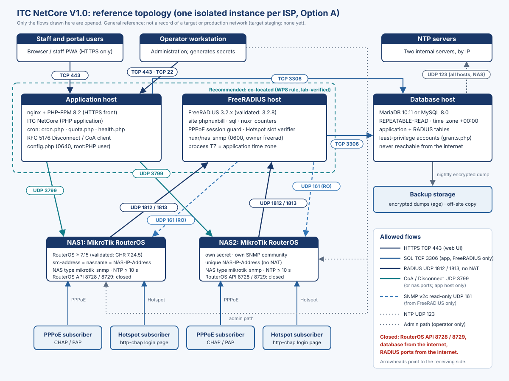

# About this manual

This manual connects MikroTik RouterOS NAS devices to an ITC NetCore V1.0 instance through FreeRADIUS, following the release architecture exactly as the product ships it. It covers the RouterOS requirements, PPPoE and Hotspot, NAS registration, secrets, accounting, Disconnect / CoA, the firewall, the session-admission policy, data and time quotas, the FreeRADIUS installation and its readiness checks, logs and recovery.

> [!WARNING]
> ITC NetCore V1.0 is a **Release Candidate** (`RELEASE_BLOCKED_WITH_EVIDENCE`). The RADIUS and NAS behaviour described here was measured on an isolated lab with **MikroTik CHR RouterOS 7.24.5** and FreeRADIUS 3.2.8 (plus a native FreeRADIUS 3.2.5 lab host). It has **not** been verified on your NAS model, your RouterOS version or your servers: that is the job of the target acceptance tests TA-01 … TA-10, which are all `NOT_RUN`. Never test against a router that carries customer traffic.

The authoritative product documents are `install/freeradius/README.md`, `docs/NAS_ONBOARDING_AND_SECRET_ROTATION.md`, `docs/PRODUCTION_CONFIGURATION_CHECKLIST.md` (sections G, H, I, J), `docs/TIME_CONTRACT.md` and `docs/WP8_INTEGRATION_MODEL.md`. Where they and this manual differ, they win; `TECH_DOCS_SOURCES.md` lists the source of every section and the contradictions that were resolved.

## Labels on configuration examples

Every configuration example carries exactly one label:

| Label | Meaning |
|---|---|
| **General template** | Built from the product documents; placeholders only; not executed as shown |
| **Lab-verified (CHR 7.24.5 lab)** | Executed in the isolated lab (CHR RouterOS 7.24.5, FreeRADIUS 3.2.5 native host or the 3.2.8 test image); lab addresses replaced by placeholders |
| **Target-staging verified** | Executed on the owner-approved staging target. **None yet** |
| **Production deployed** | Running in production. **None yet** |

Placeholders are written `<LIKE_THIS>`. No example contains a real secret, community or address. `${confdir}` is `/etc/freeradius/3.0` on Ubuntu / Debian packages and `/etc/freeradius` in the official FreeRADIUS image.

> [!NOTE]
> Internal names keep their PHPNuxBill origin: the FreeRADIUS site and dictionary are called `phpnuxbill`, the policy attributes `Nuxr-*`, and the tables `radcheck`, `radacct`, `nas`, `nuxr_admission` … Do not rename them.

<!-- pagebreak -->

# Architecture and topology

One ISP instance consists of the application host, the FreeRADIUS host, the database host and the ISP's NAS. The `nas` table in the RADIUS database is the **single NAS source**: FreeRADIUS loads its RADIUS clients from it, and the application uses it as the Disconnect / CoA target.

{width=100%}

| Component | Role in the RADIUS path |
|---|---|
| Application (PHP) | Writes the subscriber policy (`radcheck`, `radreply`, `radusergroup`, `radgroupreply`); reads `radacct`; sends RFC 5176 Disconnect / CoA itself (no `radclient`, no shell); runs the quota enforcer |
| FreeRADIUS 3.2.x | Authenticates (PAP, CHAP), applies the period counters and quota shares, runs the PPPoE session guard and the Hotspot slot verifier, maintains the admission tables, writes `radacct` |
| Database | Holds the application tables and the RADIUS tables (one database in the documented layout) |
| NAS (RouterOS) | PPPoE server and / or Hotspot; RADIUS client; accepts Disconnect / CoA; answers read-only SNMP from FreeRADIUS |

**Allowed flows** (open these and nothing else):

| From | To | Port | Purpose |
|---|---|---|---|
| Each NAS | FreeRADIUS | UDP 1812 / 1813 | Authentication / accounting, **no NAT** |
| Application | Each NAS | UDP 3799 (or `nas.ports`) | Disconnect / CoA, from an address that is a `/radius` server on the NAS |
| FreeRADIUS | Each NAS | UDP 161 | SNMP v2c read-only (session guard, slot verifier) |
| Application, FreeRADIUS | Database | TCP 3306 | SQL |
| All hosts and NAS | NTP | UDP 123 | Time |
| Operator | Hosts, NAS management | TCP 22 / private management path | Administration |
| — | NAS RouterOS API 8728 / 8729 | — | **Closed**: not used by the release profile |

> [!NOTE]
> **Co-location rule.** RouterOS accepts a Disconnect / CoA only from the address of one of its `/radius` entries and silently ignores other sources. The production rule of the integration model is to run the application on the FreeRADIUS host, on the address the NAS knows as its RADIUS server: no SNAT and no extra `/radius` entry. This is the lab arrangement. The newer onboarding documents also allow a second `/radius` entry for a separate application address with the same secret; that variant has not been executed in the lab, so prefer co-location.

<!-- pagebreak -->

# RouterOS requirements

| Requirement | Value | Why |
|---|---|---|
| Minimum RouterOS | **7.15** | Earlier versions send no `Message-Authenticator` in Access-Request; the `phpnuxbill` server drops such requests without an answer (BlastRADIUS hardening). 7.12.1 was observed being dropped |
| Validated version | **7.24.5** (CHR) only | Capability findings (per-direction PPPoE limits, ignored `Mikrotik-Total-Limit` on PPPoE, CoA not changing byte limits or interim) are version- and model-specific. A different version or board must repeat TA-03 / TA-04 |
| Major version for Hotspot | **7** | The Hotspot slot verifier refuses any other major version until the WP8 Hotspot gates are re-validated |
| Clock | NTP client with two internal servers by IP; **within 10 s** of the application (hard limit), typically under 2 s | The session-end cut-off allows 10 s; many RouterBOARDs have no real-time clock and drift 2–9 s per day without NTP |
| Identity | One unique source address per NAS, equal to `nas.nasname`, with **no NAT** to FreeRADIUS | FreeRADIUS and the application find the NAS of a session by `radacct.nasipaddress = nas.nasname` |
| RADIUS timeout | `timeout=3s` | The RouterOS default (1100 ms) is shorter than the guard path; a short timeout makes logins fail closed |
| RouterOS API | Not used; keep the `api` / `api-ssl` services unreachable | The legacy API drivers are disabled in the release profile |
| Licence level | Must allow the PPPoE server and Hotspot sessions you need | Not stated by the product documents; confirm against MikroTik's licence terms |

<!-- pagebreak -->

# FreeRADIUS installation

## Version

FreeRADIUS **3.2.x**. The project configuration and the admission policy are validated with **3.2.8** only (the official `freeradius/freeradius-server:3.2.8` image) on MariaDB 10.11 and MySQL 8.0. Another version must pass the WP8 Option G gate (`tests/Integration/Wp8/OptionGGateTest.php`, source tree) again, and on a target build that is not 3.2.8 the gate cases of staging case **X-4** are mandatory.

## Packages

**Label:** Lab-verified (CHR 7.24.5 lab) — Ubuntu 24.04, FreeRADIUS 3.2.5 package.

```bash
sudo apt-get install -y freeradius freeradius-mysql freeradius-utils
sudo apt-get install -y snmp          # snmpget, snmpbulkwalk for the session guard
```

The lab blocked service auto-start during installation and kept FreeRADIUS stopped until the project configuration was in place.

> [!WARNING]
> The lab's native FreeRADIUS 3.2.5 needed four deviations from the shipped instructions, recorded by the lab: **L1** listen addresses pinned instead of `ipaddr = *`; **L2** an SNMP-less copy of `checkrad` (see *Stock checkrad* below); **L3** the process `TZ` set from the application time zone through a systemd environment file; **L4** the stock `date` module enabled (the Ubuntu package does not enable it, and without it FreeRADIUS refuses to start with "Unknown module").

## Shipped configuration

All project files come from `install/freeradius/` of the verified release artifact.

| File | Install as | Purpose |
|---|---|---|
| `dictionary.phpnuxbill` | `${confdir}/dictionary.phpnuxbill`, plus the line `$INCLUDE dictionary.phpnuxbill` in `${confdir}/dictionary` | Internal attributes `Nuxr-Period-Start`, `Nuxr-Period-Acct-Id`, `Nuxr-Quota-Share` (never sent to a NAS) |
| `mods-available/nuxr_counters` | link into `mods-enabled/` | `Max-All-Session` / `Max-Data` counters for the current billing period |
| `mods-available/sql.example` | adapt into `mods-available/sql`, link into `mods-enabled/` | SQL module on the RADIUS database |
| `sites-available/phpnuxbill` | `sites-enabled/phpnuxbill`, **replacing `default`** | authorize / authenticate (PAP, CHAP) / accounting / session / post-auth |
| stock `mods-available/date` | keep (or create) the link in `mods-enabled/` | `%{time_since:}`, the clock of the late-claim guard |
| `bin/nuxr_pppoe_session_guard` | `${confdir}/nuxr/nuxr_pppoe_session_guard` | Fail-closed PPPoE live-session verifier |
| `mods-available/nuxr_pppoe_session_guard` | link into `mods-enabled/` | Exec module calling the guard from post-auth |
| `bin/nuxr_hotspot_slot_verifier` | `${confdir}/nuxr/nuxr_hotspot_slot_verifier` | Fail-closed Hotspot session verifier (read-only SNMP, ACTIVE slots only) |
| `mods-available/nuxr_hotspot_slot_verifier` | link into `mods-enabled/` | Exec module calling the verifier |
| `bin/nuxr_guard_selfcheck` | `${confdir}/nuxr/nuxr_guard_selfcheck`, **next to the guard** | Readiness check of the guard and the verifier |
| `nuxr_admission.sql`, `nuxr_hs_admission.sql` | run once in the RADIUS database **before** enabling the site | Admission tables (additive, idempotent) |
| `nuxr_admission_check.sql`, `nuxr_hs_admission_check.sql`, `nuxr_nasreload_collation_check.sql` | run in the RADIUS database | Read-only readiness checks (`=READY`) |
| `nuxr_hs_admission_report.sql` | run by monitoring every minute | `ALERT` lines for stuck Hotspot slots and orphan accounting |
| `nuxr_admission_release.sql` | operator only, per the recovery procedure | Releases one PPPoE `PENDING` claim with an audit record |
| `nuxr_nasreload_collation.sql` | **existing** RADIUS databases only | Collation conversion; not needed on a fresh install |

Rules that come with the shipped configuration:

- `delete_stale_sessions = no` (as shipped in `sql.example`): a "not logged in" answer must never fabricate an Accounting-Stop.
- `read_clients = yes` and `client_table = "nas"`: the NAS list comes from the database. Restart FreeRADIUS after every NAS change.
- `radpostauth` stays disabled (the stock query would store cleartext passwords).
- EAP: the `phpnuxbill` server defines no EAP section. Remove `mods-enabled/eap` (or keep EAP in your own virtual server).
- Do not enable the stock `noresetcounter` together with `nuxr_timecounter` (both define `Max-All-Session`).
- Authentication methods: **PAP and CHAP** only; any other method (for example MS-CHAPv2) is refused.

## Installation steps

**Label:** Lab-verified (CHR 7.24.5 lab) — adapted from the lab installer for Ubuntu (`${confdir}` = `/etc/freeradius/3.0`); `<F>` is `<artifact-dir>/install/freeradius`.

```bash
R=/etc/freeradius/3.0
# back up the current configuration first
sudo tar -C / -cpf /root/etc-freeradius-$(date -u +%Y%m%dT%H%M%SZ).tar etc/freeradius

# dictionary
sudo install -m 0644 -o root -g root <F>/dictionary.phpnuxbill $R/dictionary.phpnuxbill
sudo grep -q '^\$INCLUDE dictionary.phpnuxbill' $R/dictionary || echo '$INCLUDE dictionary.phpnuxbill' | sudo tee -a $R/dictionary

# modules (the sql module is prepared in the next section)
sudo install -m 0640 -o root -g freerad <F>/mods-available/nuxr_counters               $R/mods-available/nuxr_counters
sudo install -m 0640 -o root -g freerad <F>/mods-available/nuxr_pppoe_session_guard    $R/mods-available/nuxr_pppoe_session_guard
sudo install -m 0640 -o root -g freerad <F>/mods-available/nuxr_hotspot_slot_verifier  $R/mods-available/nuxr_hotspot_slot_verifier
for m in sql nuxr_counters nuxr_pppoe_session_guard nuxr_hotspot_slot_verifier; do
  sudo ln -sfn ../mods-available/$m $R/mods-enabled/$m
done
sudo rm -f $R/mods-enabled/eap
sudo test -e $R/mods-enabled/date || sudo ln -sfn ../mods-available/date $R/mods-enabled/date

# guard, verifier and self-check
sudo install -d -m 0755 -o root -g root $R/nuxr
sudo install -m 0755 -o root -g root <F>/bin/nuxr_pppoe_session_guard   $R/nuxr/nuxr_pppoe_session_guard
sudo install -m 0755 -o root -g root <F>/bin/nuxr_hotspot_slot_verifier $R/nuxr/nuxr_hotspot_slot_verifier
sudo install -m 0755 -o root -g root <F>/bin/nuxr_guard_selfcheck       $R/nuxr/nuxr_guard_selfcheck

# site: replaces default; inner-tunnel is not used
sudo install -m 0640 -o root -g freerad <F>/sites-available/phpnuxbill $R/sites-available/phpnuxbill
sudo rm -f $R/sites-enabled/default $R/sites-enabled/inner-tunnel
sudo ln -sfn ../sites-available/phpnuxbill $R/sites-enabled/phpnuxbill
```

> [!NOTE]
> The lab installer did not copy `nuxr_guard_selfcheck` onto its native host (the self-check ran in the lab's FreeRADIUS 3.2.8 test environment). The product README requires it next to the guard; the line above follows the README.

**Listen addresses.** The shipped site listens on `ipaddr = *` (ports 1812 and 1813). The lab pinned the `listen` blocks to the addresses the NAS reach (L1). Either way, restrict UDP 1812 / 1813 by firewall to the NAS addresses.

**Stock checkrad.** The stock `Simultaneous-Use` check (`session { sql }`) runs `checkrad` before the guard. It was validated **as shipped in the official 3.2.8 image**, where `checkrad` cannot run SNMP and answers at once. A distribution build whose `checkrad` does run SNMP can wait up to 10 s for a silent NAS, longer than the RouterOS timeout, so such logins are refused (fail closed, availability only). The lab therefore pointed `checkrad = ${confdir}/nuxr/checkrad-nosnmp` in `radiusd.conf` at a copy of the distribution `checkrad` with its two SNMP program paths emptied (L2). Whatever you choose, re-run the Option G gate (X-4) on the target build.

**Static clients.** NAS clients come from the `nas` table. The lab kept only a static `localhost` client in `clients.conf` (with `require_message_authenticator = yes`) for local test tools.

**Verification level:** Lab-verified with the deviations above; on a target: documented (not yet executed on target).

<!-- pagebreak -->

# SQL integration

## The sql module

Adapt `mods-available/sql.example` into `mods-available/sql`. Change only the connection lines; keep every other line as shipped.

**Label:** General template (from `sql.example`; the lab changed the same four lines).

```text
sql {
	dialect = "mysql"
	driver = "rlm_sql_${dialect}"
	server = "<DATABASE_HOST>"        # "localhost" = local socket
	port = 3306
	login = "<RADIUS_DB_USER>"
	password = "<RADIUS_DB_PASSWORD>"
	radius_db = "<DATABASE>"
	read_groups = yes
	read_profiles = yes
	delete_stale_sessions = no
	read_clients = yes
	client_table = "nas"
	pool {
		start = 0
		min = 0
		max = 32
		spare = 3
		uses = 0
		retry_delay = 30
		lifetime = 0
		idle_timeout = 60
	}
	...                               # the rest exactly as shipped
}
```

The file holds the database password: install it with mode 0640, owner `root:freerad`, and write it from a 0600 temporary file, never by pasting the password on a command line.

## Database privileges

The FreeRADIUS account is generated by `php system/reseller/grants.php --radius="'<radius user>'@'<freeradius host>'"` (the fresh installer `nuxr-fresh-install.sh` generates, reviews and applies it; installation manual, *What the installer writes: review points*). It receives:

| Table | Privilege |
|---|---|
| `radcheck`, `radreply`, `radusergroup`, `radgroupcheck`, `radgroupreply`, `nas` | `SELECT` |
| `radacct`, `nasreload` | `SELECT, INSERT, UPDATE` |
| `nuxr_admission`, `nuxr_hs_admission` | `SELECT, INSERT, UPDATE` |
| `nuxr_hs_admission_audit` | `INSERT` |
| `tbl_*` billing tables | nothing |

No `DELETE` anywhere. Create one account entry per address FreeRADIUS connects from. No account other than FreeRADIUS and the application may read `nas`.

## Session time zone, pool and capacity

- Every FreeRADIUS SQL session is **UTC** (the database global `time_zone = '+00:00'`).
- `pool.max` must cover the peak of concurrent authentications plus accounting. `pool.max` >= `thread pool { max_servers }` (32 by default) is **necessary, not sufficient**. The database `max_connections` must cover the `pool.max` of every FreeRADIUS instance on that server, plus the application, plus operator and backup sessions, plus a margin.
- The admission hardening refuses a claim written with an emptied SQL expansion; pool sizing is **not** relied on for safety, but pool exhaustion can still cost availability. Measure the reconnect storm of your largest NAS and the interim load, and confirm with TA-09.

> [!WARNING]
> Never run pool-exhaustion or SQL-fault experiments against a FreeRADIUS that serves subscribers, on staging or in production. The reproduction is forbidden by the owner.

<!-- pagebreak -->

# Time synchronisation

| Item | Requirement | Check |
|---|---|---|
| Application, database, FreeRADIUS hosts | UTC, NTP, drift between them at most 5 s; the database clock slews, never steps back | preflight `time.clock_skew`, `chronyc tracking` |
| FreeRADIUS process `TZ` | **= the application time zone** (Settings > Time zone). `Expiration` is written in that zone as `d M Y H:i:s` and FreeRADIUS interprets it in its own local time; `WISPr-Session-Terminate-Time` carries an explicit offset | `/proc/<pid>/environ` of the FreeRADIUS process |
| FreeRADIUS SQL sessions | UTC | preflight `time.sql_session_zone` |
| Every NAS | NTP from two internal servers by IP; clock zone UTC or a known fixed offset; **at most 10 s** (hard limit), typically at most 2 s | `/system clock print` against `date -u`; preflight `time.nas_clock` (WARN > 5 s ahead, FAIL > 10 s); health `nas_clock` |

The host clock zone is UTC; only the FreeRADIUS **process** carries the application zone in its environment.

**Label:** Lab-verified (CHR 7.24.5 lab) — systemd drop-in that gives FreeRADIUS the application zone.

```ini
# /etc/systemd/system/freeradius.service.d/itcnc.conf
[Service]
EnvironmentFile=-/etc/freeradius/3.0/nuxr/tz.env
```

```bash
printf 'TZ=%s\n' '<APPLICATION_TIME_ZONE>' | sudo tee /etc/freeradius/3.0/nuxr/tz.env
sudo chmod 0644 /etc/freeradius/3.0/nuxr/tz.env
sudo systemctl daemon-reload && sudo systemctl restart freeradius
```

Update `tz.env` and restart FreeRADIUS whenever the application time zone changes. The lab derived the value from the application setting before each start.

**Quota attribution does not depend on the NAS clock.** A billing period owns the `radacct` rows that **arrived after it started** (`Nuxr-Period-Acct-Id`). The NAS clock still matters for the session-end cut-off of a renewal or plan change (10 s allowance), for display and freshness, and for periods provisioned before V1.1 (time-rule fallback). Both automated checks see a NAS clock that is **ahead** only; a clock that is **behind** is visible only to NTP monitoring of the NAS.

<!-- pagebreak -->

# NAS registration

## Identity contract

`nas.nasname` = the RouterOS `/radius src-address` = the `NAS-IP-Address` of its accounting. No NAT between the NAS and FreeRADIUS. Two NAS that send the same `NAS-IP-Address` (NAT, copied configuration) would be verified at one address, and a session on one could be taken for gone on the other: every NAS needs its own unique address.

## Register the NAS in the application

Prerequisite: RADIUS is enabled in the settings (SuperAdmin). The menu entry is **Network > Radius NAS** (shown only when RADIUS is enabled). Add the NAS:

| Form field | Column | Value |
|---|---|---|
| Router Name | `shortname` | A name for the NAS |
| IP Address | `nasname` | The NAS source address (= `/radius src-address`) |
| Secret | `secret` | A new secret of 32+ random characters, unique per NAS and per instance (below). Write-only: never shown again; an empty field on edit keeps the old one |
| CoA port | `ports` | `3799` (set it explicitly; empty also means 3799) |
| Type | `type` | **`mikrotik_snmp`** (the field is pre-filled with `other`: replace it) |
| SNMP community | `community` | **Leave empty.** This column is not read by the guard or FreeRADIUS, and the admin interface shows it in the NAS list |
| Server, Description, Routers | — | optional |

Generate the secret on the operator workstation:

```bash
openssl rand -hex 24
```

> [!WARNING]
> With any NAS type other than `mikrotik_snmp` (the default is `other`), the session guard cannot verify the NAS: the release preflight `nas.verification` FAILs, and a PPPoE subscriber whose accounting Stop was lost stays locked out.

Then restart FreeRADIUS; it reads the `nas` clients at start:

```bash
sudo systemctl restart freeradius
```

**Verification level:** NAS registration through the form: documented (not yet executed on target). The lab created the equivalent `nas` row (`type = mikrotik_snmp`, `ports = 3799`) directly in the database and verified it on CHR 7.24.5.

## Guard credential file

The PPPoE session guard and the Hotspot slot verifier read SNMP communities **only** from `${confdir}/nuxr/nas_snmp`:

- one line per NAS: `<NAS_IP> <COMMUNITY>` (the NAS address exactly as in `nas.nasname`, dotted IPv4);
- community characters `A-Z a-z 0-9 . _ -` only (anything else is an ERROR);
- mode **0600** (0400 is also accepted by the self-check), owned by `freerad`; never world-readable, never in Git, never on a command line;
- part of this instance's FreeRADIUS configuration and of its backup; never copied to another instance; on persistent storage (a container mounts it, never creates it);
- the community differs from the RADIUS secret.

**Label:** Lab-verified (CHR 7.24.5 lab).

```bash
umask 077
TMP=$(mktemp)
printf '%s %s\n' '<NAS1_IP>' "$(cat <0600 file holding the NAS1 community>)" >  "$TMP"
printf '%s %s\n' '<NAS2_IP>' "$(cat <0600 file holding the NAS2 community>)" >> "$TMP"
sudo install -m 0600 -o freerad -g freerad "$TMP" /etc/freeradius/3.0/nuxr/nas_snmp
rm -f "$TMP"
sudo -u freerad /etc/freeradius/3.0/nuxr/nuxr_guard_selfcheck
```

The self-check must end with `guard_selfcheck=OK`. A NAS without an entry cannot be verified: a PPPoE login that meets an open row on it is rejected, and its Hotspot `ACTIVE` slots cannot be released.

<!-- pagebreak -->

# Secret handling

| Secret | Stored in | Readable by | Never |
|---|---|---|---|
| NAS shared secret (`nas.secret`) | RADIUS database (plaintext: RADIUS signs packets with it) | FreeRADIUS account, application account | shown in the interface, logged, put on a command line (the application's CoA client is native), written to audit or evidence |
| SNMP communities | `${confdir}/nuxr/nas_snmp` (0600, `freerad`) | the guard and the verifier | in argv or logs (the guard writes a private per-run net-snmp configuration and deletes it) |
| Database password of FreeRADIUS | `mods-available/sql` (0640, `root:freerad`) | FreeRADIUS | in tickets, chat or evidence |
| `$db_pass`, `$app_secret`, `$api_secret` | `config.php` (0640) | PHP runtime | logged, reused as each other's value |

Backups that contain the database or the FreeRADIUS configuration are secret material: encrypt them and restrict them to the instance operators.

## Rotating a NAS secret

The NAS and FreeRADIUS must change together; during the change, requests signed with the old secret are dropped (subscribers retry). Rotate per NAS in a maintenance window.

1. Generate the new secret (`openssl rand -hex 24`) on the operator workstation.
2. In the application, edit the NAS and set the new secret (write-only; empty keeps the old one).
3. Restart FreeRADIUS.
4. Immediately set the same secret on RouterOS: `/radius set [find address=<FREERADIUS_ADDRESS>] secret=<NEW_SECRET>` (type it on the console; never paste it into a ticket).
5. Verify one login, its accounting and one Disconnect.
6. Record the rotation (date, NAS, operator) in the operations log, never the secret.
7. Rotate at least yearly, and immediately after staff turnover, a suspected leak or a backup exposure.

## Rotating an SNMP community (no FreeRADIUS restart)

1. RouterOS: add the new read-only community restricted to the FreeRADIUS address; keep the old one.
2. Write the new `nas_snmp` next to the old one (`umask 077`, same directory, owner `freerad`) and `mv` it over `nas_snmp`.
3. `sudo -u freerad ${confdir}/nuxr/nuxr_guard_selfcheck` must end with `guard_selfcheck=OK`.
4. RouterOS: remove the old community.

A mistake during rotation produces ERROR, that is refused PPPoE logins for subscribers with an open row, never an unsafe Accept.

**Verification level:** Documented (not yet executed on target).

<!-- pagebreak -->

# RouterOS configuration

First capture the current values, so you can restore them:

```routeros
/radius print detail
/radius incoming print
/ppp aaa print
/ip hotspot profile print detail
/system ntp client print
/system clock print
/system resource print
/snmp print
/snmp community print detail
```

## RADIUS client

**Label:** General template.

```routeros
/radius add service=ppp,hotspot address=<FREERADIUS_ADDRESS> secret=<NAS_SECRET> src-address=<NAS_SOURCE_ADDRESS> \
  authentication-port=1812 accounting-port=1813 timeout=3s require-message-auth=yes-for-request-resp
```

`<NAS_SOURCE_ADDRESS>` is the value registered as `nas.nasname`. Type the secret on the router console; never put it into a script file that is kept, a ticket or a log.

## Disconnect / CoA

**Label:** General template.

```routeros
/radius incoming set accept=yes port=3799
/ip firewall filter add chain=input protocol=udp dst-port=3799 action=drop comment=coa_drop
/ip firewall filter add chain=input protocol=udp dst-port=3799 src-address=<APPLICATION_HOST_ADDRESS> action=accept comment=coa_from_app place-before=[find comment=coa_drop]
```

Set the port explicitly. MikroTik documents **1700** as the factory default of `/radius incoming`; with an unchanged router and an empty CoA port, the application sends to 3799 while the router listens on 1700. A port mismatch, `accept=no` and a firewall drop all look the same to the application: no answer.

If the application host is **not** the FreeRADIUS address, RouterOS ignores its requests unless it is also a `/radius` entry: add one for the application address with the same secret (not verified in the lab; co-location is preferred):

```routeros
/radius add service=ppp,hotspot address=<APPLICATION_HOST_ADDRESS> secret=<NAS_SECRET> src-address=<NAS_SOURCE_ADDRESS> require-message-auth=yes-for-request-resp
```

## PPPoE

**Label:** General template.

```routeros
/ppp aaa set use-radius=yes accounting=yes interim-update=1m
/ppp profile add name=<PPPOE_PROFILE> change-tcp-mss=yes
/interface pppoe-server server add service-name=<SERVICE_NAME> interface=<SUBSCRIBER_INTERFACE> default-profile=<PPPOE_PROFILE> disabled=no
```

- The PPPoE profile carries **no local pool or address override**: the address comes from RADIUS (`Framed-Pool` or a static `Framed-IP-Address`, never both).
- A customer's **static IP** (`pppoe_ip`, sent as `Framed-IP-Address`) must be a valid IPv4 address and is **unique across all customers**: the application refuses an invalid or already-assigned address on save, for every role (final-prep branch, `e8260df7`). Since round 3 of R-HF-CARRY-01 (`b2f7837b`; Arabic refusal details `9b21ebfe`) the special classes `0.0.0.0/8`, `127.0.0.0/8`, `169.254.0.0/16`, `224.0.0.0/4` and `240.0.0.0/4` (which includes `255.255.255.255`; RFC 2865 defines that value as "let the user select an address") are refused on every save path. R-HF-CARRY-01 itself stays **OPEN** for the owner decision. A legacy row that already holds such a value is not re-checked until it is changed and is still sent as `Framed-IP-Address` (residual R3-1): never keep one. The VPN auto-assignment and the reprovision `revert()` write a static IP without the identity lock or the uniqueness check (residual R3-2). The check does not cover NAS, gateway or pool addresses: keep static addresses outside every `Framed-Pool` range and away from the NAS and gateway addresses. How RouterOS handles a duplicate `remote-address` was not tested.
- Every pool a plan names (`Framed-Pool`) **must exist on the NAS**, otherwise the subscriber gets an Access-Accept but no IPv4 address (RADIUS cannot detect it).
- No local `/ppp secret` may carry a subscriber's name: RouterOS consults RADIUS only when no local user matches, so a local user masks the RADIUS identity.

## Hotspot

**Label:** General template.

```routeros
/ip hotspot profile add name=<HOTSPOT_PROFILE> use-radius=yes radius-accounting=yes radius-interim-update=received login-by=http-chap
```

Create the Hotspot server and its address pool on the subscriber interface with your standard procedure. Rules:

- `radius-interim-update=received`: a fixed interim in the profile would override the interval the plan sends.
- The Hotspot NAT pool is not the DHCP pool (the lab set `address-pool=none` on the Hotspot server).
- No local `/ip hotspot user` may carry a subscriber's name.
- Users type their user name exactly as stored (case and accents matter); vouchers exactly as issued. MAC login: RouterOS sends the MAC in upper case with colons (`AA:BB:CC:00:11:22`); store MAC user names in that form. A Hotspot using `mac-auth-mode=mac-as-username` with a MAC stored in lower case **stops working** under the V1 exact-spelling rule (preflight `mac` lists candidates).

## Read-only SNMP for the session guard

**Label:** General template.

```routeros
/snmp community set [find default=yes] disabled=yes
/snmp community add name=<SNMP_COMMUNITY> addresses=<FREERADIUS_ADDRESS>/32 read-access=yes write-access=no
/snmp set enabled=yes
/ip firewall filter add chain=input protocol=udp dst-port=161 action=drop comment=snmp_drop
/ip firewall filter add chain=input protocol=udp dst-port=161 src-address=<FREERADIUS_ADDRESS> action=accept comment=snmp_from_fr place-before=[find comment=snmp_drop]
```

The community differs from the RADIUS secret and goes only into `nas_snmp`.

## NTP

**Label:** General template.

```routeros
/system ntp client set enabled=yes servers=<NTP_SERVER_1>,<NTP_SERVER_2>
/system clock set time-zone-name=UTC
```

Check: `/system clock print` against `date -u` on the FreeRADIUS host. Never set the clock by hand without NTP.

## RouterOS API

The release profile never uses the RouterOS API. Keep TCP 8728 / 8729 closed: the `api` and `api-ssl` services must not be reachable from any network (check with `/ip service print`). If an API is ever enabled for another purpose, it runs only over a private management path.

## Lab-verified reference configuration

**Label:** Lab-verified (CHR 7.24.5 lab) — the configuration that the lab applied to its CHR NAS over SSH (the API stayed disabled). Lab addresses, secret and community are replaced by placeholders. Note the two differences from the general template: the lab Hotspot profile used `radius-interim-update=1m` (the newer onboarding rule requires `received`), and the lab set no NTP client in this script.

```routeros
/radius add address=<FREERADIUS_ADDRESS> service=ppp,hotspot src-address=<NAS_SOURCE_ADDRESS> timeout=3s \
  require-message-auth=yes-for-request-resp secret="<NAS_SECRET>" authentication-port=1812 accounting-port=1813
/radius incoming set accept=yes port=3799

/ip pool add name=<PPPOE_POOL> ranges=<PPPOE_POOL_RANGE>
/ppp profile add name=<PPPOE_PROFILE> local-address=<PPPOE_LOCAL_ADDRESS>
/interface pppoe-server server add service-name=<SERVICE_NAME> interface=<PPPOE_INTERFACE> default-profile=<PPPOE_PROFILE> \
  authentication=chap one-session-per-host=no disabled=no
/ppp aaa set use-radius=yes accounting=yes interim-update=1m

/ip hotspot profile add name=<HOTSPOT_PROFILE> hotspot-address=<HOTSPOT_ADDRESS> login-by=http-chap use-radius=yes \
  radius-accounting=yes radius-interim-update=1m
/ip hotspot add name=<HOTSPOT_NAME> interface=<HOTSPOT_INTERFACE> address-pool=none profile=<HOTSPOT_PROFILE> disabled=no
/ip hotspot user profile set [find default=yes] shared-users=10

/snmp community set [find default=yes] disabled=yes
/snmp community add name="<SNMP_COMMUNITY>" addresses=<FREERADIUS_ADDRESS>/32 read-access=yes write-access=no
/snmp set enabled=yes trap-generators="" trap-version=2

/ip firewall filter add chain=input protocol=udp dst-port=3799 src-address=<FREERADIUS_ADDRESS> in-interface=<MGMT_INTERFACE> action=accept
/ip firewall filter add chain=input protocol=udp dst-port=3799 action=drop
/ip firewall filter add chain=input protocol=udp dst-port=161 src-address=<FREERADIUS_ADDRESS> in-interface=<MGMT_INTERFACE> action=accept
/ip firewall filter add chain=input protocol=udp dst-port=161 action=drop
```

In the lab the application was co-located with FreeRADIUS, so the CoA rule accepts the FreeRADIUS address. `shared-users=10` on the default Hotspot user profile leaves the session count to RADIUS (`Port-Limit` and the admission slots).

## Second NAS (NAS2)

Repeat registration and configuration for each NAS with its **own** secret, its **own** community line in `nas_snmp` and its **own** unique source address. A Hotspot subscriber's `shared_users` limit applies across **all** NAS of the ISP (admission slots). The two-NAS case (staging case X-1, a Hotspot rename with sessions on two NAS) must run on two owner-supplied, non-production NAS; a local two-CHR result never substitutes for it.

> [!NOTE]
> **Lab only:** on 2026-10-29 the two-NAS test `RenameOldSessionLabTest::testHotspotOldSessionsOnTwoNasAreBothEnded` **passed on MariaDB and MySQL 8.0** against a second local CHR (CHR2, RouterOS 7.24.5, NAS type `mikrotik_snmp`, isolated bridge). The rename was `CONFIRMED`; each of the two old sessions got `COA_ACK` from its own NAS and its Accounting-Stop. This closes the lab blocker only. Real hardware, real NAS clocks and NTP, real network paths and the production FreeRADIUS deployment are not covered: **staging case X-1 stays open**.

## Removing a NAS

1. Disconnect its sessions or let them end.
2. Remove the RADIUS configuration from RouterOS.
3. Delete the NAS in the application.
4. Restart FreeRADIUS, and remove its line from `nas_snmp`.

Its accounting history stays in `radacct`; it is never deleted.

<!-- pagebreak -->

# Accounting

| Event | Behaviour |
|---|---|
| Start | Creates the `radacct` row (`nasipaddress` = `nas.nasname`). On RouterOS 7.24.5 it arrives 25–160 ms after the Access-Accept; the NAS stamps it 1.1–1.7 s earlier than the host receives it |
| Interim-Update | Updates the counters. A stale Interim (after the session's Stop, or with smaller counters than stored) is acknowledged and **not written**: usage never decreases. A lost Start is confirmed by the first Interim. Counters are 64-bit (Gigawords combined) |
| Stop | Closes the row with the terminate cause (`User-Request`, `NAS-Request` for a PPPoE Disconnect, `Admin-Reset` for a Hotspot Disconnect, `Session-Timeout`, `NAS-Reboot`) |
| Accounting-On | Sent by RouterOS before its first record; the stock query closes that NAS's open rows (`NAS-Reboot`) |
| Lost Stop | **RouterOS does not resend a lost Stop.** The row stays open; admission is then decided by the session guard (PPPoE) or the slots (Hotspot), never by row age |
| Duplicates | Duplicate Start / Stop are handled by the stock queries (`acctuniqueid`); a row never moves between billing periods |

`radacct` is the authoritative history. FreeRADIUS writes it; the application only reads it; **nothing deletes or rewrites it**, and stale sessions are reported only.

**Interim interval.** PPP AAA sends an Interim every minute in the templates above. For a plan with a **data quota**, the application writes `Acct-Interim-Interval` (default **30 s**) into the subscriber's reply; RouterOS 7.24.5 honours it instead of the PPP AAA value, and a Hotspot profile must say `radius-interim-update=received` so that it is not overridden. A CoA that changes `Acct-Interim-Interval` mid-session is ACKed but **not applied** (PPPoE): a new interval takes effect at the next login.

> [!NOTE]
> The code writes `Acct-Interim-Interval` only for plans with a data quota. For other Hotspot sessions with `radius-interim-update=received`, the product documents do not state which interval RouterOS then uses. Check the `radacct.acctupdatetime` spacing of a non-quota Hotspot session during TA-03 and record it; `health.php` `accounting` warns when no update arrives for 15 minutes while sessions are open.

**Verification level:** Lab-verified (CHR 7.24.5 lab).

<!-- pagebreak -->

# Disconnect and CoA

The application sends RFC 5176 Disconnect-Request and CoA-Request packets itself (`Reseller\Radius\CoAClient`).

| Item | Behaviour (RouterOS CHR 7.24.5 unless noted) |
|---|---|
| Destination | `nas.nasname` (an IP address), port `nas.ports` or 3799 |
| Source | Must be an address configured as a `/radius` server on that NAS. From a non-`/radius` address, requests were silently ignored on RouterOS 7.12.1; this case was not re-tested on 7.24.5, and the rule stays binding |
| Live session | ACK, result `SUCCESS` |
| Session not found | **NAK Error-Cause 406** (never 503), result `FAILED COA_NAK`; for a session-end this stays **unconfirmed** |
| No answer | After 3 identical packets about 2 s apart, result `UNKNOWN COA_NO_RESPONSE`. Never retried as a new request, never rolls back provisioning |
| Rate change | A `Mikrotik-Rate-Limit` CoA is applied live |
| Pool / address change | A CoA changing `Framed-Pool` / `Framed-IP-Address` is ACKed but **ignored**: change the policy, then Disconnect |
| Byte limits mid-session | PPPoE: ACKed, not applied; Hotspot: NAKed |

**Confirmed end.** A Disconnect-ACK alone is not proof. A renewal or plan change (RENEW, CHANGE_PLAN, REACTIVATE) ends the sessions that started before the new period and confirms each end by its Accounting-Stop (or NAK 503). An unconfirmed end never undoes the renewal (it settles exactly once); it is reported as drift `SESSION_POLICY_STALE` and by health `coa_failures` until the Stop arrives.

**Verification level:** Lab-verified (CHR 7.24.5 lab), except the separate-application-address variant.

<!-- pagebreak -->

# Firewall boundaries

| Host | Accept | Drop |
|---|---|---|
| NAS (input chain) | UDP 3799 from the application address only; UDP 161 from the FreeRADIUS address only; NTP replies; management from the private management path | UDP 3799 and UDP 161 from every other source; API 8728 / 8729 from everywhere |
| FreeRADIUS host | UDP 1812 / 1813 from the NAS addresses; SSH from the operator | RADIUS from any other source, especially the internet |
| Database host | TCP 3306 from the application and FreeRADIUS hosts | everything else, especially the internet |
| Application host | TCP 443 (and 80 for the redirect) from users; SSH from the operator | everything else |

Place the RouterOS `accept` rule **before** its `drop` rule (the templates use `place-before`, so an imported script does not depend on print indexes).

<!-- pagebreak -->

# Admission and simultaneous-session policy

Each layer fails **closed**: an error refuses the login and never grants it. A refusal by the guard or the admission policy carries only `Reply-Message = "Session verification failed"`.

## Message-Authenticator

The first statement of `authorize` drops, without any response, every Access-Request that carries no `Message-Authenticator`. NAS clients loaded from SQL do not inherit `require_message_authenticator = yes` in FreeRADIUS 3.2.8, so the check lives in the site. A wrong `Message-Authenticator` is discarded on receipt. Accounting requests are not subject to it (RouterOS sends none in accounting). Do not relax it.

## PPPoE

| Layer | Behaviour |
|---|---|
| `Simultaneous-Use = 1` | Written for every PPPoE subscriber; the stock `session { sql }` check counts open `radacct` rows |
| PPPoE session guard | For PPPoE requests only (`Service-Type = Framed-User`, `Framed-Protocol = PPP`, `NAS-Port-Type = Ethernet`). No open row: no NAS is asked. Open rows: every NAS named by them is asked over read-only SNMP whether `<pppoe-USERNAME>` is live. `SAFE` gives Accept; `LIVE` or `ERROR` (anything unproven: missing credential, SNMP silent, timeout, missing tool) gives Reject. The guard never deletes or updates `radacct` |
| Admission reservation | The last step before the Access-Accept is an atomic claim in `nuxr_admission`, one row per canonical subscriber (all case / accent spellings share it), with a per-attempt token returned in `Class` (`nuxr1…`). Accounting with that token moves it from `PENDING` to `ACTIVE`, then to `ENDED` |
| Strict Mode | A `PENDING` claim of another attempt refuses the login and is **never** released by time or SNMP |
| Late-claim guard | A request older than **5000 ms** inside FreeRADIUS gets no claim and no Accept. It assumes `/radius timeout=3s` (3 transmissions, abandoned after about 9.3 s) |
| Fresh-session hold | Within **10 s** of a session's Start, a take-over of its `ACTIVE` reservation is refused (`reject:active-fresh`); it ends by itself |
| Lost Stop | The next login of the subscriber is verified by the guard on the reservation's NAS and, once the session is proven gone, takes the reservation over |

Measured on RouterOS 7.24.5: guard median 188 ms, maximum about 1.1 s; Accept after a verification about 235 ms; Reject 1.0–1.2 s including the stock `reject_delay` of 1 s. The guard's own deadline is 1.8 s and its module timeout 3 s.

## Hotspot

| Layer | Behaviour |
|---|---|
| Exact spelling | Only for Hotspot requests (`Service-Type = Login-User`, `NAS-Port-Type = Wireless-802.11`): the bytes of the request `User-Name` must equal the one stored `radcheck.username`; any other spelling is rejected like a wrong password |
| `Port-Limit` | Reply attribute `max(1, shared_users)`, enforced by RouterOS per NAS (and per spelling). PPPoE gets none (RouterOS ignores it there) |
| Admission slots | `shared_users` is a limit across **every** NAS of the ISP: one row per (canonical subscriber, slot) in `nuxr_hs_admission`, slots `1..Simultaneous-Use`, claimed with a token in `Class` (`nuxh1…`). The stock radacct `Simultaneous-Use` check is not run for Hotspot |
| No free slot | The slot verifier checks the subscriber's `ACTIVE` slots on their NAS over read-only SNMP (deadline 1.5 s); a slot whose session (same user name and MAC) is proven absent is ended and the claim runs again. Anything unproven: nothing is released, the login is refused |
| Strict Mode | A `PENDING` slot is **never** released by time, SNMP or another request. There is no executable manual release |
| Limit changes | A decrease ends no live session; new logins are refused while slots above the new limit are live. An increase applies at the next login |
| Enabling | Sessions already live when the site is enabled hold no slot; enable outside peak hours |

Every Hotspot subscriber needs `Simultaneous-Use` in `radcheck` (the application always writes it); a Hotspot login without it is refused.

**Verification level:** Lab-verified (CHR 7.24.5 lab: race trials with no double session, cross-NAS slot enforcement with two CHR, exact-spelling gates). Target: documented (TA-03, X-1, X-2).

<!-- pagebreak -->

# Data and time quotas

Limited plans (Hotspot **and** PPPoE) carry a time quota (`Max-All-Session`), a data quota (`Max-Data`, decimal units: 1 GB = 10^9 bytes, download + upload) or both, per billing period.

## How the limit is applied

At every authentication FreeRADIUS replies the session's share of the remaining quota, `share = floor((Max-Data − period usage) / Simultaneous-Use)`, as `Mikrotik-Total-Limit`, `Mikrotik-Recv-Limit` and `Mikrotik-Xmit-Limit` (each with its Gigawords part). The time quota becomes `Session-Timeout`.

| Mechanism (RouterOS CHR 7.24.5) | PPPoE | Hotspot |
|---|---|---|
| `Mikrotik-Total-Limit` in the Accept | ignored | enforced (hard cap per session) |
| `Mikrotik-Recv-Limit` / `Xmit-Limit` in the Accept | enforced **per direction** | supported |
| `Session-Timeout` | enforced | enforced |
| `Acct-Interim-Interval` | honoured | honoured |
| CoA changing a byte limit mid-session | ACKed, not applied | NAKed |

The **quota enforcer** (`php system/reseller/quota.php enforce --loop=55 --every=5`, every minute) ends the sessions of subscribers whose current-period usage reached the quota: PPPoE upload + download together, and several concurrent Hotspot sessions. It sends a Disconnect and confirms the end by the Accounting-Stop within 6 s (or NAK 503); it retries an unanswered Disconnect after 15 s and a NAKed one after 60 s; one enforcer runs at a time.

## Actual versus billable usage

> [!FINANCE-WARNING]
> The quota is **not a byte-exact cap**. Usage can pass the quota by the detection and Disconnect delay. Overshoot is bounded by `min(share at authentication, rate × (interim + enforcer pass + Disconnect ≤ 6 s))` in normal operation. Under the owner's **Option G** this overshoot is **not charged** and **not carried into the next period**: raw accounting is kept whole, `actual` and `billable` (= `min(actual, quota)`) are separate numbers, no wallet or ledger movement results from an overshoot, and a renewal starts from zero. Never advertise the quota as byte-exact.

| Situation | Enforcement granularity |
|---|---|
| Hotspot | Cut by the router at its per-session share; measured on CHR 7.24.5 at about 1 Mbps the recorded usage ended 0.3 %–4.4 % past the share (0.2–0.7 s of line rate) |
| PPPoE, traffic in one direction | Capped by the NAS at the share (same order as Hotspot) |
| PPPoE, upload + download together | Can pass the quota; closed by the enforcer within interim + pass + Disconnect |
| Enforcer, FreeRADIUS, database or CoA path down | Only the router's own limits hold. PPPoE worst case: the share in each direction, that is up to 2 × the remaining quota |

Read the numbers with `php system/reseller/quota.php usage <user>` (actual, billable, overshoot) and `quota.php report` (over-quota open sessions).

## Settings

| Setting | Default | Notes |
|---|---|---|
| Interim for quota sessions (`nuxr_quota_interim_seconds`) | **30 s** | Owner's provisional N1 setting; allowed 10–300. A shorter interval lowers the overshoot bound and raises the accounting write rate (one Interim per online quota subscriber per interval). Applies to sessions that authenticate after the change. The final value is fixed by TA-05 and TA-09; keep the default for the first installation |
| Enforcer pass (`--every`) | 5 s | At least 5 (design range 5–15; a value below 5 exits 5) |

**Fail closed.** A share of 0 is never sent (RouterOS reads 0 as "no limit"). An exhausted quota, a malformed quota row or a failed SQL expansion rejects the login with "Data quota exhausted or unavailable"; a `Max-Data` / `Max-All-Session` row that is not exactly what FreeRADIUS loaded rejects with "Quota unavailable". A Limited plan with a zero, negative, non-numeric or unknown-unit limit cannot be saved.

**Install order.** Install `dictionary.phpnuxbill`, `nuxr_counters` and the `phpnuxbill` site together, and restart FreeRADIUS, **before** the first quota plan is provisioned: an unknown attribute in `radcheck` makes FreeRADIUS reject the subscriber.

**Verification level:** Lab-verified (CHR 7.24.5 lab, quota gate). Target: documented (TA-04, TA-05).

<!-- pagebreak -->

# Accounting and policy tables

| Table | Written by | Read by | Content |
|---|---|---|---|
| `radcheck` | application | FreeRADIUS | `Cleartext-Password`, `Simultaneous-Use`, `Expiration`, `Max-All-Session`, `Max-Data`, `Nuxr-Period-Start`, `Nuxr-Period-Acct-Id` |
| `radreply` | application | FreeRADIUS | `Mikrotik-Rate-Limit`, `Framed-IP-Address` or `Framed-Pool` (PPPoE), `WISPr-Session-Terminate-Time` and `Port-Limit` (Hotspot), `Acct-Interim-Interval` (data quota) |
| `radusergroup`, `radgroupreply`, `radgroupcheck` | application | FreeRADIUS | Plan group `plan_<id>` and its rate attributes |
| `radacct` | FreeRADIUS | application, guard | Accounting history; never deleted |
| `nas` | application | FreeRADIUS (clients), application (CoA) | NAS list and secrets |
| `nasreload` | FreeRADIUS | FreeRADIUS | Accounting-On bookkeeping of the stock queries |
| `nuxr_admission` | FreeRADIUS; operator release | FreeRADIUS, `reconcile.php` | PPPoE admission reservation |
| `nuxr_admission_audit` | operator release only (`reconcile.php`; FreeRADIUS has no privilege on it) | operator, `reconcile.php` | Audit of each operator release |
| `nuxr_hs_admission`, `nuxr_hs_admission_audit` | FreeRADIUS | FreeRADIUS, monitoring | Hotspot admission slots and their audit |
| `radpostauth` | — | — | Not used (would store cleartext passwords) |

The RADIUS key is the PPPoE user name when set, otherwise the user name (Hotspot / VPN: the user name). `Mikrotik-Rate-Limit` `rx/tx` means rx = client **upload**, tx = client **download**.

<!-- pagebreak -->

# Guard scripts and readiness

## nuxr_guard_selfcheck

```bash
sudo -u freerad ${confdir}/nuxr/nuxr_guard_selfcheck [NAS_IP ...]
```

Read-only. It runs, per NAS (default: every NAS in `nas_snmp`), the guard's own probe: the credential entry, `sysUpTime.0`, then the MIKROTIK-MIB interface-name table. It also checks the file (present, mode 0600 or 0400, owned by the user running it) and that `snmpget` / `snmpbulkwalk` can run. It never prints a community.

```text
nas=<NAS_IP> status=OK rows=<N> ms=<M>
nas=<NAS_IP> status=ERROR:<reason> ms=<M>
guard_selfcheck=OK|ERROR nas=<N> errors=<E>
```

Exit 0 only when every NAS is OK, 2 otherwise.

| Reason | Meaning |
|---|---|
| `no-credential-file` | File missing or not readable by this user |
| `credential-file-mode` | Readable by group or others, or not owned by this user |
| `no-nas` / `malformed-nas` | No NAS listed / an entry is not a dotted IPv4 address |
| `credentials` | No entry for the NAS, or invalid characters in the community |
| `snmpget-missing`, `snmpbulkwalk-missing` | net-snmp tools cannot run |
| `health` | No SNMP answer to `sysUpTime.0`: wrong community, SNMP disabled or filtered, or NAS unreachable (SNMP v2c gives no answer to a wrong community, so these cannot be told apart: check the community, its `addresses` and the UDP 161 rule) |
| `health-format`, `walk`, `walk-format`, `walk-empty` | Unexpected or empty answers |

Run it after every installation or rotation, after every new NAS, at FreeRADIUS start, and every few minutes from cron or monitoring with an alert on a non-zero exit. The README's example (root crontab):

**Label:** General template.

```cron
*/5 * * * * sudo -u freerad /etc/freeradius/3.0/nuxr/nuxr_guard_selfcheck >/var/log/nuxr-guard-selfcheck.log 2>&1 || logger -p auth.crit -t nuxr-guard "PPPoE session guard cannot verify a NAS (see /var/log/nuxr-guard-selfcheck.log)"
```

An older manual check still works: `sudo -u freerad ${confdir}/nuxr/nuxr_pppoe_session_guard 70726f6265 1 <NAS_IP>` must print `Tmp-String-7 = "SAFE"` (`70726f6265` is the hex of a user name that is not online); `ERROR` means stop and fix.

## Hotspot report

`install/freeradius/nuxr_hs_admission_report.sql` (read-only), every minute, with a monitoring account: `ALERT pending_over_1_minute` names a stuck slot (subscriber, slot, NAS, Acct-Session-Id, MAC, age); `ALERT orphan_accounting` means a live session holds no slot (investigate at once).

## Readiness sequence

| # | Check | Expected |
|---|---|---|
| 1 | `sudo freeradius -XC` (configuration check; the lab used `-XC`, the README `-C`) | "Configuration appears to be OK" |
| 2 | `nuxr_admission_check.sql`, `nuxr_hs_admission_check.sql`, `nuxr_nasreload_collation_check.sql` | each `=READY` |
| 3 | `sudo -u freerad ${confdir}/nuxr/nuxr_guard_selfcheck` | `guard_selfcheck=OK` |
| 4 | One PPPoE and one Hotspot test login (synthetic identity) | Access-Accept; the Accept carries `Class` starting `nuxr1` (PPPoE) or `0x6e75786831` = `nuxh1` (Hotspot) |
| 5 | `radacct` | Start row with `nasipaddress` = `nas.nasname` |
| 6 | One Disconnect from the application | CoA ACK, Stop within about 6 s |
| 7 | `php system/reseller/preflight.php` (release mode) | exit 0; `nas.verification` PASS; `time.nas_clock` PASS |

<!-- pagebreak -->

# File ownership and permissions

| Path (Ubuntu `${confdir}` = `/etc/freeradius/3.0`) | Mode | Owner | Source |
|---|---|---|---|
| `${confdir}/dictionary.phpnuxbill` | 0644 | `root:root` | lab |
| `${confdir}/mods-available/sql` (holds the DB password) | 0640 | `root:freerad` | lab |
| `${confdir}/mods-available/nuxr_*`, `${confdir}/sites-available/phpnuxbill` | 0640 | `root:freerad` | lab |
| `${confdir}/nuxr/` | 0755 | `root` | README |
| `${confdir}/nuxr/nuxr_pppoe_session_guard`, `nuxr_hotspot_slot_verifier`, `nuxr_guard_selfcheck` | 0755 | `root` | README |
| `${confdir}/nuxr/nas_snmp` | 0600 (or 0400) | `freerad` | README |
| `${confdir}/nuxr/tz.env` | 0644 | `root` | lab |
| `config.php` (application) | 0640 | `root:<php-user>` | checklist |

<!-- pagebreak -->

# Logs and service management

| Task | Command |
|---|---|
| Check the configuration | `sudo freeradius -XC` |
| Restart (after every NAS change, secret rotation, `tz.env` change) | `sudo systemctl restart freeradius` |
| State | `systemctl is-active freeradius` |
| Start at boot | `sudo systemctl enable freeradius` |
| Service log | `journalctl -u freeradius` and the log file configured in `radiusd.conf` |

Run FreeRADIUS threaded under the service manager. **Never use `-X` (or `-s`) in production**: single-thread debug mode under load can stall the process, and a whole-process stall longer than about 9 s leaves admission claims `PENDING` that need an operator.

Messages to recognise in the FreeRADIUS log and replies:

| Message | Meaning |
|---|---|
| `Reply-Message = "Session verification failed"` | Refused by the guard or the admission policy (fail closed) |
| `reject:active-fresh` | Fresh-session hold (within 10 s of the Start); ends by itself |
| `reject:active-unverified`, `reject:echo` | An `ACTIVE` reservation could not be verified / an emptied SQL expansion was detected |
| "Data quota exhausted or unavailable" | Quota used up, or the quota query failed (fail closed) |
| "Quota unavailable" | A `Max-Data` / `Max-All-Session` row is malformed or duplicated (written outside the application) |
| `No connections available` | SQL pool exhausted: an availability incident to investigate |

<!-- pagebreak -->

# Recovery

> [!WARNING]
> Never delete or close `radacct` rows by hand, never `UPDATE` or `DELETE` the admission tables, and never release funds to "unblock" a login. Every procedure below changes nothing unless its gates hold, and records an audit entry.

| Situation | Detect | Action |
|---|---|---|
| PPPoE subscriber refused, claim `PENDING` | health `admission_pending`; `php system/reseller/reconcile.php admission-pending` (key in hex, token, NAS, age, `releasable`) | Collect **NAS-side proof** that the attempt can no longer become a session (the NAS rebooted after `created_at`, or its log shows `authentication failed - radius timeout` for that user at that time; an empty active list alone is not proof). Then `php system/reseller/reconcile.php admission-release <key_hex> <token> --operator=<name> --reason="<why>" --evidence="<NAS, time, log line / reboot record>"`. Gates: still `PENDING` with that token, at least 600 s old, no open accounting row |
| PPPoE subscriber refused, reservation `ACTIVE` (lost Stop, NAS restart) | FreeRADIUS log; status query of `nuxr_admission` | Not an operator release case. Run `nuxr_guard_selfcheck <NAS_IP>` and fix what it reports; check preflight `nas.verification` (NAS type `mikrotik_snmp`); within 10 s of the Start the hold ends by itself; ask the subscriber to reconnect |
| Hotspot slot `PENDING` | `nuxr_hs_admission_report.sql` `ALERT pending_over_1_minute` | **No executable release** (owner decision). Collect the evidence (NAS reboot or NAS log, no Hotspot session for that user and MAC, FreeRADIUS restarted since), record the case and escalate to the owner. Never edit `nuxr_hs_admission` |
| Orphan Hotspot accounting | `ALERT orphan_accounting` | A live session holds no slot: investigate at once |
| Guard cannot verify a NAS | `nuxr_guard_selfcheck` non-zero exit | Fix the credential entry, the RouterOS community / `addresses` / UDP 161 rule, or the net-snmp tools; repeat until OK. No database change is needed or allowed |
| Session kept the old policy after renewal / plan change | drift `SESSION_POLICY_STALE`; health `coa_failures` | `php system/reseller/reconcile.php session-end <ACT>` (re-sends the Disconnect) or disconnect on the NAS. NAK 406 with no session on the NAS means the Stop was lost: the finding stays until a Stop arrives; record the NAS evidence |
| NAS clock ahead | preflight `time.nas_clock` WARN / FAIL; health `nas_clock` | Identify the NAS, compare `/system clock print` with `date -u`, repair NTP; recheck after the next Interim. Sessions that changed plan while the clock was ahead are not reported automatically and `session-end` does not select them: list them on the NAS (`/ppp active print`, `/ip hotspot active print`) against the period's activations and remove them on the NAS (`/ppp active remove [find name=<user>]`, `/ip hotspot active remove`) |
| Over-quota session still open | health `quota_enforcer` WARNING; `quota.php report` | The enforcer re-sends every 60 s; a NAS that never answers is a NAS / CoA problem |
| Enforcer not running | health `quota_enforcer` CRITICAL | Restart the cron job; until then only the router's limits apply |
| Rollback of the site | — | Reinstall the previous site file (and remove the added modules from `mods-enabled/`), restart FreeRADIUS. The admission tables may stay (nothing reads them then); they hold admission state only |

**Operator identity.** `--operator` is free text. The README recommends, before production, one personal database account per operator for releases (no shared login) so that the database attests who acted.

**Verification level:** Guard recovery after a lost Stop or a NAS reboot: Lab-verified (CHR 7.24.5 lab, failure drills). `reconcile.php admission-release`: covered by the automated test harness (both engines), not run against the CHR lab. Hotspot `PENDING` handling: design only (no executable release exists). On target: documented (TA-07).

# Appendix: per-NAS verification record

Fill one record per NAS. Never write a secret or a community into it.

| Item | Value |
|---|---|
| NAS name / board / RouterOS version | |
| `nas.nasname` = `/radius src-address` = `radacct.nasipaddress` | yes / no |
| NAS type `mikrotik_snmp` | yes / no |
| `/radius` `timeout=3s`, `require-message-auth=yes-for-request-resp` | yes / no |
| `/radius incoming accept=yes port=` (= `nas.ports` or 3799) | |
| CoA accepted only from the application address; SNMP only from FreeRADIUS | yes / no |
| PPP AAA accounting + interim; Hotspot `radius-interim-update=received` | yes / no |
| No local `/ppp secret` or Hotspot user shadowing a subscriber | yes / no |
| NTP enabled, two servers; offset against `date -u` | s |
| `nuxr_guard_selfcheck` for this NAS | OK / ERROR |
| Test login, Start row, Disconnect ACK + Stop | yes / no |
| Release preflight exit 0 | yes / no |
| Operator, date (UTC) | |
