# حول هذا الدليل

هذا هو دليل التدريب الرسمي لـ ITC NetCore V1.0، منصة إدارة وفوترة مزوّدي خدمة الإنترنت. كُتب لموظفي مزوّد الخدمة وللموزّعين، ويشرح ما يفعله كل دور في النظام كما هو فعلاً في هذا الإصدار، خطوةً بخطوة، مع صور حقيقية من النظام العامل.

**كيف كُتب هذا الدليل:**

- كل صلاحية مذكورة هنا مأخوذة من قواعد التفويض الفعلية في الخادم (خريطة المسارات وخريطة الأدوار والصلاحيات)، لا من شكل الواجهة.
- أسماء الأزرار والقوائم مكتوبة بين «» كما تظهر في ملف اللغة العربية للنظام، بما في ذلك تصحيحات التسميات في هذا الإصدار، مثل «شحن العميل بقسيمة» و«إعادة شحن اشتراك العميل» و«الكوبونات» وزر «إضافة قسائم». والتُقطت الصور من النسخة المرشّحة النهائية بعد هذه التصحيحات.
- كل الصور لقطات حقيقية من بيئة اختبار ببيانات تجريبية. غُطّيت بمربعات رمادية أرقام الهواتف والعناوين ورموز القسائم وكلمات المرور. لا يحتوي الدليل أي كلمة مرور أو سر حقيقي.
- المصطلحات التقنية والأسماء التجارية مكتوبة بالحروف اللاتينية: PPPoE وRADIUS وNAS وCoA وFreeRADIUS وMikroTik وSNMP وNTP.

> [!WARNING]
> هذا إصدار مرشّح (Release Candidate) ولم يُقبل بعد للتشغيل الإنتاجي. اختُبر سلوك الشبكة في بيئة مختبر معزولة فقط. قبل التشغيل الفعلي تُجرى اختبارات القبول على بيئة المزوّد.

**طريقة عرض كل عملية:** لكل عملية رئيسية ثمانية عناصر ثابتة:

| العنصر | معناه |
|---|---|
| الغرض | ما الذي تحققه العملية |
| الدور المطلوب | من يملك الصلاحية على الخادم |
| المتطلبات المسبقة | ما يجب أن يكون جاهزاً قبل البدء |
| الخطوات | ما تضغطه بالترتيب |
| صورة | لقطة من الشاشة الحقيقية عند الحاجة |
| النتيجة المتوقعة | ما تراه عند النجاح |
| أخطاء شائعة | ما يقع فيه المتدربون عادةً |
| تحذير | تنبيه أمني أو مالي عند الحاجة |

<!-- pagebreak -->

# 1. مقدمة إلى ITC NetCore

## 1.1 ما الذي يفعله النظام

ITC NetCore منصة واحدة يدير بها مزوّد خدمة الإنترنت دورة الاشتراك كاملة:

- **المشتركون:** إضافة المشترك، وبيانات دخوله إلى الشبكة (Hotspot أو PPPoE)، وملكيته التجارية.
- **التفعيل:** تفعيل الباقة وتجديدها وتغييرها، مع معاينة السعر والرصيد قبل التأكيد.
- **المال:** محافظ مسبقة الدفع للموزّعين، ودفتر حركات بقيد مزدوج لا يُعدَّل، وعمولات وتسوية مع المزوّد.
- **الشبكة:** تطبيق سياسة كل مشترك على FreeRADIUS، وأجهزة MikroTik تعمل خوادم وصول (NAS).
- **البوابة:** صفحة خاصة يدخل منها المشترك ليرى باقته وحسابه.

تُنشأ نسخة مستقلة من النظام لكل مزوّد خدمة، بقاعدة بيانات وخادم FreeRADIUS وأجهزة NAS خاصة به.

## 1.2 الأدوار

كل مستخدم يرى ما يخصّه فقط. الخادم يتحقق من الصلاحية في كل طلب، وإخفاء عنصر من القائمة ليس هو ما يمنع الوصول.

| الدور (كما يظهر في «نوع المستخدم») | من هو | باختصار |
|---|---|---|
| «مدير النظام» (SuperAdmin) | المسؤول الأعلى عن النسخة | كل صلاحيات المدير، ويزيد عليها حفظ الصفحات الثابتة، وتثبيت الإضافات، وإعداد بوابات الدفع، والنسخ الاحتياطي من الواجهة، وإعدادات الأمان |
| «مدير» (Admin) | موظف التشغيل لدى المزوّد | يدير المشتركين والباقات والأسعار والشبكة والمحافظ ومركز العمليات |
| «الوكيل» (Agent) | الموزّع، وقد يكون موزّعاً فرعياً تحت موزّع آخر | يضيف مشتركيه ويفعّل لهم من محفظته، ويحوّل رصيداً إلى فروعه المباشرة، ويحدد أسعارهم |
| «مبيعات» (Sales) | مندوب مبيعات يتبع موزّعاً | يخدم المشتركين المسندين إليه فقط، والدفع من محفظة موزّعه |
| «تقارير» (Report) | حساب مخصص للتقارير | في هذا الإصدار لا يرى أي بيانات (الفصل 5) |
| المشترك | صاحب الاشتراك | يدخل إلى بوابة المشترك فقط |

## 1.3 تسجيل الدخول والأمان

### تسجيل دخول الموظفين

**الغرض:** الدخول إلى واجهة الموظفين.

**الدور المطلوب:** أي حساب موظف نشط.

**المتطلبات المسبقة:** اسم مستخدم وكلمة مرور سلّمها لك المسؤول بطريقة آمنة.

**الخطوات:**

1. افتح عنوان النظام متبوعاً بـ `/admin`.
2. أدخل «اسم المستخدم» و«كلمة المرور».
3. اضغط «تسجيل الدخول».

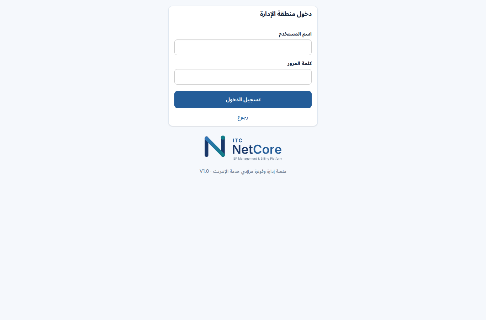

**النتيجة المتوقعة:** تفتح «لوحة التحكم» الخاصة بدورك.

**أخطاء شائعة:**

- الخلط بين صفحة الموظفين (`/admin`) وصفحة دخول المشتركين.
- عند خطأ اسم المستخدم أو كلمة المرور تظهر الرسالة «اسم المستخدم أو كلمة المرور غير صالحة». الرسالة نفسها تظهر للحساب الموقوف، فراجع المسؤول إذا تكررت.

### تغيير كلمة المرور

1. افتح قائمة الحساب (الحرف الأول من اسمك أعلى الصفحة).
2. اختر «تغيير كلمة المرور».
3. أدخل «كلمة المرور الحالية» ثم «كلمة المرور الجديدة» ثم «تأكيد كلمة المرور الجديدة»، واضغط «حفظ التغييرات».

> [!SECURITY-WARNING]
> في أول دخول بكلمة المرور الافتراضية التي يضعها المثبّت، يُحوَّل كل طلب إلى صفحة تغيير كلمة المرور حتى تغييرها. لا يُفرض هذا على الحسابات الأخرى، لذلك غيّر كلمة المرور المؤقتة بنفسك في أول دخول.

> [!SECURITY-WARNING]
> لا يحد النظام نفسه من محاولات الدخول المتكررة. يجب أن يطبّق مزوّد الخدمة حداً لمعدل الطلبات على واجهة HTTPS الأمامية. أبلغ المسؤول فوراً عن أي محاولات دخول فاشلة متكررة.

**قواعد أمان عامة لكل الموظفين:**

- كل عملية تغيّر بيانات تُرسل بنموذج يحمل رمز حماية (CSRF). الرابط المباشر لعملية تغيير لا ينفّذها.
- عند حدوث خطأ في الخادم تظهر رسالة عامة مع رقم مرجعي. أعطِ الرقم المرجعي للمشغّل ليجد التفاصيل في سجل الخادم.
- إذا فتحت صفحة لا يملك دورك صلاحيتها تظهر صفحة «الوصول مرفوض» بعنوان «لا يمكنك فتح هذه الصفحة».
- لا تشارك حسابك. كل عملية مسجلة باسم من نفّذها.
- لا يفصل النظام جلسة الموظف عن جلسة المشترك في المتصفح نفسه. استخدم متصفحاً أو نافذة منفصلة عند اختبار بوابة المشترك.

## 1.4 التنقل في الواجهة

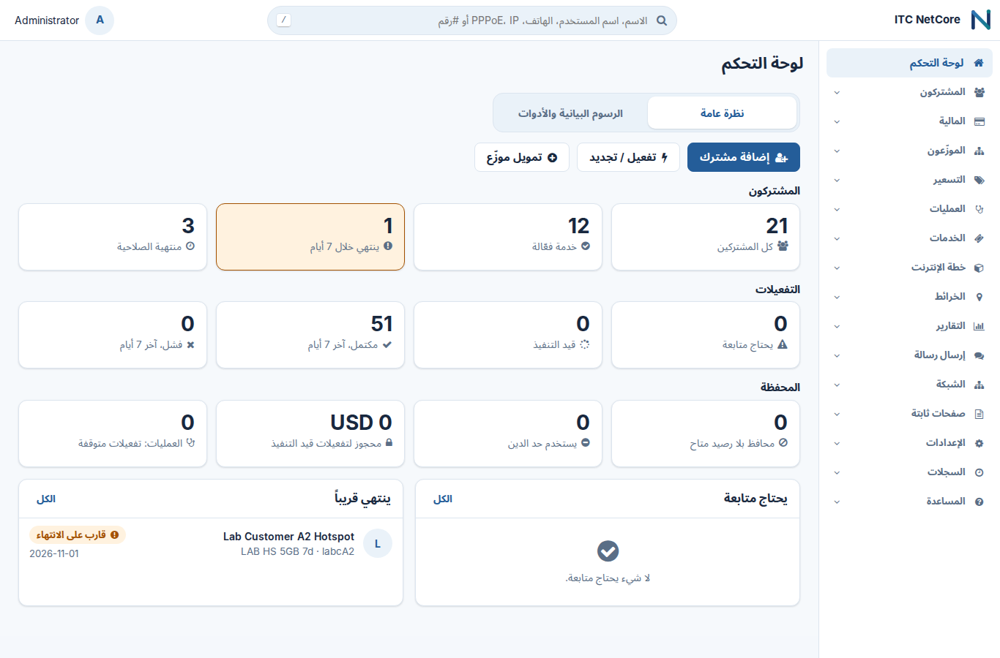

- **القائمة الجانبية:** مقسمة إلى مجموعات حسب العمل: «المشتركون»، «المالية»، «الموزّعون»، «التسعير»، «العمليات»، «الخدمات»، «خطة الإنترنت»، «الخرائط»، «التقارير»، «إرسال رسالة»، «الشبكة»، «صفحات ثابتة»، «الإعدادات»، «السجلات»، «المساعدة». لا يظهر لكل مستخدم إلا ما يسمح به دوره.
- **أزرار سريعة** في أعلى لوحة التحكم، حسب الدور: «إضافة مشترك»، «تفعيل / تجديد»، «إرسال إلى موزّع فرعي» (للموزّع الذي له فروع نشطة)، «تمويل موزّع» (للمدير).
- **البحث:** حقل «البحث عن مشتركين» أعلى كل صفحة، بالاسم أو اسم المستخدم أو الهاتف أو PPPoE أو IP أو #الرقم. اضغط مفتاح `/` للانتقال إليه. النتائج محصورة في نطاقك.
- **رابط الرجوع:** فوق عنوان صفحات التفاصيل يظهر رابط إلى الصفحة الأم (مثلاً «التفعيلات»).
- **قائمة الحساب:** «حسابي»، «تغيير كلمة المرور»، زر تبديل اللغة، «المظهر الفاتح / الداكن»، «تثبيت التطبيق»، «تسجيل الخروج».
- **تبويبا لوحة التحكم للمدير:** «نظرة عامة» و«الرسوم البيانية والأدوات».

> [!NOTE]
> لكل عنصر في مجموعة «الخدمات» اسم عربي مميّز: «شحن العميل بقسيمة» (استرداد رمز قسيمة لصالح المشترك)، و«القسائم» (بطاقات القسائم المطبوعة)، و«الكوبونات» (رموز الخصم، إن كانت مفعّلة)، و«إعادة شحن اشتراك العميل» (اختيار باقة وتفعيلها أو تجديدها نقداً أو من الرصيد). وعنوان صفحة الشحن بالقسيمة «شحن الحساب بقسيمة».

## 1.5 العربية والإنجليزية

- **الموظف:** يبدّل اللغة من قائمة الحساب. يظهر الزر باسم اللغة الأخرى («English» أو «العربية»). يُحفظ الاختيار في هذا المتصفح.
- **المشترك:** يختار لغته من أيقونة «اللغة» أعلى البوابة.
- **اللغة الافتراضية للنظام:** من «الإعدادات» › «الإعدادات المحلية» (للمدير).
- الواجهة العربية تُعرض من اليمين إلى اليسار بالكامل. وتبقى المصطلحات التقنية مثل PPPoE وRADIUS وFreeRADIUS بالحروف اللاتينية. ويظهر عنوان الباقة الذي كتبه المزوّد بنفسه كما كُتب، أما عناوين الباقات الافتراضية فتظهر مترجمة (مثل «خطة Radius» في بوابة المشترك).

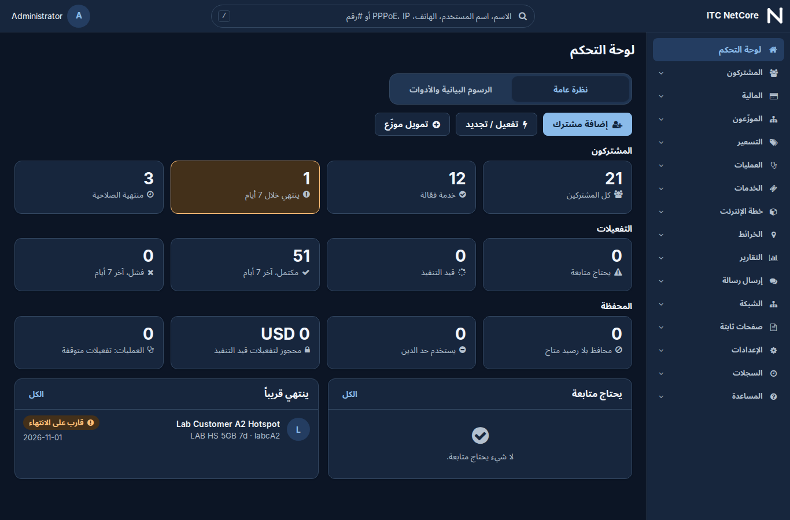

## 1.6 الهاتف والتطبيق المثبّت (PWA)

الصفحات نفسها تعمل على الهاتف بتصميم مخصص للمس:

- **شريط تنقل سفلي:** «الرئيسية»، «العملاء»، «جديد» (الإجراءات السريعة)، ثم «المحفظة» للموزّع أو «التفعيلات» لغيره، ثم «المزيد» لبقية الأقسام.
- الجداول تتحول إلى بطاقات.

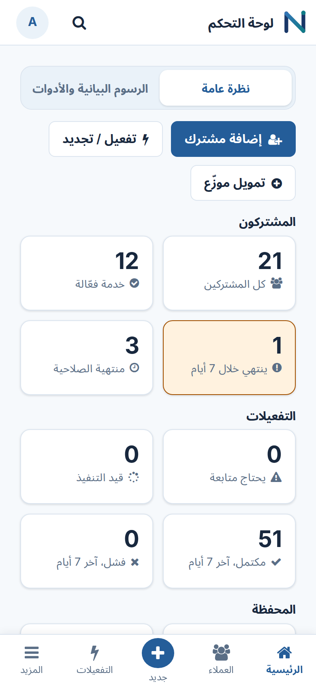

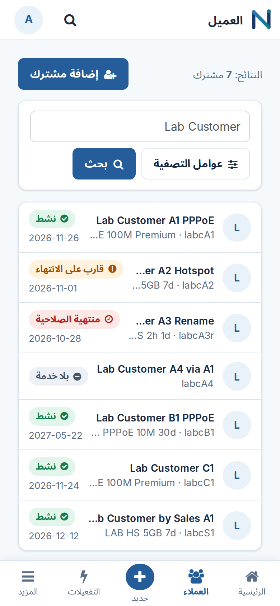

**تثبيت التطبيق:**

1. افتح قائمة الحساب واختر «تثبيت التطبيق». يظهر الزر فقط في اتصال آمن (HTTPS) وإذا لم يكن التطبيق مثبتاً.
2. أكّد التثبيت في المتصفح. يفتح النظام بعد ذلك بأيقونة مستقلة.

**عند انقطاع الإنترنت:** تظهر صفحة «غير متصل» ثابتة باللغتين.

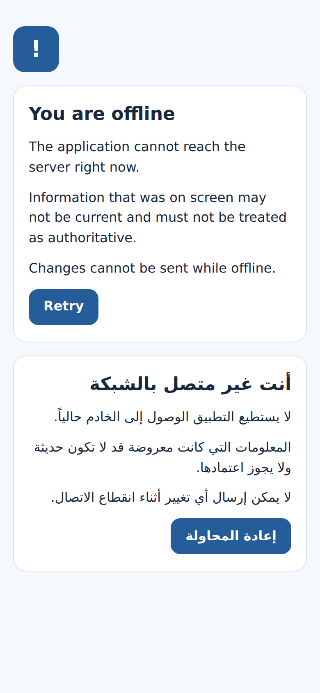

> [!SECURITY-WARNING]
> التطبيق المثبّت لا يحفظ أي بيانات مالية أو بيانات مشتركين على الجهاز، ولا يخزّن أي عملية لإرسالها لاحقاً. إذا انقطع الاتصال أثناء إرسال عملية فلا تُعاد تلقائياً. افتح الصفحة المعنية بعد عودة الاتصال وتحقق من حالة العملية قبل أي محاولة جديدة.

<!-- pagebreak -->

# 2. المدير العام (SuperAdmin)

يملك المدير العام كل صلاحيات «مدير» (Admin)، ويزيد عليها ثلاث صلاحيات لا يملكها غيره:

| الصلاحية الإضافية | ما تفتحه |
|---|---|
| تعديل الشيفرة الظاهرة | حفظ «صفحات ثابتة» أو إعادة ضبطها، وتثبيت الإضافات أو حذفها في «مدير الإضافات»، وإعداد بوابة دفع أو حذفها |
| النسخ الاحتياطي من الواجهة | زر «تنزيل النسخة الاحتياطية» في «النسخ الاحتياطي / الاستعادة» |
| الاستعادة من الواجهة | مرفوضة على أنظمة الموزّعين (انظر 2.11) |

وإعدادات الأمان التالية يحفظها المدير العام وحده. إذا أرسلها «مدير» تُتجاهل بصمت: «تفعيل Radius»، و«جلسة مسؤول واحدة»، و«تفعيل انتهاء الجلسة» ومدتها، وإعدادات الوكيل (proxy) وGitHub.

## 2.1 أول دخول

**الغرض:** تأمين الحساب وتهيئة النظام قبل أي عمل.

**الدور المطلوب:** «مدير النظام».

**المتطلبات المسبقة:** اكتمال التثبيت وترحيل قاعدة البيانات على الخادم (مهمة المشغّل).

**الخطوات:**

1. ادخل من `/admin` بالحساب الذي أنشأه المثبّت.
2. إذا كانت كلمة المرور الافتراضية ما زالت مستخدمة يحوّلك النظام إلى «تغيير كلمة المرور». غيّرها إلى كلمة قوية.
3. إذا ظهر شريط يقول إن مخطط الموزّعين غير جاهز، فعمليات الموزّعين والخدمة معطلة لكل الأدوار. أوقف العمل واطلب من المشغّل إكمال الترحيل.

**النتيجة المتوقعة:** لوحة التحكم بلا شريط تحذير.

> [!SECURITY-WARNING]
> لا تستخدم حساب المدير العام للعمل اليومي. أنشئ حساب «مدير» لكل موظف تشغيل، واحتفظ بحساب المدير العام للإعداد والطوارئ.

## 2.2 الإعداد الأولي بالترتيب

| الخطوة | من القائمة | ماذا تضبط |
|---|---|---|
| 1 | «الإعدادات» › «الإعدادات العامة» › «عام» | «اسم الشركة» والشعار وبيانات الاتصال (2.3) |
| 2 | «الإعدادات» › «الإعدادات المحلية» | المنطقة الزمنية وتنسيق التاريخ والعملة واللغة الافتراضية |
| 3 | «الإعدادات» › «الإعدادات العامة» › قسم FreeRADIUS | «تفعيل Radius» = «نعم» (يخزّنه المثبّت الجديد عادةً، فتحقّق منه). بعدها تظهر «Radius NAS» في «الشبكة» و«Radius» في «السجلات» |
| 4 | «الشبكة» › «Radius NAS» | إضافة كل جهاز NAS (2.10) |
| 5 | «خطة الإنترنت» › «عرض النطاق الترددي» ثم «هوتسبوت» / «PPPOE» | ملفات السرعة ثم الباقات (2.6) |
| 6 | «التسعير» › «الخطط والأسعار» | التكلفة الأساسية للمزوّد وتفعيل بيع الموزّعين (2.6) |
| 7 | «الإعدادات» › «مستخدمو المدير» | حسابات المديرين والموزّعين والمندوبين (2.4) |
| 8 | «المالية» › «المحافظ» | التمويل الأول للموزّعين (الفصل 7) |
| 9 | «الإعدادات» › «الأدوات» و«إشعار المستخدم»، و«صفحات ثابتة» | أدوات لوحة التحكم، وقوالب رسائل الانتهاء والتذكير، ونصوص البوابة |
| 10 | على الخادم (المشغّل) | المهام المجدولة وفحص الجاهزية `preflight.php` الذي يجب أن ينتهي بنجاح |

## 2.3 إعدادات الشركة واسم الشركة

**الغرض:** إظهار اسم مزوّد الخدمة في العناوين وللمشتركين وعلى الفواتير.

**الدور المطلوب:** «مدير النظام» أو «مدير».

**المتطلبات المسبقة:** لا شيء.

**الخطوات:**

1. «الإعدادات» › «الإعدادات العامة».
2. افتح قسم «عام».
3. اكتب «اسم الشركة»، وارفع الشعار عند الحاجة، وأكمل بيانات الاتصال.
4. اضغط «حفظ التغييرات».

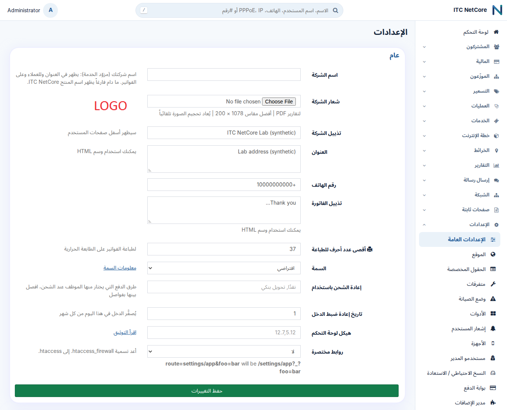

**النتيجة المتوقعة:** يظهر اسم شركتك في رأس الواجهة وعنوان الصفحات وبوابة المشترك.

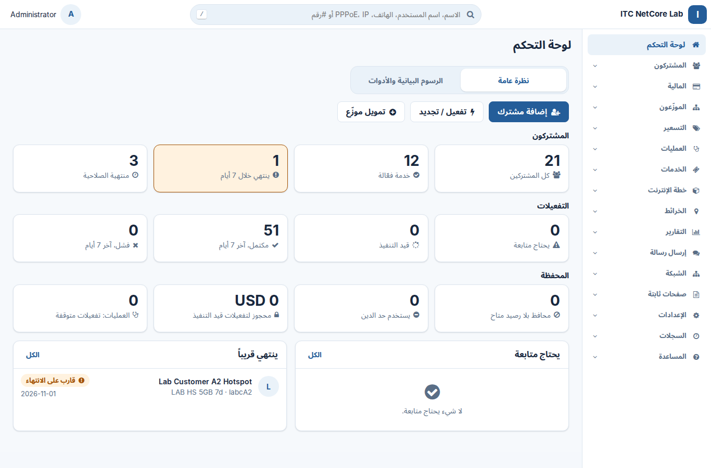

**أخطاء شائعة:**

- ترك «اسم الشركة» فارغاً. عندها يظهر اسم المنتج ITC NetCore في كل مكان، لكن الفواتير والرسائل تطبع القيمة المخزنة كما هي. اضبط الاسم **قبل** بدء التشغيل.
- البحث عن حقول الأسرار (كلمة مرور البريد ورموز الخدمات). هذه الحقول تُكتب فقط ولا تُعرض مرة أخرى، والحقل الفارغ يُبقي القيمة المخزنة.

## 2.4 إدارة المديرين والموظفين

**الغرض:** إنشاء حسابات الموظفين والموزّعين والمندوبين.

**الدور المطلوب:** «مدير النظام» ينشئ كل الأدوار. «مدير» ينشئ «تقارير» و«الوكيل» و«مبيعات» فقط.

**المتطلبات المسبقة:** لإنشاء مندوب يجب وجود موزّع يتبعه.

**الخطوات:**

1. «الإعدادات» › «مستخدمو المدير» › «إضافة مدير جديد». أو من «شجرة الموزّعين» زر «إضافة موزّع / مبيعات».
2. في «الملف الشخصي»: «الاسم الكامل» و«الهاتف» و«البريد الإلكتروني».
3. في «بيانات الاعتماد»: اختر «نوع المستخدم».
4. لموزّع أو مندوب اختر «الموزّع الأب». الخيار «لا يوجد (وكيل في المستوى الأعلى)» يُنشئ موزّعاً رئيسياً. الحقل «إلزامي للمندوب، واختياري للوكيل».
5. أدخل «اسم المستخدم» و«كلمة المرور» المؤقتة، واختر «إرسال إشعار» إن أردت، ثم «حفظ التغييرات».

**النتيجة المتوقعة:** يظهر الحساب في «مستخدمو المدير»، ويظهر الموزّع أو المندوب في «شجرة الموزّعين» تحت أبيه مباشرة.

**قواعد ثابتة في V1.0:**

| القاعدة | التفصيل |
|---|---|
| حذف الموزّع | ممنوع على الجميع. الرسالة: «لا يمكن حذف حسابات الوكلاء (الموزّعين) في الإصدار الأول؛ عطّل الحساب بدلاً من ذلك.» |
| تغيير دور الموزّع | ممنوع. عطّل الحساب وأنشئ حساباً جديداً |
| المدير العام الأخير النشط | لا يمكن تعطيله أو حذفه أو تخفيض دوره |
| حسابك أنت | لا تستطيع تغيير حالتك أو دورك بنفسك |
| «مدير» | يحذف حسابات «تقارير» فقط |

**أخطاء شائعة:** إنشاء مندوب دون «الموزّع الأب»، أو تسليم كلمة المرور المؤقتة عبر قناة غير آمنة.

> [!SECURITY-WARNING]
> سلّم كلمة المرور المؤقتة خارج النظام بطريقة آمنة، واطلب تغييرها في أول دخول.

## 2.5 إدارة الموزّعين

**الغرض:** متابعة شجرة الموزّعين وتعطيل الحسابات أو نقلها.

**الدور المطلوب:** «مدير النظام» أو «مدير» (الوضع والنقل للمديرين فقط).

**الخطوات:**

1. «الموزّعون» › «شجرة الموزّعين».
2. اضغط «فتح» على الحساب لفتح صفحة الموزّع.
3. من صفحة الموزّع: «إضافة موزّع / مبيعات»، «تعطيل» أو «إعادة التنشيط»، «نقل».

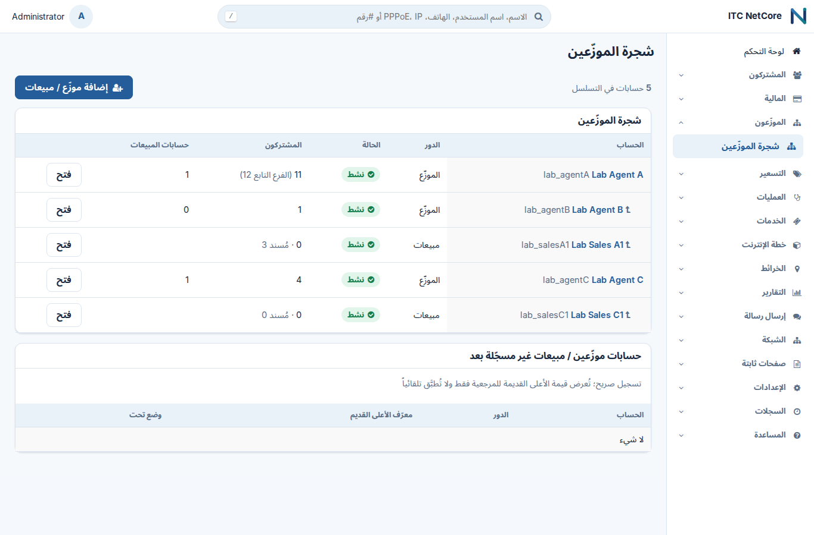

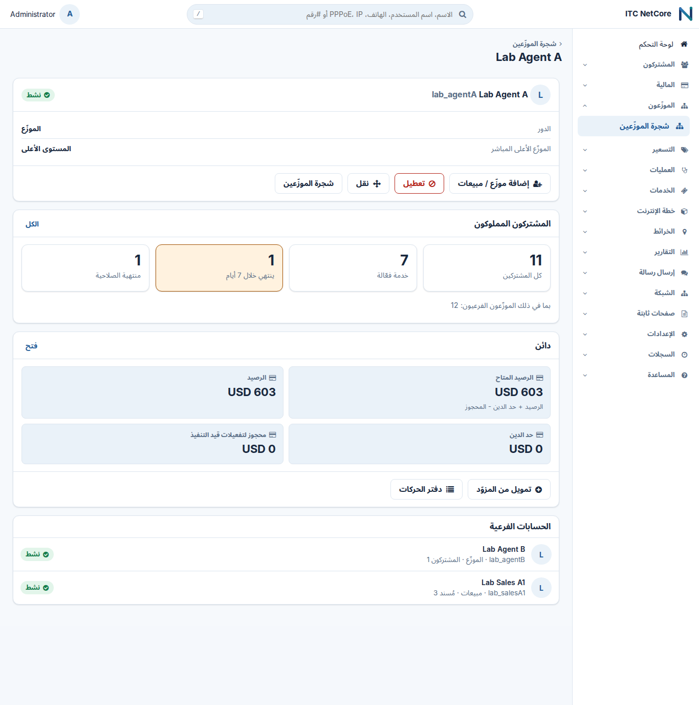

**النتيجة المتوقعة:**

- **التعطيل:** رسالة التأكيد «تعطيل هذا الحساب؟ تصبح الحسابات التابعة له للقراءة فقط.» يظهر الفرع كله بحالة «مجمّد من موزّع أعلى».
- **النقل:** رسالة التأكيد «نقل هذا الحساب (مع الحسابات التابعة له)؟» مع ملاحظة «تبقى السجلات المالية التاريخية لدى الموزّعين الأصليين.»
- **الحسابات القديمة غير المسجّلة:** تظهر في قسم «حسابات موزّعين / مبيعات غير مسجّلة بعد»، وتُوضع في مكانها بزر «وضع». لا يُطبَّق «معرّف الأعلى القديم» تلقائياً أبداً.

> [!FINANCE-WARNING]
> قبل تعطيل موزّع سوِّ رصيده بعملية مدققة ما دام نشطاً. بعد التعطيل تُرفض كل عمليات التمويل والسحب والتسوية وحد الدين والتحويلات الجديدة على محفظته، حتى من المدير. تبقى تسوية التفعيلات الجارية وعكس التحويلات الموجودة ممكنة.

## 2.6 الباقات والتسعير

### الباقات وملفات السرعة

**الغرض:** تعريف ما يُباع للمشتركين.

**الدور المطلوب:** «مدير النظام» أو «مدير».

**الخطوات:**

1. «خطة الإنترنت» › «عرض النطاق الترددي»: أنشئ ملفات السرعة.
2. «خطة الإنترنت» › «هوتسبوت» أو «PPPOE»: أضف الباقة واربطها بجهاز **Radius**، واختر ملف السرعة والسعر والصلاحية وعدد الأجهزة.
3. للباقة المحدودة اختر نوع الحد (بيانات أو وقت أو كلاهما) وأدخل قيمة صحيحة بالميغابايت أو الغيغابايت أو بالدقائق أو الساعات.

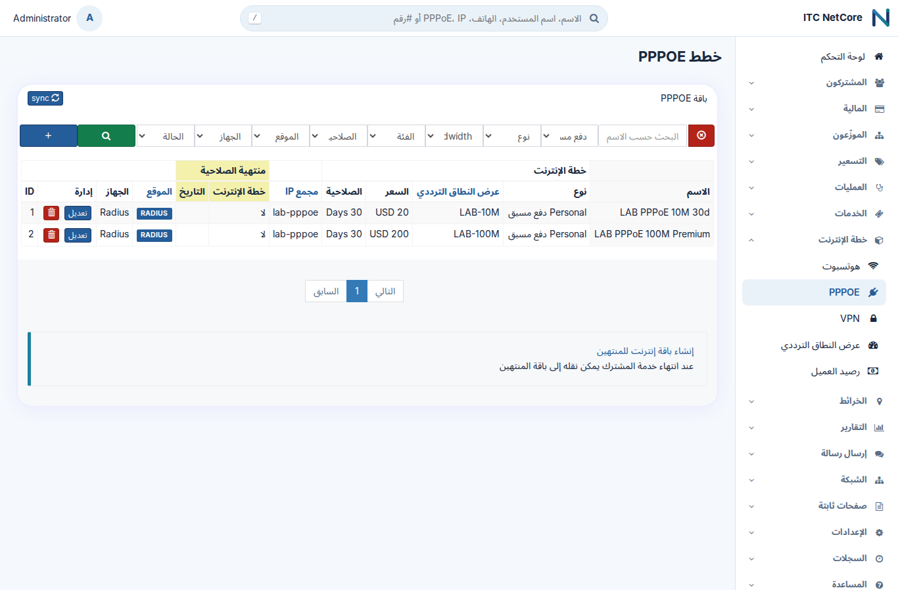

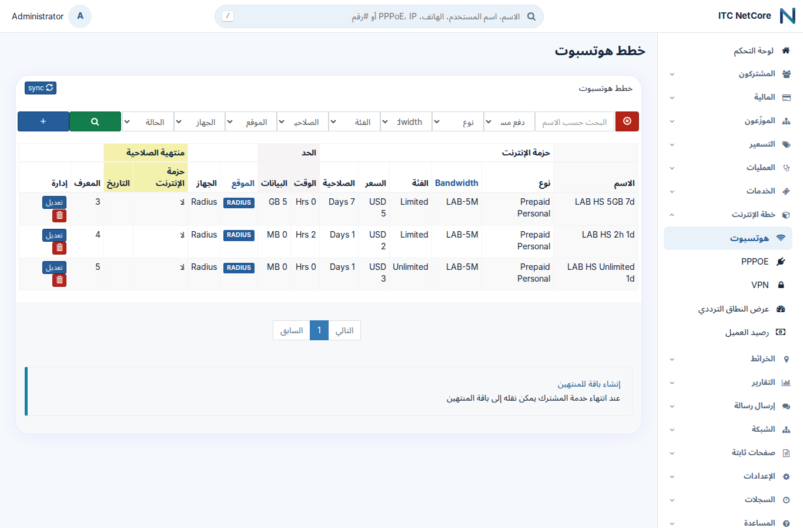

> [!NOTE]
> تفعيلات الموزّعين تقبل فقط باقات جهاز Radius من نوع Hotspot أو PPPoE. باقات VPN وباقات الرصيد لا تُباع عبر الموزّعين.

### التسعير

**الغرض:** تحديد تكلفة المزوّد وأسعار الجملة والبيع لكل مستوى.

**الدور المطلوب:** التكلفة الأساسية وتفعيل بيع الموزّعين: «مدير النظام» أو «مدير». أسعار الموزّعين: المدير لأي موزّع، والموزّع لفروعه المباشرة (الفصل 3).

**الخطوات:**

1. «التسعير» › «الخطط والأسعار». لكل باقة: «سعر البيع الافتراضي (سعر الخطة)» و«التكلفة الأساسية للمزوّد» وحالة البيع.
2. اضغط «تعديل» › في «التكلفة الأساسية للمزوّد» أدخل المبلغ و«السبب (اختياري)»، ثم «حفظ».
3. في القسم نفسه اضغط «تفعيل بيع الموزّعين». الباقة الجديدة تبدأ والبيع متوقف.
4. افتح الباقة لترى لكل موزّع: «سعر الجملة (تكلفة الموزّع)» و«سعر البيع (سعر المشترك)» و«الإتاحة» و«قابل للبيع»، ومصدر كل سعر («محدد لهذا الموزّع» أو «موروث» أو «التكلفة الأساسية للمزوّد»).

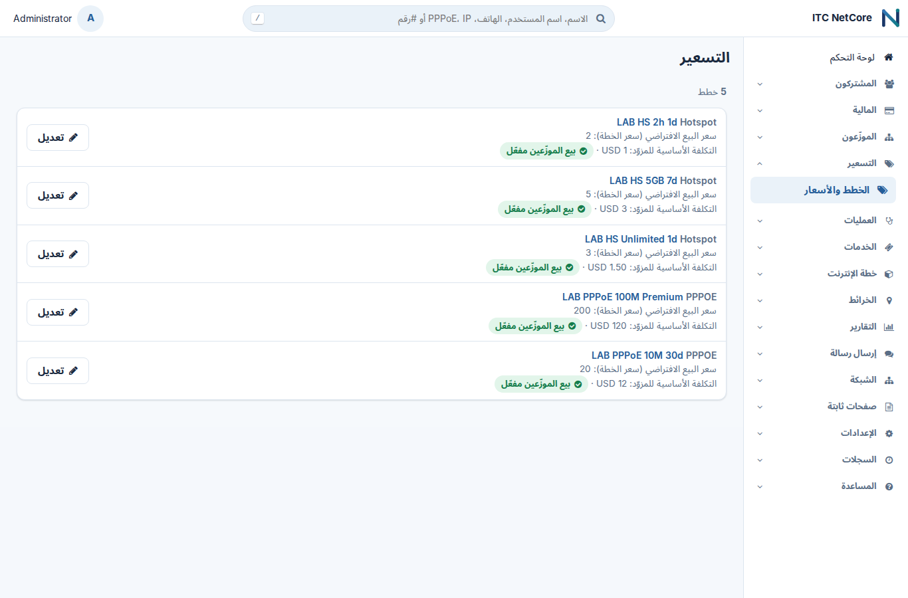

**قواعد التسعير:**

| القاعدة | السلوك |
|---|---|
| سعر الجملة الفعلي | سعر الموزّع نفسه إن وُجد، وإلا سعر أقرب أب، وإلا التكلفة الأساسية |
| الحد الأدنى | سعر جملة الفرع لا يقل عن سعر أبيه، وسعر الموزّع الرئيسي لا يقل عن التكلفة الأساسية |
| سعر البيع | لا يقل عن سعر الجملة. الفارغ يعني «سعر البيع الافتراضي (سعر الخطة)» |
| الإتاحة | «تعطيل» في أي مستوى يغلق الباقة لكل الفرع تحته، و«تمكين» لا يتجاوز قيداً من الأعلى |
| سعر جملة صفري | مسموح في الإعداد، لكنه لا يصلح للتفعيل |
| الاحتساب النسبي | لا يوجد. تغيير الباقة يبدأ فترة جديدة كاملة |

**مثال:** التكلفة الأساسية 10، وسعر جملة الموزّع الرئيسي 12، وسعر جملة الموزّع الفرعي 15. عند تفعيل يبيعه الموزّع الفرعي: تُخصم 15 من محفظة الفرعي، ويكسب الرئيسي عمولة 3، وتسوية المزوّد 12.

**أخطاء شائعة:** نسيان «تفعيل بيع الموزّعين»، فلا تظهر الباقة للموزّعين. أو رفع سعر موزّع أعلى فوق سعر فرع له محدد صراحةً، فيُرفض التغيير حتى ترفع أسعار الفروع أولاً.

## 2.7 القسائم (توليدها للمدير فقط)

**الغرض:** إنشاء قسائم مطبوعة تُباع للمشتركين المباشرين.

**الدور المطلوب:** «مدير النظام» أو «مدير». الموزّع والمندوب لا يولّدان القسائم.

**الخطوات:**

1. «الخدمات» › «القسائم» › الزر «إضافة قسائم» في أعلى القائمة.
2. اختر «نوع» («خطط هوتسبوت» أو «خطط PPPOE»)، و«الموجهات» (Radius)، و«خطة الخدمة».
3. أدخل «عدد القسائم» و«تنسيق القسيمة» و«بادئة القسيمة» و«طول الكود»، واختر «اطبع الآن» إن أردت.
4. اضغط «توليد» وأكّد.

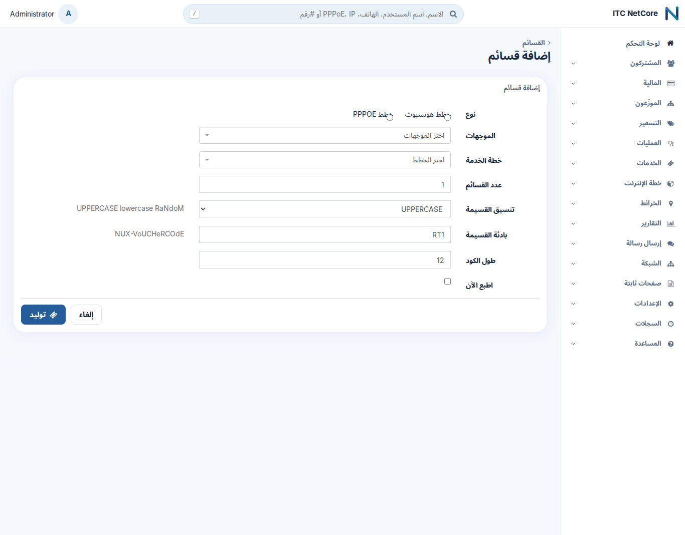

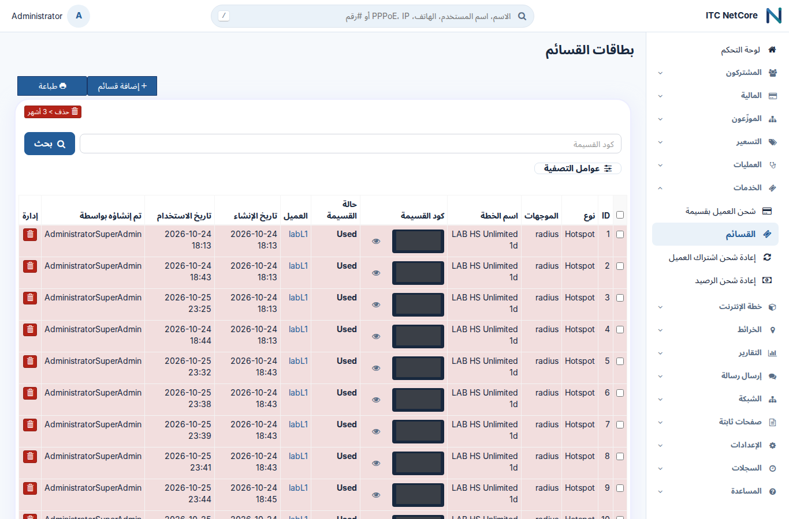

> [!SECURITY-WARNING]
> عامل القسائم المطبوعة كالنقد. الرموز مخفية في القوائم والتقارير. القسيمة التي لم يثبت منحها تبقى قيد المراجعة ولا تُستخدم مرة أخرى حتى يقرر المشغّل، فلا تُصدر بديلاً لها دون قرار.

## 2.8 التقارير على مستوى النظام

**الدور المطلوب:** «مدير النظام» أو «مدير».

من «التقارير»:

| التقرير | محتواه |
|---|---|
| «مبيعات» | كل تفعيل بسعر الجملة المخصوم وسعر البيع |
| «العمولات» | ما استحقه كل موزّع من فرق السعر عن مبيعات فروعه |
| «تسوية المزوّد» | ما استحقه المزوّد مقابل ما دفعه الموزّعون (للمدير فقط) |
| «أداء الموزّعين» | التفعيلات والمبالغ لكل موزّع خلال الفترة |
| «المعاملات (النظام القديم)» | المعاملات مع تصفية وطباعة |
| «سجل التفعيل (النظام القديم)» | كل فاتورة بالمشترك والباقة والتاريخ والطريقة |

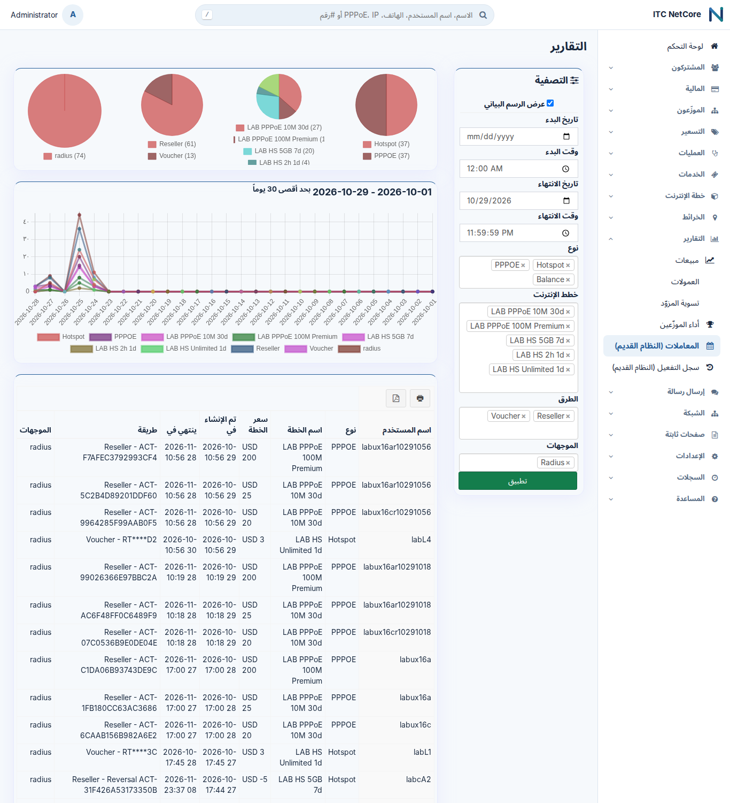

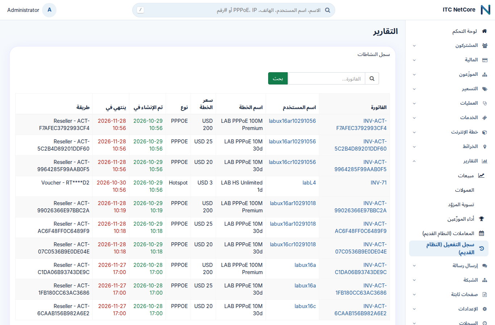

> [!FINANCE-WARNING]
> التصدير إلى CSV يحمل نطاق الشاشة نفسها، وحده الأعلى 20,000 صف و366 يوماً. التصدير الأكبر يُرفض ولا يُقتطع، فضيّق المرشحات. أسعار البيع لدى الموزّعين تظهر في التقارير القديمة.

## 2.9 إعدادات الأمان

**الدور المطلوب:** «مدير النظام» (الحفظ الفعلي).

من «الإعدادات» › «الإعدادات العامة» › قسم «الأمان»:

- «تفعيل انتهاء الجلسة» ومدتها: خروج المسؤول الخامل تلقائياً.
- «جلسة مسؤول واحدة»: الدخول من جهاز جديد يُخرج الجلسة الأخرى.

قواعد ثابتة:

- حقول الأسرار في الإعدادات تُكتب فقط ولا تُعرض.
- لا تثبّت إضافة أو بوابة دفع على نظام إنتاجي دون مراجعة، لأن أي شيفرة داخل التطبيق قد تتجاوز قواعد الموزّعين والمال.
- لا تُفعَّل مشغّلات MikroTik API المباشرة في هذا الإصدار. الشبكة تُدار عبر RADIUS فقط.

## 2.10 إعداد جهاز NAS

**الغرض:** ربط راوتر MikroTik بـ FreeRADIUS والنظام.

**الدور المطلوب:** «مدير النظام» أو «مدير» في الواجهة، ومسؤول الشبكة على الراوتر، والمشغّل على خادم FreeRADIUS.

**المتطلبات المسبقة:** «تفعيل Radius» = «نعم»؛ عنوان الراوتر الذي يرسل منه طلبات RADIUS ثابت ودون NAT؛ سر مشترك عشوائي من 32 حرفاً أو أكثر يُولَّد على جهاز المشغّل.

**الخطوات:**

1. «الشبكة» › «Radius NAS» › «جهاز NAS جديد».
2. «اسم الموجه»: اسم الجهاز.
3. «عنوان IP»: العنوان الذي يرسل منه الراوتر طلبات RADIUS نفسه.
4. «السر المشترك»: السر نفسه المضبوط على الراوتر.
5. «منفذ الفصل (CoA)»: `3799`.
6. «نوع»: اكتب `mikrotik_snmp`. القيمة الافتراضية `other` غير مدعومة.
7. اضغط «حفظ التغييرات» وأكّد.
8. يضيف المشغّل مجتمع SNMP للقراءة فقط إلى ملف بيانات حارس الجلسة على خادم FreeRADIUS، ثم يعيد تشغيل FreeRADIUS.
9. على الراوتر يضبط مسؤول الشبكة RADIUS لخدمتي PPP وHotspot، واستقبال طلبات الفصل على المنفذ 3799، ويسمح بالمنفذ UDP 3799 من خادم التطبيق فقط، ويفعّل NTP.

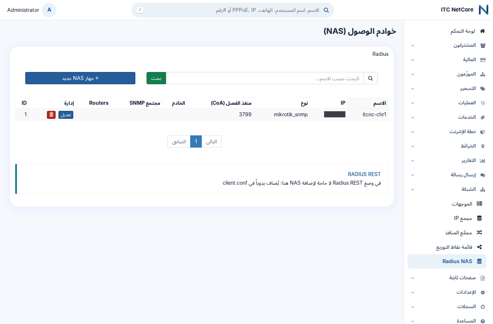

**النتيجة المتوقعة:** دخول تجريبي ناجح، وظهور سجل محاسبة للجلسة، ونجاح فحص `preflight.php` لدى المشغّل.

**أخطاء شائعة:**

- ترك «نوع» على `other`: يفشل فحص الجاهزية، ويبقى المشتركون ممنوعين من إعادة الاتصال بعد فقدان رسالة نهاية الجلسة.
- ترك منفذ الراوتر على قيمته الافتراضية 1700 بينما يرسل النظام إلى 3799.
- سر مختلف بين النظام والراوتر.

> [!SECURITY-WARNING]
> السر المشترك لا يُعرض في الواجهة بعد الحفظ؛ حقل التعديل يظهر فارغاً، والحقل الفارغ يُبقي السر القديم. لا ترسل السر في محادثة أو تذكرة، ولا تكرره بين الأجهزة. غيّره سنوياً على الأقل، وفوراً عند مغادرة موظف أو الاشتباه بتسرّبه.

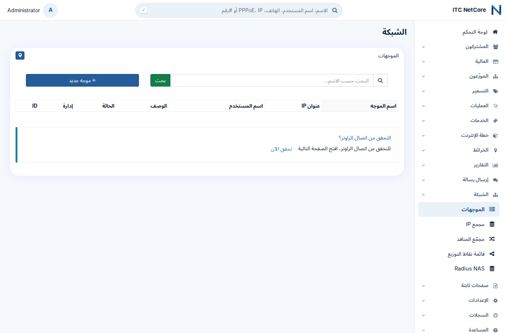

## 2.11 الصحة التشغيلية

**الدور المطلوب:** «مدير النظام» أو «مدير» (مركز العمليات للقراءة)، والمشغّل على الخادم.

1. «العمليات» › «مركز العمليات» يومياً. الأقسام:
   - «يحتاج متابعة»: «تفعيلات تحتاج متابعة» و«تفعيلات متوقفة (دون تقدم منذ 5 دقائق)».
   - «بانتظار / معلّق»: «عمليات رصيد قديمة معلّقة».
   - «للعلم / يتطلب سطر الأوامر»: «التجديد التلقائي غير متاح (سجلات)» و«فحص الانحراف (عند الطلب)».
   - «المحلولة / السجل»: «النتائج النهائية، آخر 7 أيام».
2. يشغّل المشغّل الفحوص اليومية للقراءة فقط على الخادم (الفصل 8).

**النسخ الاحتياطي والاستعادة:** النسخة الاحتياطية الإنتاجية تُؤخذ على مستوى قاعدة البيانات وفق إجراء التشغيل. زر الاستعادة في «النسخ الاحتياطي / الاستعادة» يُرفض بالرسالة «الاستعادة من هنا معطّلة في هذا النظام؛ استخدم إجراء الاستعادة على مستوى قاعدة البيانات.»

## 2.12 سجلات التدقيق

| أين | ماذا تجد |
|---|---|
| «السجلات» › «ITC NetCore» («سجل النشاطات») | الدخول والإجراءات بالتاريخ والمستخدم، مع البحث والتصدير |
| «السجلات» › «Radius» | أحداث المصادقة من FreeRADIUS |
| «السجلات» › «الرسالة» | الرسائل المرسلة وحالتها |
| «المالية» › «دفتر الحركات» | كل حركة مالية بالسبب والمرجع ومنفذها |
| صفحة التفعيل › «التسلسل الزمني» | كل مرحلة من مراحل التفعيل بالتوقيت |

سجل التدقيق التفصيلي لعمليات الموزّعين والمال يُحفظ في الخادم ويراجعه المشغّل؛ لا توجد له شاشة مستقلة في V1.0.

> [!SECURITY-WARNING]
> لا تستخدم «تنظيف السجلات» إلا وفق سياسة الاحتفاظ المعتمدة لدى المزوّد.

<!-- pagebreak -->

# 3. الموزّع والموزّع الفرعي

الموزّع حساب من نوع «الوكيل» (Agent). **الموزّع الفرعي** موزّع موضوع تحت موزّع آخر في الشجرة: له الصلاحيات نفسها، محصورةً في فرعه، ويدفع من محفظته **هو**.

| النطاق | المعنى |
|---|---|
| فرعك | أنت وكل من تحتك |
| فروعك المباشرة | من تحتك مباشرة فقط |
| أنت فقط | حسابك ومشتركوك أنت |

> [!NOTE]
> يجب أن يكون حسابك موضوعاً في الشجرة. الموزّع غير الموضوع لا يرى أي بيانات. وإذا كان حسابك أو أي موزّع فوقك غير نشط يصبح حسابك «مجمّد من موزّع أعلى»: ترى بياناتك وتُمنع كل التغييرات.

## 3.1 لوحة التحكم

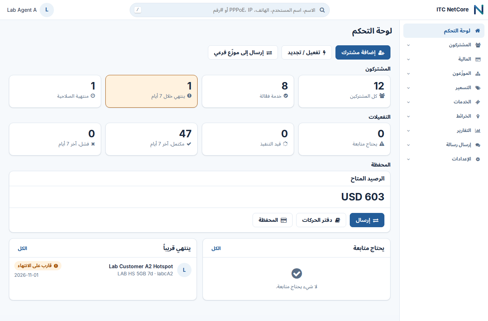

- أزرار: «إضافة مشترك»، «تفعيل / تجديد»، و«إرسال إلى موزّع فرعي» إن كان لك فرع مباشر نشط.
- بطاقات «المشتركون» و«التفعيلات» لفرعك، وبطاقة «المحفظة» برصيدك المتاح.
- قائمتا «يحتاج متابعة» و«ينتهي قريباً».
- القائمة الجانبية: «المشتركون»، «المالية»، «الموزّعون»، «التسعير»، «الخدمات»، «الخرائط»، «التقارير»، «إرسال رسالة»، «الإعدادات».

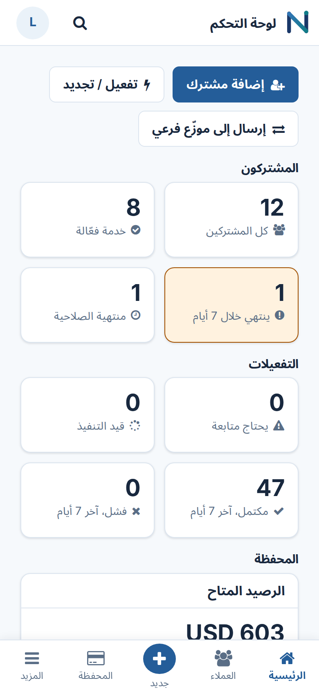

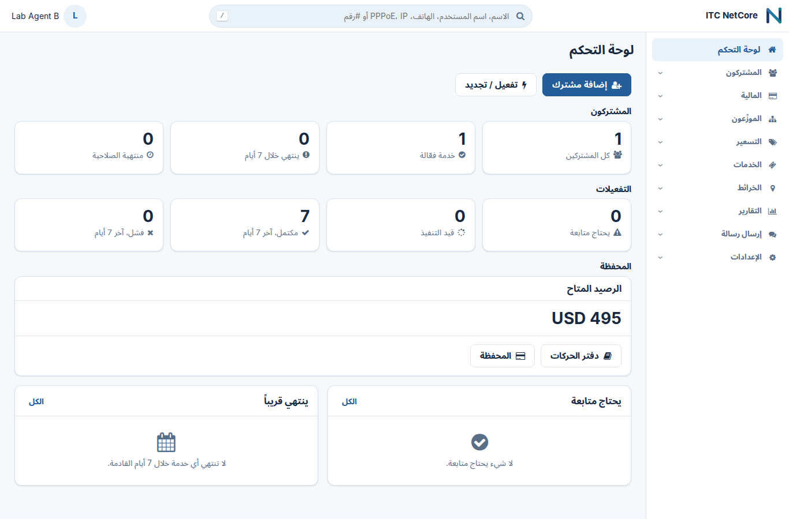

## 3.2 نطاق مشتركيك

| ما تستطيعه | النطاق |
|---|---|
| عرض المشتركين وملفاتهم | فرعك كله |
| إضافة مشترك | يُنشأ مملوكاً لك دائماً |
| إسناد مندوب أو إلغاء إسناده | فرعك، ومندوب تابع لمالك المشترك مباشرة |
| التفعيل والتجديد وتغيير الباقة | مشتركوك أنت فقط |
| عرض التفعيلات | فرعك كله |
| عرض الفواتير وإرسالها، ورسالة لمشترك أو لمشتركين محددين | فرعك |

| ما لا تستطيعه في V1.0 | من يقوم به |
|---|---|
| تعديل بيانات مشترك بعد إنشائه (كلمة المرور، PPPoE، الحالة)، أو مزامنته، أو إيقاف خدمته، أو حذفه، أو تصديره، أو الدخول كمشترك | «مدير» |
| تفعيل مشترك يملكه موزّع فرعي تحتك | الموزّع الفرعي نفسه |
| عكس تفعيل أو إلغاؤه أو استئنافه | «مدير» |
| توليد القسائم، والشحن المباشر، والرصيد | «مدير» |
| الرسائل الجماعية لكل المشتركين | «مدير» |

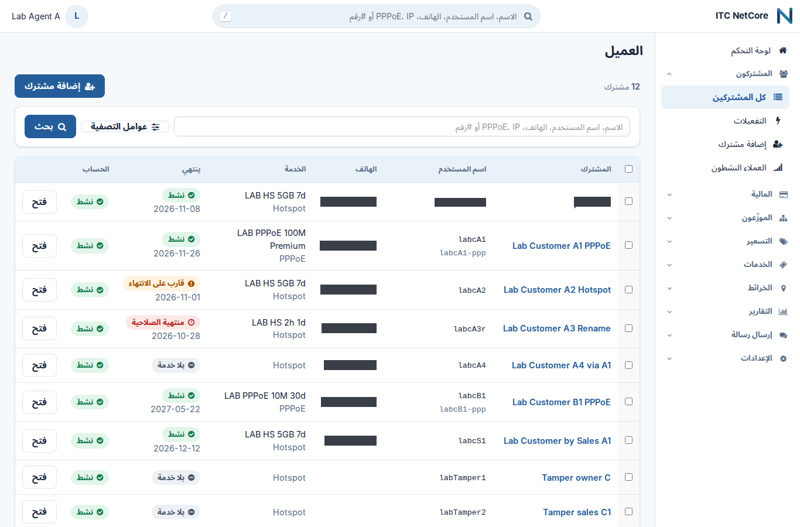

## 3.3 إضافة مشترك

**الغرض:** تسجيل مشترك جديد تملكه.

**الدور المطلوب:** «الوكيل» (المالك أنت دائماً)، أو «مبيعات» (المالك موزّعه)، أو «مدير».

**المتطلبات المسبقة:** اسم مستخدم غير مستعمل؛ نوع الخدمة معروف.

**الخطوات:**

1. «المشتركون» › «إضافة مشترك»، أو الزر السريع.
2. **«الهوية والخدمة»:** «الاسم الكامل»، «رقم الهاتف»، «البريد الإلكتروني»، «نوع الخدمة»، «نوع الحساب». على الهاتف اضغط «التالي» للانتقال إلى الخطوة التالية؛ وعلى الحاسوب تظهر الخطوات الأربع في صفحة واحدة.
3. **«بيانات الدخول والشبكة»:** «اسم المستخدم» (حروف وأرقام و : + _ . @ - فقط)، «كلمة المرور» (زر «توليد» يقترح كلمة قوية)، وعند الحاجة «اسم مستخدم PPPoE» و«كلمة مرور PPPoE» و«IP ثابت». إذا تُرك اسم PPPoE فارغاً يستخدم دخول PPPoE اسم المستخدم وكلمة المرور. ويجب أن يكون «IP ثابت» عنوان IPv4 صالحاً غير محجوز، **لا يستخدمه أي مشترك آخر** في أي شجرة موزّع؛ واتركه فارغاً إذا كان المشترك يأخذ عنوانه من مجمّع عناوين الراوتر.
4. **«المالك التجاري والمندوب»:** المالك أنت. اختر مندوباً من مندوبيك المباشرين أو «لا شيء».
5. **«المراجعة والإنشاء»:** راجع، واختر «إرسال رسالة ترحيب» إن أردت، ثم «إنشاء المشترك».

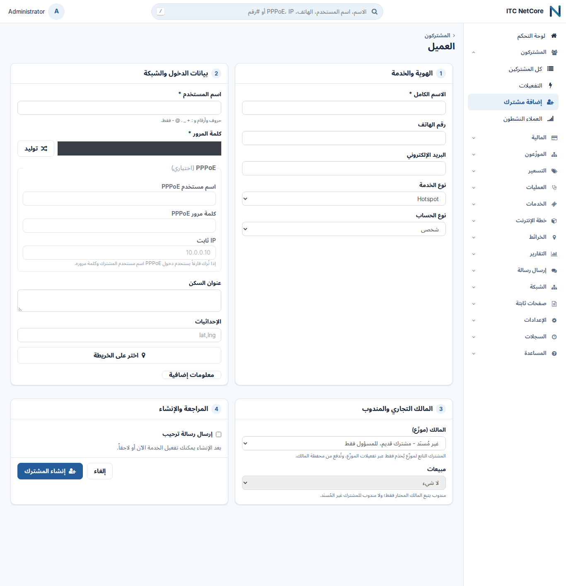

**النتيجة المتوقعة:** رسالة «تم إنشاء المشترك.» و«فعّل الخدمة الآن، أو لاحقاً من هذه الصفحة.»

**أخطاء شائعة:**

- مشترك له خدمتا Hotspot وPPPoE بالاسم نفسه: يلزم «اسم مستخدم PPPoE» مختلف، وإلا تُرفض الخدمة الثانية.
- اسم مستخدم أو اسم PPPoE أو «IP ثابت» يستخدمه مشترك آخر (في أي مكان من النظام، بما في ذلك أشجار الموزّعين الآخرين): يُرفض الإنشاء. ويرى الموزّع والمندوب **رسالة رفض عامة واحدة** لا تذكر القيمة المستخدمة ولا صاحبها، حمايةً لبيانات الموزّعين الآخرين. اختر قيمة أخرى وأعد المحاولة. أما المدير فيرى السبب المحدد.
- عنوان «IP ثابت» غير صالح (ليس عنوان IPv4، أو عنوان خاص مثل 0.x أو عنوان الاسترجاع أو البث العام): يُرفض النموذج كله بالرسالة «يجب أن يكون عنوان IP الثابت عنوان IPv4 صالحاً لجهاز مشترك (ليس من النطاق 0.x ولا عنوان استرجاع أو ربط محلي أو بث متعدد أو محجوز أو بث عام)؛ اتركه فارغاً إن لم يكن له عنوان ثابت.»
- إدخال بيانات خاطئة: لا تستطيع تعديلها بعد الإنشاء، فراجعها جيداً قبل «إنشاء المشترك».

## 3.4 التفعيل والتجديد وتغيير الباقة

**الغرض:** منح المشترك فترة خدمة مدفوعة من محفظتك.

**الدور المطلوب:** «الوكيل» لمشتركيه هو، أو «مبيعات» للمشتركين المسندين إليه، أو «مدير» لأي مشترك تابع لموزّع. في كل الحالات تُخصم محفظة **مالك المشترك**.

**المتطلبات المسبقة:** المشترك مملوك لموزّع؛ الباقة مسعّرة ومتاحة لهذا الموزّع؛ رصيد متاح كافٍ؛ لا يوجد تفعيل آخر قيد التنفيذ لهذا المشترك.

**الخطوات:**

1. من ملف المشترك اضغط «تجديد / تغيير الباقة» (الزر نفسه يبدأ أول تفعيل لمشترك ليست له خدمة بعد)، أو «المشتركون» › «التفعيلات» › «تفعيل / تجديد» ثم اختر المشترك.
2. اختر الباقة من قائمة «الخطة» (تظهر فيها «اختر باقة» إلى أن تختار) واضغط «مراجعة».
3. راجع بطاقة التأكيد:
   - نوع العملية الذي يحدده الخادم (الجدول أدناه).
   - «الانتهاء الحالي» و«الفترة الجديدة» و«يُدفع من محفظة».
   - «سعر الجملة - تكلفة الموزّع» (يُخصم من محفظة الموزّع) و«سعر البيع - سعر المشترك» (ما يدفعه المشترك).
   - «الرصيد المتاح الآن» و«الرصيد المتاح بعد التفعيل».
   - «الرصيد كافٍ: نعم» أو «الرصيد كافٍ: لا».
4. إذا كانت العملية **تغيير باقة** يُلغي مدة مدفوعة باقية، ضع علامة على «أفهم أن المدة المدفوعة المتبقية ستُفقد». لا يعمل زر التأكيد دون ذلك.
5. اضغط «تأكيد التفعيل». لا تغلق الصفحة حتى تظهر النتيجة.

| حالة الخدمة الحالية | نوع العملية | الفترة الجديدة |
|---|---|---|
| لا خدمة | تفعيل جديد | تبدأ الآن |
| الباقة نفسها وما زالت فعالة | تجديد | «الباقة نفسها: تستمر الفترة الجديدة من تاريخ الانتهاء الحالي.» |
| الباقة نفسها ومنتهية | إعادة تفعيل | «يُعاد تفعيل الخدمة المنتهية؛ تبدأ فترة جديدة الآن.» |
| باقة أخرى | تغيير باقة | «تغيير الباقة: يسري فوراً، وتُحتسب الفترة الجديدة كاملة، دون احتساب نسبي.» |

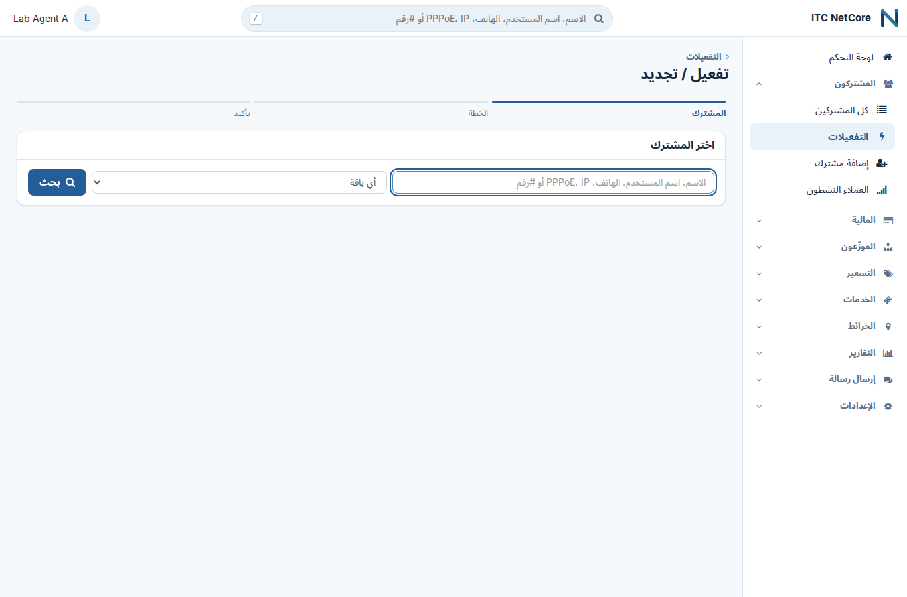

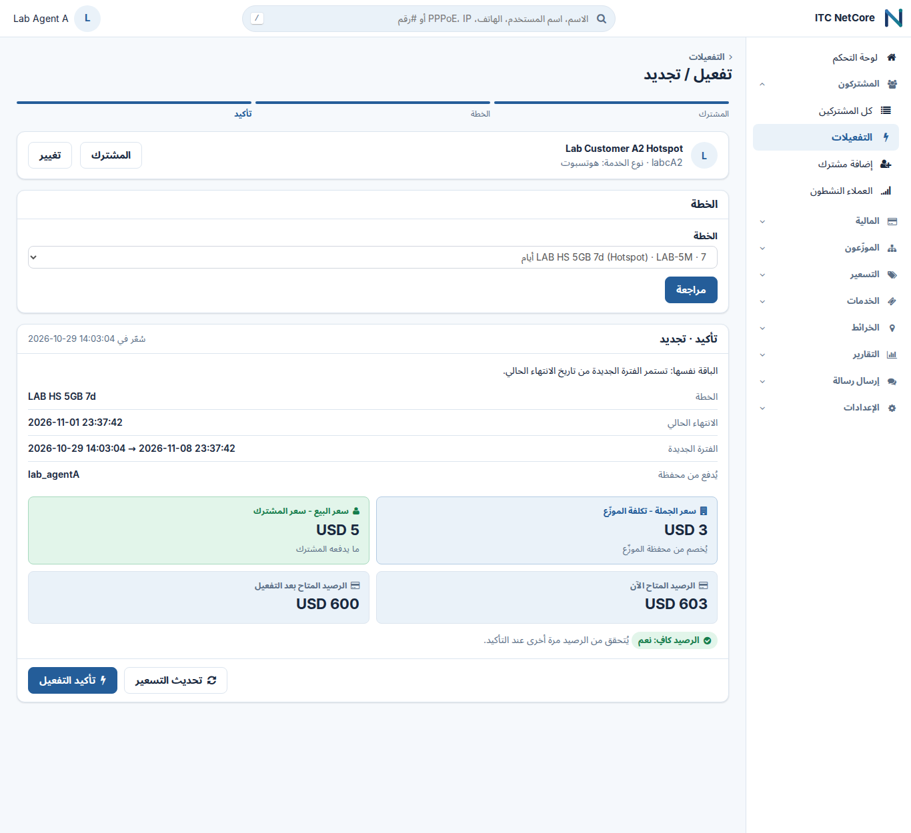

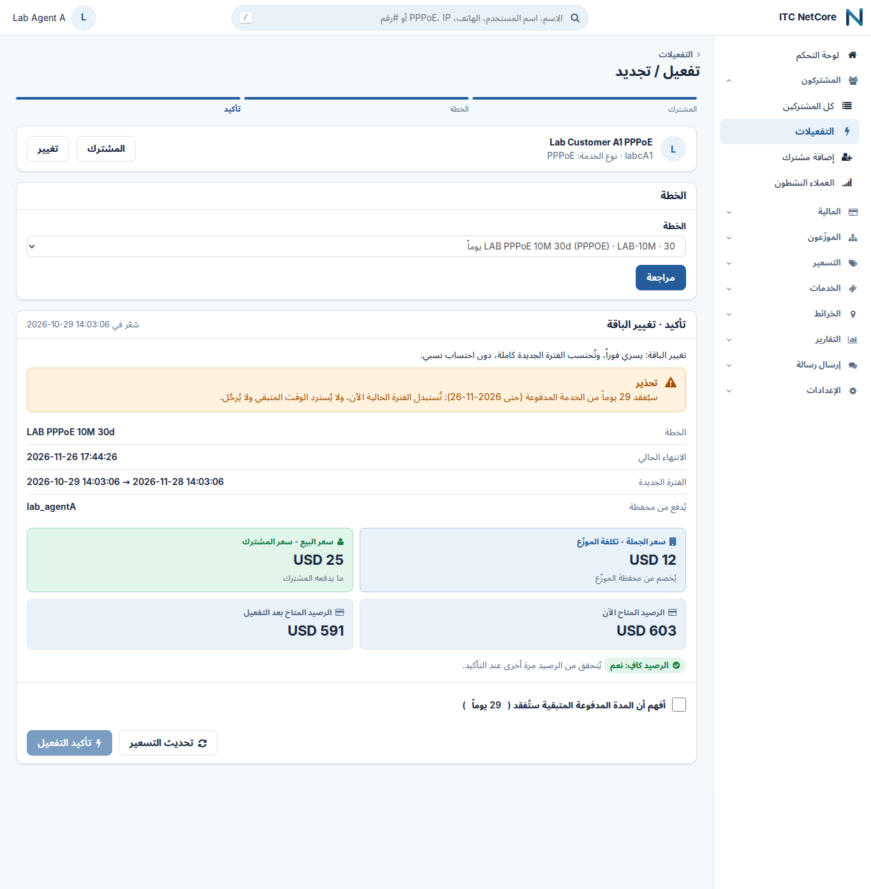

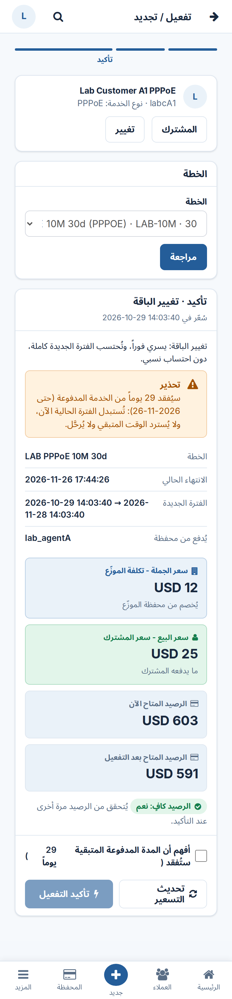

**النتيجة المتوقعة:** صفحة التفعيل بشريط «التقدّم» و«مكتمل» مع «الخدمة فعّالة حتى» و«خُصمت تكلفة الجملة.»، وتفاصيل «دفعه (الموزّع)» و«طلبه» و«الفاتورة»، و«التسلسل الزمني».

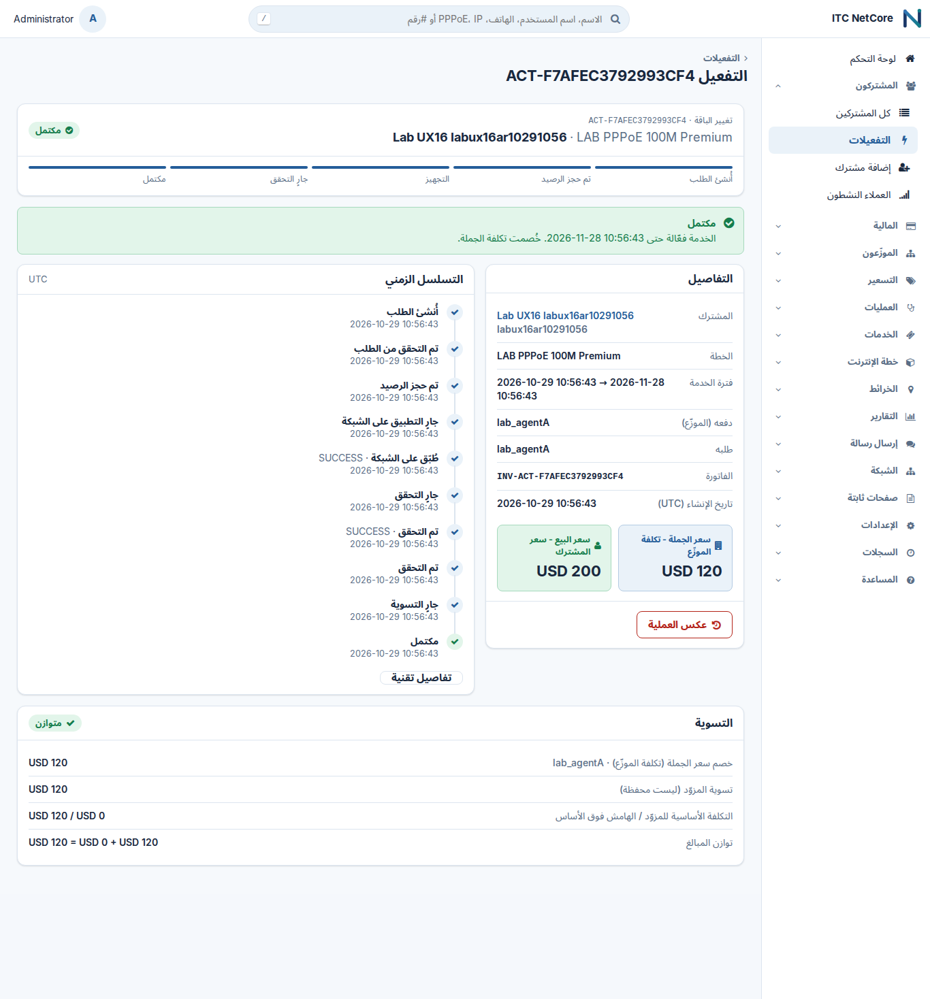

**أخطاء شائعة:**

- الضغط على التأكيد أكثر من مرة أو تحديث الصفحة. لا يُخصم المبلغ مرتين، لكن لا تكرر العملية: افتح حالتها.
- بدء تفعيل ثانٍ لمشترك له تفعيل جارٍ: يُرفض بالرسالة «يوجد تفعيل آخر لهذا المشترك ما زال قيد التنفيذ؛ راجع حالته أولاً.»
- تغيير الباقة بدل التجديد دون قصد: يبدأ فترة جديدة الآن وتضيع المدة المتبقية. التجديد يكون باختيار **الباقة نفسها**.
- تجاهل «تحديث التسعير» بعد تغيّر الأسعار: إذا تغيّر السعر بعد المراجعة يرفض الخادم التأكيد بالرسالة «تغيّر السعر أو الشروط منذ مراجعتك. لم يُخصم شيء؛ راجع التأكيد المحدّث.»

> [!FINANCE-WARNING]
> الأسعار والأرصدة في بطاقة التأكيد يحسبها الخادم، ويُعاد التحقق منها عند التأكيد («يُتحقق من الرصيد مرة أخرى عند التأكيد.»). مع رصيد غير كافٍ يبقى زر التأكيد معطلاً، وأي محاولة لفرضه يرفضها الخادم. لا تجديد تلقائي لمشتركي الموزّعين في V1.0: عند انتهاء الفترة تنتهي الخدمة، ويجدد الموزّع يدوياً.

> [!WARNING]
> إذا ظهرت «قيد المعالجة» أو «قيد التحقق - مطلوب مطابقة» فلا تكرر التفعيل. المبلغ محجوز ولم يُخصم، ويبقى محجوزاً حتى يقرر المدير. تابع الحالة من صفحة التفعيل.

## 3.5 التسعير والبيع

**الغرض:** تحديد أسعار فروعك وسعر بيعك.

**الدور المطلوب:** «الوكيل».

| ما تحدده | لمن |
|---|---|
| «سعر الجملة (تكلفة الموزّع)» | لفروعك المباشرة فقط. لا تحدد سعر جملتك أنت أبداً |
| «الإتاحة» | لفروعك المباشرة فقط |
| «سعر البيع (سعر المشترك)» | لنفسك فقط |

**الخطوات:**

1. «التسعير» › «الخطط والأسعار». ترى الباقات المتاحة لك مع «سعر الجملة (تكلفة الموزّع)» و«سعر البيع (سعر المشترك)» و«هامشك».
2. افتح الباقة، ثم «تعديل» على صفك أو صف فرعك.
3. لفرعك: «سعر الجملة (تكلفة الموزّع) لهذا الموزّع» («لا يمكن أن يقل عن سعر جملة الموزّع الأعلى. فارغ = موروث.») و«الإتاحة لهذا الموزّع».
4. لنفسك: سعر البيع («لا يمكن أن يقل عن سعر الجملة. فارغ = سعر البيع الافتراضي (سعر الخطة).»).
5. «حفظ».

**النتيجة المتوقعة:** تصبح الباقة «قابل للبيع» للفرع. الفرق بين سعر جملتك وسعر جملة فرعك هو عمولتك.

**أخطاء شائعة:** سعر بيع أقل من سعر الجملة (يُرفض)، أو سعر جملة صفري لفرع (لا يصلح للتفعيل).

## 3.6 المحفظة والحركات

**المعادلة:** «الرصيد المتاح» = «الرصيد + حد الدين - المحجوز».

- «المالية» › «نظرة عامة على المحفظة»: «محفظتي»، «آخر الحركات»، و«موزّعيّ الفرعيون».
- «دفتر الحركات»: كل خصم وعمولة وتحويل بالرصيد قبل وبعد، مع تصفية و«تصدير CSV». «قيود دفتر الحركات دائمة. تتم التصحيحات بقيد تعويضي جديد.»
- «التحويلات»: التحويلات التي تخصك.

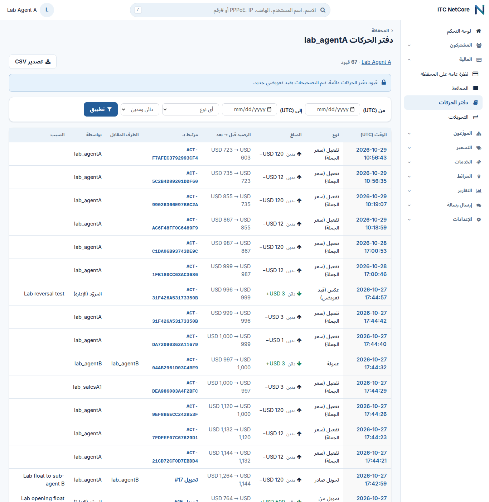

### إرسال رصيد إلى موزّع فرعي

**الغرض:** تمويل فرع مباشر من محفظتك.

**الدور المطلوب:** «الوكيل» إلى فرعه المباشر فقط، أو «مدير».

**المتطلبات المسبقة:** رصيد متاح كافٍ؛ الفرع نشط.

**الخطوات:**

1. «المالية» › «نظرة عامة على المحفظة» › «إرسال إلى موزّع فرعي» (أو الزر السريع).
2. في «إلى (موزّع فرعي مباشر)» اختر الفرع. الفرع غير النشط يظهر «غير نشط - التحويلات محظورة».
3. أدخل «المبلغ» و«السبب» ثم «مراجعة».
4. راجع: «أنت ترسل»، و«من - الرصيد المتاح»، و«إلى - الرصيد»، و«مرجع العملية». الملاحظة: «هذا تحويل رصيد وليس عملية بيع.»
5. اضغط «تأكيد».

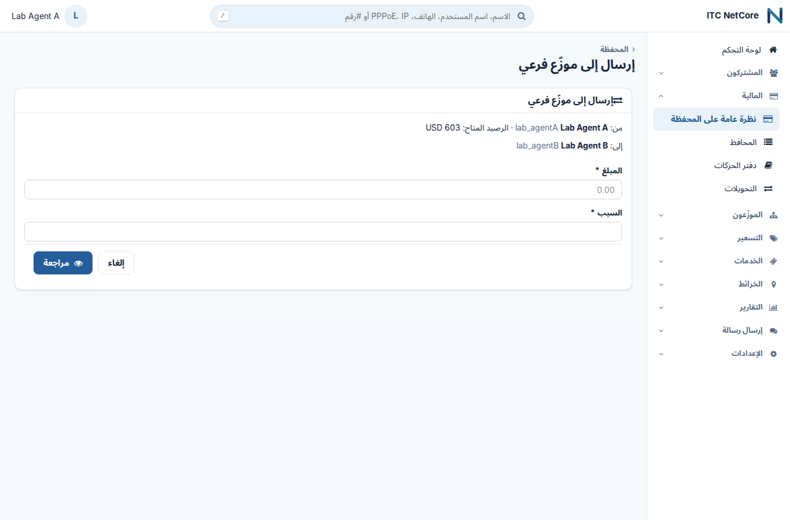

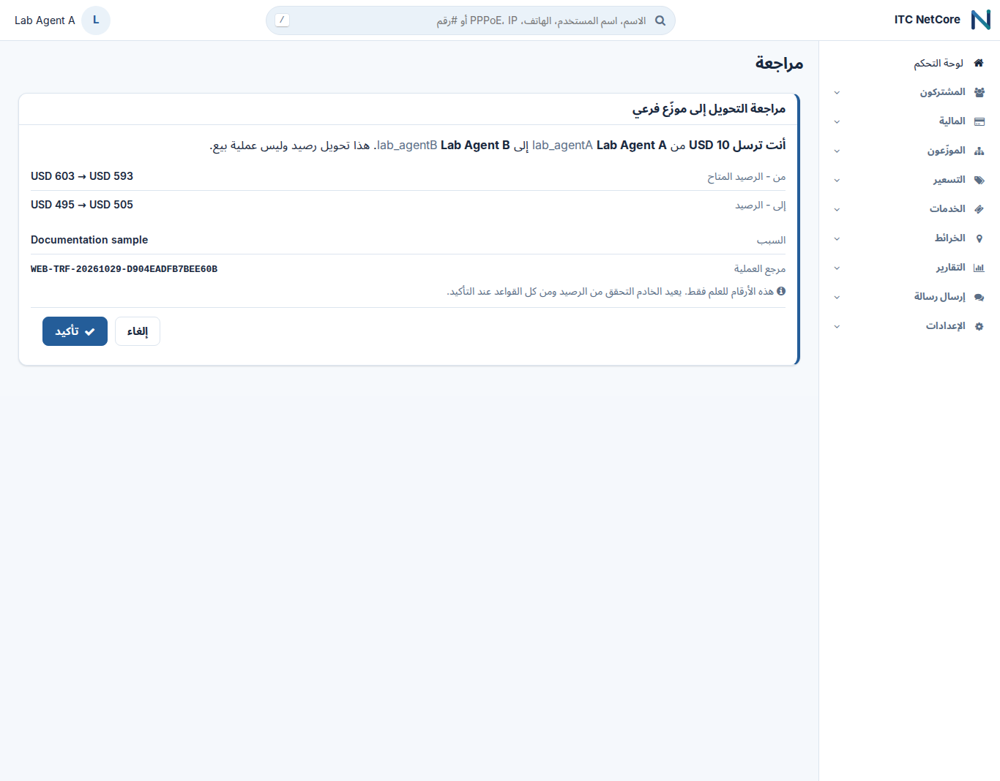

**النتيجة المتوقعة:** «تم التسجيل.» وقيدان متقابلان: خصم من محفظتك وإضافة إلى محفظة الفرع.

**أخطاء شائعة:** الضغط على «تأكيد» مرتين. لا يُكرر التحويل، وتظهر الرسالة «مسجّل مسبقاً: عولج هذا التأكيد مرة واحدة.»

> [!FINANCE-WARNING]
> لا تستطيع تمويل نفسك ولا الصرف من محفظة فرع تحتك. محفظتك يمولها المزوّد (المدير) أو موزّعك الأعلى. التحويل لا يُلغى إلا بعملية «عكس التحويل» يجريها المدير.

## 3.7 التسلسل الفرعي: إنشاء موزّعين فرعيين ومندوبين

**الغرض:** بناء شبكة بيع تحتك.

**الدور المطلوب:** «الوكيل».

**الخطوات:**

1. «الإعدادات» › «مستخدمو المدير» › «إضافة مدير جديد».
2. في «نوع المستخدم» تظهر لك «الوكيل» (موزّع فرعي) و«مبيعات» فقط، مع الملاحظة «تُنشأ الحسابات الجديدة تابعة لك مباشرة.»
3. أكمل البيانات و«حفظ التغييرات».
4. حدد أسعار الجملة والإتاحة للفرع الجديد (3.5)، ثم موّله بالتحويل (3.6).

**ما تستطيعه على فروعك:** تعديل الملف الشخصي والتعطيل وإعادة التنشيط لكل من تحتك (عدا إعادة تنشيط حساب عطّله المدير). أما إعادة تعيين كلمة المرور فلفروعك **المباشرين** فقط؛ ولحساب أبعد من ذلك تظهر رسالة الرفض «يمكنك إعادة تعيين كلمة مرور حساباتك الفرعية المباشرة فقط.»

**ما لا تستطيعه:** الحذف، وتغيير الأدوار، ونقل الحسابات في الشجرة، وإعادة تنشيط حساب عطّله المدير.

> [!FINANCE-WARNING]
> الموزّع الذي يكسب عمولة من مبيعات فروعه يجب أن تكون له محفظة، وإلا يُرفض تفعيل الفرع بالرسالة «الموزّع الأعلى الذي يستحق عمولة من هذا البيع ليس لديه محفظة بعد.» الموزّع الذي يمول فروعه بالتحويل له محفظة أصلاً.

## 3.8 التقارير

من «التقارير» يرى الموزّع: «مبيعات» و«العمولات» و«أداء الموزّعين» لفرعه. «تسوية المزوّد» والتقارير القديمة («المعاملات (النظام القديم)» و«سجل التفعيل (النظام القديم)») للمدير فقط.

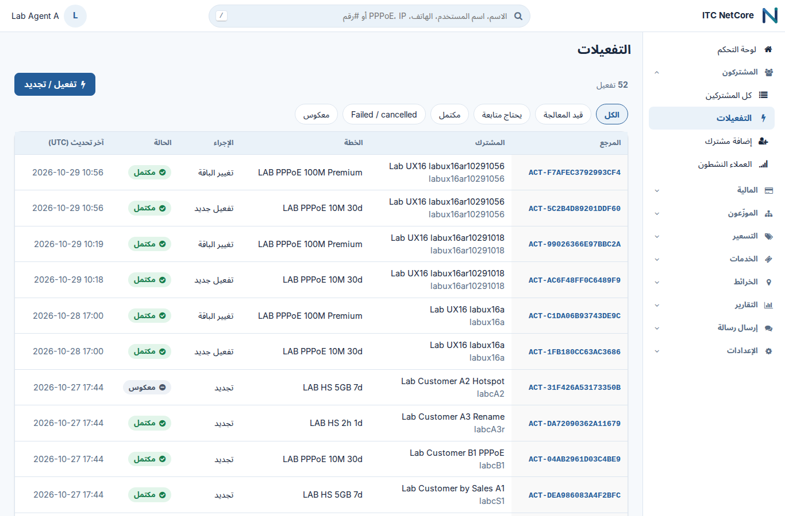

## 3.9 حالات الخطأ والاستعادة

| ما تراه | معناه | ماذا تفعل |
|---|---|---|
| «الرصيد كافٍ: لا» | الرصيد المتاح أقل من سعر الجملة | اطلب تمويلاً من موزّعك الأعلى أو من المزوّد |
| «يوجد تفعيل آخر لهذا المشترك ما زال قيد التنفيذ؛ راجع حالته أولاً.» | تفعيل سابق لم ينتهِ | افتح حالته. إذا بقي أكثر من 5 دقائق أبلغ المدير |
| «تعذّر إكمال العملية المالية بسبب نشاط متزامن؛ يرجى المحاولة مرة أخرى.» | ضغط متزامن كبير على محفظة واحدة. قد يبقى المبلغ محجوزاً دون خصم أو منح | **لا تكرر المحاولة مراراً.** اطلب من المدير استئناف التفعيل المعلّق أو إلغاءه بعد 5 دقائق |
| «قيد التحقق - مطلوب مطابقة» | نتيجة الشبكة غير مؤكدة | لا تكرر. المدير يطابقه من مركز العمليات |
| «لا توجد باقة متاحة لهذا المشترك.» | لا باقة مسعّرة ومتاحة لموزّع المشترك | راجع التسعير مع موزّعك الأعلى أو المدير |
| «الموزّع أو موزّعه الأعلى غير فعّال؛ التغييرات المالية محظورة.» | حسابك أو أحد أعلى منك معطّل | راجع المدير |
| «هذه الخدمة يديرها وكيلك ولا يمكن تغييرها من هنا...» | ظهرت لمشتركك في البوابة | طبيعي: التجديد يتم عبرك من شاشة التفعيل |

<!-- pagebreak -->
# 4. المندوب وموظفو التشغيل

يغطي هذا الفصل دورين يعملان يومياً مع المشتركين: «مبيعات» (المندوب) و«مدير» (موظف التشغيل لدى المزوّد).

## 4.1 المندوب (Sales): الصلاحيات بالضبط

المندوب يتبع موزّعاً واحداً، ويخدم فقط المشتركين **المسندين إليه صراحةً** من مشتركي ذلك الموزّع.

| يستطيع | لا يستطيع |
|---|---|
| عرض المشتركين المسندين إليه وملفاتهم | رؤية مشتركي موزّعه الآخرين. فتح أي منهم يرفضه الخادم |
| إضافة مشترك: يُنشأ مملوكاً لموزّعه ومسنداً إليه («المشترك الذي تنشئه يتبع موزّعك ويُسنَد إليك.») | تعديل المشترك أو مزامنته أو إيقاف خدمته أو حذفه |
| التفعيل والتجديد وتغيير الباقة لمشتركيه، **من محفظة موزّعه** | رؤية المحافظ أو «دفتر الحركات» أو شاشات «التسعير» |
| عرض الفواتير وإرسالها، ورسالة لمشترك واحد أو لمشتركين محددين | الرسائل الجماعية لكل المشتركين، وتوليد القسائم |
| ملفه الشخصي وكلمة مروره | إنشاء الموظفين أو إدارتهم |

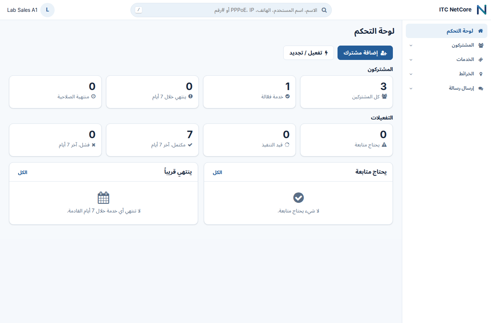

- القائمة الجانبية للمندوب: «المشتركون»، «الخدمات»، «الخرائط»، «إرسال رسالة».
- على الهاتف: «الرئيسية»، «العملاء»، «جديد»، «التفعيلات»، «المزيد».

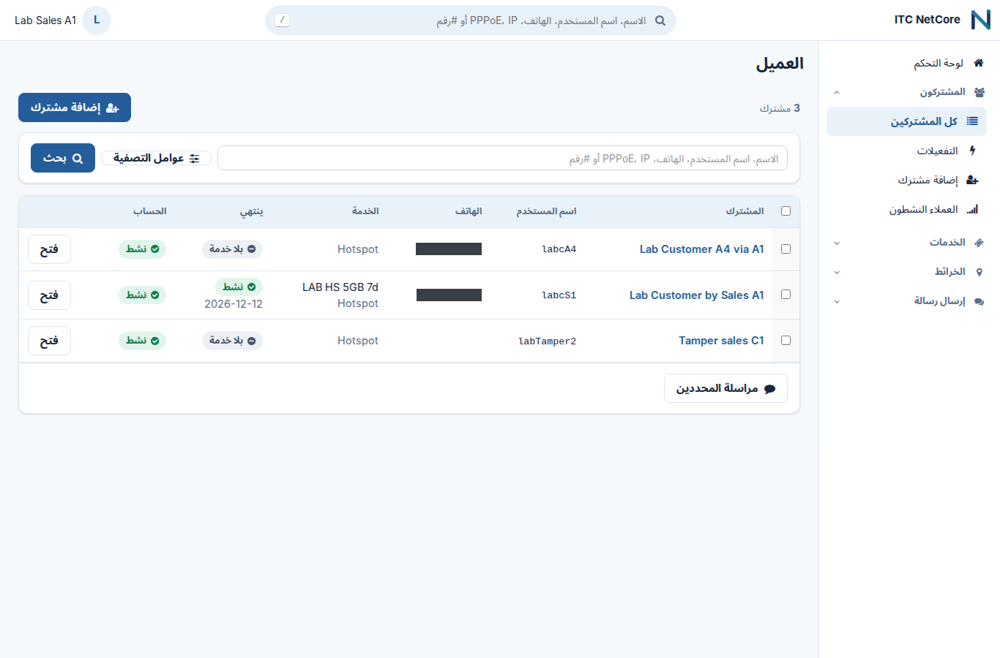

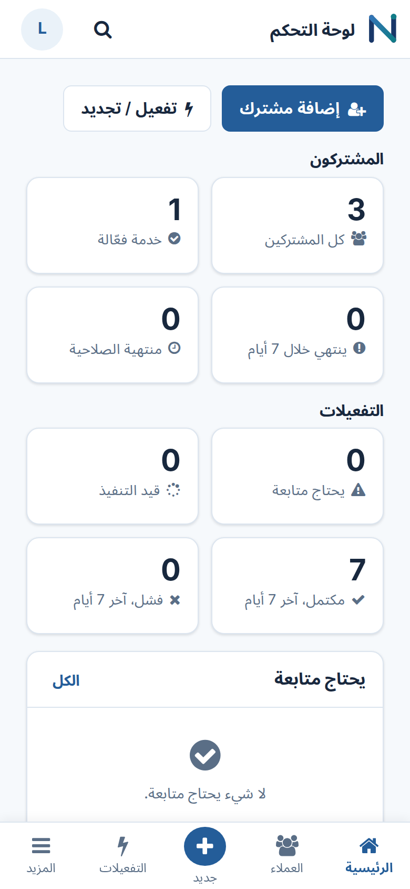

### التفعيل بواسطة المندوب

**الغرض:** تجديد اشتراك مشترك مسند إلى المندوب.

**الدور المطلوب:** «مبيعات» موضوع تحت موزّع، نشط وغير مجمّد.

**المتطلبات المسبقة:** المشترك مسند إليه؛ لموزّعه رصيد كافٍ.

**الخطوات:** كما في 3.4. الفرق: بطاقة المراجعة لا تعرض للمندوب سعر الجملة ولا أرقام الرصيد، بل «سعر البيع - سعر المشترك» والفترة الجديدة و«الرصيد كافٍ: نعم» أو «لا».

**النتيجة المتوقعة:** تفعيل «مكتمل»، والخصم من محفظة الموزّع المالك.

**أخطاء شائعة:**

- البحث عن مشترك غير مسند إليك: لن يظهر. اطلب من موزّعك إسناده إليك («إسناد مندوب»).
- «الرصيد كافٍ: لا»: لا تملك تمويل المحفظة. أبلغ موزّعك.
- إذا نقلك موزّعك في الشجرة تُلغى إسنادات المشتركين التي لم تعد مطابقة.

> [!SECURITY-WARNING]
> إذا لم يكن حسابك موضوعاً تحت موزّع، أو كان مجمّداً، فشاشات التفعيل تُرفض. هذا متعمد وليس عطلاً.

## 4.2 المدير (Admin): موظف التشغيل

«مدير» يملك صلاحيات «مدير النظام» نفسها **عدا**: حفظ «صفحات ثابتة»، وتثبيت الإضافات، وإعداد بوابات الدفع، والنسخ الاحتياطي والاستعادة من الواجهة، وإعدادات الأمان الخاصة بالمدير العام. ولا ينشئ إلا حسابات «تقارير» و«الوكيل» و«مبيعات»، ولا يحذف إلا «تقارير».

### نوعان من المشتركين

«المشتركون» › «كل المشتركين» تعرض للمدير كل المشتركين مع البحث والتصفية.

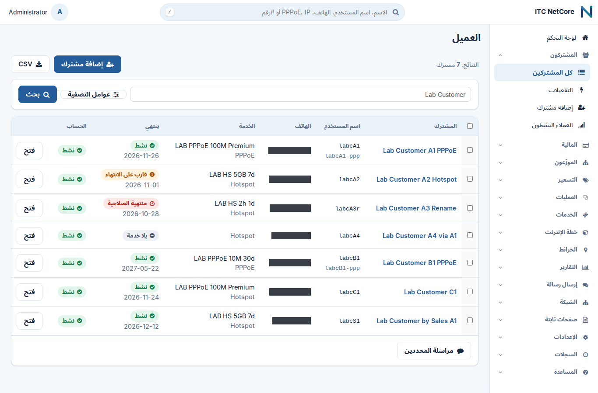

| | المشترك المباشر (دون موزّع) | مشترك الموزّع |
|---|---|---|
| في ملف المشترك | «المالك (موزّع)» = «غير مُسنَد (قديم)» | «المالك (موزّع)» = اسم الموزّع |
| منح الخدمة | «الخدمات» › «إعادة شحن اشتراك العميل» (شحن مباشر) أو «شحن العميل بقسيمة» (بقسيمة)، أو زر «شحن (مشترك قديم)» في ملفه | شاشة «تفعيل / تجديد» فقط، والخصم من محفظة المالك |
| إيقاف الباقة | زر «إيقاف الباقة» في ملفه | يُرفض. تنتهي الخدمة بالانتهاء الطبيعي أو بعكس التفعيل المكتمل |
| الرسالة عند محاولة الشحن القديم | — | «يُفعَّل مشتركو الموزّعين من خلال تفعيل الموزّع.» ثم تنتقل إلى شاشة التفعيل |

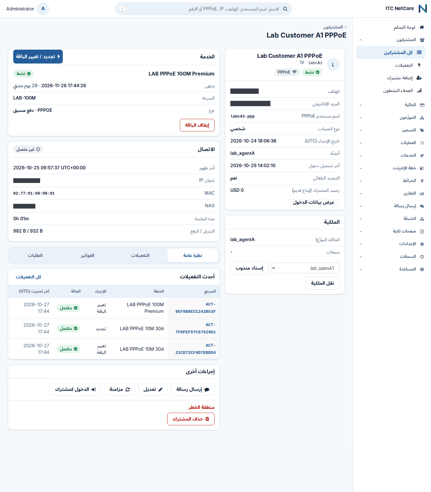

### تعديل مشترك ومزامنته

**الغرض:** تصحيح بيانات الدخول أو إعادة كتابة خدمة المشترك على الشبكة.

**الدور المطلوب:** «مدير» أو «مدير النظام».

**الخطوات:**

1. افتح ملف المشترك › «إجراءات أخرى».
2. «تعديل» لتغيير البيانات وكلمة المرور وبيانات PPPoE، ثم احفظ.
3. «مزامنة» لإعادة كتابة الخدمة الحالية على الشبكة.

**النتيجة المتوقعة:** لمشترك الموزّع يُعاد تطبيق حسابه على الشبكة دون تغيير فترة الاشتراك. إذا ظهر «لم يُؤكَّد التغيير على الشبكة» فلم تُعد المحاولة تلقائياً، ويجب تنفيذ «مزامنة» مرة واحدة.

**أخطاء شائعة:** تكرار «مزامنة» عدة مرات بسرعة. نفّذها مرة واحدة وانتظر النتيجة.

### إيقاف باقة مشترك مباشر

**الخطوات:** ملف المشترك › «إيقاف الباقة» › نافذة التأكيد: «ينهي هذا الباقة الآن ويجعلها منتهية. يتوقف الإنترنت لهذه الباقة.» › «إيقاف الباقة».

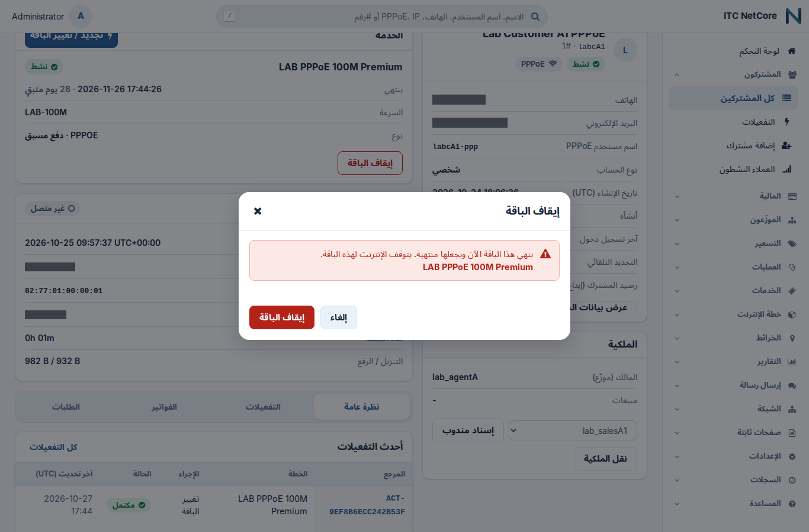

> [!WARNING]
> يظهر زر «إيقاف الباقة» للمدير على كل باقة فعالة، لكن الخادم يرفضه لمشترك الموزّع بالرسالة «هذه الخدمة يديرها وكيلك ولا يمكن تغييرها من هنا. يرجى التواصل مع وكيلك المعتمد.» لإنهاء خدمة مشترك موزّع قبل موعدها يُستخدم «عكس العملية» على التفعيل المكتمل (الفصل 7).

### حذف مشترك

ملف المشترك › «منطقة الخطر» › «حذف المشترك»، ثم «اكتب اسم المستخدم للتأكيد». «يُرفض الحذف ما دام سجل مالي أو سجل تفعيل يشير إلى المشترك.»

### الملكية

من ملف المشترك › «الملكية»:

- «إسناد مندوب» و«إلغاء إسناد المندوب»: مندوب تابع لمالك المشترك مباشرة.
- «نقل الملكية» إلى موزّع آخر: «تستخدم العمليات المستقبلية محفظة المالك الجديد وأسعاره...» ويبقى السجل لدى المالك الأصلي.
- «إسناد مالك» لمشترك مباشر: بعدها يُخدم المشترك عبر تفعيلات الموزّع فقط.

### التفعيلات التي تحتاجك

من «العمليات» › «مركز العمليات»، أو من صفحة التفعيل. الأزرار تظهر حسب الحالة فقط، وتفاصيلها في الفصل 7: «مطابقة»، «استئناف» أو «تسوية (استئناف)»، «إلغاء التفعيل»، «تراجع»، «عكس العملية».

### الرسائل

«إرسال رسالة» › «عميل واحد» أو «عملاء مجمعين» (الجماعية للمدير فقط).

## 4.3 ملخص الصلاحيات حسب الدور

| العملية | مدير النظام | مدير | الوكيل | مبيعات | تقارير |
|---|---|---|---|---|---|
| عرض المشتركين | الكل | الكل | فرعه | المسندون إليه | — |
| إضافة مشترك | نعم | نعم | لنفسه | لموزّعه ومسند إليه | — |
| تعديل / مزامنة / إيقاف / حذف مشترك | نعم | نعم | — | — | — |
| تفعيل / تجديد / تغيير باقة | أي مشترك موزّع | أي مشترك موزّع | مشتركوه هو | المسندون إليه | — |
| عكس تفعيل، مطابقة، إلغاء، استئناف | نعم | نعم | — | — | — |
| عرض المحافظ ودفتر الحركات | الكل | الكل | فرعه | — | — |
| تحويل إلى موزّع فرعي | نعم | نعم | لفروعه المباشرة | — | — |
| تمويل، سحب، حد دين، تسوية، عكس تحويل | نعم | نعم | — | — | — |
| التكلفة الأساسية وبيع الموزّعين | نعم | نعم | — | — | — |
| أسعار جملة الفروع وإتاحتها | الكل | الكل | فروعه المباشرة | — | — |
| توليد القسائم | نعم | نعم | — | — | — |
| مركز العمليات | نعم | نعم | — | — | — |
| التقارير القديمة («المعاملات»، «سجل التفعيل») | نعم | نعم | — | — | — |
| إنشاء الموظفين | كل الأدوار | تقارير / الوكيل / مبيعات | الوكيل / مبيعات تحته مباشرة | — | — |
| الإعدادات والشبكة والباقات | نعم | نعم | — | — | — |
| الصفحات الثابتة، الإضافات، بوابات الدفع، النسخ الاحتياطي | نعم | — | — | — | — |
| لوحة التحكم، الملف الشخصي، كلمة المرور | نعم | نعم | نعم | نعم | نعم |

<!-- pagebreak -->

# 5. دور التقارير (Report)

> [!WARNING]
> وصفت أدلة سابقة دور «تقارير» بأنه «للاطلاع على التقارير والقوائم». هذا **غير صحيح** في V1.0. هذا الفصل يصف السلوك الفعلي.

**ما يستطيعه حساب «تقارير» بالضبط:**

- تسجيل الدخول والخروج.
- فتح «لوحة التحكم»، وهي تعرض فقط: «لا توجد عروض بيانات مخصصة لهذا الدور.» و«استخدم القائمة لملفك الشخصي وكلمة المرور.»
- من قائمة الحساب: «حسابي»، «تغيير كلمة المرور»، تبديل اللغة، «المظهر الفاتح / الداكن»، «تثبيت التطبيق».

**ما لا يستطيعه:**

- القائمة الجانبية لا تحتوي إلا «لوحة التحكم».
- لا يرى أي مشترك أو تفعيل أو محفظة أو سعر أو تقرير.
- فتح «التقارير» مباشرة بعنوانها يعطي صفحة «الوصول مرفوض» (HTTP 403)، لأن الدور لا يملك صلاحية قراءة التقارير.

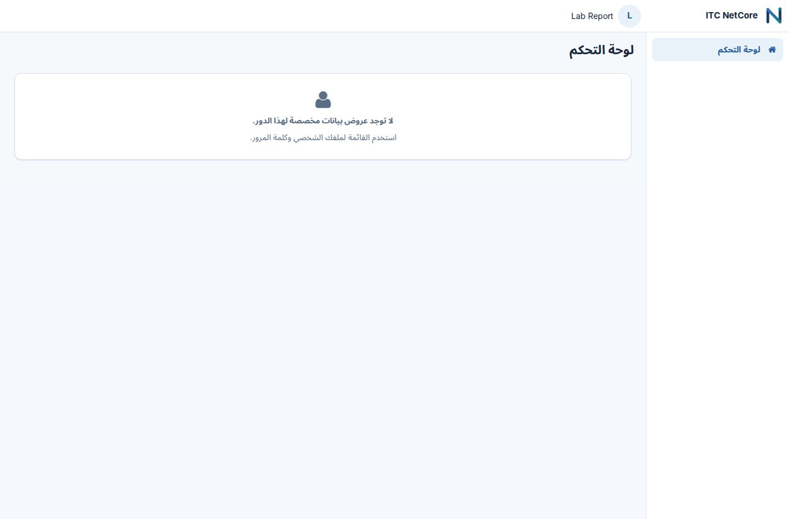

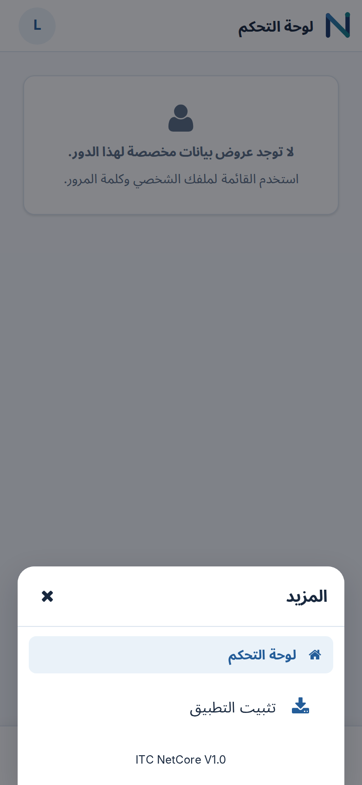

**متى تستخدمه:** لا يصلح هذا الدور حالياً لأي عمل على البيانات. من يحتاج التقارير المالية يحتاج حساب «مدير»، أو يستلم تصديراً يعدّه المدير. إنشاء حساب «تقارير» يمنح دخولاً فقط.

> [!NOTE]
> توسيع صلاحيات دور «تقارير» يحتاج قراراً من مالك المنتج وتغييراً في الشيفرة. لا يمكن تعديله من الإعدادات.

<!-- pagebreak -->

# 6. بوابة المشترك

يدخل المشترك إلى بوابة خاصة تحمل اسم شركتك. ما يظهر له يختلف حسب نوعه:

| | المشترك المباشر | مشترك الموزّع |
|---|---|---|
| التجديد | من البوابة إن كانت الأدوات مفعّلة، أو عبر المزوّد | عبر موزّعه فقط: «للتجديد تواصل مع وكيلك المعتمد» |
| القسائم، الشراء، الشحن، التمديد، الإيقاف، تحويل الرصيد | متاحة حسب الإعدادات | مرفوضة برسالة: «هذه الخدمة يديرها وكيلك ولا يمكن تغييرها من هنا. يرجى التواصل مع وكيلك المعتمد.» |
| «مزامنة» | متاحة | متاحة، ولا تمنح خدمة جديدة |
| تغيير كلمة المرور | متاح | متاح، ويُعاد تطبيق الحساب على الشبكة |

> [!NOTE]
> صور البوابة في هذا الفصل لمشترك تجريبي تابع لموزّع، في نظام ضُبط فيه «اسم الشركة». لذلك تظهر فيه رسالة التجديد عبر الوكيل ولا تظهر أزرار الشحن.

## 6.1 الدخول

**الخطوات:**

1. افتح صفحة البوابة.
2. أدخل «اسم المستخدم» و«كلمة المرور» (أو رقم الهاتف أو البريد إن ضبط المزوّد ذلك).
3. اختر «تذكرني» على جهازك الشخصي فقط، واضغط «تسجيل الدخول».

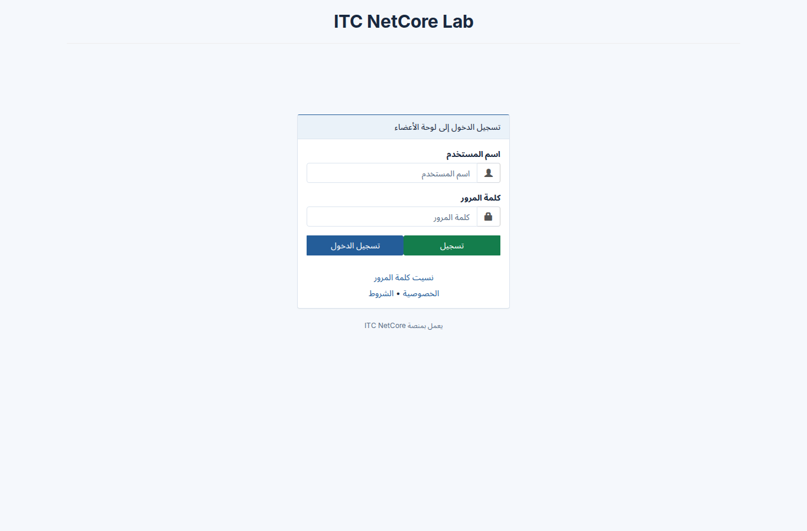

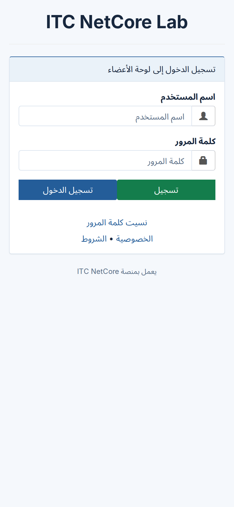

- «نسيت كلمة المرور»: رمز تحقق إلى الهاتف أو البريد.
- «تسجيل»: التسجيل الذاتي، إن لم يعطّله المزوّد.
- الحساب «محظور» لا يدخل، وتظهر «حالة هذا الحساب : محظور».

## 6.2 الحساب

- «معلومات حسابك»: «اسم المستخدم»، «كلمة المرور» (مغطاة في الصور)، «نوع الخدمة»، الرصيد.
- من القائمة العلوية: «حسابي» لتعديل البيانات، و«تغيير كلمة المرور».
- «اللغة» من أيقونة الكرة الأرضية، و«الوضع الداكن».

## 6.3 الاشتراك الفعال ومعلومات الباقة

بطاقة الباقة تعرض: «اسم الباقة»، «تم الإنشاء في»، «ينتهي في»، «نوع» («دفع مسبق» أو «دفع آجل»)، وأزراراً حسب نوع المشترك.

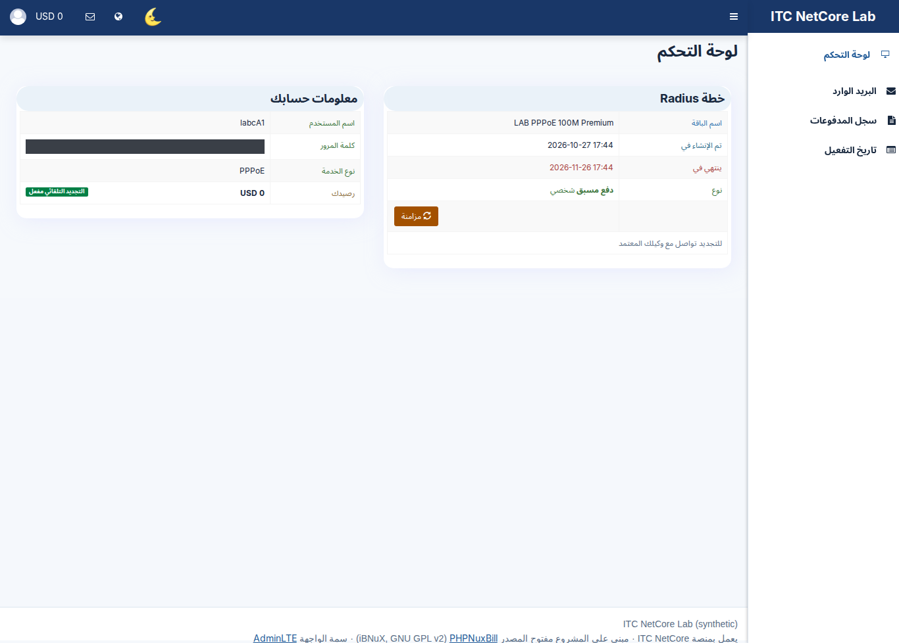

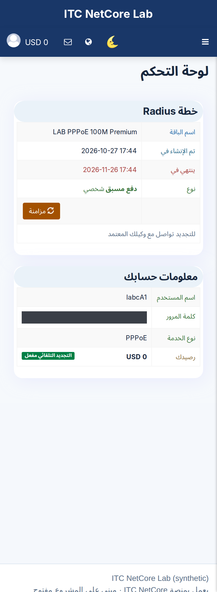

- «مزامنة»: «زامِن الحساب إذا تعذّر عليك الدخول إلى الإنترنت».
- القائمة الجانبية: «لوحة التحكم»، «البريد الوارد»، «سجل المدفوعات»، «تاريخ التفعيل».

## 6.4 التجديد

| نوع المشترك | كيف يجدد |
|---|---|
| مشترك الموزّع | يتواصل مع موزّعه، الذي يجدد من شاشة «تفعيل / تجديد». لا تجديد تلقائي لمشتركي الموزّعين في V1.0، أياً كان مفتاح التجديد التلقائي في البوابة |
| المشترك المباشر | قسيمة (6.5)، أو زر «إعادة شحن» في بطاقة الباقة الذي ينقله إلى صفحة الدفع (يحتاج بوابة دفع مثبتة)، أو «تمديد» للباقة المنتهية غير المدفوعة مسبقاً إن فعّله المزوّد، أو شحن يجريه المدير |

> [!NOTE]
> شراء الباقات إلكترونياً («شراء حزمة») يحتاج بوابة دفع يثبتها المدير العام. **لا تأتي أي بوابة دفع مع V1.0.**

## 6.5 استخدام قسيمة (للمشترك المباشر)

**الغرض:** تفعيل باقة برمز قسيمة مطبوعة.

**الدور المطلوب:** مشترك مباشر نشط. عنصر القائمة «قسيمة» لا يظهر لمشترك الموزّع، والخادم يرفض أي محاولة منه.

**الخطوات:**

1. من القائمة اختر «قسيمة».
2. في «تفعيل القسيمة» أدخل الرمز في «أدخل رمز القسيمة هنا» أو استخدم «مسح رمز QR».
3. اضغط «إعادة شحن».

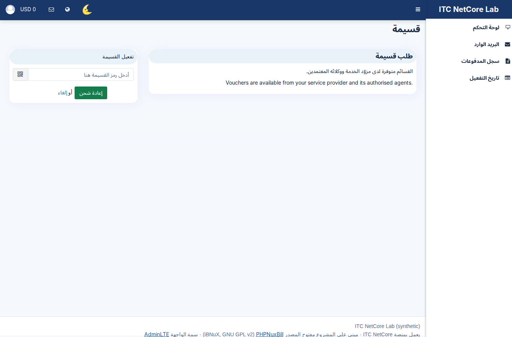

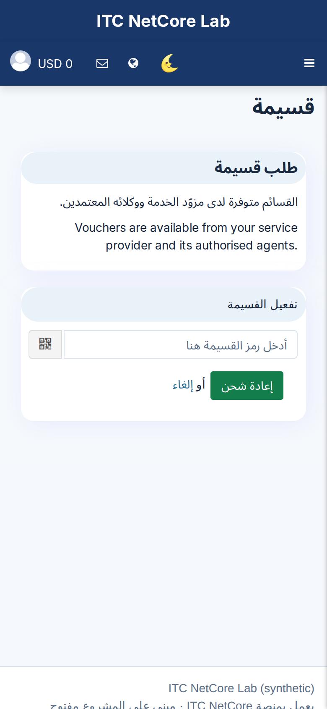

**النتيجة المتوقعة:** «تم تفعيل القسائم بنجاح» والانتقال إلى «تاريخ التفعيل».

**أخطاء شائعة:** رمز خاطئ أو مستخدم: «القسيمة غير صالحة». حساب غير نشط: «حالة هذا الحساب : ...».

## 6.6 إيقاف الباقة المدفوعة مسبقاً (للمشترك المباشر فقط)

**الغرض:** إنهاء الباقة الحالية من البوابة.

**الدور المطلوب:** مشترك مباشر. لا يظهر الزر لمشترك الموزّع، والخادم يرفضه.

**الخطوات:**

1. في بطاقة الباقة الفعالة اضغط أيقونة «تعطيل».
2. للباقة المدفوعة مسبقاً تظهر رسالة: «هل تريد تعطيل هذه الباقة المدفوعة مسبقاً؟ سيُفقد الوقت المدفوع المتبقي ولا يُسترد وفق السياسة الحالية.»
3. أكّد فقط إذا كان المشترك يقبل ذلك.

**النتيجة المتوقعة:** تنتهي الباقة فوراً ويتوقف الإنترنت.

> [!FINANCE-WARNING]
> لا يوجد في النظام أي مسار لاسترداد المبلغ بعد الإيقاف. أي تعويض قرار يتخذه المدير ويسجله بتسوية مدققة، ولا يتم تلقائياً.

> [!NOTE]
> لم تُلتقط صورة لنافذة الإيقاف في البوابة، لأن كل المشتركين التجريبيين ذوي الباقات الفعالة تابعون لموزّعين، والزر لا يظهر لهم.

## 6.7 الإشعارات والبريد الوارد

- «البريد الوارد»: الرسائل التي يرسلها المزوّد إلى المشترك.
- رسائل الانتهاء والتذكير تُرسل حسب القوالب التي يضبطها المدير في «الإعدادات» › «إشعار المستخدم»، وعبر القنوات المفعّلة.
- «سجل المدفوعات» و«تاريخ التفعيل»: الفواتير وتواريخ التفعيل والانتهاء.

<!-- pagebreak -->

# 7. العمليات المالية

> [!FINANCE-WARNING]
> **يُمنع إصلاح المال بتعديل قاعدة البيانات مباشرة.** لا يُنفّذ أي إدراج أو تعديل أو حذف على دفتر الحركات أو المحافظ أو التحويلات أو الحجوزات أو التفعيلات أو جداول التدقيق أو `radacct`. كل تصحيح عملية جديدة مدققة من التطبيق أو من أداة المطابقة.

## 7.1 المفاهيم

| المفهوم | التعريف |
|---|---|
| المحفظة | رصيد مسبق الدفع لموزّع واحد. «تُفتح المحفظة بأول تمويل من المزوّد، أو بحد دين موجب، أو بتحويل من الموزّع الأعلى.» |
| «حد الدين» | ائتمان يمنحه المزوّد للموزّع (المدير فقط)، ويُحسب رصيداً متاحاً فعلياً |
| «محجوز لتفعيلات قيد التنفيذ» | مبالغ محجوزة لتفعيلات لم تنتهِ |
| «الرصيد المتاح» | «الرصيد + حد الدين - المحجوز» |
| «دفتر الحركات» | سجل بقيد مزدوج، يُضاف إليه فقط. لا تعديل ولا حذف. التصحيح بقيد تعويضي |
| المبالغ | بخانتين عشريتين كحد أقصى، دون فاصل آلاف |

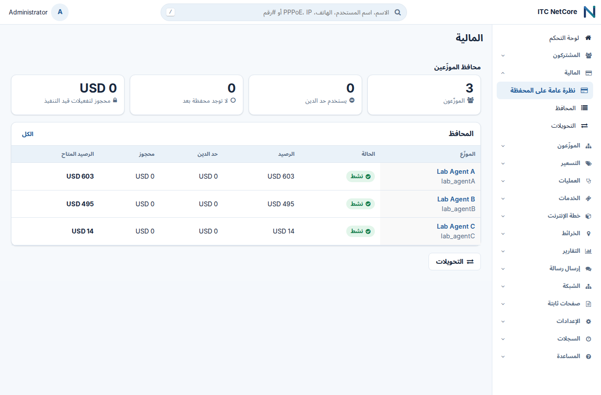

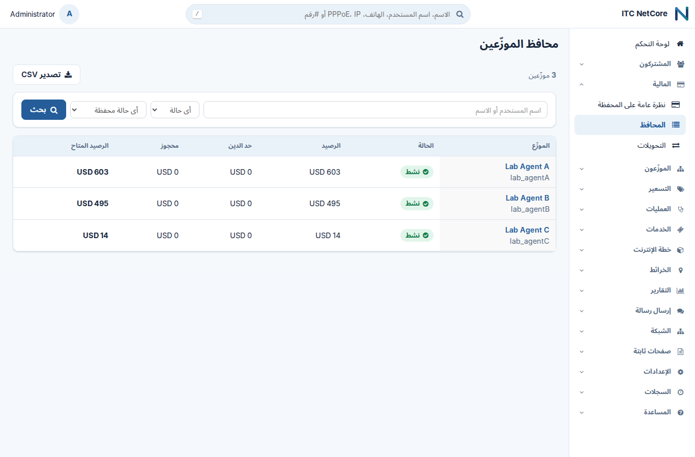

## 7.2 التمويل من المزوّد والسحب

**الغرض:** إضافة رصيد إلى محفظة موزّع مقابل دفعة استلمها المزوّد، أو سحب رصيد منها.

**الدور المطلوب:** «مدير النظام» أو «مدير».

**المتطلبات المسبقة:** الموزّع نشط ومسجّل في الشجرة؛ إيصال الدفع أو مرجع الحوالة جاهز.

**الخطوات:**

1. «المالية» › «المحافظ» (أو زر «تمويل موزّع») › افتح محفظة الموزّع.
2. اضغط «تمويل من المزوّد» (أو «سحب من المزوّد»).
3. أدخل «المبلغ» («أرقام بخانتين عشريتين كحد أقصى، دون فاصل آلاف.»)، و«السبب» («يُسجَّل السبب بشكل دائم ويظهر للموزّع في دفتر حركاته.»)، و«مرجع خارجي (اختياري)» مثل رقم الإيصال.
4. اضغط «مراجعة». لا يُكتب شيء بعد.
5. راجع الرصيد قبل وبعد و«مرجع العملية». «هذه الأرقام للعلم فقط. يعيد الخادم التحقق من الرصيد ومن كل القواعد عند التأكيد.»
6. **للسحب فقط:** اكتب اسم مستخدم الموزّع في «اكتب اسم مستخدم الموزّع للتأكيد». لا يعمل الزر حتى يتطابق.
7. اضغط «تأكيد».

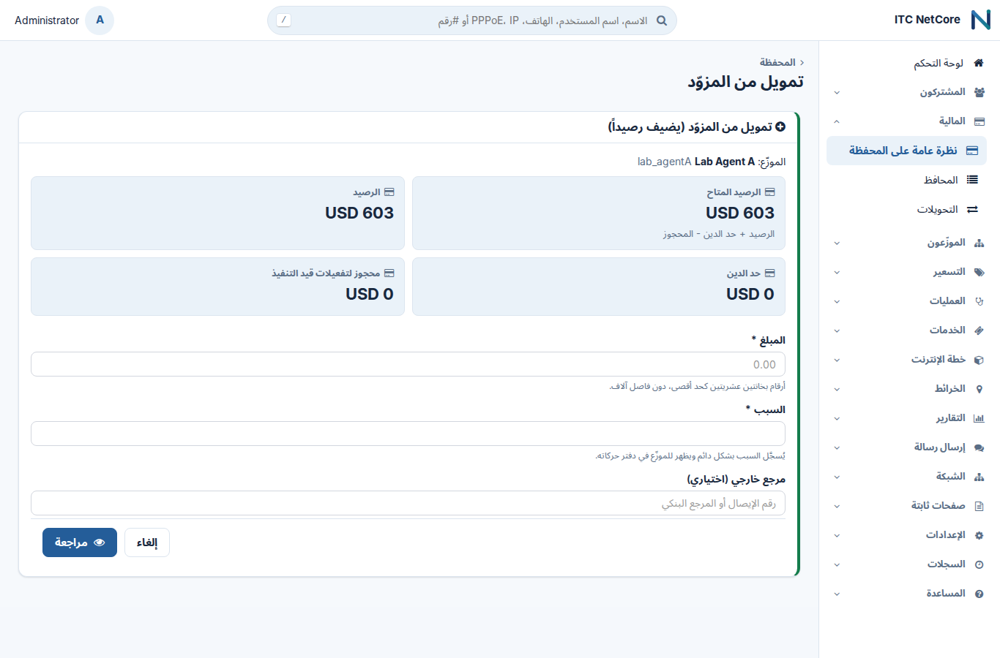

**النتيجة المتوقعة:** «تم التسجيل.» وقيد جديد في «دفتر الحركات»، وتحديث رصيد المحفظة.

**أخطاء شائعة:**

- الضغط مرتين على «تأكيد»: لا تتكرر العملية، وتظهر «مسجّل مسبقاً: عولج هذا التأكيد مرة واحدة.»
- العودة إلى صفحة مراجعة قديمة: «لم يعد هذا التأكيد صالحاً؛ لم يتغير شيء. راجع العملية مجدداً.»
- سبب أقصر من 3 أحرف أو أطول من 255: يُرفض.

## 7.3 حد الدين والتسويات المحاسبية

**الدور المطلوب:** «مدير النظام» أو «مدير».

| العملية | الزر في صفحة المحفظة | التأكيد المكتوب |
|---|---|---|
| «حد الدين» | «التصحيحات المحاسبية» › «حد الدين» › «حد الدين الجديد» | عند **التخفيض** فقط: اسم مستخدم الموزّع |
| «تسوية دائنة» | «التصحيحات المحاسبية» › «تسوية دائنة» | لا |
| «تسوية مدينة» | «التصحيحات المحاسبية» › «تسوية مدينة» | نعم: اسم مستخدم الموزّع |

**الخطوات:** النموذج › «مراجعة» › (التأكيد المكتوب عند الحاجة) › «تأكيد».

- التسوية «تصحيح للمحفظة بقيد جديد في دفتر الحركات. ليس تمويلاً من المزوّد ولا يفتح محفظة أبداً.»
- لا يُخفَّض حد الدين تحت ما يغطي الرصيد والحجوزات القائمة.
- إذا تغيّر حد الدين بعد المراجعة يُرفض التأكيد.

> [!FINANCE-WARNING]
> كتابة اسم المستخدم أو المرجع خطوة أمان مقصودة للعمليات التي تنقص المال. لا تنسخها آلياً: اقرأ الاسم وتأكد أنك في المحفظة الصحيحة.

## 7.4 التحويل إلى موزّع فرعي

موضّح في 3.6. التحويل من الموزّع إلى فرعه **المباشر** فقط، ولا يحتاج تأكيداً مكتوباً. المدير يستطيع أيضاً تنفيذ «إرسال إلى هذا الموزّع» من صفحة المحفظة.

## 7.5 عكس التحويل

**الغرض:** تصحيح تحويل أو تمويل خاطئ.

**الدور المطلوب:** «مدير النظام» أو «مدير».

**الخطوات:**

1. «المالية» › «التحويلات» › افتح التحويل.
2. «التصحيحات المحاسبية» › «عكس هذا التحويل».
3. أدخل «السبب» › «مراجعة».
4. اكتب مرجع التحويل الأصلي في «اكتب مرجع التحويل الأصلي للتأكيد» › «تأكيد».

**النتيجة المتوقعة:** عملية تعويضية جديدة. «تبقى القيود الأصلية دون تغيير؛ ويُسجَّل قيد تعويضي جديد.» يُعكس التحويل مرة واحدة فقط.

## 7.6 الخصم عند التفعيل والتسوية والعمولات

| المرحلة | ما يحدث للمال |
|---|---|
| فتح التفعيل | يُثبَّت تسلسل الأسعار، ويُحجز سعر الجملة من محفظة الموزّع المالك («التكلفة محجوزة من رصيد الموزّع؛ ولم تُخصم بعد.») |
| التجهيز على الشبكة | لا يتحرك أي مبلغ |
| الإتمام | في عملية واحدة: خصم سعر الجملة، وعمولة لكل موزّع وسيط له هامش موجب، وتسجيل تسوية المزوّد، والتفعيل «مكتمل» |

- التفعيل الذي لم تطبّقه الشبكة: «لم يُفعَّل» و«حُرّر الرصيد المحجوز؛ لم يُخصم شيء.»
- كشف حساب الموزّع يعرض كل خصم وعمولة.

## 7.7 الحجوزات المعلّقة (HELD)

> [!FINANCE-WARNING]
> **الحجز المعلّق لا يُحرَّر تلقائياً أبداً**: لا بمرور الوقت، ولا بمهمة مجدولة، ولا بخطأ تزامن. يُحل فقط بقرار مدقق من المدير أو المشغّل حسب الحالة. لا تحرره أبداً بتعديل قاعدة البيانات.

مصادر الحجز المعلّق: تفعيل توقف قبل التجهيز أو بينه، أو نتيجة شبكة غير مؤكدة، أو رفض تزامن على محفظة واحدة تحت ضغط شديد.

أين تراه: «مركز العمليات» › «يحتاج متابعة»، وبطاقة «محجوز لتفعيلات قيد التنفيذ» في المحفظة ولوحة التحكم.

## 7.8 التفعيلات المعلّقة والفاشلة

**الدور المطلوب:** «مدير النظام» أو «مدير». الموزّع والمندوب لا يملكان هذه الإجراءات.

**المتطلبات المسبقة:** مرّ على التفعيل 5 دقائق على الأقل دون تقدم. الأدوات ترفض التفعيل الحي.

| ما تعرضه صفحة التفعيل | الإجراء المتاح | أثره |
|---|---|---|
| «قيد المعالجة» ومتوقف 5 دقائق | «استئناف» أو «إلغاء التفعيل» | الاستئناف يكمل. الإلغاء يحرر الحجز: «لم يُطبَّق هذا التفعيل على الشبكة. هل تريد إلغاءه وتحرير الرصيد المحجوز؟ لا يمكن التراجع عن ذلك.» |
| تم التحقق ولم تتم التسوية | «تسوية (استئناف)» | تتم التسوية مرة واحدة |
| «قيد التحقق - مطلوب مطابقة» | «مطابقة» | إذا ثبت التسليم تتم التسوية مرة واحدة، وإذا عادت الشبكة للحالة السابقة يُحرَّر الحجز، وإلا «مطلوب مراجعة المشغّل» |
| «مطلوب مراجعة المشغّل» | «تراجع» أو تصحيح RADIUS ثم «مطابقة» | «التراجع باتجاه واحد: بعد محاولة التراجع لا يمكن تسوية هذا التفعيل أبداً.» يتطلب «اكتب المرجع للتأكيد» |
| «التراجع معلّق» | «إعادة محاولة التراجع» | يبقى الحجز حتى يُتحقق من الاستعادة |
| «عكس العملية معلّق» | «استكمال عكس العملية» | استكمال آمن للعكس |

**أخطاء شائعة:** تكرار «مطابقة» دون فحص RADIUS بعد «مطلوب مراجعة المشغّل»؛ أو الإلغاء قبل التأكد أن الشبكة لم تطبّق الخدمة.

> [!WARNING]
> لا تُعِد أبداً محاولة عملية نتيجتها على الشبكة غير معروفة دون فحص. عند الشك اترك المبلغ محجوزاً وصعّد الأمر.

## 7.9 عكس تفعيل مكتمل

**الغرض:** إنهاء خدمة مشترك موزّع قبل موعدها، أو تصحيح تفعيل خاطئ.

**الدور المطلوب:** «مدير النظام» أو «مدير» فقط.

**الخطوات:**

1. افتح التفعيل «مكتمل» › «عكس العملية».
2. اقرأ: «عكس هذا التفعيل المكتمل: استعادة حالة RADIUS السابقة، وإرجاع المبلغ للموزّع، واسترداد العمولات؟»
3. أدخل «السبب» (إلزامي)، واكتب مرجع التفعيل في «اكتب المرجع للتأكيد»، ثم «عكس العملية».

**النتيجة المتوقعة:** «معكوس»: «عُكس التفعيل المكتمل واستُعيدت الحالة السابقة.» و«استُردّت تكلفة الجملة وعُكست العمولات.»

> [!FINANCE-WARNING]
> لا يوجد استرداد تلقائي للمشترك. أي مبلغ دفعه المشترك للموزّع خارج النظام يُعاد خارج النظام. يُرفض العكس إذا تغيّرت خدمة المشترك بعد التفعيل، أو إذا كان استرداد عمولة سيجعل الرصيد المتاح لمستلمها أقل من صفر.

## 7.10 مطابقة المشغّل

| التكرار | الفحص | المتوقع |
|---|---|---|
| كل ساعة (المراقبة) | سلامة المال `health.php --finance` | سليم |
| يومياً | `reconcile.php finance-check` | `CONSISTENT` |
| يومياً | `reconcile.php drift` | لا أسطر |
| يومياً | «مركز العمليات» و`reconcile.php stale` | فارغ، أو لكل عنصر مشغّل مسمّى مسؤول عنه |
| شهرياً | «دفتر الحركات»، «التحويلات»، «مبيعات»، «العمولات»، «تسوية المزوّد»، «أداء الموزّعين» | مطابقة لسجلات الدفع الخارجية لدى المزوّد |

> [!SECURITY-WARNING]
> إذا انتهى `finance-check` برمز 4 أو ظهر تنبيه `finance` حرج، فقد حدثت كتابة خارج الخدمات المالية. أوقف البيع، **لا تصحح الأرقام**، احفظ نسخة من قاعدة البيانات والسجلات، وصعّد فوراً.

## 7.11 التدقيق

كل عملية مالية ناجحة تُسجَّل مع المنفذ والهدف والمرجع والمبلغ والرصيد قبل وبعد والسبب. كل تصدير مالي يُسجَّل أيضاً. المحاولات المرفوضة والمكررة لا تُسجَّل لأنها لا تغيّر شيئاً.

## 7.12 ممنوعات مالية

- تعديل أو حذف أي صف في دفتر الحركات أو التحويلات أو المعاملات أو `radacct` أو جداول التدقيق.
- تحرير حجز معلّق بتعديل قاعدة البيانات، حتى «لفك» حالة عالقة.
- تحرير حجز دون قرار موثق لحالته.
- تكرار عملية شبكة نتيجتها غير معروفة.
- تثبيت إضافة أو بوابة دفع غير مراجعة.

<!-- pagebreak -->
# 8. عمليات الشبكة

يكتب النظام سياسة كل مشترك (كلمة المرور، والصلاحية، والسرعة، وعدد الأجهزة المتزامنة، والعنوان، والحصة) في قاعدة بيانات FreeRADIUS. يسأل راوتر MikroTik خادم FreeRADIUS عند كل دخول، ويرسل سجلات المحاسبة أثناء الجلسة. وعند الحاجة يرسل النظام إلى الراوتر طلب فصل الجلسة أو تغيير خصائصها (Disconnect / CoA).

**توزيع المسؤوليات في هذا الفصل:**

| من | ماذا |
|---|---|
| المدير («مدير» أو «مدير النظام») | الواجهة: أجهزة NAS، ملف المشترك، السجلات، مركز العمليات |
| المشغّل | خادم التطبيق وخادم FreeRADIUS: أدوات `preflight.php` و`health.php` و`reconcile.php` و`quota.php` |
| مسؤول الشبكة | الراوتر: إعداد RADIUS وSNMP وNTP والجدار الناري |

## 8.1 حالة أجهزة NAS

- «الشبكة» › «Radius NAS»: الأجهزة المعرّفة، مع «الاسم» و«نوع» و«منفذ الفصل (CoA)» و«الخادم».
- «الشبكة» › «الموجهات»: الراوترات المسجلة وحالتها.
- يجب أن يكون «نوع» كل جهاز `mikrotik_snmp`.

## 8.2 اتصال FreeRADIUS

**الغرض:** التأكد أن الراوتر يصل إلى FreeRADIUS وأن FreeRADIUS يقرأ الأجهزة.

**الخطوات (للتحقق، دون تغيير):**

1. «السجلات» › «Radius»: هل تظهر محاولات دخول حديثة من هذا الجهاز؟
2. المشغّل: `php system/reseller/preflight.php`، ويجب أن ينتهي بنجاح.
3. المشغّل: `php system/reseller/health.php`. فحص `accounting` يحذر إذا لم تصل محاسبة منذ أكثر من 15 دقيقة والجلسات مفتوحة.

> [!NOTE]
> يقرأ FreeRADIUS قائمة الأجهزة عند بدء تشغيله. بعد إضافة جهاز أو تعديل سره يجب إعادة تشغيل FreeRADIUS، ولا تعتمد على إعادة التحميل.

## 8.3 حارس الجلسة (التحقق من الجلسة عبر SNMP)

عند إعادة اتصال مشترك PPPoE وما زالت جلسته السابقة مسجلة مفتوحة (مثلاً بعد فقدان رسالة نهاية الجلسة)، يسأل حارس الجلسة الراوتر عبر SNMP هل الجلسة القديمة ما زالت موجودة. إذا لم يستطع التأكد يرفض الدخول بالرسالة "Session verification failed" بدل المخاطرة بجلستين.

- يحتاج الحارس مجتمع SNMP للقراءة فقط لكل جهاز في ملف بيانات على خادم FreeRADIUS، و«نوع» الجهاز `mikrotik_snmp`.
- يفحصه المشغّل بأداة `nuxr_guard_selfcheck`، ويجب أن تطبع `guard_selfcheck=OK`.
- خلال 10 ثوانٍ من بدء جلسة يُرفض أي استيلاء جديد عليها؛ إعادة الاتصال بعد ثوانٍ قليلة تنجح.

## 8.4 التحقق من جلسة مشترك

**الغرض:** معرفة هل المشترك متصل الآن ومن أي جهاز.

**الدور المطلوب:** أي دور يرى المشترك.

**الخطوات:**

1. افتح ملف المشترك.
2. بطاقة «الاتصال»: «متصل» أو «غير متصل» أو «لا جلسات بعد» أو «الحالة غير معروفة»، مع «متصل منذ» أو «آخر ظهور»، و«عنوان IP» و«MAC» و«NAS» و«مدة الجلسة» و«التنزيل / الرفع».
3. للمدير: «السجلات» › «Radius» لرؤية رفض المصادقة الأخير.

**ما تعنيه الحالات:**

| الحالة | المعنى |
|---|---|
| «متصل» | جلسة مفتوحة حُدّثت مؤخراً |
| «الحالة غير معروفة» | «توجد جلسة مفتوحة لكنها لم تُحدَّث مؤخراً؛ قد يكون المشترك غير متصل.» |
| «لا جلسات بعد» | «لم تُسجَّل أي جلسة RADIUS لهذا المشترك.» |
| «غير متاح» | بيانات المحاسبة غير مقروءة؛ الحالة مجهولة |

## 8.5 الاستعادة

| الحالة | الإجراء المعتمد | من |
|---|---|---|
| تعديل لم يُؤكَّد على الشبكة («لم يُؤكَّد التغيير على الشبكة») | «مزامنة» مرة واحدة من ملف المشترك | المدير |
| جلسة قديمة بعد تغيير الباقة أو التجديد ما زالت بالسياسة القديمة | `reconcile.php session-end <ACT>` أو فصل الجلسة على الراوتر | المشغّل / مسؤول الشبكة |
| مطالبة دخول PPPoE معلّقة | إطلاقها بأداة المطابقة مع دليل من الراوتر | المشغّل |
| انحراف بين النظام وRADIUS | «فحص الانحراف» في مركز العمليات، ثم «مزامنة» | المدير |

> [!WARNING]
> لا تطلق مطالبة دخول نشطة يدوياً، ولا تعدّل جداول RADIUS أو المحاسبة يدوياً. كل تصحيح من التطبيق أو أدوات المطابقة.

## 8.6 Disconnect وCoA

- يرسل النظام طلبات Disconnect وCoA بنفسه إلى عنوان الجهاز، على «منفذ الفصل (CoA)» أو 3799 إذا كان فارغاً.
- يرسلها تلقائياً عند: التجديد وتغيير الباقة وإعادة التفعيل (لإنهاء جلسة الفترة السابقة)، وعند تجاوز الحصة.
- **لا يوجد زر فصل جلسة في واجهة الموظفين في V1.0.** الفصل اليدوي يتم على الراوتر، أو بأداة `reconcile.php session-end` لدى المشغّل.
- الراوتر يقبل الطلب فقط إذا جاء من عنوان مسجل لديه خادمَ RADIUS، وعلى منفذ الاستقبال المضبوط.
- إذا لم يُجب الراوتر لا يُعاد الطلب تلقائياً ولا يُلغى التفعيل؛ يظهر في الانحراف حتى تنتهي الجلسة.
- تغيير حد البيانات أو مجمع العناوين بطلب CoA أثناء الجلسة لا يطبقه RouterOS؛ يلزم فصل الجلسة ليعيد المشترك الدخول بالسياسة الجديدة.

## 8.7 سلوك الحصص

| الجانب | السلوك في V1.0 |
|---|---|
| الوحدات | بيانات: ميغابايت أو غيغابايت عشرية (1 غيغابايت = 10^9 بايت)، تنزيل ورفع معاً. وقت: دقائق أو ساعات |
| الفترة | لكل فترة اشتراك. التجديد وتغيير الباقة وإعادة التفعيل تبدأ فترة جديدة من الصفر. تغيير كلمة المرور أو المزامنة لا يغيّر الفترة |
| التطبيق | يطبّق الراوتر حداً لكل جلسة، ويتابع مراقب الحصص الاستهلاك كل بضع ثوانٍ ويفصل الجلسة المتجاوزة |
| الدقة | **محدودة، وليست دقيقة بالبايت.** قد يتجاوز الاستهلاك الحد بكمية صغيرة |
| التجاوز | «الاستهلاك الزائد عن الحصة سببه الوقت الذي تحتاجه الشبكة لإيقاف الجلسة. لا يُحتسب ولا يُرحَّل إلى الفترة التالية.» |
| العرض | ملف المشترك › «الحصة في هذه الفترة»: «حصة البيانات» أو «حصة الوقت»، «الاستهلاك الفعلي»، «المشمول بالباقة»، «تجاوز الحصة» |
| انتهاء الحصة | يُرفض الدخول برسالة "Data quota exhausted or unavailable" |

> [!WARNING]
> لا تُعلن الحصة للمشتركين على أنها سقف دقيق بالبايت. عند توقف مراقب الحصص أو FreeRADIUS أو قاعدة البيانات لا تنطبق إلا حدود الراوتر.

## 8.8 مزامنة الساعة

- خادم التطبيق وقاعدة البيانات وFreeRADIUS: توقيت UTC ومزامنة NTP، والفرق بينها 5 ثوانٍ كحد أقصى.
- كل راوتر: NTP من خادمين داخليين، والفرق 10 ثوانٍ كحد أقصى (يُفضّل أقل من ثانيتين).
- راوتر ساعته متقدمة أكثر من 10 ثوانٍ قد يترك جلسة قديمة تعمل بسياسة الباقة السابقة بعد التجديد أو تغيير الباقة حتى تعيد الاتصال، ولا يُكتشف ذلك تلقائياً.
- الفحوص: `preflight.php` (`time.nas_clock`: تحذير فوق 5 ثوانٍ، فشل فوق 10) و`health.php` (`nas_clock`). الفحوص ترى الساعة **المتقدمة** فقط؛ الساعة المتأخرة تُكتشف بمراقبة NTP.

> [!WARNING]
> لا تضبط ساعة الراوتر يدوياً بدل إصلاح NTP.

## 8.9 أخطاء SNMP

أسباب فشل `nuxr_guard_selfcheck` الشائعة:

| السبب الذي تطبعه الأداة | المعنى |
|---|---|
| `no-credential-file` أو `credential-file-mode` | ملف البيانات غير موجود أو صلاحياته خاطئة (يجب 0600 أو 0400 ومالكه `freerad`) |
| `credentials` | لا يوجد سطر لهذا الجهاز أو فيه أحرف غير صالحة |
| `snmpget-missing` / `snmpbulkwalk-missing` | أدوات net-snmp غير مثبتة |
| `health` | المجتمع خاطئ، أو SNMP معطل أو محجوب على الراوتر (لا يمكن التمييز بينهما) |

الإصلاح: يصحح المشغّل ملف البيانات أو يصحح مسؤول الشبكة إعداد SNMP على الراوتر، حتى تطبع الأداة `guard_selfcheck=OK`. لا يلزم إعادة تشغيل FreeRADIUS لتعديل ملف البيانات، ولا يلزم أي تعديل في قاعدة البيانات.

## 8.10 التنبيهات

يشغّل المشغّل `health.php` من نظام المراقبة كل 5 دقائق. رموز الخروج: 0 سليم، 1 تحذير، 2 حرج، 3 تعذّر الفحص.

| الفحص | يعني |
|---|---|
| `db` | قاعدة البيانات، وتوقيت UTC، وفرق الساعة |
| `schema` | جاهزية مخطط الموزّعين |
| `activations_stale` | تفعيلات متوقفة 5 دقائق (تحذير) أو 30 دقيقة (حرج) |
| `reconciliation` | تفعيلات تنتظر المطابقة والمبلغ محجوز |
| `reservations` | أقدم حجز نشط: تحذير بعد ساعة، حرج بعد 24 ساعة |
| `admission_pending` | مطالبات دخول معلّقة أكثر من 10 دقائق |
| `vouchers_review` | قسائم قيد المراجعة |
| `balance_held` | عمليات رصيد قديمة معلّقة |
| `accounting` | حداثة سجلات المحاسبة |
| `nas_clock` | راوتر ساعته متقدمة |
| `coa_failures` | نهايات جلسات غير مؤكدة في الساعة الأخيرة |
| `quota_enforcer` | مراقب الحصص متوقف أو جلسة متجاوزة |
| `finance` (مع `--finance`) | سلامة المال الكاملة |

<!-- pagebreak -->

# 9. استكشاف الأخطاء وإصلاحها

كل حالة بالترتيب نفسه: **العَرَض › الأسباب المحتملة › التحقق الآمن › الحل المعتمد › التصعيد.** خطوات التحقق الآمن للقراءة فقط. الحل المعتمد يحدد من يملك الصلاحية والطريق المدعوم.

> [!FINANCE-WARNING]
> في كل الحالات: لا تعدّل دفتر الحركات أو المحافظ أو الحجوزات أو التفعيلات أو `radacct` أو جداول الحصص أو التدقيق بقاعدة البيانات، ولا تحرر حجزاً معلقاً أو مطالبة دخول نشطة «لفك» مشترك، ولا تكرر عملية شبكة نتيجتها غير معروفة.

## 9.1 خطأ في تسجيل الدخول

**العَرَض:** موظف أو مشترك لا يستطيع الدخول إلى الواجهة أو البوابة، أو يُرفض دخول PPPoE أو Hotspot.

**الأسباب المحتملة:** اسم مستخدم أو كلمة مرور خاطئة؛ حساب موظف معطّل (الرسالة نفسها «اسم المستخدم أو كلمة المرور غير صالحة»)؛ موزّع مجمّد (يدخل لكن تُرفض التغييرات)؛ كلمة المرور الافتراضية للمثبّت (تحويل إلى تغيير كلمة المرور)؛ مشترك «محظور»؛ بيانات دخول الشبكة تغيّرت ولم تُطبَّق.

**التحقق الآمن:** المدير: «مستخدمو المدير» (حالة الحساب)، و«شجرة الموزّعين» (حالة من فوقه)، وملف المشترك (الحالة واسم المستخدم واسم PPPoE)، و«السجلات» › «Radius».

**الحل المعتمد:** إعادة ضبط كلمة مرور موظف: المدير لأي حساب أدنى، والموزّع لمن تحته فقط. كلمة مرور المشترك: المدير يعدّلها، أو المشترك من البوابة، أو «نسيت كلمة المرور». أعد تنشيط حساب معطّل فقط إذا لم يكن التعطيل مقصوداً.

**التصعيد:** فشل متكرر لحسابات كثيرة قد يكون محاولة تخمين. صعّد إلى مسؤول الأمن لتطبيق حد معدل الطلبات على واجهة HTTPS.

## 9.2 رصيد غير كافٍ

**العَرَض:** «الرصيد كافٍ: لا» وزر «تأكيد التفعيل» معطّل؛ أو «الرصيد المتاح غير كافٍ.»

**الأسباب المحتملة:** الرصيد المتاح أقل من سعر الجملة؛ الرصيد محجوز لتفعيلات عالقة؛ موزّع أعلى يستحق عمولة بلا محفظة؛ الحساب أو من فوقه مجمّد.

**التحقق الآمن:** صفحة المحفظة («الرصيد» و«حد الدين» و«محجوز لتفعيلات قيد التنفيذ» و«الرصيد المتاح»)؛ «مركز العمليات» لتفعيلات هذا الموزّع العالقة.

**الحل المعتمد:** الموزّع الأعلى: «إرسال إلى موزّع فرعي». المدير: «تمويل من المزوّد» أو «حد الدين». الحجوزات العالقة: حلّها حسب 9.4.

**التصعيد:** المشغّل المالي لسياسة الائتمان أو رصيد متنازع عليه.

## 9.3 اشتراك منتهٍ

**العَرَض:** المشترك لا يتصل بعد تاريخ الانتهاء؛ البوابة تظهر الباقة منتهية؛ الموزّع يقول «كان يتجدد تلقائياً».

**الأسباب المحتملة:** انتهت الفترة فرفض FreeRADIUS الدخول وأنهى النظام الخدمة؛ **لا تجديد تلقائي لمشتركي الموزّعين في V1.0**؛ تخطت المهمة المجدولة المشترك مؤقتاً لأن تجديده كان جارياً.

**التحقق الآمن:** ملف المشترك (الباقة و«ينتهي» وآخر تفعيل)؛ «مركز العمليات» › «التجديد التلقائي غير متاح (سجلات)».

**الحل المعتمد:** مشترك الموزّع: الموزّع أو مندوبه أو المدير يجدد من «تفعيل / تجديد» (إعادة تفعيل). المشترك المباشر: قسيمة أو شحن من البوابة أو من المدير.

**التصعيد:** إذا تخطت المهمة المجدولة المشترك نفسه مرات كثيرة، يفحص المشغّل التفعيلات المتوقفة.

## 9.4 تفعيل معلّق

**العَرَض:** تفعيل يبقى «قيد المعالجة» أو «قيد التحقق - مطلوب مطابقة»؛ رفض محاولة جديدة برسالة «يوجد تفعيل آخر لهذا المشترك ما زال قيد التنفيذ؛ راجع حالته أولاً.»؛ أو ظهرت للموزّع رسالة النشاط المتزامن.

**الأسباب المحتملة:** توقف العملية قبل التجهيز أو بينه؛ رفض تزامن على محفظة واحدة؛ نتيجة RADIUS غير معروفة؛ تسليم بلا تسوية.

**التحقق الآمن:** «مركز العمليات» › «يحتاج متابعة» و«تفعيلات متوقفة»؛ صفحة التفعيل («التسلسل الزمني» والإجراءات المتاحة)؛ المشغّل: `reconcile.php show <ACT>`.

**الحل المعتمد:** المدير فقط، بعد 5 دقائق من التوقف، حسب جدول 7.8: «استئناف» أو «إلغاء التفعيل» أو «تسوية (استئناف)» أو «مطابقة» أو «تراجع».

**التصعيد:** المشغّل المالي لأي نتيجة غامضة؛ فريق ITC إذا بقي التفعيل غامضاً بعد فحص RADIUS.

## 9.5 جهاز NAS لا يستجيب

**العَرَض:** دخولات جديدة على جهاز واحد تنتهي بمهلة؛ تحذير `accounting` أو `coa_failures`؛ تفعيلات بنتيجة `COA_NO_RESPONSE`.

**الأسباب المحتملة:** الراوتر متوقف أو معزول؛ تغيير في التوجيه أو الجدار الناري؛ منفذ استقبال الفصل على الراوتر 1700 والنظام يرسل إلى 3799؛ استقبال طلبات الفصل معطل؛ SNMP محجوب.

**التحقق الآمن:** مسؤول الشبكة على الراوتر: إعداد RADIUS واستقبال الفصل وقواعد UDP 3799 وUDP 161 ومدة التشغيل. المشغّل: `nuxr_guard_selfcheck` و`preflight.php`.

**الحل المعتمد:** يعيد مسؤول الشبكة الاتصال وإعداد الجهاز. بعدها ينهي المشغّل الجلسات القديمة المعلقة بأداة `session-end` حيث يذكرها فحص الانحراف.

**التصعيد:** مسؤول الشبكة أولاً، ثم ITC إذا كان الإعداد صحيحاً وما زال الفصل يفشل.

## 9.6 رفض RADIUS

**العَرَض:** يُرفض دخول المشترك، وسجل الراوتر يظهر Access-Reject.

| الرسالة أو السبب | السبب المحتمل | الحل المعتمد |
|---|---|---|
| خطأ كلمة مرور دون رسالة خاصة | كلمة مرور خاطئة، أو طريقة مصادقة غير مدعومة (PAP وCHAP فقط؛ MS-CHAPv2 مرفوضة) | تصحيح البيانات أو طريقة المصادقة في ملف PPP على الراوتر |
| رفض بعد تاريخ الانتهاء | الفترة انتهت | التجديد (9.3) |
| "Data quota exhausted or unavailable" | انتهت الحصة، أو تعذّر استعلام قاعدة البيانات | التجديد أو تغيير الباقة، أو إصلاح قاعدة البيانات |
| "Quota unavailable" | صف حصة تالف كُتب خارج التطبيق | إعادة حفظ باقة المشترك من التطبيق، لا يدوياً |
| "Session verification failed" | حارس الجلسة لم يتأكد من انتهاء الجلسة القديمة، أو مهلة الثواني العشر | 9.7 و9.8 |

**التحقق الآمن:** ملف المشترك؛ «السجلات» › «Radius»؛ سجل FreeRADIUS لدى المشغّل.

**التصعيد:** المشغّل ثم ITC، مع مقتطف من سجل FreeRADIUS دون أي أسرار.

## 9.7 فشل التحقق عبر SNMP

**العَرَض:** مشتركو PPPoE على جهاز واحد يُرفضون برسالة "Session verification failed" عند إعادة الاتصال؛ `nuxr_guard_selfcheck` يطبع `guard_selfcheck=ERROR`.

**الأسباب المحتملة:** راجع جدول 8.9؛ أو «نوع» الجهاز ليس `mikrotik_snmp`.

**التحقق الآمن:** `nuxr_guard_selfcheck <NAS_IP>` (للقراءة، ولا يطبع المجتمع)؛ على الراوتر إعداد SNMP والمجتمع وقاعدة UDP 161؛ فحص `nas.verification` في `preflight.php`.

**الحل المعتمد:** تصحيح ملف البيانات أو إعداد SNMP حتى `guard_selfcheck=OK`. الدخول التالي للمشترك ينجح بعد مهلة الثواني العشر. **لا يلزم ولا يُسمح بأي تعديل في قاعدة البيانات.**

**التصعيد:** مسؤول الشبكة (SNMP على الراوتر) والمشغّل (خادم FreeRADIUS).

## 9.8 المشترك لا يستطيع إعادة الاتصال

**العَرَض:** مشترك كان متصلاً لا يستطيع الدخول مجدداً، غالباً بعد انقطاع كهرباء أو إعادة تشغيل الراوتر أو تغيير الباقة أو كلمة المرور.

| السبب | التحقق الآمن | الحل المعتمد |
|---|---|---|
| فقدان رسالة نهاية الجلسة، والحارس يجب أن يتحقق | `nuxr_guard_selfcheck` | إذا كان الحارس سليماً: أعد الاتصال بعد ثوانٍ. وإلا 9.7 |
| مهلة الثواني العشر بعد بدء الجلسة | سجل FreeRADIUS `reject:active-fresh` | تنتهي وحدها؛ أعد الاتصال بعد ثوانٍ |
| مطالبة دخول معلّقة | `reconcile.php admission-pending` | يطلقها المشغّل بأداة المطابقة مع **دليل من الراوتر** أن المحاولة لن تصبح جلسة |
| تغيير لم يُؤكَّد على الشبكة | `reconcile.php drift` | «مزامنة» مرة واحدة من ملف المشترك |
| جلسة قديمة بسياسة قديمة | `reconcile.php drift` | `session-end` أو فصل الجلسة على الراوتر |
| مجمع العناوين غير موجود على الراوتر | إعداد الباقة مقابل الراوتر | ينشئ مسؤول الشبكة المجمع |

**التصعيد:** المشغّل ثم ITC، مع مرجع التفعيل أو مفتاح المطالبة (لا ترسل الرمز في قناة عامة).

## 9.9 خلاف على الحصة أو الاستهلاك

**العَرَض:** المشترك أو الموزّع يقول إن الاستهلاك لا يطابق الراوتر أو اختبار السرعة؛ جلسة استمرت قليلاً بعد الحصة؛ الاستهلاك «تصفّر» أو «لم يتصفّر».

**الأسباب المحتملة:** الحصة محدودة وليست دقيقة بالبايت؛ التجاوز لا يُحتسب؛ التجديد يبدأ فترة من الصفر بينما تغيير كلمة المرور لا يفعل ذلك؛ الوحدات عشرية؛ توقف مراقب الحصص.

**التحقق الآمن:** ملف المشترك › «الحصة في هذه الفترة»؛ المشغّل: `quota.php usage <USERNAME>` و`quota.php report`؛ فحص `quota_enforcer`.

**الحل المعتمد:** اشرح عقد الحصة للمشترك. إذا كان المراقب متوقفاً يعيد المشغّل تشغيله. أي تعويض قرار من المدير بتسوية مدققة. **لا تعدّل `radacct` أو صفوف الحصة.**

**التصعيد:** ITC مع مخرجات `quota.php usage` إذا خالفت الأرقام العقد.

## 9.10 فشل النسخ الاحتياطي أو الاستعادة

**العَرَض:** النسخة الليلية مفقودة أو صغيرة أو فاشلة؛ الاستعادة تفشل أو لا تجتاز التحقق.

**الأسباب المحتملة:** حساب النسخ ينقصه صلاحية؛ ترحيل جرى أثناء النسخ؛ ملف الإعداد أو المفتاح مفقود أو بصلاحيات خاطئة، أو المساحة ممتلئة؛ فشل النسخ خارج الخادم؛ انتهت صلاحية سجل binlog قبل أرشفته؛ مفتاح فك التشفير غير متاح؛ الاستعادة إلى قاعدة غير فارغة (ترفضها أداة الاستعادة).

**التحقق الآمن:** رمز الخروج وأسطر النتيجة لأدوات النسخ (`install/backup/`، انظر `backup_restore_guide`)؛ وملف `backup.info` وقائمة البصمات للنسخة؛ وعلى النسخة المستعادة تشغّل أداة الاستعادة نفسها `migrate.php verify` و`health.php --finance` وعدّ صفوف الجداول المالية.

**الحل المعتمد:** يصلح مسؤول قاعدة البيانات السبب ويأخذ نسخة جديدة فوراً. الاستعادة دائماً إلى قاعدة **جديدة فارغة**، ولا تُستبدل القاعدة الحية. زر الاستعادة في الواجهة مرفوض على هذا النظام. لا «تُصلح» أرقام نسخة بقاعدة البيانات.

**التصعيد:** مسؤول قاعدة البيانات ثم ITC؛ وإدارة المزوّد إذا لم توجد نسخة صالحة.

<!-- pagebreak -->

# 10. تمارين تدريبية

تُجرى التمارين على **بيئة تدريب ببيانات وهمية فقط**، وليس على نظام إنتاجي. استخدم أسماء مثل `trn_agent01` و`trn_cust01` وكلمات مرور مؤقتة تولّدها لنفسك. لا تستخدم بيانات مشتركين حقيقيين.

## التمرين 1: إنشاء موزّع

**الدور:** «مدير».

1. أنشئ حساب «الوكيل» باسم `trn_agent01` في المستوى الأعلى.
2. أنشئ تحته «مبيعات» باسم `trn_sales01`.

- [ ] يظهر `trn_agent01` في «شجرة الموزّعين» بحالة «نشط».
- [ ] يظهر `trn_sales01` في السطر التالي له مباشرة بدور «مبيعات»، ويُظهر عمود «حسابات المبيعات» لـ `trn_agent01` العدد 1.
- [ ] لم تُرسل كلمة المرور المؤقتة عبر قناة غير آمنة.

## التمرين 2: إنشاء مشترك

**الدور:** `trn_agent01`.

1. أضف مشترك PPPoE باسم `trn_cust01`، واستخدم «توليد» لكلمة المرور.
2. أسنده إلى `trn_sales01`.

- [ ] رسالة «تم إنشاء المشترك.»
- [ ] «المالك (موزّع)» = `trn_agent01`، و«مبيعات» = `trn_sales01`.
- [ ] `trn_sales01` يرى المشترك في قائمته، ولا يرى مشتركاً آخر غير مسند إليه.

## التمرين 3: إسناد باقة (تسعيرها للموزّع)

**الدور:** «مدير».

1. اختر باقة PPPoE على Radius، واضبط «التكلفة الأساسية للمزوّد» وفعّل بيع الموزّعين.
2. اضبط لـ `trn_agent01` سعر جملة أعلى من التكلفة الأساسية وسعر بيع أعلى منه.

- [ ] الباقة «قابل للبيع» لـ `trn_agent01`.
- [ ] تجربة سعر بيع أقل من سعر الجملة تُرفض.

## التمرين 4: تمويل المحفظة

**الدور:** «مدير».

1. موّل محفظة `trn_agent01` بمبلغ تجريبي، مع سبب ومرجع خارجي تجريبي.
2. في شاشة المراجعة اضغط الرجوع ثم أعد المراجعة.
3. أكّد.

- [ ] قيد تمويل واحد في «دفتر الحركات» بالسبب؛ ورابط «تحويل» في القيد يفتح صفحة التحويل وفيها «المرجع الخارجي».
- [ ] «الرصيد المتاح» = الرصيد + حد الدين - المحجوز.
- [ ] الضغط المزدوج على «تأكيد» لم يكرر التمويل.

## التمرين 5: التفعيل

**الدور:** `trn_sales01`.

1. فعّل الباقة لـ `trn_cust01`.

- [ ] بطاقة المراجعة لا تعرض للمندوب سعر الجملة ولا أرقام الرصيد.
- [ ] التفعيل «مكتمل» ومعه رقم «الفاتورة».
- [ ] نقصت محفظة `trn_agent01` بسعر الجملة بالضبط (يتحقق المدير أو الموزّع).

## التمرين 6: التجديد وتغيير الباقة

**الدور:** `trn_agent01`.

1. جدّد `trn_cust01` بالباقة نفسها. لاحظ عبارة «الباقة نفسها: تستمر الفترة الجديدة من تاريخ الانتهاء الحالي.» وأن «الفترة الجديدة» تنتهي عند تاريخ الانتهاء الحالي مضافاً إليه مدة الباقة.
2. افتح تغيير الباقة إلى باقة أخرى ولا تؤكد. لاحظ التحذير وإقرار «أفهم أن المدة المدفوعة المتبقية ستُفقد».

- [ ] نوع العملية في التجديد: الباقة نفسها تستمر من تاريخ الانتهاء الحالي.
- [ ] زر «تأكيد التفعيل» معطّل في تغيير الباقة حتى الإقرار.
- [ ] شرح المتدرب متى يُستخدم التجديد ومتى تغيير الباقة.

## التمرين 7: استخدام قسيمة

**الدور:** «مدير» ثم مشترك مباشر.

1. أنشئ مشتركاً مباشراً من نوع Hotspot باسم `trn_direct01` («المالك (موزّع)» = «غير مُسنَد - مشترك قديم، للمسؤول فقط»).
2. ولّد قسيمة واحدة لباقة Hotspot.
3. ادخل البوابة بـ `trn_direct01` واستخدم القسيمة.
4. جرّب الدخول بـ `trn_cust01` (مشترك موزّع) ولاحظ غياب عنصر «قسيمة».

- [ ] «تم تفعيل القسائم بنجاح».
- [ ] استخدام الرمز نفسه مرة ثانية: «القسيمة غير صالحة».
- [ ] مشترك الموزّع لا يرى عنصر القسيمة ويرى «للتجديد تواصل مع وكيلك المعتمد».

## التمرين 8: التحقق من جلسة RADIUS

**الدور:** «مدير»، مع راوتر المختبر.

1. اتصل بحساب `trn_cust01` من جهاز اختبار.
2. افتح ملف المشترك › «الاتصال».
3. افتح «السجلات» › «Radius».

- [ ] «متصل» مع «عنوان IP» و«NAS» و«مدة الجلسة».
- [ ] بعد قطع الاتصال تظهر «غير متصل» و«آخر ظهور».
- [ ] شرح المتدرب معنى «الحالة غير معروفة».

## التمرين 9: مراجعة فاتورة

**الدور:** `trn_agent01` أو «مدير».

1. افتح ملف `trn_cust01` › تبويب «الفواتير».
2. افتح الفاتورة الأخيرة (اضغط رقمها)، وقارنها بصفحة التفعيل (تبويب «التفعيلات» في ملف المشترك › المرجع المذكور في الفاتورة).

- [ ] رقم الفاتورة نفسه في صفحة التفعيل.
- [ ] «سعر المشترك (بيع)» يطابق سعر البيع في المراجعة.
- [ ] المتدرب يميّز بين سعر البيع (للمشترك) وسعر الجملة (من المحفظة).

## التمرين 10: تصحيح استثناء تشغيلي معتمد

**الدور:** «مدير».

**السيناريو أ (تفعيل متوقف):** في بيئة التدريب يُعدّ المدرّب تفعيلاً متوقفاً.

1. افتحه من «مركز العمليات» › «يحتاج متابعة».
2. اقرأ «التسلسل الزمني» وحدد الحالة.
3. بعد مرور 5 دقائق: «إلغاء التفعيل» إذا لم تطبّقه الشبكة، أو «استئناف».

**السيناريو ب (تسوية خاطئة):** تمويل سُجّل بمبلغ زائد.

1. افتح المحفظة › «التصحيحات المحاسبية» › «تسوية مدينة» بالفرق، مع سبب واضح.
2. «مراجعة» ثم اكتب اسم مستخدم الموزّع في التأكيد المكتوب، ثم «تأكيد».

- [ ] لم يُستخدم أي تعديل مباشر لقاعدة البيانات.
- [ ] كل إجراء له سبب مكتوب ويظهر في السجل.
- [ ] في السيناريو أ: لم يُنفذ أي إجراء قبل مرور 5 دقائق.
- [ ] في السيناريو ب: القيد الأصلي باقٍ كما هو، وظهر قيد تصحيح جديد.

<!-- pagebreak -->

# 11. قائمة كفاءة المشغّل والاختبار القصير

## 11.1 قائمة الكفاءة

يوقّع المدرّب على كل بند بعد أن يؤديه المتدرب أمامه.

**عام (كل الأدوار)**

- [ ] يدخل ويخرج ويغيّر كلمة مروره ويبدّل اللغة.
- [ ] يشرح لماذا لا يكفي إخفاء عنصر من القائمة للحماية.
- [ ] يعطي الرقم المرجعي للخطأ بدل وصفه العام.

**الموزّع والمندوب**

- [ ] يضيف مشتركاً ببيانات صحيحة من المرة الأولى.
- [ ] يفعّل ويجدد ويميز بين التجديد وتغيير الباقة.
- [ ] يقرأ «الرصيد المتاح» ويفسر «المحجوز».
- [ ] (الموزّع) يرسل رصيداً لفرع مباشر ويحدد سعر جملته.
- [ ] يعرف ماذا يفعل عند رسالة النشاط المتزامن (لا يكرر، ويبلغ المدير).

**المدير**

- [ ] ينشئ موزّعاً ومندوباً ويضعهما في الشجرة.
- [ ] يضبط التكلفة الأساسية وبيع الموزّعين وأسعار موزّع.
- [ ] ينفذ تمويلاً وتسوية مدينة بتأكيد مكتوب.
- [ ] يقرأ «مركز العمليات» ويختار الإجراء الصحيح لكل حالة تفعيل.
- [ ] يعكس تفعيلاً مكتملاً بسبب، ويشرح أثره المالي.
- [ ] يفرّق بين المشترك المباشر ومشترك الموزّع في الخدمة والإيقاف.

**المشغّل ومسؤول الشبكة**

- [ ] يضيف جهاز NAS بالنوع والمنفذ الصحيحين، ويتحقق بدخول ومحاسبة.
- [ ] يشغّل `preflight.php` و`health.php` ويفسر النتائج.
- [ ] يشغّل `nuxr_guard_selfcheck` ويصلح خطأ SNMP.
- [ ] يشرح عقد الحصة ومزامنة الساعة.
- [ ] يذكر الممنوعات المالية الخمسة (7.12).

## 11.2 اختبار المعرفة

اختر إجابة واحدة لكل سؤال. مفتاح الإجابات في الملحق أ.

**1.** ماذا يرى حساب «تقارير» في V1.0؟
أ) كل التقارير المالية للقراءة فقط
ب) لوحة تحكم تقول «لا توجد عروض بيانات مخصصة لهذا الدور.» وملفه الشخصي فقط
ج) قائمة المشتركين دون إجراءات
د) تقارير المبيعات والعمولات

**2.** موزّع يريد تفعيل مشترك يملكه موزّع فرعي تحته. ما النتيجة؟
أ) ينجح ويُخصم من محفظة الموزّع الأعلى
ب) ينجح ويُخصم من محفظة الفرع
ج) لا يستطيع؛ التفعيل للموزّع المالك نفسه (أو مندوبه أو المدير)
د) ينجح بعد موافقة المدير

**3.** من أي محفظة يُخصم تفعيل يجريه مندوب؟
أ) محفظة المندوب
ب) محفظة الموزّع المالك للمشترك
ج) محفظة المزوّد
د) لا يُخصم شيء

**4.** «الرصيد المتاح» يساوي:
أ) الرصيد فقط
ب) الرصيد - حد الدين
ج) الرصيد + حد الدين - المحجوز
د) الرصيد + المحجوز

**5.** بعد رسالة «تعذّر إكمال العملية المالية بسبب نشاط متزامن؛ يرجى المحاولة مرة أخرى.» ماذا يفعل الموزّع؟
أ) يكرر التأكيد حتى ينجح
ب) لا يكرر مراراً، ويطلب من المدير استئناف التفعيل المعلّق أو إلغاءه بعد 5 دقائق
ج) يحذف المشترك ويعيد إنشاءه
د) يطلب تعديل المحفظة في قاعدة البيانات

**6.** متى يُحرَّر الحجز المعلّق؟
أ) تلقائياً بعد 24 ساعة
ب) بمهمة مجدولة ليلية
ج) فقط بقرار مدقق من المدير أو المشغّل حسب حالته
د) عند تسجيل خروج الموزّع

**7.** أي عملية تتطلب كتابة اسم مستخدم الموزّع للتأكيد؟
أ) التمويل من المزوّد
ب) التحويل إلى موزّع فرعي
ج) التسوية المدينة
د) تعديل التكلفة الأساسية

**8.** تغيير باقة مشترك له 20 يوماً مدفوعة متبقية:
أ) يضيف الأيام الباقية إلى الفترة الجديدة
ب) يحتسب نسبياً
ج) يبدأ فترة جديدة الآن وتُفقد الأيام الباقية بعد إقرار صريح
د) مرفوض حتى انتهاء الفترة

**9.** أي «نوع» يجب أن يحمله جهاز NAS؟
أ) `other`
ب) `mikrotik_snmp`
ج) `radius`
د) يُترك فارغاً

**10.** مشترك تابع لموزّع يريد استخدام قسيمة في البوابة:
أ) ينجح
ب) يُرفض؛ يجدد عبر موزّعه
ج) ينجح إذا كانت القسيمة Hotspot
د) يحتاج موافقة المندوب

**11.** المدير يريد إنهاء خدمة مشترك موزّع قبل موعدها. الطريق المعتمد:
أ) «إيقاف الباقة»
ب) حذف المشترك
ج) «عكس العملية» على التفعيل المكتمل، مع سبب
د) تعديل تاريخ الانتهاء في قاعدة البيانات

**12.** الحصة في V1.0:
أ) دقيقة بالبايت
ب) محدودة وليست دقيقة بالبايت، والتجاوز لا يُحتسب ولا يُرحَّل
ج) التجاوز يُخصم من الفترة التالية
د) لا تعمل مع PPPoE

**13.** لماذا قد تبقى جلسة قديمة بسياسة الباقة السابقة بعد التجديد؟
أ) ساعة الراوتر متقدمة أكثر من 10 ثوانٍ أو لم يُؤكَّد الفصل
ب) كلمة المرور قصيرة
ج) المشترك مباشر
د) اللغة عربية

**14.** المشترك المباشر يوقف باقته المدفوعة مسبقاً من البوابة. ماذا يحدث للأيام الباقية؟
أ) تُسترد إلى رصيده تلقائياً
ب) تُفقد ولا تُسترد وفق السياسة الحالية
ج) تُحفظ للتجديد التالي
د) تُحوّل إلى قسيمة

**15.** وجدت رقماً خاطئاً في محفظة. التصحيح الصحيح:
أ) تعديل الصف في قاعدة البيانات
ب) حذف القيد الخاطئ
ج) عملية تصحيح جديدة مدققة (تسوية أو عكس تحويل) بسبب مكتوب
د) انتظار تصحيحه تلقائياً

**16.** موزّع يريد حذف حساب موزّع فرعي لم يعد يعمل:
أ) يحذفه من «مستخدمو المدير»
ب) يطلب من المدير حذفه
ج) لا يُحذف الموزّع في V1.0؛ يُعطَّل الحساب
د) يغيّر دوره إلى «تقارير»

<!-- pagebreak -->

# ملحق أ: مفتاح الإجابات

| السؤال | الإجابة | المرجع في الدليل |
|---|---|---|
| 1 | ب | الفصل 5 |
| 2 | ج | 3.2، 3.4 |
| 3 | ب | 4.1 |
| 4 | ج | 3.6، 7.1 |
| 5 | ب | 3.9، 9.4 |
| 6 | ج | 7.7 |
| 7 | ج | 7.3 |
| 8 | ج | 3.4 |
| 9 | ب | 2.10 |
| 10 | ب | 6.5 |
| 11 | ج | 4.2، 7.9 |
| 12 | ب | 8.7 |
| 13 | أ | 8.8 |
| 14 | ب | 6.6 |
| 15 | ج | 7.3، 7.5، 7.12 |
| 16 | ج | 2.4، 3.7 |

**درجة النجاح المقترحة:** 13 من 16، مع إجابة صحيحة إلزامية عن الأسئلة المالية 5 و6 و15.

# ملحق ب: مسرد مختصر

| المصطلح | المعنى |
|---|---|
| NAS | جهاز الوصول (راوتر MikroTik) الذي يتصل به المشترك |
| RADIUS / FreeRADIUS | بروتوكول وخادم المصادقة والمحاسبة |
| PPPoE / Hotspot | نوعا خدمة الدخول المدعومان لتفعيلات الموزّعين |
| Disconnect / CoA | طلب فصل جلسة أو تغيير خصائصها من النظام إلى الراوتر |
| SNMP | البروتوكول الذي يسأل به حارس الجلسة الراوتر عن الجلسات |
| NTP | مزامنة الساعة |
| سعر الجملة | ما يُخصم من محفظة الموزّع |
| سعر البيع | ما يدفعه المشترك للموزّع |
| التكلفة الأساسية | أدنى سعر جملة يحدده المزوّد |
| الحجز | مبلغ محجوز لتفعيل لم ينتهِ |
| المطابقة | التحقق من نتيجة غير مؤكدة على الشبكة ثم التسوية أو التحرير |
| «الإعدادات المحلية» (Localisation) | صفحة الإعدادات التي تُضبط فيها المنطقة الزمنية وتنسيق التاريخ والعملة واللغة الافتراضية |
