# About this manual

This is the official training manual for ITC NetCore V1.0, the ISP Management & Billing Platform. It is written for ISP staff and resellers. It explains, step by step and with real screenshots of the running system, what each role can do in this release.

**How this manual was written:**

- Every permission stated here comes from the server's actual authorization rules (the route map and the role-capability map), not from what the interface happens to show.
- Button and menu names are quoted exactly as they appear in the English language file of the product, including the label fixes of the final-prep branch (commit `012a9e91`: for example the "Add Vouchers" button and the "FreeRADIUS" settings heading). The screenshots were captured on the final runtime candidate (`33624129`), after these fixes.
- All images are genuine screenshots of a test environment with synthetic data. Phone numbers, addresses, voucher codes and passwords are covered by grey boxes. The manual contains no real password or secret.
- An Arabic edition with the same structure exists; Arabic is the primary language of the product.

> [!WARNING]
> This is a Release Candidate. It is not yet accepted for production use. The network behaviour was tested in an isolated lab only. Acceptance tests run on the ISP's own environment before go-live.

**How each workflow is presented:** every major workflow uses the same eight elements:

| Element | Meaning |
|---|---|
| Purpose | What the workflow achieves |
| Required role | Who holds the permission on the server |
| Preconditions | What must be ready before you start |
| Steps | What you press, in order |
| Screenshot | A picture of the real screen where useful |
| Expected result | What you see when it succeeds |
| Common mistakes | What trainees usually get wrong |
| Warning | A security or finance warning where relevant |

<!-- pagebreak -->

# 1. Introduction to ITC NetCore

## 1.1 What the system does

ITC NetCore is one platform with which an ISP runs the whole subscription life cycle:

- **Subscribers:** the subscriber record, network login data (Hotspot or PPPoE) and commercial ownership.
- **Activation:** activating, renewing and changing a plan, with a price and credit preview before confirmation.
- **Money:** prepaid reseller wallets, an insert-only double-entry ledger, commissions and provider settlement.
- **Network:** each subscriber's policy is applied through FreeRADIUS, with MikroTik routers as access servers (NAS).
- **Portal:** a page where subscribers see their plan and account.

Each ISP gets its own isolated instance, with its own database, FreeRADIUS server and NAS devices.

## 1.2 Roles

Each user sees only what belongs to them. The server checks the permission on every request; hiding a menu item is not what protects a page.

| Role (as shown in "User Type") | Who | In short |
|---|---|---|
| "SuperAdmin" | The highest administrator of the instance | Everything an Admin can do, plus saving static pages, installing plugins, configuring payment gateways, the web backup and the security settings |
| "Admin" | ISP operations staff | Manages subscribers, plans, prices, the network, wallets and the Operations Center |
| "Agent" | A reseller; may be a sub-reseller under another Agent | Adds its own subscribers and activates them from its wallet, sends credit to its direct children and sets their prices |
| "Sales" | A sales representative under an Agent | Serves only the subscribers assigned to it; its Agent's wallet pays |
| "Report" | A reporting account | Sees no data in this release (Chapter 5) |
| Subscriber | The customer | Uses the customer portal only |

## 1.3 Login and security

### Staff login

**Purpose:** sign in to the staff interface.

**Required role:** any active staff account.

**Preconditions:** a username and password handed to you securely by an administrator.

**Steps:**

1. Open the system address followed by `/admin`.
2. Enter "Username" and "Password".
3. Press "Login".

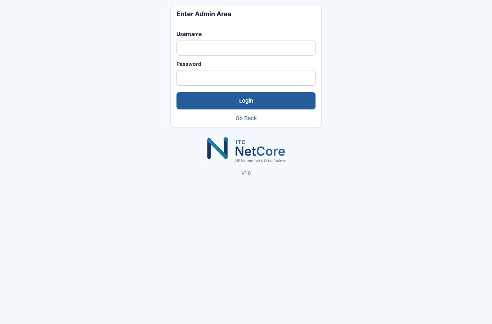

**Expected result:** the "Dashboard" of your role opens.

**Common mistakes:**

- Confusing the staff page (`/admin`) with the subscriber login page.
- A wrong username or password shows "Invalid Username or Password." A disabled staff account gets the same message, so ask an administrator if it repeats.

### Changing your password

1. Open the account menu (your initial at the top of the page).
2. Choose "Change Password".
3. Enter "Current Password", "New Password" and "Confirm New Password", then press "Save Changes".

> [!SECURITY-WARNING]
> While the installer's default password is still in use, every request is redirected to the password change until it is changed. Other accounts are not forced, so change a temporary password yourself at the first login.

> [!SECURITY-WARNING]
> The application itself does not throttle repeated login attempts. The ISP must apply rate limiting at the HTTPS front end. Report repeated failed logins to an administrator at once.

**General security rules for all staff:**

- Every operation that changes data is sent by a form carrying a protection token (CSRF). A direct link to a changing operation does not run it.
- When a server error occurs, a generic message with a reference number appears. Give the reference to the operator, who finds the details in the server log.
- Opening a page your role may not use shows "Access denied" with the heading "You cannot open this page".
- Never share your account. Every operation is recorded under the person who ran it.
- Staff and subscriber sessions are not separated within one browser. Use a separate browser or window when testing the customer portal.

## 1.4 Navigating the interface

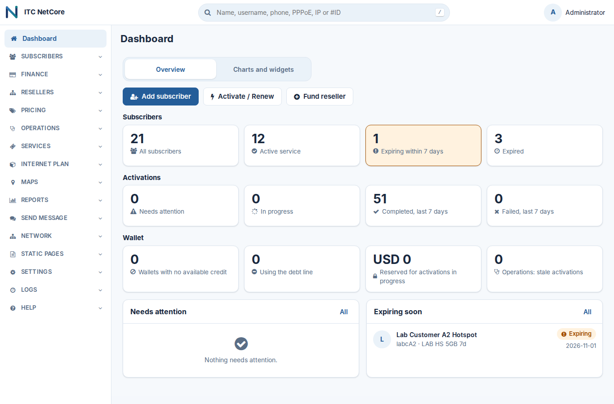

- **Sidebar:** grouped by task: "Subscribers", "Finance", "Resellers", "Pricing", "Operations", "Services", "Internet Plan", "Maps", "Reports", "Send Message", "Network", "Static Pages", "Settings", "Logs", "Help". Each user sees only what the role allows.
- **Quick actions** at the top of the dashboard, depending on the role: "Add subscriber", "Activate / Renew", "Send to child reseller" (an Agent with an active direct child), "Fund reseller" (Admin).
- **Search:** the "Search subscribers" field at the top of every page, by name, username, phone, PPPoE, IP or #ID. Press `/` to jump to it. Results are limited to your scope.
- **Back link:** detail pages show a link to their parent page above the title (for example "Activations").
- **Account menu:** "My Account", "Change Password", the language switch, "Light / dark theme", "Install app", "Logout".
- **Admin dashboard tabs:** "Overview" and "Charts and widgets".

## 1.5 Arabic and English

- **Staff:** switch the language from the account menu. The button shows the other language ("العربية" or "English"). The choice is kept in this browser.
- **Subscribers:** choose the language from the "Language" icon at the top of the portal.
- **System default language:** "Settings" > "Localisation" (Admin).
- The Arabic interface is fully right-to-left. Technical terms such as PPPoE, RADIUS and FreeRADIUS stay in Latin script. A plan title that the ISP typed itself is shown exactly as typed; the default plan titles (for example "Radius Plan") are translated.

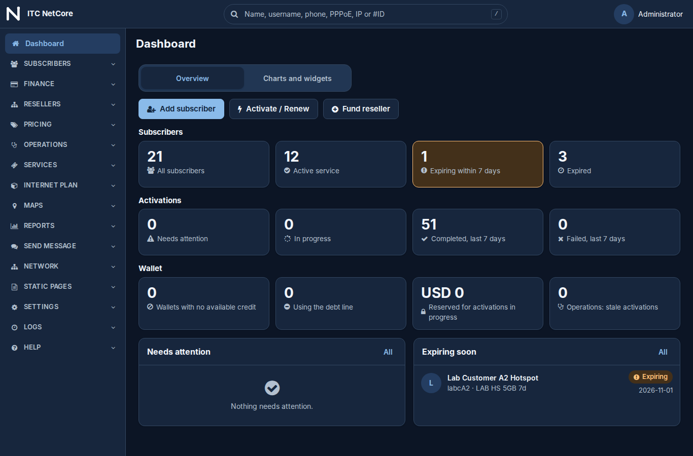

## 1.6 Phone and the installed app (PWA)

The same pages work on a phone with a touch layout:

- **Bottom navigation bar:** "Home", "Customers", "New" (quick actions), then "Wallet" for an Agent or "Activations" for others, then "More" for every other section.
- Tables become cards.

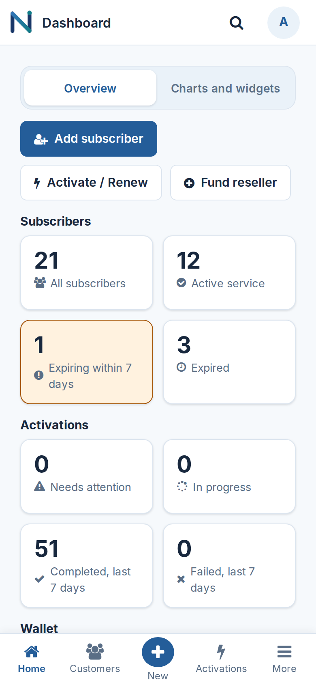

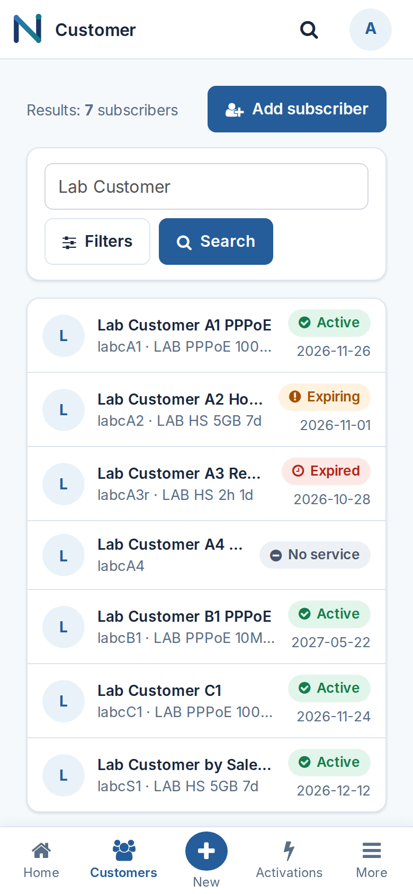

**Installing the app:**

1. Open the account menu and choose "Install app". The button appears only over a secure (HTTPS) connection and while the app is not installed.
2. Confirm in the browser. The system then opens from its own icon.

**When the internet connection drops:** a static offline page appears in both languages.

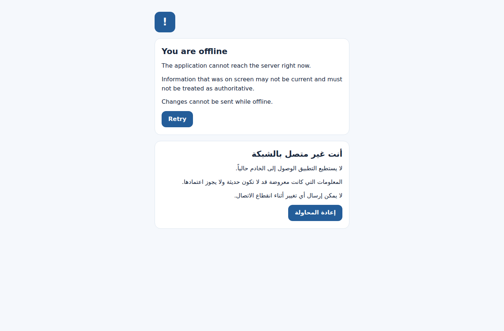

> [!SECURITY-WARNING]
> The installed app stores no financial or subscriber data on the device and never queues an operation to send later. If the connection drops while an operation is being sent, it is not resent automatically. Once you are back online, open the relevant page and check the operation's status before trying again.

<!-- pagebreak -->

# 2. SuperAdmin

The SuperAdmin holds every Admin capability plus three that no other role has:

| Additional capability | What it opens |
|---|---|
| Code surfaces | Saving or resetting "Static Pages"; installing or deleting plugins in "Plugin Manager"; configuring or deleting a payment gateway |
| Web backup | The "Download Backup Database" button under "Backup/Restore" |
| Web restore | Refused on reseller installations (see 2.11) |

The following security settings are saved by the SuperAdmin only. If an Admin submits them they are silently ignored: "Enable Radius", "Single Admin Session", "Enable Session Timeout" and its duration, and the proxy and GitHub settings.

## 2.1 First login

**Purpose:** secure the account and prepare the system before any other work.

**Required role:** "SuperAdmin".

**Preconditions:** installation and database migration completed on the server (operator task).

**Steps:**

1. Sign in at `/admin` with the account created by the installer.
2. If the default password is still in use, the system sends you to "Change Password". Set a strong password.
3. If a banner says the reseller schema is not ready, reseller and service operations are disabled for every role. Stop and ask the operator to complete the migrations.

**Expected result:** the dashboard with no warning banner.

> [!SECURITY-WARNING]
> Do not use the SuperAdmin account for daily work. Create an "Admin" account for each operations employee and keep the SuperAdmin account for setup and emergencies.

## 2.2 Initial setup, in order

| Step | Menu | What to set |
|---|---|---|
| 1 | "Settings" > "General Settings" > "General" | "Company Name", logo and contact details (2.3) |
| 2 | "Settings" > "Localisation" | Time zone, date format, currency, default language |
| 3 | "Settings" > "General Settings" > "FreeRADIUS" section | "Enable Radius" = "Yes" (the fresh installer normally stores it already; check it). "Radius NAS" then appears under "Network" and "Radius" under "Logs" |
| 4 | "Network" > "Radius NAS" | Add each NAS (2.10) |
| 5 | "Internet Plan" > "Bandwidth", then "Hotspot" / "PPPOE" | Bandwidth profiles, then plans (2.6) |
| 6 | "Pricing" > "Plans and prices" | Provider base cost and reseller commerce (2.6) |
| 7 | "Settings" > "Administrator Users" | Admin, reseller and Sales accounts (2.4) |
| 8 | "Finance" > "Wallets" | First funding of the resellers (Chapter 7) |
| 9 | "Settings" > "Widgets" and "User Notification"; "Static Pages" | Dashboard widgets, expiry and reminder templates, portal texts |
| 10 | On the server (operator) | Scheduled jobs and the readiness check `preflight.php`, which must pass |

## 2.3 Company settings and the company name

**Purpose:** show the ISP's name in titles, to subscribers and on invoices.

**Required role:** "SuperAdmin" or "Admin".

**Preconditions:** none.

**Steps:**

1. "Settings" > "General Settings".
2. Open the "General" section.
3. Enter the "Company Name", upload a logo if needed, and complete the contact details.
4. Press "Save Changes".

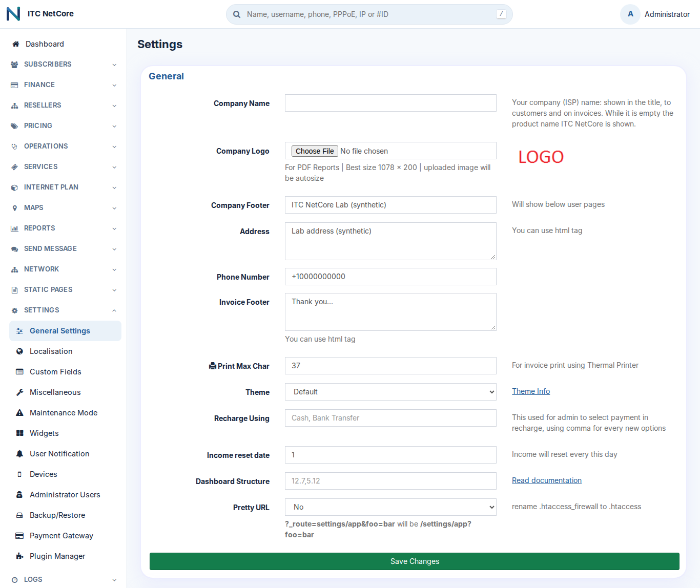

**Expected result:** your company name appears in the header, the page titles and the customer portal.

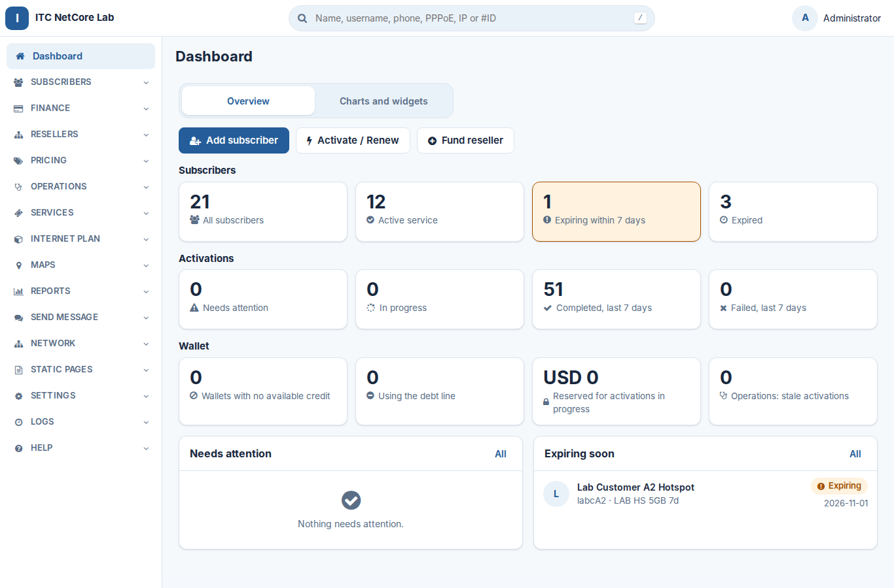

**Common mistakes:**

- Leaving "Company Name" empty. The product name ITC NetCore is then shown everywhere, but invoices and messages print the stored value as it is. Set the name **before** go-live.
- Looking for secret fields (mail password, service tokens). These fields are write-only and are never shown again; an empty field keeps the stored value.

## 2.4 Managing administrators and staff

**Purpose:** create staff, reseller and Sales accounts.

**Required role:** "SuperAdmin" creates every role. "Admin" creates "Report", "Agent" and "Sales" only.

**Preconditions:** a Sales account needs an Agent to belong to.

**Steps:**

1. "Settings" > "Administrator Users" > "Add New Administrator", or "Add Agent / Sales" in the "Reseller Tree".
2. Under "Profile": "Full Name", "Phone", "Email".
3. Under "Credentials": choose the "User Type".
4. For an Agent or Sales choose the "Parent Agent". "None (top-level Agent)" creates a top-level reseller. The field is "Required for Sales; optional for Agents."
5. Enter the "Username" and a temporary "Password", choose "Send Notification" if wanted, and press "Save Changes".

**Expected result:** the account appears in "Administrator Users"; an Agent or Sales account appears in the "Reseller Tree" directly under its parent.

**Fixed rules in V1.0:**

| Rule | Detail |
|---|---|
| Deleting an Agent | Not allowed for anyone. Message: "Agent (reseller) accounts cannot be deleted in V1; disable the account instead." |
| Changing an Agent's role | Not allowed. Disable the account and create a new one |
| Last active SuperAdmin | Cannot be disabled, deleted or demoted |
| Your own account | You cannot change your own status or role |
| "Admin" | Deletes "Report" accounts only |

**Common mistakes:** creating a Sales account without a "Parent Agent"; handing over the temporary password through an insecure channel.

> [!SECURITY-WARNING]
> Hand over temporary passwords outside the system through a secure channel and require a change at the first login.

## 2.5 Managing resellers

**Purpose:** supervise the reseller tree and disable or move accounts.

**Required role:** "SuperAdmin" or "Admin" (placing and moving are administrator-only).

**Steps:**

1. "Resellers" > "Reseller Tree".
2. Press "Open" on an account to open its reseller page.
3. From the reseller page: "Add Agent / Sales", "Disable" or "Reactivate", "Move".

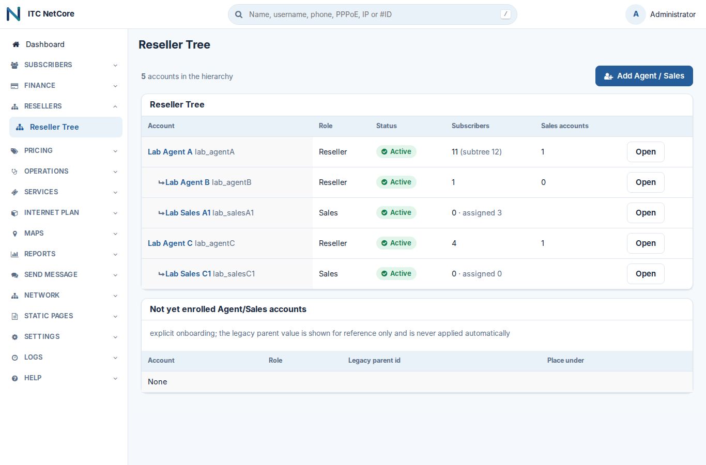

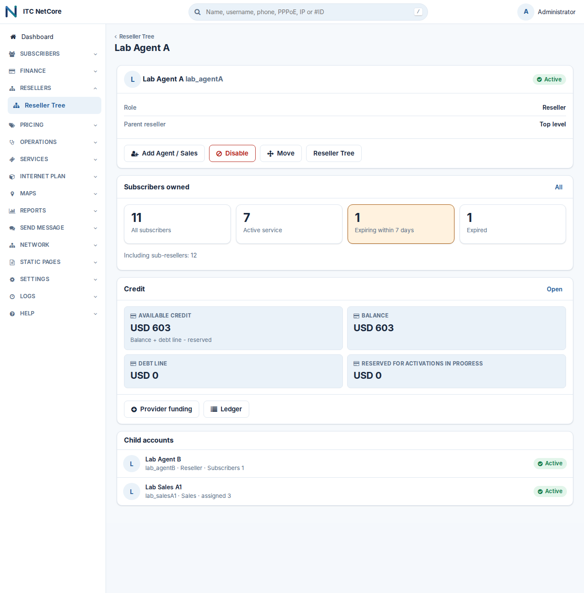

**Expected result:**

- **Disable:** confirmation "Disable this account? Its descendants become read-only." The whole subtree shows "Frozen by an upstream reseller".
- **Move:** confirmation "Move this account (and its subtree)?" with the note "Historical finance stays with the original resellers."
- **Legacy accounts not yet placed:** listed under "Not yet enrolled Agent/Sales accounts" and placed explicitly with "Place". The "Legacy parent id" is never applied automatically.

> [!FINANCE-WARNING]
> Settle a reseller's balance with an audited operation while the account is still active. Once it is disabled, funding, withdrawal, adjustments, debt-line changes and new transfers on its wallet are refused for everyone, Admin included. Settlement of activations already in flight and reversal of existing transfers remain possible.

## 2.6 Plans and pricing

### Plans and bandwidth profiles

**Purpose:** define what is sold to subscribers.

**Required role:** "SuperAdmin" or "Admin".

**Steps:**

1. "Internet Plan" > "Bandwidth": create the bandwidth profiles.
2. "Internet Plan" > "Hotspot" or "PPPOE": add the plan on the **Radius** device and choose the bandwidth, price, validity and number of devices.
3. For a limited plan choose the limit type (data, time or both) and enter a whole number of MB or GB, or minutes or hours.

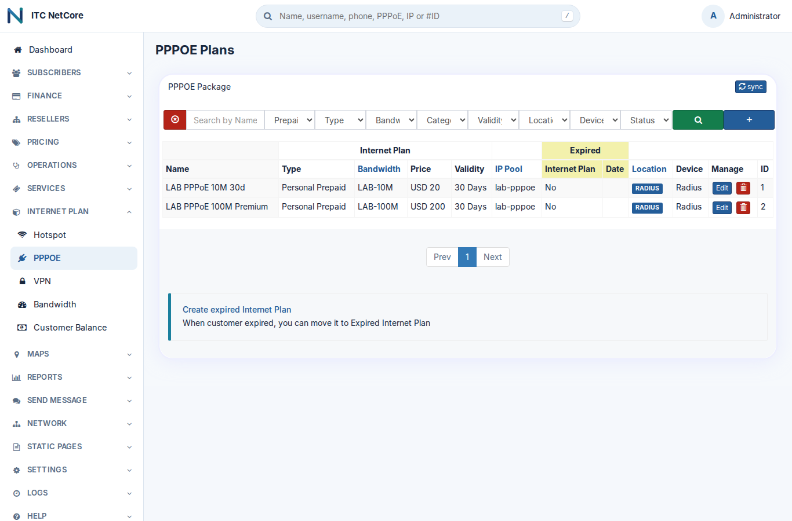

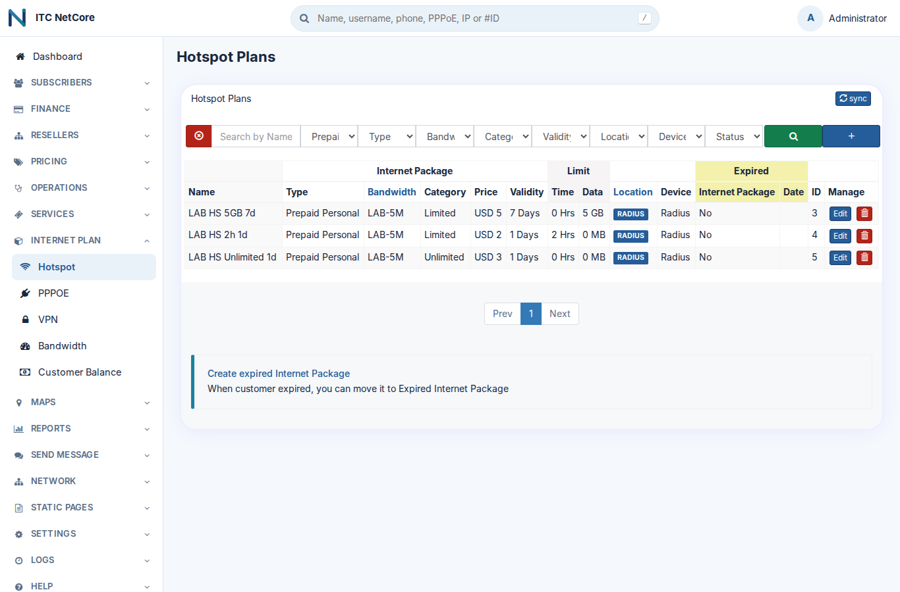

> [!NOTE]
> Reseller activations accept only plans on the Radius device of type Hotspot or PPPoE. VPN plans and balance plans are not sold through resellers.

### Pricing

**Purpose:** set the provider cost and the wholesale and retail prices at each level.

**Required role:** base cost and reseller commerce: "SuperAdmin" or "Admin". Reseller prices: an administrator for any reseller, an Agent for its direct children (Chapter 3).

**Steps:**

1. "Pricing" > "Plans and prices". For each plan: "Default retail (plan price)", "Provider base cost" and the commerce status.
2. Press "Edit" > under "Provider base cost" enter the amount and "Reason (optional)", then "Save".
3. In the same sheet press "Turn reseller commerce on". A new plan starts with reseller commerce off.
4. Open the plan to see, for each reseller: "Wholesale (reseller cost)", "Retail (customer price)", "Availability" and "Saleable", and the source of each price ("set for this reseller", "inherited" or "provider base cost").

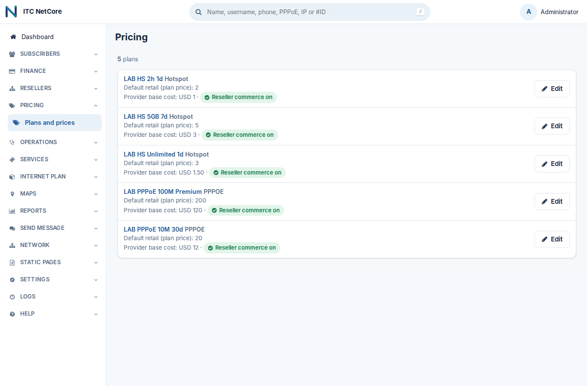

**Pricing rules:**

| Rule | Behaviour |
|---|---|
| Effective wholesale | The reseller's own price if set, else the nearest ancestor's, else the base cost |
| Floor | A child's wholesale is not below its parent's; a top-level reseller's is not below the base cost |
| Retail | Not below the wholesale. Empty means "default retail (plan price)" |
| Availability | "Disable" at any level closes the plan for the whole subtree below; "Enable" cannot override an upstream restriction |
| Zero wholesale | Allowed as configuration, but not usable for an activation |
| Proration | None. A plan change starts a full new period |

**Example:** base cost 10, top-level reseller wholesale 12, sub-reseller wholesale 15. When the sub-reseller sells: 15 is debited from the sub-reseller's wallet, the top-level reseller earns a commission of 3, and the provider settlement is 12.

**Common mistakes:** forgetting "Turn reseller commerce on", so resellers never see the plan; raising an upstream price above an explicitly set child price, which is refused until the child prices are raised first.

## 2.7 Vouchers (generated by administrators only)

**Purpose:** create printed vouchers sold to direct subscribers.

**Required role:** "SuperAdmin" or "Admin". Agents and Sales do not generate vouchers.

**Steps:**

1. "Services" > "Vouchers" > the "Add Vouchers" button at the top of the list.
2. Choose "Type" ("Hotspot Plans" or "PPPOE Plans"), "Routers" (Radius) and "Service Plan".
3. Enter "Number of Vouchers", "Voucher Format", "Voucher Prefix" and "Length Code"; tick "Print Now" if wanted.
4. Press "Generate" and confirm.

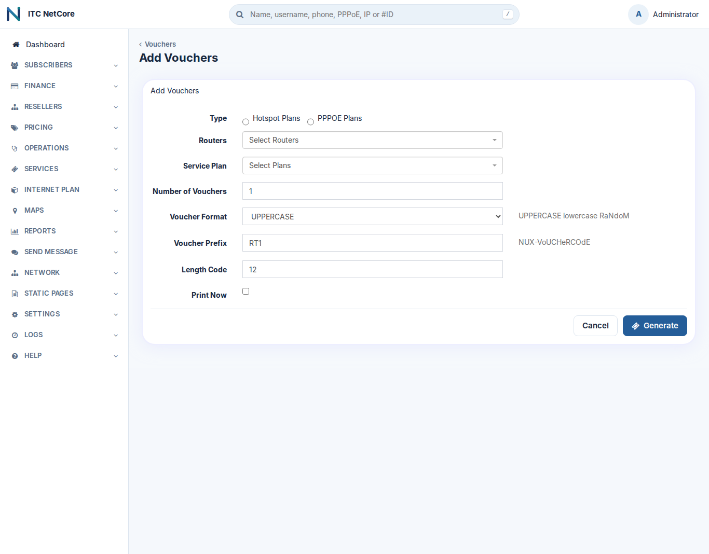

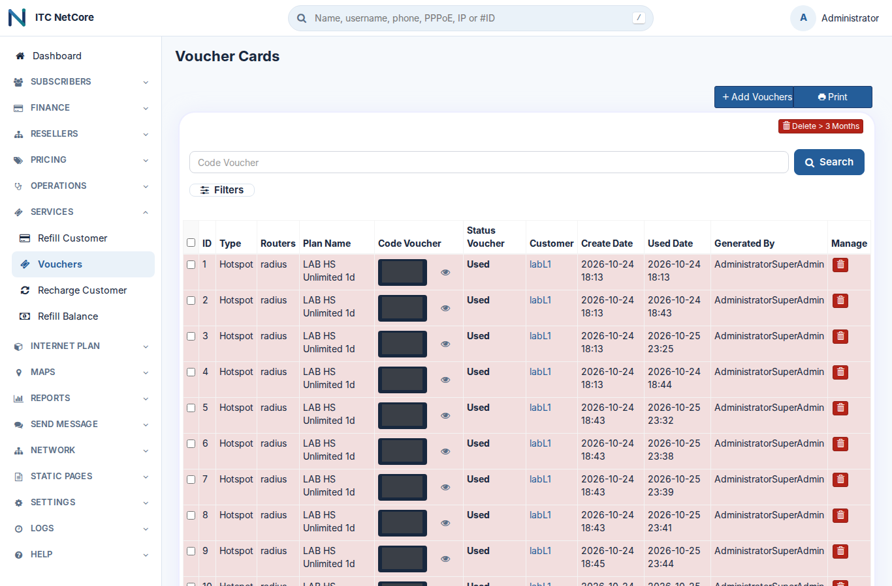

> [!SECURITY-WARNING]
> Treat printed vouchers like cash. Codes are masked in lists and reports. A voucher whose grant was not proven stays under review and cannot be used again until the operator decides; never issue a replacement without that decision.

## 2.8 System-wide reports

**Required role:** "SuperAdmin" or "Admin".

Under "Reports":

| Report | Content |
|---|---|
| "Sales" | Every activation with the wholesale debited and the retail price |
| "Commissions" | What each reseller earned from the price difference on its children's sales |
| "Provider settlement" | What the provider is owed against what resellers paid (administrators only) |
| "Reseller performance" | Activations and amounts per reseller over the period |
| "Transactions (legacy)" | Transactions with filters and printing |
| "Activation History (legacy)" | Every invoice with subscriber, plan, dates and method |

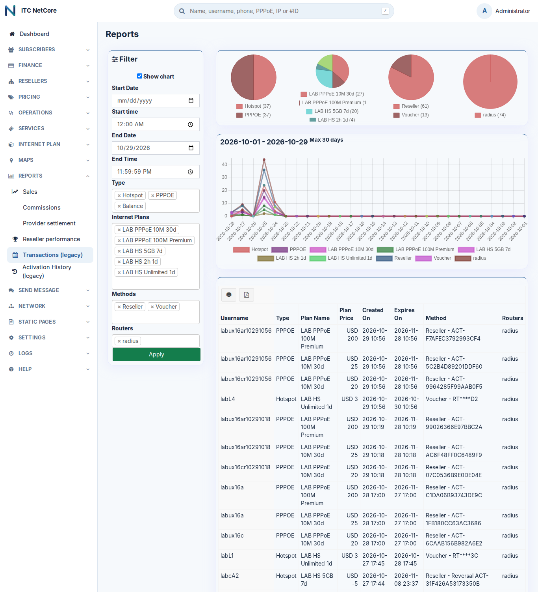

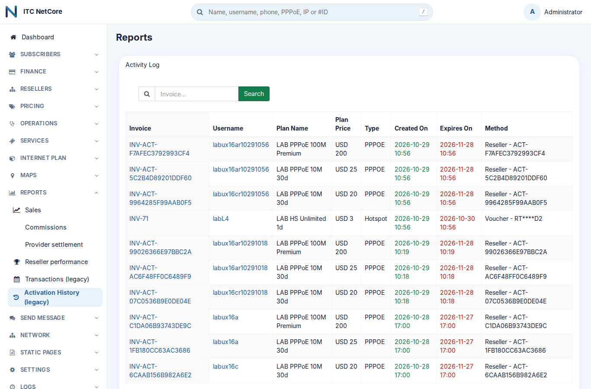

> [!FINANCE-WARNING]
> CSV exports carry the same scope as the screen and are limited to 20,000 rows and 366 days. A larger export is refused, never truncated; narrow the filters. Reseller retail prices appear in the legacy reports.

## 2.9 Security settings

**Required role:** "SuperAdmin" (for the save to take effect).

Under "Settings" > "General Settings" > "Security":

- "Enable Session Timeout" and its duration: idle administrators are logged out automatically.
- "Single Admin Session": a login from a new device logs out the other session.

Fixed rules:

- Secret fields in the settings are write-only and are never displayed.
- Do not install a plugin or payment gateway on a production system without review: any code running inside the application can bypass the reseller and finance rules.
- The direct MikroTik API drivers are not enabled in this release. The network is driven through RADIUS only.

## 2.10 NAS configuration

**Purpose:** connect a MikroTik router to FreeRADIUS and the application.

**Required role:** "SuperAdmin" or "Admin" in the interface; the network administrator on the router; the operator on the FreeRADIUS host.

**Preconditions:** "Enable Radius" = "Yes"; the router's RADIUS source address is fixed and not behind NAT; a random shared secret of 32 or more characters generated on the operator's workstation.

**Steps:**

1. "Network" > "Radius NAS" > "New NAS".
2. "Router Name": the device name.
3. "IP Address": exactly the address the router sends RADIUS requests from.
4. "Secret": the same secret as on the router.
5. "CoA port": `3799`.
6. "Type": enter `mikrotik_snmp`. The default `other` is not supported.
7. Press "Save Changes" and confirm.
8. The operator adds the router's read-only SNMP community to the session-guard credential file on the FreeRADIUS host, then restarts FreeRADIUS.
9. On the router the network administrator configures RADIUS for PPP and Hotspot, enables incoming Disconnect / CoA on port 3799, allows UDP 3799 only from the application host, and enables NTP.

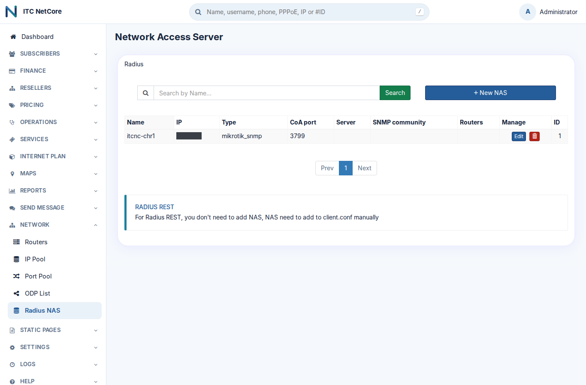

**Expected result:** a test login succeeds, an accounting record of the session appears, and the operator's `preflight.php` passes.

**Common mistakes:**

- Leaving "Type" as `other`: the readiness check fails, and subscribers stay locked out after a lost session-end message.
- Leaving the router's incoming port at its default 1700 while the application sends to 3799.
- A different secret on the application and the router.

> [!SECURITY-WARNING]
> The shared secret is never displayed after saving: the edit field is empty, and an empty field keeps the old secret. Never send the secret in a chat or ticket, and never reuse it across devices. Rotate it at least yearly, and immediately after staff turnover or a suspected leak.

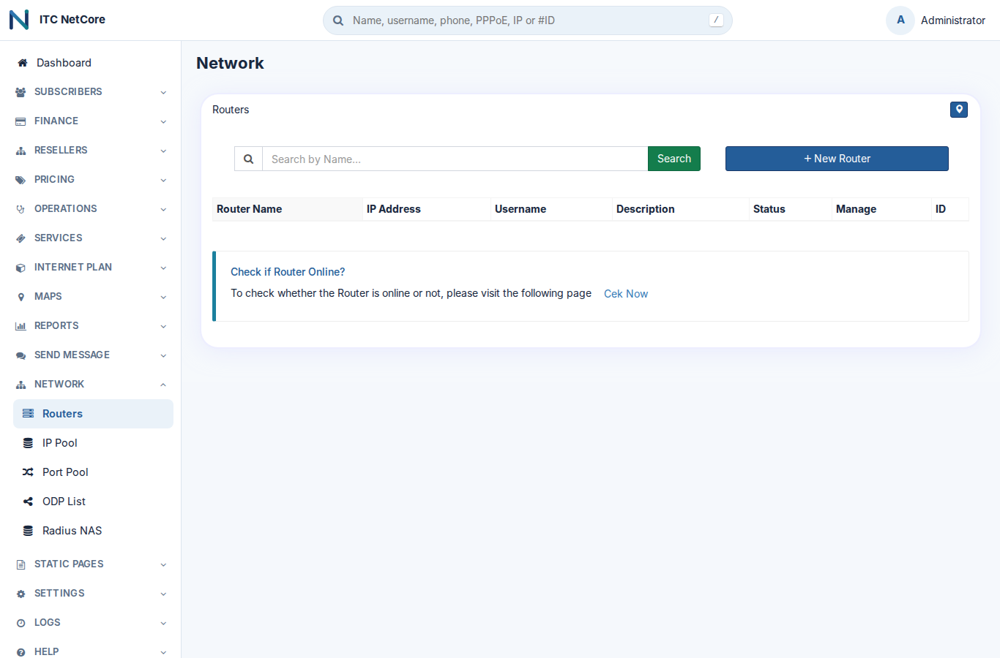

## 2.11 Operational health

**Required role:** "SuperAdmin" or "Admin" (read-only Operations Center), and the operator on the server.

1. "Operations" > "Operations Center", daily. Sections:
   - "Needs attention": "Activations needing attention" and "Stale activations (no progress for 5 minutes)".
   - "Waiting / held": "Legacy balance operations held".
   - "Informational / CLI required": "Auto-renew not available (records)" and "Drift check (run on demand)".
   - "Resolved / history": "Terminal outcomes, last 7 days".
2. The operator runs the daily read-only checks on the server (Chapter 8).

**Backup and restore:** the production backup is taken at database level by the operations procedure. The restore button under "Backup/Restore" is refused with "Restore is disabled on reseller installations; use the database-level restore runbook."

## 2.12 Audit logs

| Where | What you find |
|---|---|
| "Logs" > "ITC NetCore" ("Activity Log") | Logins and actions with date and user, with search and export |
| "Logs" > "Radius" | Authentication events from FreeRADIUS |
| "Logs" > "Message" | Messages sent and their status |
| "Finance" > "Ledger" | Every money movement with reason, reference and actor |
| Activation page > "Timeline" | Every stage of the activation with its time |

The detailed audit trail of reseller and finance operations is stored on the server and reviewed by the operator; V1.0 has no dedicated screen for it.

> [!SECURITY-WARNING]
> Use "Clean up Logs" only according to the ISP's approved retention policy.

<!-- pagebreak -->

# 3. Reseller and sub-reseller

A reseller is an account of type "Agent". A **sub-reseller** is an Agent placed under another Agent in the tree. It has the same capabilities, limited to its own subtree, and pays from its **own** wallet.

| Scope | Meaning |
|---|---|
| Your subtree | You and everyone under you |
| Your direct children | Only the accounts directly under you |
| Yourself | Your own account and your own subscribers |

> [!NOTE]
> Your account must be placed in the tree. An unplaced reseller sees no data. If your account or any reseller above you is inactive, your account becomes "Frozen by an upstream reseller": you can still see your data, but every change is refused.

## 3.1 Dashboard

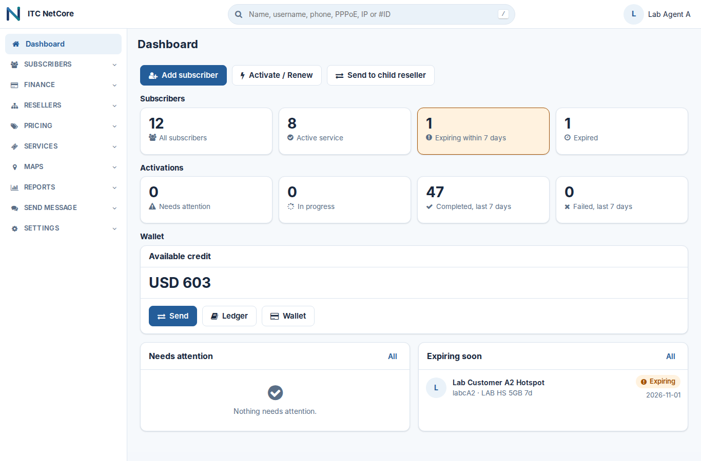

- Buttons: "Add subscriber", "Activate / Renew", and "Send to child reseller" if you have an active direct child.
- "Subscribers" and "Activations" cards for your subtree, and a "Wallet" card with your available credit.
- The "Needs attention" and "Expiring soon" lists.
- Sidebar: "Subscribers", "Finance", "Resellers", "Pricing", "Services", "Maps", "Reports", "Send Message", "Settings".

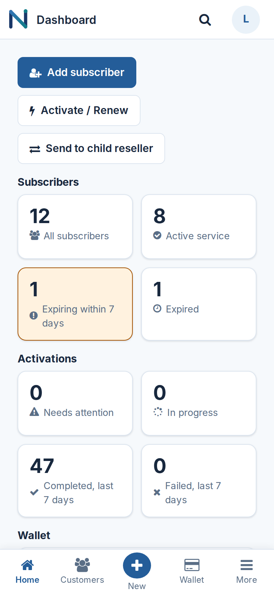

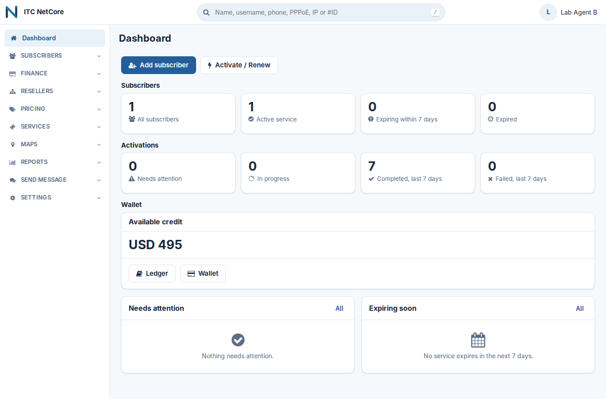

## 3.2 Your customer scope

| What you can do | Scope |
|---|---|
| View subscribers and their records | Your whole subtree |
| Add a subscriber | Always created as owned by you |
| Assign or clear a Sales user | Your subtree; a Sales account directly under the subscriber's owner |
| Activate, renew, change plan | Your own subscribers only |
| View activations | Your whole subtree |
| View and send invoices; message one or selected subscribers | Your subtree |

| What you cannot do in V1.0 | Who does it |
|---|---|
| Edit a subscriber after creation (password, PPPoE, status), synchronize, deactivate, delete, export or log in as the customer | "Admin" |
| Activate a subscriber owned by a sub-reseller under you | That sub-reseller |
| Reverse, cancel or resume an activation | "Admin" |
| Generate vouchers, direct recharge, balance | "Admin" |
| Bulk messages to all customers | "Admin" |

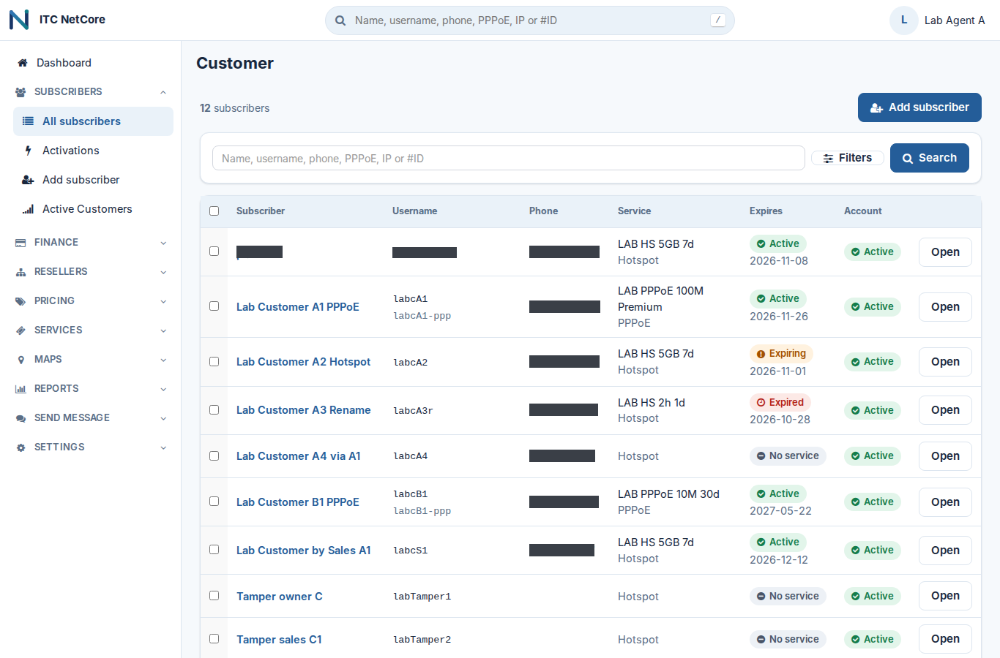

## 3.3 Adding a subscriber

**Purpose:** register a new subscriber that you own.

**Required role:** "Agent" (the owner is always you), "Sales" (the owner is its Agent), or "Admin".

**Preconditions:** an unused username; the service type is known.

**Steps:**

1. "Subscribers" > "Add subscriber", or the quick action.
2. **"Identity and service":** "Full Name", "Phone Number", "Email", "Service Type", "Account Type". On a phone, press "Next" to go to the following step; on a computer all four steps are shown on one page.
3. **"Credentials and network":** "Username" ("Letters, digits and : + _ . @ - only."), "Password" ("Generate" proposes a strong one), and if needed "PPPoE username", "PPPoE password" and "Static IP". "When empty, the PPPoE login uses the subscriber's username and password." A static IP must be a valid, non-reserved IPv4 address that **no other subscriber** uses, in any reseller's tree; leave it empty when the subscriber gets an address from the router's pool.
4. **"Commercial owner and Sales":** the owner is you. Choose one of your direct Sales accounts or "None".
5. **"Review and create":** check, tick "Send welcome message" if wanted, then "Create subscriber".

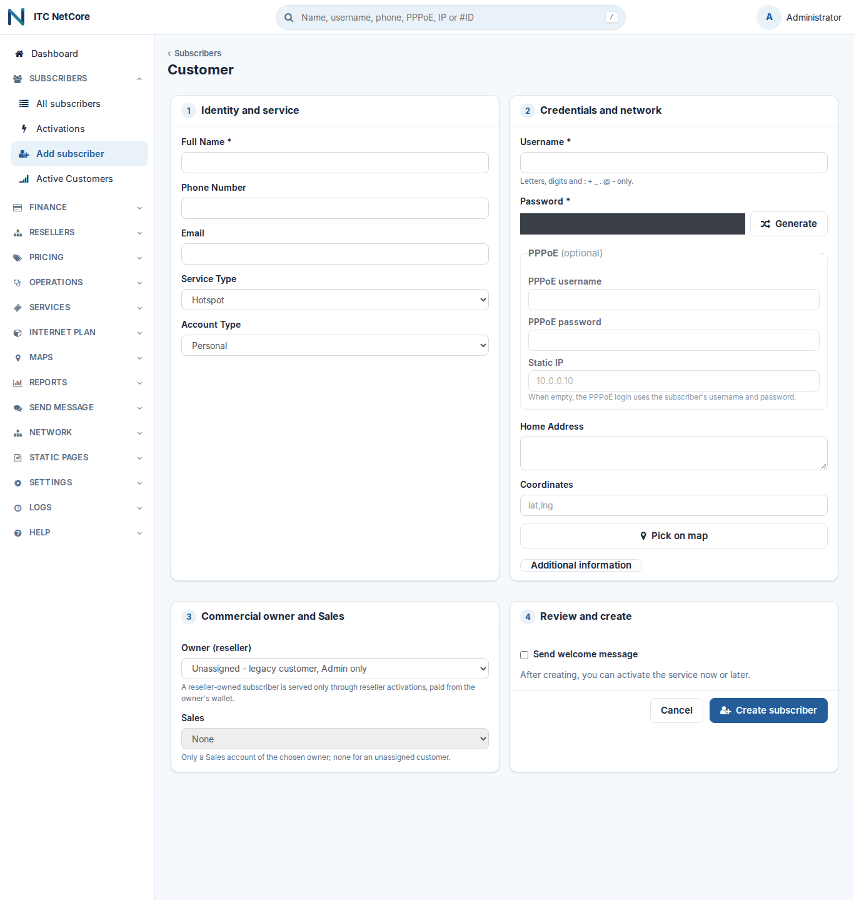

**Expected result:** "Subscriber created." and "Activate the service now, or later from this page."

**Common mistakes:**

- A subscriber with both Hotspot and PPPoE under one name: a distinct "PPPoE username" is needed, otherwise the second service is refused.
- A username, PPPoE username or static IP that another subscriber already uses (anywhere in the system, also in other resellers' trees): creation is refused. Agents and Sales see **one general refusal** that does not say which value is taken or by whom; this protects other resellers' data. Choose another value and try again. An administrator sees the specific reason.
- An invalid static IP (not an IPv4 address, or a reserved address) refuses the whole form: "The static IP must be a valid IPv4 address (leave it empty for none)."
- Wrong data: you cannot edit it after creation, so check it before "Create subscriber".

## 3.4 Activation, renewal and plan change

**Purpose:** give the subscriber a paid service period, paid from your wallet.

**Required role:** "Agent" for its own subscribers, "Sales" for its assigned subscribers, or "Admin" for any reseller-owned subscriber. In every case the **subscriber owner's** wallet is debited.

**Preconditions:** the subscriber is owned by a reseller; the plan is priced and available for that reseller; enough available credit; no other activation in progress for this subscriber.

**Steps:**

1. From the subscriber record press "Renew / change plan" (the same button starts the first activation of a subscriber that has no service yet), or "Subscribers" > "Activations" > "Activate / Renew" and choose the subscriber.
2. Choose the plan in the "Plan" list (it shows "Choose a plan" until you choose one) and press "Review".
3. Check the confirmation card:
   - the action type decided by the server (table below);
   - "Current expiry", "New period" and "Paid from the wallet of";
   - "Wholesale - reseller cost" ("Charged to the reseller wallet") and "Retail - customer price" ("What the subscriber pays");
   - "Available credit now" and "Available credit after";
   - "Credit sufficient: yes" or "Credit sufficient: no".
4. If the action is a **plan change** that replaces remaining paid time, tick "I understand that the remaining paid time will be lost". The Confirm button stays disabled until you do.
5. Press "Confirm activation". Do not close the page until the result appears.

| Current service | Action | New period |
|---|---|---|
| None | New activation | Starts now ("A new service period starts now.") |
| Same plan, still active | Renewal | "Same plan: the new period continues from the current expiry." |
| Same plan, expired | Reactivation | "The expired service is reactivated; a new period starts now." |
| Another plan | Plan change | "Plan change: takes effect immediately, the full new period is charged, no proration." |

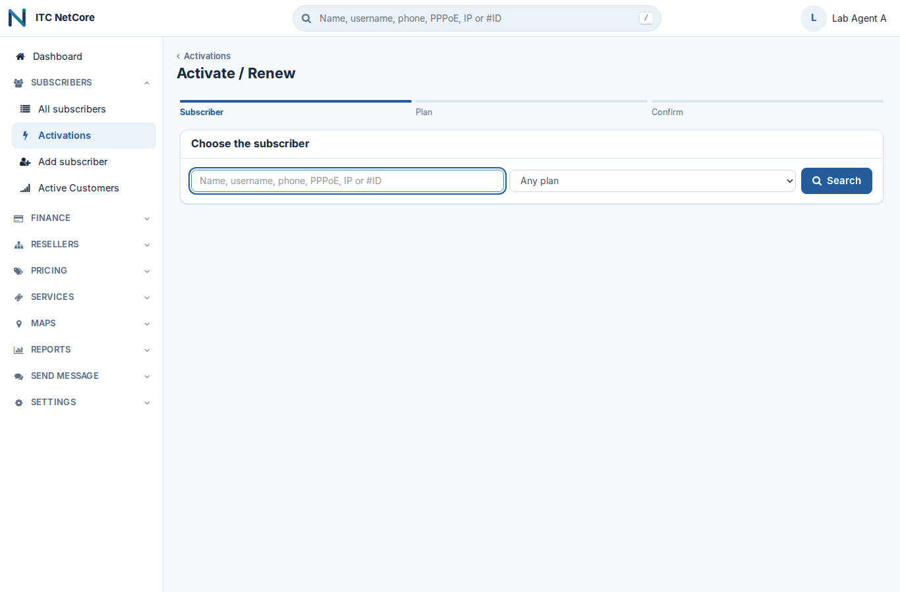

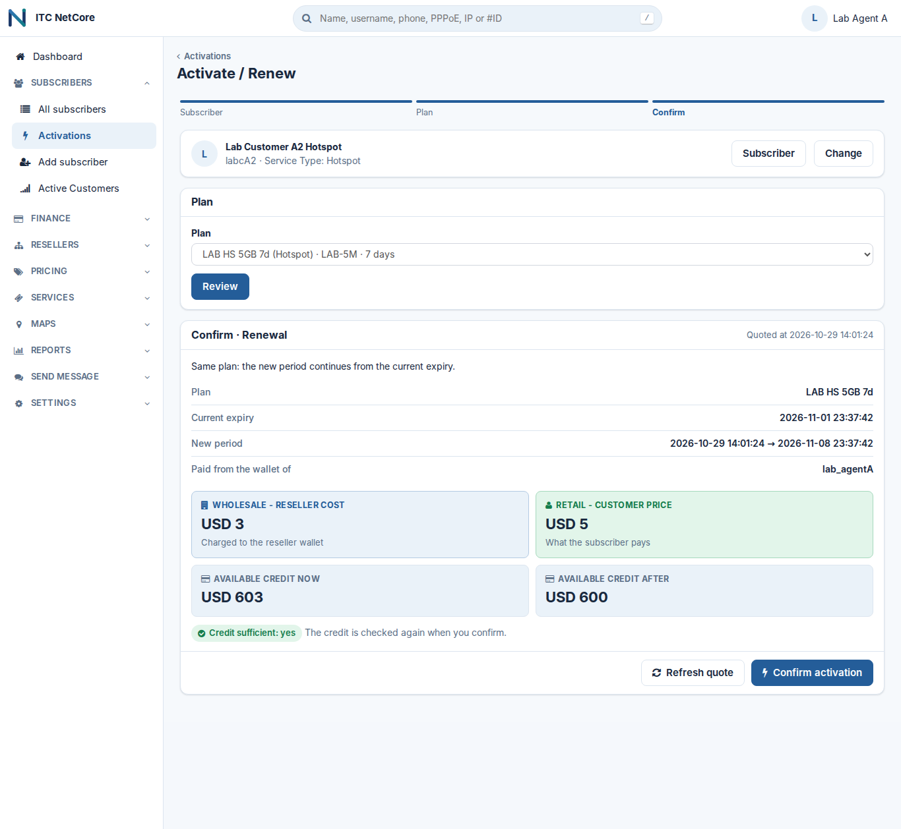

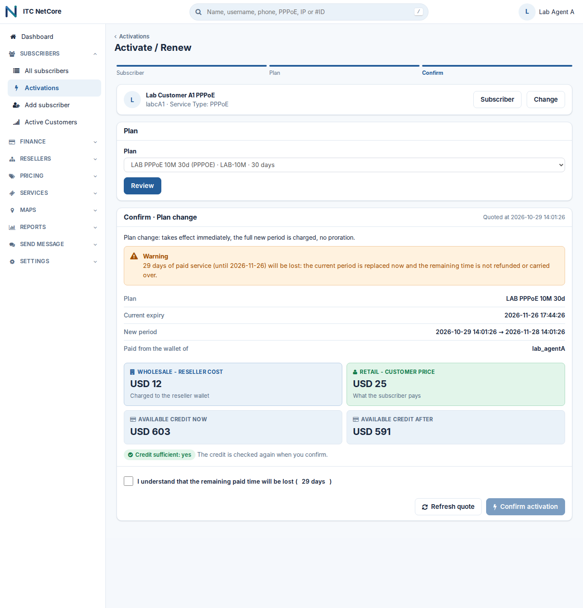

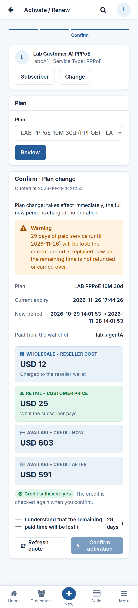

**Expected result:** the activation page with its "Progress" bar and "Completed", showing "Service active until" and "The wholesale cost was charged.", the "Paid by (reseller)", "Requested by" and "Invoice" details, and the "Timeline".

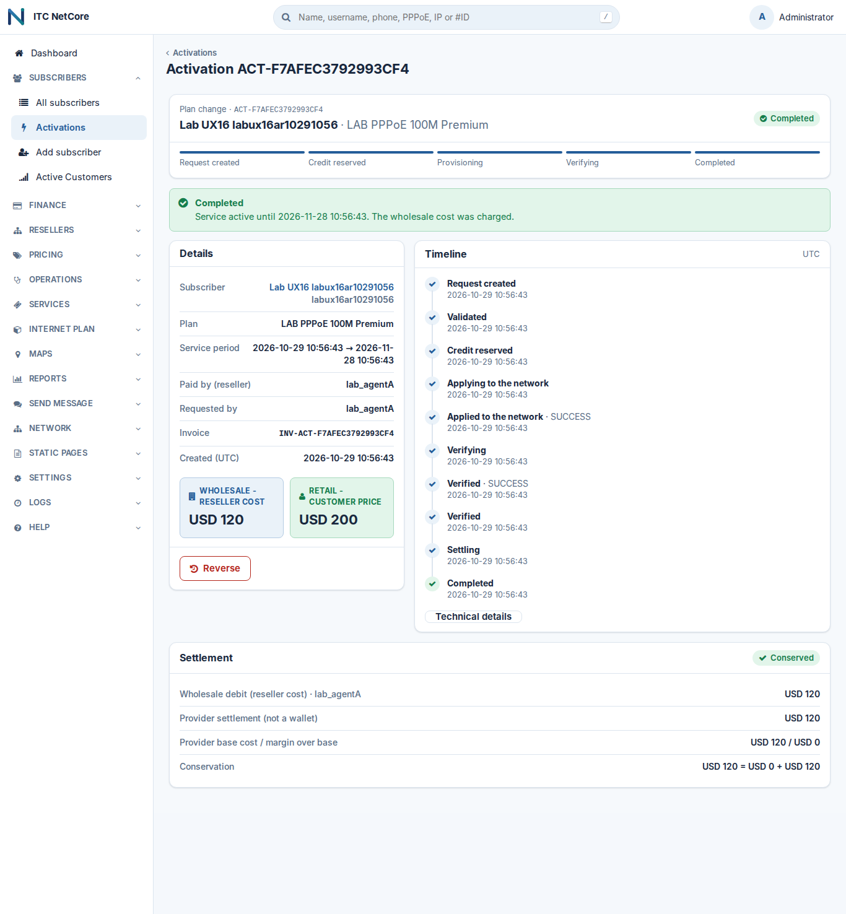

**Common mistakes:**

- Pressing Confirm several times or reloading the page. The amount is never debited twice, but do not repeat the operation: open its status.
- Starting a second activation for a subscriber with one in progress: refused with "Another activation for this customer is still in progress; check its status first."
- Changing the plan by accident instead of renewing: a new period starts now and the remaining time is lost. A renewal means choosing the **same plan**.
- Ignoring "Refresh quote" after prices change: if the price changed after your review the server refuses with "The price or terms changed since you reviewed them. Nothing was charged; review the updated confirmation."

> [!FINANCE-WARNING]
> The prices and balances on the confirmation card are calculated by the server and checked again at confirmation ("The credit is checked again when you confirm."). With insufficient credit the Confirm button stays disabled, and any forced submission is refused by the server. Reseller-owned subscribers have no auto-renew in V1.0: when the period ends the service ends, and the reseller renews manually.

> [!WARNING]
> If the page shows "Processing" or "Checking - reconciliation required", do not repeat the activation. The amount is reserved, not debited, and stays reserved until an administrator decides. Follow the status on the activation page.

## 3.5 Pricing and selling

**Purpose:** set your children's prices and your own retail price.

**Required role:** "Agent".

| What you set | For whom |
|---|---|
| "Wholesale (reseller cost)" | Your direct children only. You never set your own wholesale |
| "Availability" | Your direct children only |
| "Retail (customer price)" | Yourself only |

**Steps:**

1. "Pricing" > "Plans and prices". You see the plans available to you with "Wholesale (reseller cost)", "Retail (customer price)" and "Your margin".
2. Open the plan, then "Edit" on your row or a child's row.
3. For a child: "Wholesale (reseller cost) for this reseller" ("Cannot be below the parent wholesale. Empty = inherit.") and "Availability for this reseller".
4. For yourself: the retail price ("Cannot be below the wholesale. Empty = default retail (plan price).").
5. "Save".

**Expected result:** the plan becomes "Saleable" for the child. The difference between your wholesale and your child's is your commission.

**Common mistakes:** a retail price below the wholesale (refused); a zero wholesale for a child (not usable for activation).

## 3.6 Wallet and transactions

**The formula:** "Available credit" = "Balance + debt line - reserved".

- "Finance" > "Wallet overview": "My wallet", "Latest movements" and "My child resellers".
- "Ledger": every debit, commission and transfer with the balance before and after, with filters and "Export CSV". "Ledger entries are permanent. Corrections are made by a new compensating entry."
- "Transfers": the transfers that concern you.

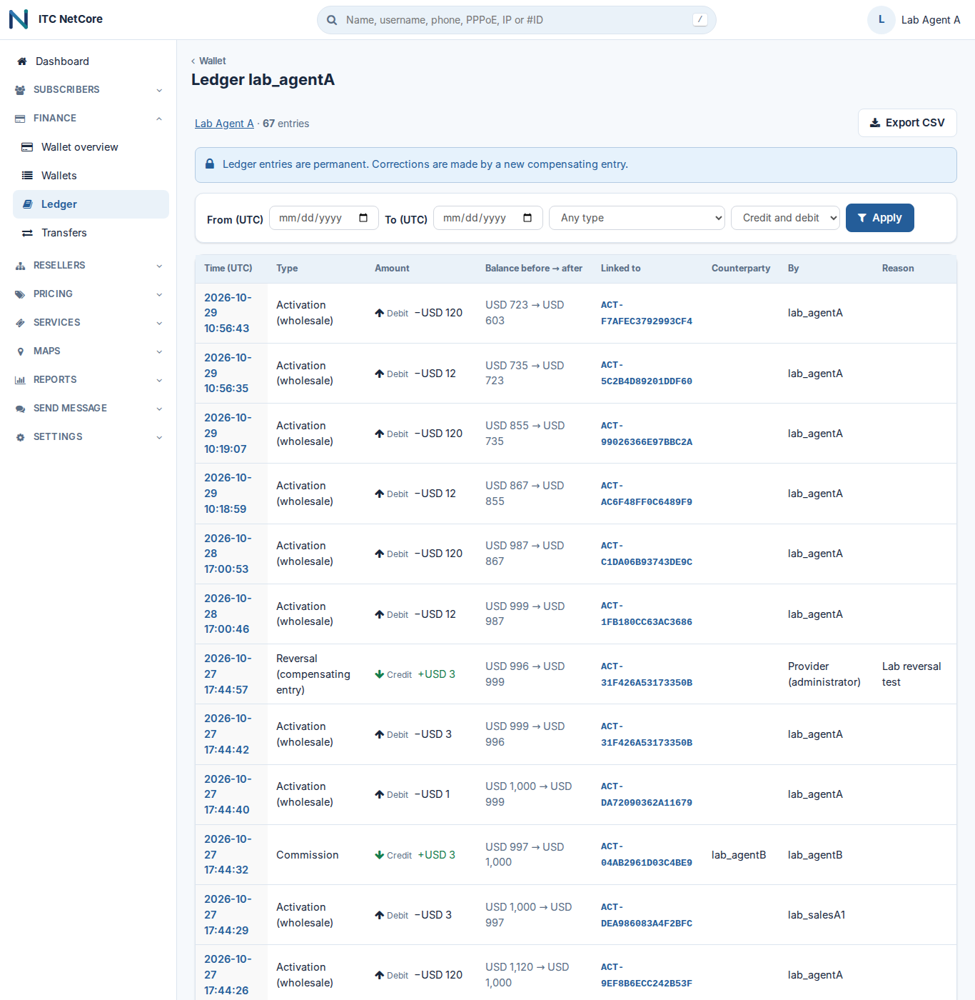

### Sending credit to a sub-reseller

**Purpose:** fund a direct child from your wallet.

**Required role:** "Agent" to its direct child only, or "Admin".

**Preconditions:** enough available credit; the child is active.

**Steps:**

1. "Finance" > "Wallet overview" > "Send to a child reseller" (or the quick action).
2. Under "To (direct child reseller)" choose the child. An inactive child shows "Inactive - transfers blocked".
3. Enter "Amount" and "Reason", then "Review".
4. Check "You are sending", "From - available credit", "To - balance" and "Operation reference". The note reads "This is a balance transfer, not a sale."
5. Press "Confirm".

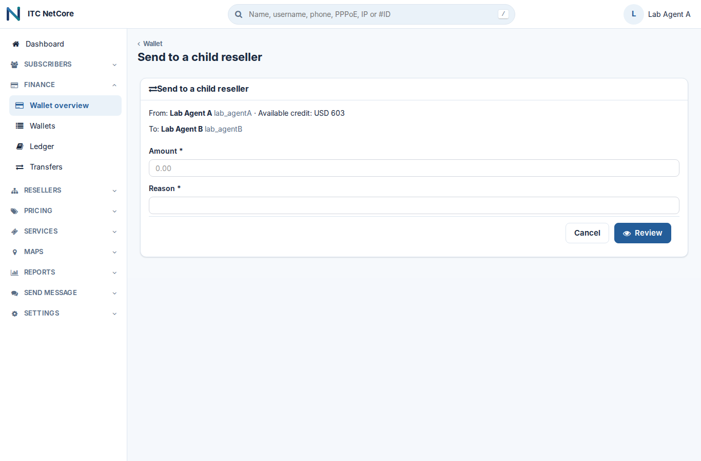

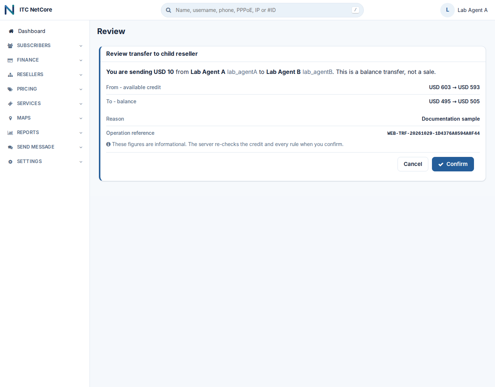

**Expected result:** "Recorded." and two matching entries: a debit on your wallet and a credit on the child's.

**Common mistakes:** pressing "Confirm" twice. The transfer is not repeated; you see "Already recorded: this confirmation was processed once."

> [!FINANCE-WARNING]
> You cannot fund yourself, and you cannot spend from a child's wallet. Your wallet is funded by the provider (Admin) or by your parent reseller. A transfer can only be undone by a "Transfer reversal" made by an administrator.

## 3.7 The sub-reseller hierarchy: creating sub-resellers and Sales

**Purpose:** build a sales network under you.

**Required role:** "Agent".

**Steps:**

1. "Settings" > "Administrator Users" > "Add New Administrator".
2. "User Type" offers only "Agent" (a sub-reseller) and "Sales", with the note "New accounts are created as your direct children."
3. Complete the form and press "Save Changes".
4. Set the new child's wholesale prices and availability (3.5), then fund it by transfer (3.6).

**What you can do to your children:** edit the profile, reset the password, disable and reactivate, for everyone under you.

**What you cannot do:** delete, change roles, move accounts in the tree, or reactivate an account an administrator disabled.

> [!FINANCE-WARNING]
> A reseller that earns a commission on its children's sales must have a wallet, otherwise the child's activation is refused with "A parent reseller that earns a commission on this sale has no wallet yet." A reseller that funds its children by transfer already has one.

## 3.8 Reports

Under "Reports" an Agent sees "Sales", "Commissions" and "Reseller performance" for its subtree. "Provider settlement" and the legacy reports ("Transactions (legacy)", "Activation History (legacy)") are for administrators only.

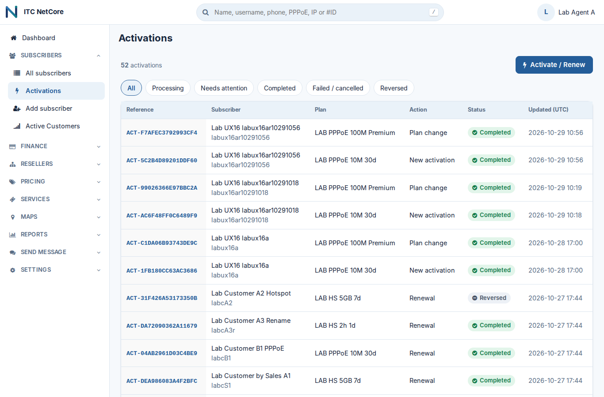

## 3.9 Error and recovery cases

| What you see | Meaning | What to do |
|---|---|---|
| "Credit sufficient: no" | Available credit is below the wholesale | Ask your parent reseller or the provider for funding |
| "Another activation for this customer is still in progress; check its status first." | A previous activation is unfinished | Open its status. If it stays more than 5 minutes, tell an administrator |
| "The financial operation could not complete because of concurrent activity; please try again." | Heavy simultaneous activity on one wallet. The amount may stay reserved, with nothing debited or granted | **Do not retry repeatedly.** Ask an administrator to resume or cancel the held activation after 5 minutes |
| "Checking - reconciliation required" | The network outcome is unconfirmed | Do not repeat. An administrator reconciles it from the Operations Center |
| "No plan is available for this subscriber." | No plan is priced and available for the subscriber's reseller | Check pricing with your parent reseller or an administrator |
| "The reseller or a parent reseller is inactive; financial changes are blocked." | Your account or one above you is disabled | Contact an administrator |
| "This service is managed by your reseller and cannot be changed here..." | Shown to your subscriber in the portal | Expected: renewals go through you on the activation screen |

<!-- pagebreak -->
# 4. Sales and operational staff

This chapter covers the two roles that work with subscribers every day: "Sales" (the sales representative) and "Admin" (the ISP's operations staff).

## 4.1 Sales: exact permissions

A Sales account belongs to one Agent and serves only the subscribers **explicitly assigned** to it among that Agent's subscribers.

| Can | Cannot |
|---|---|
| View its assigned subscribers and their records | See its Agent's other subscribers. Opening one is refused by the server |
| Add a subscriber: created as owned by its Agent and assigned to itself ("A subscriber you create belongs to your reseller and is assigned to you.") | Edit, synchronize, deactivate or delete a subscriber |
| Activate, renew and change plan for its subscribers, **paid from its Agent's wallet** | See wallets, the "Ledger" or the "Pricing" screens |
| View and send invoices; message one subscriber or selected subscribers | Bulk messages to all customers; generate vouchers |
| Its own profile and password | Create or manage staff |

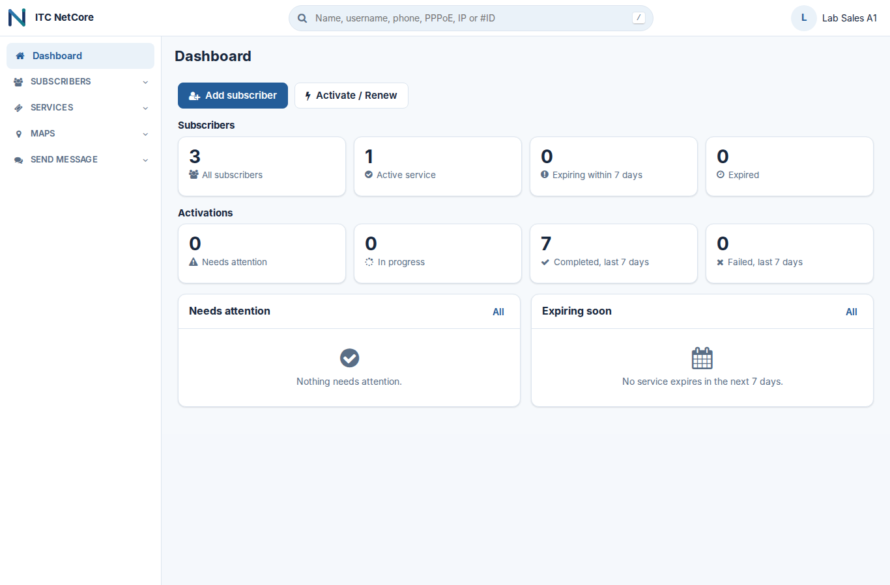

- Sales sidebar: "Subscribers", "Services", "Maps", "Send Message".
- On a phone: "Home", "Customers", "New", "Activations", "More".

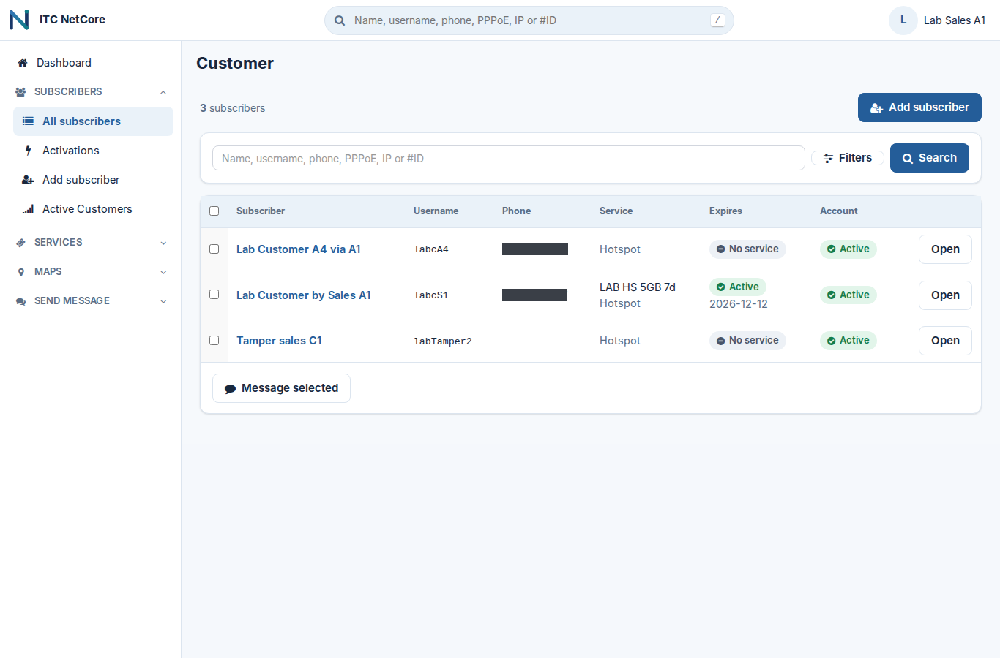

### Activation by a Sales user

**Purpose:** renew an assigned subscriber.

**Required role:** "Sales", placed under an Agent, active and not frozen.

**Preconditions:** the subscriber is assigned to it; its Agent has enough credit.

**Steps:** as in 3.4. The difference: the review card does not show the wholesale price or the credit figures to a Sales user. It shows "Retail - customer price", the new period, and "Credit sufficient: yes" or "no".

**Expected result:** a "Completed" activation, debited from the owning Agent's wallet.

**Common mistakes:**

- Searching for a subscriber not assigned to you: it will not appear. Ask your Agent to assign it to you ("Assign Sales").
- "Credit sufficient: no": you cannot fund the wallet. Tell your Agent.
- If your Agent moves you in the tree, subscriber assignments that no longer match are cleared.

> [!SECURITY-WARNING]
> If your account is not placed under an Agent, or is frozen, the activation screens are refused. This is intentional, not a fault.

## 4.2 Admin: operational staff

"Admin" holds the same capabilities as "SuperAdmin" **except**: saving "Static Pages", installing plugins, configuring payment gateways, web backup and restore, and the SuperAdmin-only security settings. An Admin creates only "Report", "Agent" and "Sales" accounts and deletes only "Report" accounts.

### Two kinds of subscriber

"Subscribers" > "All subscribers" shows every subscriber to an administrator, with search and filters.

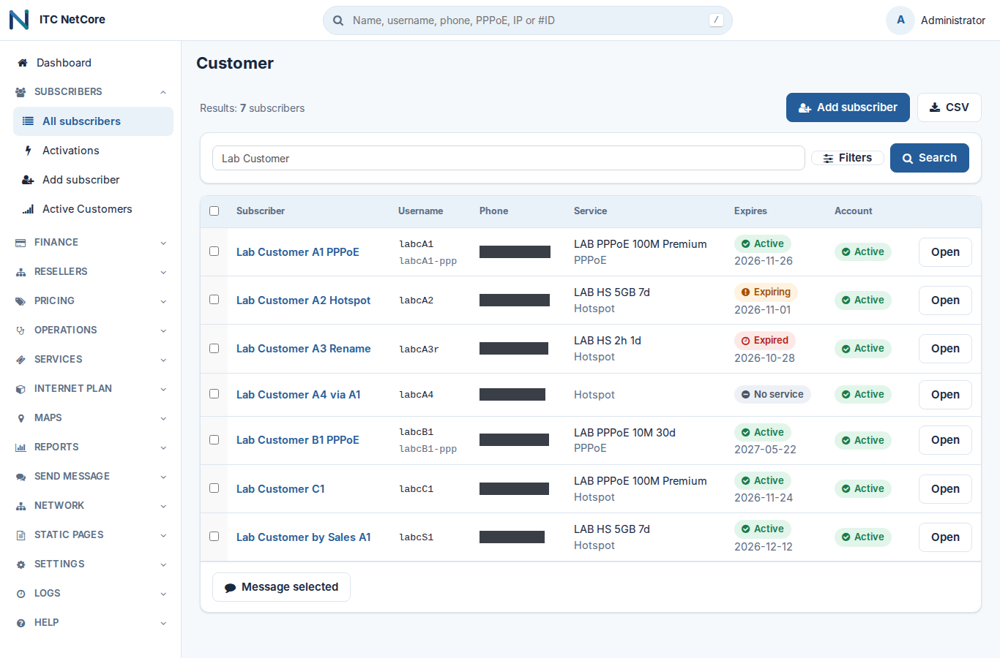

| | Direct subscriber (no reseller) | Reseller-owned subscriber |
|---|---|---|
| In the subscriber record | "Owner (reseller)" = "Unassigned (legacy)" | "Owner (reseller)" = the reseller's name |
| Granting service | "Services" > "Recharge Customer" or "Refill Customer" (voucher), or the "Recharge (legacy customer)" button in the record | The "Activate / Renew" screen only, debiting the owner's wallet |
| Deactivating the plan | "Deactivate plan" in the record | Refused. The service ends at expiry or by reversing the completed activation |
| Message when the legacy recharge is attempted | — | "Reseller-managed customers are activated through the reseller activation." and you are taken to the activation screen |

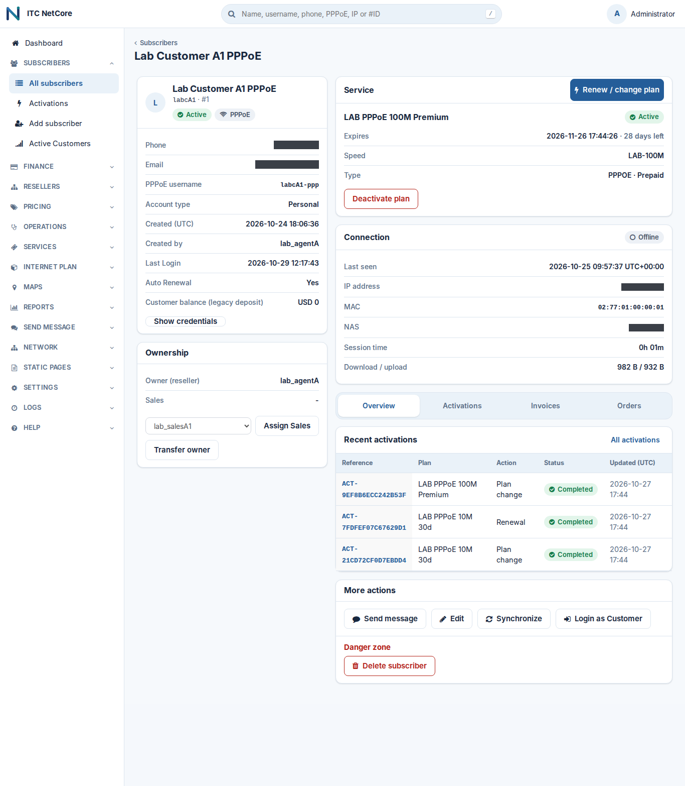

### Editing and synchronizing a subscriber

**Purpose:** correct login data or write the subscriber's service to the network again.

**Required role:** "Admin" or "SuperAdmin".

**Steps:**

1. Open the subscriber record > "More actions".
2. "Edit" to change the details, password and PPPoE data, then save.
3. "Synchronize" to write the current service to the network again.

**Expected result:** for a reseller-owned subscriber the network account is re-applied without changing the billing period. If "Network change not confirmed" appears, the change was not retried automatically and "Synchronize" must be run once.

**Common mistakes:** pressing "Synchronize" several times quickly. Run it once and wait for the result.

### Deactivating a direct subscriber's plan

**Steps:** subscriber record > "Deactivate plan" > dialog: "This ends the plan now and makes it expired. Internet access stops for this plan." > "Deactivate plan".

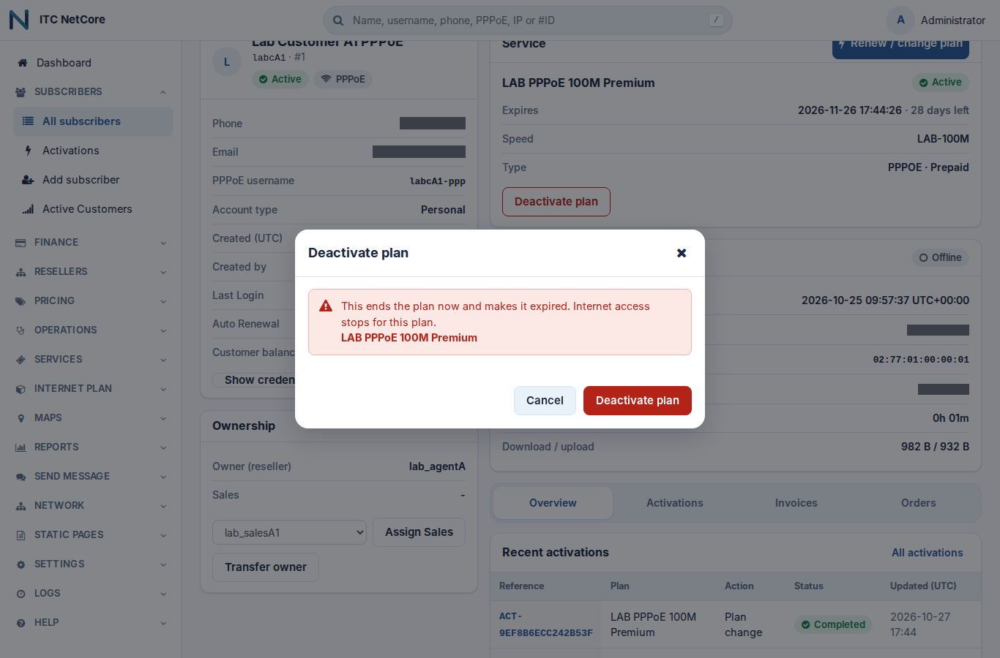

> [!WARNING]
> The "Deactivate plan" button is shown to administrators for every active plan, but the server refuses it for a reseller-owned subscriber with "This service is managed by your reseller and cannot be changed here. Please contact your authorized reseller." To end a reseller-owned service early, use "Reverse" on the completed activation (Chapter 7).

### Deleting a subscriber

Subscriber record > "Danger zone" > "Delete subscriber", then "Type the username to confirm". "It is refused while financial or activation history references the subscriber."

### Ownership

From the subscriber record > "Ownership":

- "Assign Sales" and "Clear Sales": a Sales account directly under the subscriber's owner.
- "Transfer owner" to another reseller: "Future operations use the new owner's wallet and prices. History stays with the original owner..."
- "Assign owner" for a direct subscriber: afterwards the subscriber is served through reseller activations only.

### Activations that need you

From "Operations" > "Operations Center", or from the activation page. Buttons appear only for the matching state; details in Chapter 7: "Reconcile", "Resume" or "Settle (resume)", "Cancel activation", "Roll back", "Reverse".

### Messages

"Send Message" > "Single Customer" or "Bulk Customers" (bulk is administrators only).

## 4.3 Permission summary by role

| Operation | SuperAdmin | Admin | Agent | Sales | Report |
|---|---|---|---|---|---|
| View subscribers | All | All | Subtree | Assigned | — |
| Add a subscriber | Yes | Yes | For itself | For its Agent, assigned to itself | — |
| Edit / synchronize / deactivate / delete a subscriber | Yes | Yes | — | — | — |
| Activate / renew / change plan | Any reseller-owned | Any reseller-owned | Its own | Assigned | — |
| Reverse, reconcile, cancel, resume an activation | Yes | Yes | — | — | — |
| View wallets and the ledger | All | All | Subtree | — | — |
| Transfer to a child reseller | Yes | Yes | To direct children | — | — |
| Funding, withdrawal, debt line, adjustment, transfer reversal | Yes | Yes | — | — | — |
| Base cost and reseller commerce | Yes | Yes | — | — | — |
| Child wholesale and availability | All | All | Direct children | — | — |
| Generate vouchers | Yes | Yes | — | — | — |
| Operations Center | Yes | Yes | — | — | — |
| Legacy reports ("Transactions", "Activation History") | Yes | Yes | — | — | — |
| Create staff | Every role | Report / Agent / Sales | Agent / Sales directly under it | — | — |
| Settings, network, plans | Yes | Yes | — | — | — |
| Static pages, plugins, payment gateways, web backup | Yes | — | — | — | — |
| Dashboard, own profile, own password | Yes | Yes | Yes | Yes | Yes |

<!-- pagebreak -->

# 5. Report role

> [!WARNING]
> Earlier guides described the "Report" role as "view-only access to reports and lists". That is **not correct** for V1.0. This chapter describes the actual behaviour.

**Exactly what a "Report" account can do:**

- Log in and log out.
- Open the "Dashboard", which shows only: "No data views are assigned to this role." and "Use the menu for your profile and password."
- From the account menu: "My Account", "Change Password", the language switch, "Light / dark theme", "Install app".

**What it cannot do:**

- The sidebar contains only "Dashboard".
- It sees no subscriber, activation, wallet, price or report.
- Opening "Reports" directly by its address returns the "Access denied" page (HTTP 403), because the role does not hold the report-reading capability.

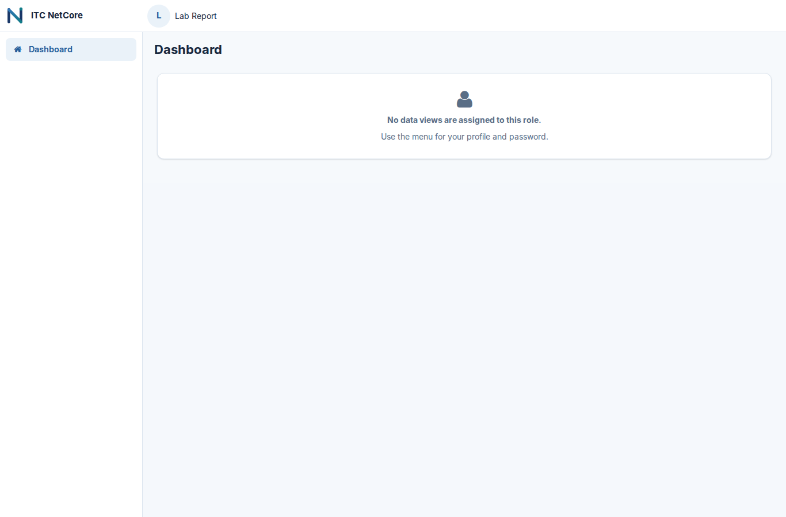

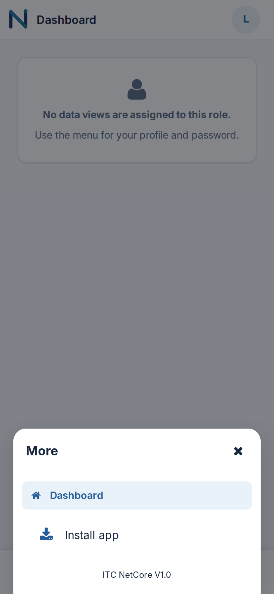

**When to use it:** this role is currently not usable for any data work. Staff who need financial reports need an "Admin" account, or receive an export prepared by an administrator. Creating a "Report" account grants a login only.

> [!NOTE]
> Extending the "Report" role needs a decision by the product owner and a code change. It cannot be changed in the settings.

<!-- pagebreak -->

# 6. Subscriber portal

Subscribers sign in to a portal that carries your company name. What they see depends on their kind:

| | Direct subscriber | Reseller-owned subscriber |
|---|---|---|
| Renewal | From the portal if the tools are enabled, or through the ISP | Through its reseller only: "To renew, contact your authorised agent" |
| Vouchers, purchase, recharge, extend, deactivate, balance transfer | Available, depending on the settings | Refused with "This service is managed by your reseller and cannot be changed here. Please contact your authorized reseller." |
| "Sync" | Available | Available; it grants no new service |
| Password change | Available | Available; the network account is re-applied |

> [!NOTE]
> The portal images in this chapter show a synthetic reseller-owned subscriber on an instance with "Company Name" set. That is why they show the renew-through-your-agent message and no recharge buttons.

## 6.1 Login

**Steps:**

1. Open the portal page.
2. Enter "Username" and "Password" (or phone number or email if the ISP configured that).
3. Tick "Remember me" on a personal device only, and press "Login".

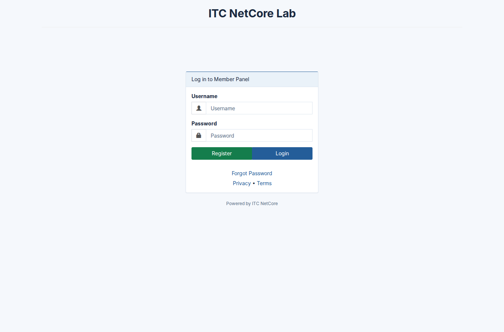

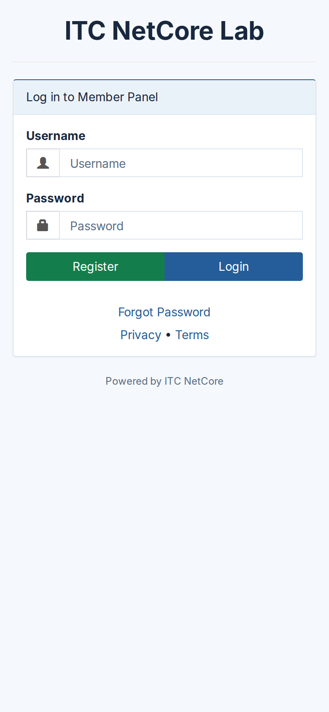

- "Forgot Password": a verification code to phone or email.
- "Register": self-registration, unless the ISP disabled it.
- A "Banned" account cannot log in and sees "This account status : Banned".

## 6.2 Account

- "Your Account Information": "Username", "Password" (masked in the images), "Service Type", balance.
- From the top menu: "My Account" to edit details, and "Change Password".
- "Language" from the globe icon, and "Dark mode".

## 6.3 Active subscription and plan information

The plan card shows "Package Name", "Created On", "Expires On", "Type" ("Prepaid" or "Postpaid"), and buttons that depend on the kind of subscriber.

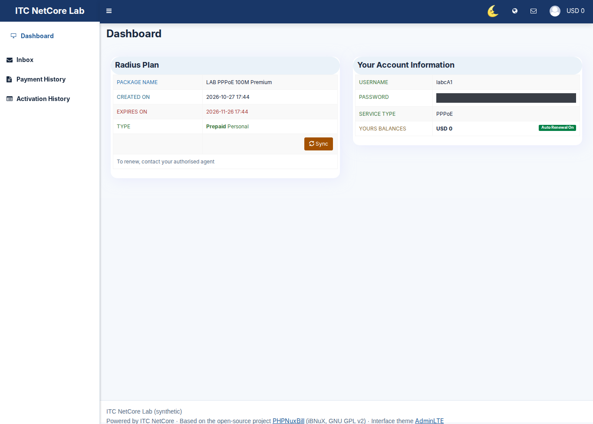

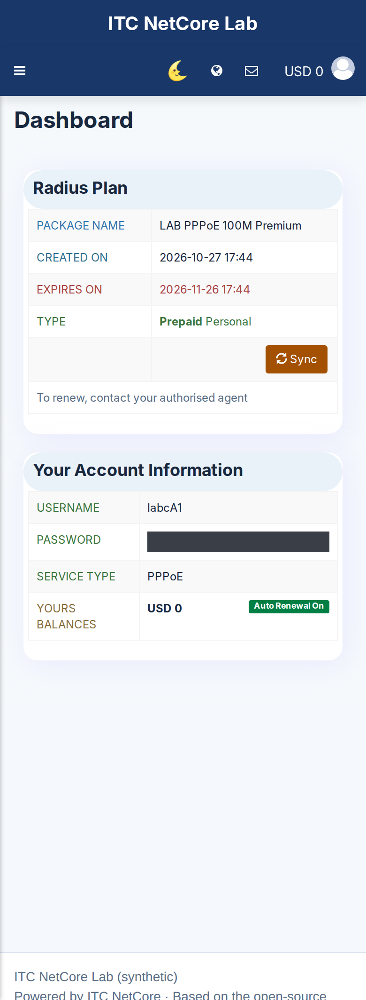

- "Sync": "Sync account if you failed login to internet".
- Sidebar: "Dashboard", "Inbox", "Payment History", "Activation History".

## 6.4 Renewal

| Kind of subscriber | How to renew |
|---|---|
| Reseller-owned | Contacts its reseller, who renews on the "Activate / Renew" screen. There is no auto-renew for reseller-owned subscribers in V1.0, whatever the auto-renewal switch in the portal shows |
| Direct | A voucher (6.5), or the "Recharge" button on the plan card, which leads to the payment page (needs an installed payment gateway), or "Extend" for an expired non-prepaid plan if the ISP enabled it, or a recharge by an administrator |

> [!NOTE]
> Buying plans online ("Buy Package") needs a payment gateway installed by the SuperAdmin. **No payment gateway ships with V1.0.**

## 6.5 Voucher redemption (direct subscribers)

**Purpose:** activate a plan with a printed voucher code.

**Required role:** an active direct subscriber. The "Voucher" menu item is not shown to reseller-owned subscribers, and the server refuses any attempt from them.

**Steps:**

1. Choose "Voucher" in the menu.
2. Under "Voucher Activation" enter the code in "Enter voucher code here" or use "Scan QR code".
3. Press "Recharge".

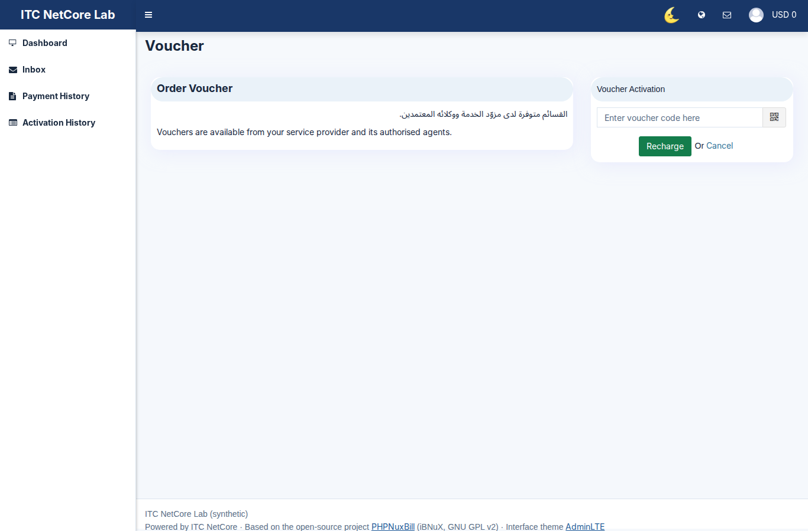

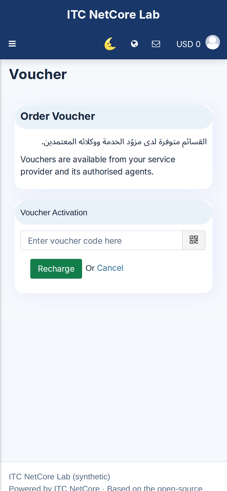

**Expected result:** "Activation Vouchers Successfully" and a move to "Activation History".

**Common mistakes:** a wrong or used code gives "Voucher Not Valid". An inactive account gives "This account status : ...".

## 6.6 Prepaid deactivation (direct subscribers only)

**Purpose:** end the current plan from the portal.

**Required role:** a direct subscriber. The button is not shown to reseller-owned subscribers, and the server refuses it.

**Steps:**

1. On the active plan card press the "Deactivate" icon.
2. For a prepaid plan the message reads: "Deactivate this prepaid plan? The remaining paid time will be lost and is not refunded under the current policy."
3. Confirm only if the subscriber accepts that.

**Expected result:** the plan ends at once and internet access stops.

> [!FINANCE-WARNING]
> The system has no refund path after a deactivation. Any goodwill compensation is an administrator's decision recorded by an audited adjustment; it never happens automatically.

> [!NOTE]
> No screenshot of the portal deactivation dialog was captured, because every synthetic subscriber with an active plan is reseller-owned, and the button is not shown to them.

## 6.7 Notifications and inbox

- "Inbox": messages the ISP sends to the subscriber.
- Expiry and reminder messages are sent according to the templates an administrator sets under "Settings" > "User Notification", through the enabled channels.
- "Payment History" and "Activation History": invoices and activation and expiry dates.

<!-- pagebreak -->

# 7. Financial operations

> [!FINANCE-WARNING]
> **Never repair money by editing the database directly.** No insert, update or delete is ever run against the ledger, wallets, transfers, reservations, activations, audit tables or `radacct`. Every correction is a new, audited operation in the application or the reconciliation tool.

## 7.1 Concepts

| Concept | Definition |
|---|---|
| Wallet | Prepaid credit of one reseller. "A wallet opens with the first provider funding, a positive debt line, or a transfer from the parent reseller." |
| "Debt line" | Credit the provider extends to a reseller (administrators only); it counts as real available credit |
| "Reserved for activations in progress" | Amounts held for unfinished activations |
| "Available credit" | "Balance + debt line - reserved" |
| "Ledger" | Insert-only, double-entry record. No edit, no delete. A correction is a compensating entry |
| Amounts | At most two decimals, no thousands separator |

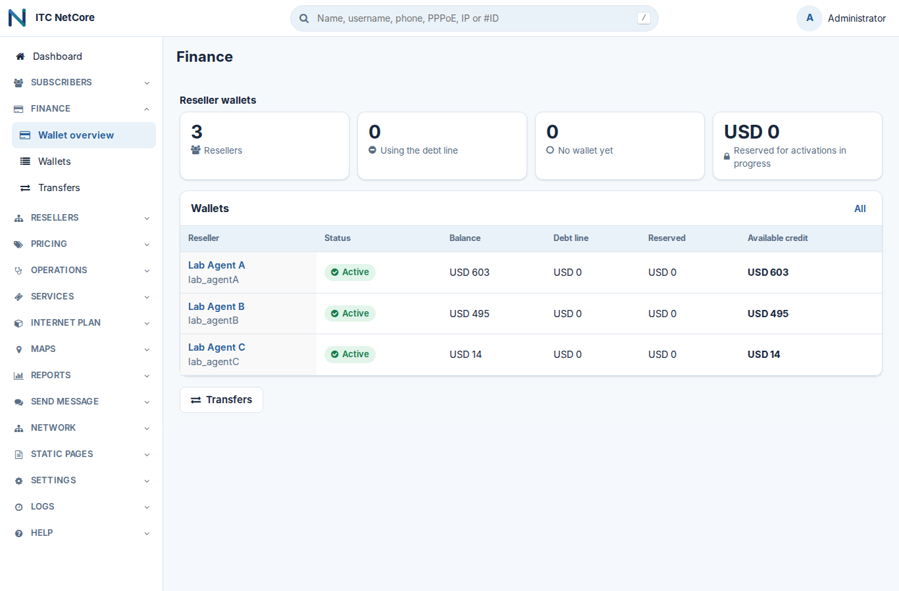

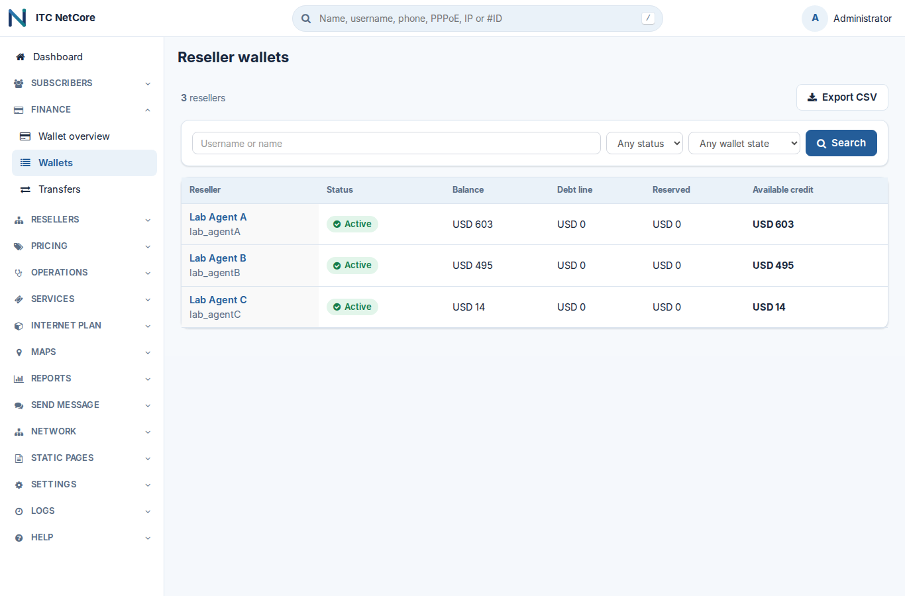

## 7.2 Provider funding and withdrawal

**Purpose:** add credit to a reseller's wallet against a payment the ISP received, or remove credit from it.

**Required role:** "SuperAdmin" or "Admin".

**Preconditions:** the reseller is active and placed in the tree; the payment receipt or transfer reference is at hand.

**Steps:**

1. "Finance" > "Wallets" (or "Fund reseller") > open the reseller's wallet.
2. Press "Provider funding" (or "Provider withdrawal").
3. Enter "Amount" ("Digits with up to two decimals, no thousands separator."), "Reason" ("The reason is recorded permanently and is visible to the reseller in its ledger.") and "External reference (optional)", for example the receipt number.
4. Press "Review". Nothing is written yet.
5. Check the balances before and after and the "Operation reference". "These figures are informational. The server re-checks the credit and every rule when you confirm."
6. **Withdrawal only:** type the reseller's username in "Type the reseller username to confirm". The button stays disabled until it matches.
7. Press "Confirm".

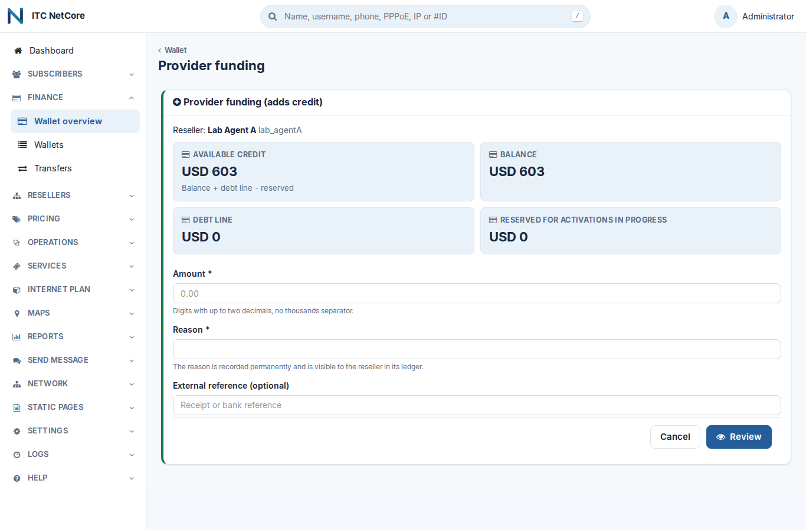

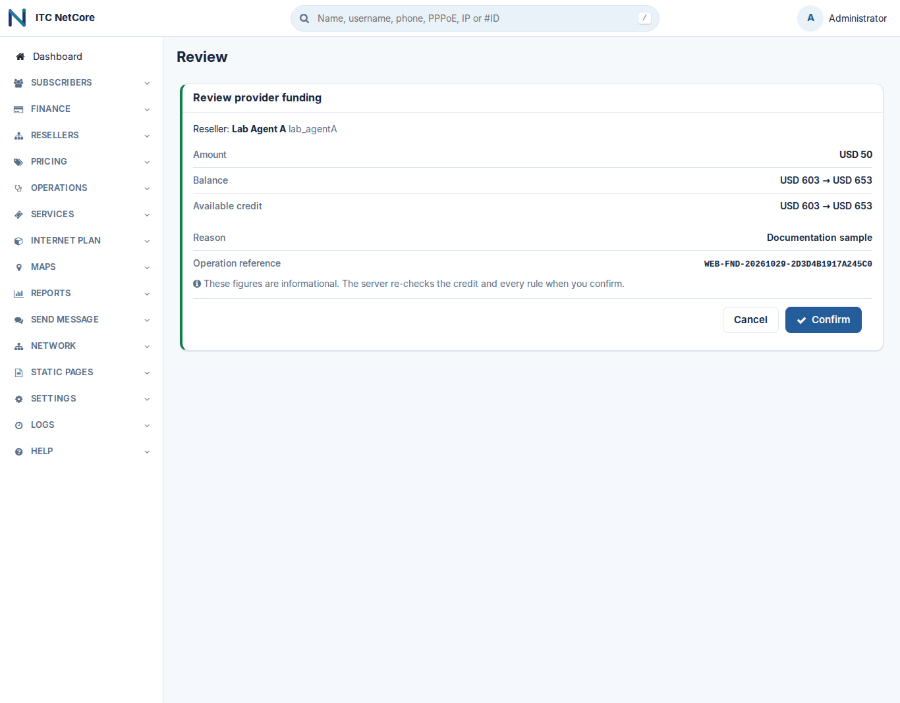

**Expected result:** "Recorded.", a new entry in the "Ledger", and the wallet balance updated.

**Common mistakes:**

- Pressing "Confirm" twice: the operation is not repeated; "Already recorded: this confirmation was processed once." appears.
- Returning to an old review page: "This confirmation is no longer valid; nothing was changed. Review the operation again."
- A reason shorter than 3 or longer than 255 characters: refused.

## 7.3 Debt line and accounting adjustments

**Required role:** "SuperAdmin" or "Admin".

| Operation | Button on the wallet page | Typed confirmation |
|---|---|---|
| "Debt line" | "Accounting corrections" > "Debt line" > "New debt line" | On a **decrease** only: the reseller's username |
| "Credit adjustment" | "Accounting corrections" > "Credit adjustment" | No |
| "Debit adjustment" | "Accounting corrections" > "Debit adjustment" | Yes: the reseller's username |

**Steps:** form > "Review" > (typed confirmation where required) > "Confirm".

- An adjustment is "A correction of the wallet by a new ledger entry. It is not provider funding and it never opens a wallet."
- The debt line cannot be reduced below what covers the balance and the active reservations.
- If the debt line changed after the review, the confirmation is refused.

> [!FINANCE-WARNING]
> Typing the username or reference is an intentional safety step for operations that remove money. Do not paste it mechanically: read the name and make sure you are on the right wallet.

## 7.4 Transfer to a sub-reseller

Described in 3.6. A transfer goes from a reseller to its **direct** child only and needs no typed confirmation. An administrator can also use "Send to this reseller" from the wallet page.

## 7.5 Transfer reversal

**Purpose:** correct a wrong transfer or funding.

**Required role:** "SuperAdmin" or "Admin".

**Steps:**

1. "Finance" > "Transfers" > open the transfer.
2. "Accounting corrections" > "Reverse this transfer".
3. Enter the "Reason" > "Review".
4. Type the original transfer reference in "Type the original transfer reference to confirm" > "Confirm".

**Expected result:** a new compensating operation. "The original entries stay unchanged; a new compensating entry is posted." A transfer is reversed once only.

## 7.6 Activation debits, settlement and commissions

| Phase | What happens to money |
|---|---|
| Open | The price chain is sealed and the wholesale is reserved on the owning reseller's wallet ("The cost is reserved from the reseller credit; it is not charged yet.") |
| Network provisioning | No money moves |
| Completion | In one transaction: the wholesale debit, a commission for each intermediate reseller with a positive margin, the provider settlement recorded, and the activation "Completed" |

- An activation the network did not apply: "Not activated" and "The reserved credit was released; nothing was charged."
- The reseller statement shows every debit and commission.

## 7.7 HELD reservations

> [!FINANCE-WARNING]
> **A held reservation is never released automatically**: not by time, not by a scheduled job, not by a concurrency error. It is resolved only by an audited decision of an administrator or the operator, according to its state. Never release it by editing the database.

Sources of held funds: an activation that stopped before or between provisioning steps, an unconfirmed network outcome, or a concurrency refusal on one wallet under heavy load.

Where you see it: "Operations Center" > "Needs attention", and the "Reserved for activations in progress" figure on the wallet and the dashboard.

## 7.8 Pending and failed activations

**Required role:** "SuperAdmin" or "Admin". Agents and Sales do not have these actions.

**Preconditions:** the activation has made no progress for at least 5 minutes. The tools refuse a live activation.

| What the activation page shows | Available action | Effect |
|---|---|---|
| "Processing", stale for 5 minutes | "Resume" or "Cancel activation" | Resume continues. Cancel releases the reservation: "This activation has not been applied to the network. Cancel it and release the reserved credit? This cannot be undone." |
| Verified but not settled | "Settle (resume)" | Settles exactly once |
| "Checking - reconciliation required" | "Reconcile" | If delivery is proven it settles once; if the network is back in its prior state the reservation is released; otherwise "Operator review required" |
| "Operator review required" | "Roll back", or correct RADIUS then "Reconcile" | "Roll back is one-way: after a roll back attempt this activation can never be settled." Needs "Type the reference to confirm" |
| "Rollback pending" | "Retry roll back" | Funds stay held until the restore is verified |
| "Reversal pending" | "Resume reversal" | Safe continuation of the reversal |

**Common mistakes:** repeating "Reconcile" without checking RADIUS after "Operator review required"; cancelling before making sure the network did not apply the service.

> [!WARNING]
> Never retry an operation whose network outcome is unknown without checking. When in doubt, leave the amount held and escalate.

## 7.9 Reversing a completed activation

**Purpose:** end a reseller-owned service early, or correct a wrong activation.

**Required role:** "SuperAdmin" or "Admin" only.

**Steps:**

1. Open the "Completed" activation > "Reverse".
2. Read: "Reverse this completed activation: restore the previous RADIUS state, credit the reseller and claw back the commissions?"
3. Enter the "Reason" (required), type the activation reference in "Type the reference to confirm", then "Reverse".

**Expected result:** "Reversed": "The completed activation was reversed and the previous state restored." and "The wholesale cost was refunded and the commissions were reversed."

> [!FINANCE-WARNING]
> There is no automatic refund to the subscriber. Any amount the subscriber paid the reseller outside the system is returned outside the system. The reversal is refused if the subscriber's service changed after the activation, or if clawing back a commission would take its recipient's available credit below zero.

## 7.10 Operator reconciliation

| Frequency | Check | Expected |
|---|---|---|
| Hourly (monitoring) | Finance integrity `health.php --finance` | OK |
| Daily | `reconcile.php finance-check` | `CONSISTENT` |
| Daily | `reconcile.php drift` | No lines |
| Daily | "Operations Center" and `reconcile.php stale` | Empty, or each item owned by a named operator |
| Monthly | "Ledger", "Transfers", "Sales", "Commissions", "Provider settlement", "Reseller performance" | Agrees with the ISP's external payment records |

> [!SECURITY-WARNING]
> If `finance-check` exits with code 4, or the `finance` health check is critical, a write happened outside the finance services. Stop selling, **do not correct the numbers**, keep a database snapshot and the logs, and escalate at once.

## 7.11 Audit

Every successful money operation is recorded with the actor, target, reference, amount, balance before and after, and the reason. Every finance export is recorded too. Refused and repeated attempts are not recorded, because they change nothing.

## 7.12 Finance prohibitions

- Editing or deleting any row of the ledger, transfers, transactions, `radacct` or the audit tables.
- Releasing a held reservation by editing the database, even "to unblock" a stuck case.
- Releasing a reservation without a documented decision for its state.
- Retrying a network operation whose outcome is unknown.
- Installing an unreviewed plugin or payment gateway.

<!-- pagebreak -->
# 8. Network operations

The application writes each subscriber's policy (password, validity, speed, simultaneous devices, address, quota) to the FreeRADIUS database. The MikroTik router asks FreeRADIUS at every login and sends accounting records during the session. When needed, the application sends the router a request to end a session or change its attributes (Disconnect / CoA).

**Who does what in this chapter:**

| Who | What |
|---|---|
| Administrator ("Admin" or "SuperAdmin") | The interface: NAS devices, the subscriber record, logs, the Operations Center |
| Operator | The application host and the FreeRADIUS host: the `preflight.php`, `health.php`, `reconcile.php` and `quota.php` tools |
| Network administrator | The router: RADIUS, SNMP, NTP and firewall configuration |

## 8.1 NAS status

- "Network" > "Radius NAS": the defined devices, with "Name", "Type", "CoA port" and "Server".
- "Network" > "Routers": the registered routers and their status.
- The "Type" of every device must be `mikrotik_snmp`.

## 8.2 FreeRADIUS connectivity

**Purpose:** confirm that the router reaches FreeRADIUS and that FreeRADIUS reads the devices.

**Steps (verification only, no change):**

1. "Logs" > "Radius": are there recent login attempts from this device?
2. Operator: `php system/reseller/preflight.php` must pass.
3. Operator: `php system/reseller/health.php`. The `accounting` check warns when no accounting has arrived for more than 15 minutes while sessions are open.

> [!NOTE]
> FreeRADIUS reads the device list when it starts. After adding a device or changing its secret, FreeRADIUS must be restarted or reloaded.

## 8.3 Session guard (session verification over SNMP)

When a PPPoE subscriber reconnects while its previous session is still recorded as open (for example after a lost session-end message), the session guard asks the router over SNMP whether the old session still exists. If it cannot be sure, it rejects the login with "Session verification failed" rather than risk two sessions.

- The guard needs a read-only SNMP community for each device in a credential file on the FreeRADIUS host, and the device "Type" `mikrotik_snmp`.
- The operator checks it with `nuxr_guard_selfcheck`, which must print `guard_selfcheck=OK`.
- Within 10 seconds of a session start every take-over is refused; reconnecting a few seconds later succeeds.

## 8.4 Verifying a subscriber's session

**Purpose:** find out whether the subscriber is online now and through which device.

**Required role:** any role that can see the subscriber.

**Steps:**

1. Open the subscriber record.
2. The "Connection" card: "Online", "Offline", "No session yet" or "Status unknown", with "Online since" or "Last seen", "IP address", "MAC", "NAS", "Session time" and "Download / upload".
3. Administrators: "Logs" > "Radius" to see recent authentication rejects.

**What the states mean:**

| State | Meaning |
|---|---|
| "Online" | An open session updated recently |
| "Status unknown" | "A session is open but has not been updated recently; the subscriber may be offline." |
| "No session yet" | "No RADIUS session has been recorded for this subscriber." |
| "Unavailable" | Accounting data cannot be read; the state is unknown |

## 8.5 Recovery

| Situation | Approved action | Who |
|---|---|---|
| A change not confirmed on the network ("Network change not confirmed") | "Synchronize" once from the subscriber record | Administrator |
| An old session still on the old policy after a plan change or renewal | `reconcile.php session-end <ACT>`, or disconnect the session on the router | Operator / network administrator |
| A PPPoE admission claim left pending | Released with the reconciliation tool, with evidence from the router | Operator |
| Drift between the application and RADIUS | "Drift check" in the Operations Center, then "Synchronize" | Administrator |

> [!WARNING]
> Never release an active admission claim by hand, and never edit the RADIUS or accounting tables by hand. Every correction goes through the application or the reconciliation tools.

## 8.6 Disconnect and CoA

- The application sends Disconnect and CoA requests itself to the device address, on the "CoA port", or 3799 when it is empty.
- It sends them automatically on renewal, plan change and reactivation (to end the previous period's session), and when a quota is exceeded.
- **There is no "disconnect session" button in the staff interface in V1.0.** A manual disconnect is done on the router, or with `reconcile.php session-end` by the operator.
- The router accepts a request only from an address configured on it as a RADIUS server, and on the configured incoming port.
- If the router does not answer, the request is not retried automatically and the activation is not undone; it is reported as drift until the session ends.
- RouterOS does not apply a mid-session CoA that changes a data limit or an address pool; the session must be disconnected so the subscriber logs in again with the new policy.

## 8.7 Quota behaviour

| Aspect | Behaviour in V1.0 |
|---|---|
| Units | Data: decimal MB or GB (1 GB = 10^9 bytes), download and upload combined. Time: minutes or hours |
| Period | Per billing period. A renewal, plan change or reactivation starts a new period from zero. A password change or synchronization keeps the period |
| Enforcement | The router enforces a per-session limit, and the quota enforcer checks usage every few seconds and disconnects a session that exceeds it |
| Accuracy | **Bounded, not byte-exact.** Usage can exceed the limit by a small amount |
| Overshoot | "The usage above the quota was caused by the time the network needs to stop a session. It is not charged and not carried into the next period." |
| Display | Subscriber record > "Quota this period": "Data quota" or "Time quota", "Actual usage", "Covered by the plan", "Over the quota" |
| Quota used up | The login is rejected with "Data quota exhausted or unavailable" |

> [!WARNING]
> Never advertise a quota to subscribers as a byte-exact cap. While the quota enforcer, FreeRADIUS or the database is down, only the router's limits apply.

## 8.8 Clock synchronization

- Application host, database and FreeRADIUS: UTC and NTP, at most 5 seconds apart.
- Every router: NTP from two internal servers, at most 10 seconds off (preferably under 2 seconds).
- A router clock more than 10 seconds ahead can leave an old session running on the previous plan's policy after a renewal or plan change until it reconnects; this is not detected automatically.
- Checks: `preflight.php` (`time.nas_clock`: warning above 5 seconds, failure above 10) and `health.php` (`nas_clock`). The checks only see a clock that is **ahead**; a clock that is behind is caught by NTP monitoring.

> [!WARNING]
> Never set a router clock by hand instead of fixing NTP.

## 8.9 SNMP errors

Common reasons `nuxr_guard_selfcheck` fails:

| Reason printed by the tool | Meaning |
|---|---|
| `no-credential-file` or `credential-file-mode` | The credential file is missing or has the wrong permissions (must be 0600 or 0400, owned by `freerad`) |
| `credentials` | No line for this device, or invalid characters |
| `snmpget-missing` / `snmpbulkwalk-missing` | The net-snmp tools are not installed |
| `health` | Wrong community, or SNMP disabled or blocked on the router (the two look the same) |

The fix: the operator corrects the credential file, or the network administrator corrects SNMP on the router, until the tool prints `guard_selfcheck=OK`. Changing the credential file needs no FreeRADIUS restart and no database change.

## 8.10 Alarms

The operator runs `health.php` from the monitoring system every 5 minutes. Exit codes: 0 OK, 1 warning, 2 critical, 3 the check itself failed.

| Check | Meaning |
|---|---|
| `db` | Database, UTC session, clock skew |
| `schema` | Reseller schema readiness |
| `activations_stale` | Activations stuck for 5 minutes (warning) or 30 minutes (critical) |
| `reconciliation` | Activations waiting for reconciliation, funds held |
| `reservations` | Oldest active reservation: warning after 1 hour, critical after 24 hours |
| `admission_pending` | Admission claims pending for more than 10 minutes |
| `vouchers_review` | Vouchers under review |
| `balance_held` | Legacy balance operations held |
| `accounting` | Freshness of accounting records |
| `nas_clock` | A router clock ahead |
| `coa_failures` | Unconfirmed session ends in the last hour |
| `quota_enforcer` | Quota enforcer silent, or a session over quota |
| `finance` (with `--finance`) | Full finance integrity |

<!-- pagebreak -->

# 9. Troubleshooting

Each case follows the same order: **Symptom → Likely causes → Safe verification → Authorized resolution → Escalation.** Safe verification steps are read-only. The authorized resolution names who holds the permission and the supported path.

> [!FINANCE-WARNING]
> In every case: never edit the ledger, wallets, reservations, activations, `radacct`, quota rows or audit tables in the database; never release a held reservation or an active admission claim to "unblock" a subscriber; never retry a network operation whose outcome is unknown.

## 9.1 Incorrect login

**Symptom:** a staff user or subscriber cannot sign in to the interface or the portal, or a PPPoE / Hotspot login is rejected.

**Likely causes:** wrong username or password; a disabled staff account (same message, "Invalid Username or Password."); a frozen reseller (can log in, changes are refused); the installer's default password (redirect to the password change); a "Banned" subscriber; network credentials changed but not applied.

**Safe verification:** administrator: "Administrator Users" (account status), "Reseller Tree" (status of the accounts above), the subscriber record (status, username, PPPoE username), "Logs" > "Radius".

**Authorized resolution:** staff password reset: an administrator for any lower account, an Agent for accounts under it only. Subscriber password: an administrator edits it, or the subscriber changes it in the portal or uses "Forgot Password". Reactivate a disabled account only if the disabling was not deliberate.

**Escalation:** repeated failures across many accounts may be a password-guessing attempt. Escalate to security to apply rate limiting at the HTTPS front end.

## 9.2 Insufficient credit

**Symptom:** "Credit sufficient: no" and "Confirm activation" disabled; or "Insufficient available credit."

**Likely causes:** available credit below the wholesale; credit held by stuck activations; an upstream reseller earning a commission has no wallet; the account or one above it is frozen.

**Safe verification:** the wallet page ("Balance", "Debt line", "Reserved for activations in progress", "Available credit"); the "Operations Center" for that reseller's stuck activations.

**Authorized resolution:** the parent reseller: "Send to a child reseller". An administrator: "Provider funding" or a "Debt line". Stuck reservations: resolve them per 9.4.

**Escalation:** the financial operator for credit policy or a disputed balance.

## 9.3 Expired subscription

**Symptom:** the subscriber cannot connect after the end date; the portal shows the plan expired; the reseller says "it used to renew automatically".

**Likely causes:** the period ended, FreeRADIUS rejects the login and the service is expired; **no auto-renew for reseller-owned subscribers in V1.0**; the scheduled job skipped the subscriber temporarily because a renewal was in flight.

**Safe verification:** the subscriber record (plan, "Expires", last activation); "Operations Center" > "Auto-renew not available (records)".

**Authorized resolution:** reseller-owned: the reseller, its Sales user or an administrator renews on "Activate / Renew" (reactivation). Direct: a voucher, or a recharge from the portal or by an administrator.

**Escalation:** if the scheduled job skips the same subscriber many times, the operator checks stale activations.

## 9.4 Activation pending

**Symptom:** an activation stays at "Processing" or "Checking - reconciliation required"; a new attempt is refused with "Another activation for this customer is still in progress; check its status first."; or the reseller saw the concurrency message.

**Likely causes:** the process stopped before or between provisioning steps; a concurrency refusal on one wallet; an unknown RADIUS outcome; delivered but not settled.

**Safe verification:** "Operations Center" > "Needs attention" and "Stale activations"; the activation page ("Timeline" and the available actions); operator: `reconcile.php show <ACT>`.

**Authorized resolution:** administrators only, after 5 minutes without progress, per the table in 7.8: "Resume", "Cancel activation", "Settle (resume)", "Reconcile" or "Roll back".

**Escalation:** the financial operator for any ambiguous outcome; ITC if the activation stays ambiguous after the RADIUS inspection.

## 9.5 NAS unreachable

**Symptom:** new logins on one device time out; `accounting` or `coa_failures` warnings; activations annotated `COA_NO_RESPONSE`.

**Likely causes:** the router is down or isolated; a routing or firewall change; the router's incoming Disconnect port is 1700 while the application sends to 3799; incoming Disconnect disabled; SNMP blocked.

**Safe verification:** the network administrator on the router: RADIUS configuration, incoming Disconnect, the UDP 3799 and UDP 161 rules, uptime. Operator: `nuxr_guard_selfcheck` and `preflight.php`.

**Authorized resolution:** the network administrator restores reachability and the device configuration. The operator then ends the old pending sessions with `session-end` where the drift check lists them.

**Escalation:** the network administrator first, then ITC if the configuration is correct and Disconnect still fails.

## 9.6 RADIUS reject

**Symptom:** the subscriber's login is rejected; the router log shows Access-Reject.

| Message or reason | Likely cause | Authorized resolution |
|---|---|---|
| Password error with no specific message | Wrong password, or an unsupported authentication method (PAP and CHAP only; MS-CHAPv2 is refused) | Correct the credentials or the router's PPP authentication method |
| Rejected after the end date | The period ended | Renew (9.3) |
| "Data quota exhausted or unavailable" | The quota is used up, or the database query failed | Renew or change plan, or fix the database |
| "Quota unavailable" | A damaged quota row written outside the application | Save the subscriber's plan again through the application, never by hand |
| "Session verification failed" | The session guard could not confirm the old session ended, or the 10-second hold | 9.7 and 9.8 |

**Safe verification:** the subscriber record; "Logs" > "Radius"; the FreeRADIUS log (operator).

**Escalation:** operator, then ITC, with an excerpt of the FreeRADIUS log and no secrets.

## 9.7 SNMP verification failed

**Symptom:** PPPoE subscribers on one device are rejected with "Session verification failed" when they reconnect; `nuxr_guard_selfcheck` prints `guard_selfcheck=ERROR`.

**Likely causes:** see the table in 8.9; or the device "Type" is not `mikrotik_snmp`.

**Safe verification:** `nuxr_guard_selfcheck <NAS_IP>` (read-only; it never prints the community); on the router the SNMP configuration, community and UDP 161 rule; the `nas.verification` line of `preflight.php`.

**Authorized resolution:** correct the credential file or the SNMP configuration until `guard_selfcheck=OK`. The subscriber's next login succeeds after the 10-second hold. **No database change is needed or allowed.**

**Escalation:** the network administrator (SNMP on the router) and the operator (FreeRADIUS host).

## 9.8 Customer cannot reconnect

**Symptom:** a subscriber who was online cannot log in again, often after a power cut, a router reboot, a plan change or a password change.

| Cause | Safe verification | Authorized resolution |
|---|---|---|
| Lost session-end message; the guard must verify | `nuxr_guard_selfcheck` | If the guard is healthy, reconnect after a few seconds; otherwise 9.7 |
| The 10-second hold after a session start | FreeRADIUS log `reject:active-fresh` | Ends by itself; reconnect after a few seconds |
| A pending admission claim | `reconcile.php admission-pending` | The operator releases it with the reconciliation tool, with **router-side evidence** that the attempt cannot become a session |
| A change not confirmed on the network | `reconcile.php drift` | "Synchronize" once from the subscriber record |
| An old session on the old policy | `reconcile.php drift` | `session-end`, or disconnect the session on the router |
| The plan's address pool missing on the router | Plan settings against the router | The network administrator creates the pool |

**Escalation:** operator, then ITC, with the activation reference or the claim key (never post the token in a public channel).

## 9.9 Quota or usage disagreement

**Symptom:** the subscriber or reseller says the usage does not match the router or a speed test; a session ran slightly past the quota; usage "reset" or "did not reset".

**Likely causes:** the quota is bounded, not byte-exact; overshoot is not charged; a renewal starts a period from zero while a password change does not; the units are decimal; the quota enforcer stopped.

**Safe verification:** the subscriber record > "Quota this period"; operator: `quota.php usage <USERNAME>` and `quota.php report`; the `quota_enforcer` check.

**Authorized resolution:** explain the quota contract to the subscriber. If the enforcer stopped, the operator restarts it. Any compensation is an administrator's decision through an audited adjustment. **Never edit `radacct` or quota rows.**

**Escalation:** ITC with the `quota.php usage` output if the figures contradict the contract.

## 9.10 Backup or restore failure

**Symptom:** the nightly backup is missing, small or failed; a restore fails or does not pass verification.

**Likely causes:** the backup account lacks a privilege; a migration ran during the dump; the configuration or key file is missing or has the wrong mode, or the disk is full; the off-host copy failed; a binary log expired before it was archived; the decryption key is unavailable; a restore into a non-empty database (the restore tool refuses it).

**Safe verification:** the exit code and result lines of the backup tools (`install/backup/`, see `backup_restore_guide`); the set's `backup.info` and manifest; on a restored copy the restore tool itself runs `migrate.php verify`, `health.php --finance` and the finance row counts.

**Authorized resolution:** the database administrator fixes the cause and takes a new backup at once. A restore always goes into a **new, empty** database; the live database is never overwritten. The restore button in the interface is refused on this system. Never "fix" a copy's figures in the database.

**Escalation:** the database administrator, then ITC; ISP management if no valid backup exists.

<!-- pagebreak -->

# 10. Training exercises

Run the exercises in a **training environment with synthetic data only**, never on a production system. Use names such as `trn_agent01` and `trn_cust01`, and temporary passwords you generate yourself. Never use real subscriber data.

## Exercise 1: Create a reseller

**Role:** "Admin".

1. Create an "Agent" account `trn_agent01` at the top level.
2. Create a "Sales" account `trn_sales01` under it.

- [ ] `trn_agent01` appears in the "Reseller Tree" with status "Active".
- [ ] `trn_sales01` appears on the row directly below it with the role "Sales", and the "Sales accounts" column of `trn_agent01` shows 1.
- [ ] The temporary password was not sent through an insecure channel.

## Exercise 2: Create a customer

**Role:** `trn_agent01`.

1. Add a PPPoE subscriber `trn_cust01`, using "Generate" for the password.
2. Assign it to `trn_sales01`.

- [ ] "Subscriber created." appears.
- [ ] "Owner (reseller)" = `trn_agent01` and "Sales" = `trn_sales01`.
- [ ] `trn_sales01` sees the subscriber in its list and does not see any subscriber not assigned to it.

## Exercise 3: Assign a plan (pricing for the reseller)

**Role:** "Admin".

1. Choose a PPPoE plan on Radius, set the "Provider base cost" and turn reseller commerce on.
2. For `trn_agent01` set a wholesale above the base cost and a retail price above that.

- [ ] The plan is "Saleable" for `trn_agent01`.
- [ ] An attempt to set a retail price below the wholesale is refused.

## Exercise 4: Fund the wallet

**Role:** "Admin".

1. Fund `trn_agent01`'s wallet with a test amount, a reason and a test external reference.
2. On the review screen go back, then review again.
3. Confirm.

- [ ] One funding entry in the "Ledger", with the reason; its "Transfer" link opens the transfer, which shows the "External reference".
- [ ] "Available credit" = balance + debt line - reserved.
- [ ] A double press on "Confirm" did not repeat the funding.

## Exercise 5: Activate

**Role:** `trn_sales01`.

1. Activate the plan for `trn_cust01`.

- [ ] The review card shows the Sales user neither the wholesale nor the credit figures.
- [ ] The activation is "Completed", with an "Invoice" number.
- [ ] `trn_agent01`'s wallet decreased by exactly the wholesale (checked by the administrator or the Agent).

## Exercise 6: Renew and change plan

**Role:** `trn_agent01`.

1. Renew `trn_cust01` with the same plan. Note the text "Same plan: the new period continues from the current expiry." and that the "New period" ends at the current expiry plus the plan's validity.
2. Open a change to another plan and do not confirm. Note the warning and the "I understand that the remaining paid time will be lost" acknowledgement.

- [ ] The renewal shows: same plan, continuing from the current expiry.
- [ ] "Confirm activation" stays disabled on the plan change until the acknowledgement is ticked.
- [ ] The trainee explains when to renew and when to change plan.

## Exercise 7: Redeem a voucher

**Role:** "Admin", then a direct subscriber.

1. Create a direct Hotspot subscriber `trn_direct01` ("Owner (reseller)" = "Unassigned - legacy customer, Admin only").
2. Generate one voucher for a Hotspot plan.
3. Log in to the portal as `trn_direct01` and redeem the voucher.
4. Log in as `trn_cust01` (reseller-owned) and note that the "Voucher" item is absent.

- [ ] "Activation Vouchers Successfully".
- [ ] Using the same code a second time gives "Voucher Not Valid".
- [ ] The reseller-owned subscriber has no voucher item and sees "To renew, contact your authorised agent".

## Exercise 8: Verify a RADIUS session

**Role:** "Admin", with the lab router.

1. Connect as `trn_cust01` from a test device.
2. Open the subscriber record > "Connection".
3. Open "Logs" > "Radius".

- [ ] "Online" with "IP address", "NAS" and "Session time".
- [ ] After disconnecting: "Offline" and "Last seen".
- [ ] The trainee explains what "Status unknown" means.

## Exercise 9: Review an invoice

**Role:** `trn_agent01` or "Admin".

1. Open `trn_cust01`'s record > the "Invoices" tab.
2. Open the latest invoice (press its number) and compare it with the activation page (the record's "Activations" tab > the reference shown on the invoice).

- [ ] The same invoice number appears on the activation page.
- [ ] "Customer price (retail)" matches the retail price of the review.
- [ ] The trainee distinguishes the retail price (the subscriber's) from the wholesale (debited from the wallet).

## Exercise 10: Correct an authorized operational exception

**Role:** "Admin".

**Scenario A (stale activation):** the trainer prepares a stale activation in the training environment.

1. Open it from "Operations Center" > "Needs attention".
2. Read the "Timeline" and identify the state.
3. After 5 minutes: "Cancel activation" if the network did not apply it, or "Resume".

**Scenario B (wrong amount):** a funding was recorded with too high an amount.

1. Open the wallet > "Accounting corrections" > "Debit adjustment" for the difference, with a clear reason.
2. "Review", then type the reseller's username in the typed confirmation, then "Confirm".

- [ ] No direct database edit was used.
- [ ] Every action has a written reason and appears in the records.
- [ ] Scenario A: no action was taken before 5 minutes had passed.
- [ ] Scenario B: the original entry is unchanged and a new correcting entry appears.

<!-- pagebreak -->

# 11. Operator competency checklist and knowledge assessment

## 11.1 Competency checklist

The trainer signs each item after the trainee performs it in front of them.

**General (all roles)**

- [ ] Logs in and out, changes the password and switches the language.
- [ ] Explains why hiding a menu item alone is not protection.
- [ ] Reports the error reference number instead of a general description.

**Reseller and Sales**

- [ ] Adds a subscriber with correct data the first time.
- [ ] Activates and renews, and distinguishes a renewal from a plan change.
- [ ] Reads "Available credit" and explains "reserved".
- [ ] (Agent) Sends credit to a direct child and sets its wholesale.
- [ ] Knows what to do on the concurrency message (no repeated retries; tell an administrator).

**Administrator**

- [ ] Creates an Agent and a Sales account and places them in the tree.
- [ ] Sets the base cost, reseller commerce and a reseller's prices.
- [ ] Runs a funding and a debit adjustment with typed confirmation.
- [ ] Reads the "Operations Center" and chooses the right action for each activation state.
- [ ] Reverses a completed activation with a reason and explains its financial effect.
- [ ] Distinguishes direct and reseller-owned subscribers for service and deactivation.

**Operator and network administrator**

- [ ] Adds a NAS with the right type and port, and verifies it with a login and accounting.
- [ ] Runs `preflight.php` and `health.php` and interprets the results.
- [ ] Runs `nuxr_guard_selfcheck` and fixes an SNMP error.
- [ ] Explains the quota contract and clock synchronization.
- [ ] Names the five finance prohibitions (7.12).

## 11.2 Knowledge assessment

Choose one answer per question. The answer key is in Appendix A.

**1.** What does a "Report" account see in V1.0?
a) All financial reports, read-only
b) A dashboard saying "No data views are assigned to this role." and its own profile only
c) The subscriber list without actions
d) The sales and commission reports

**2.** A reseller wants to activate a subscriber owned by a sub-reseller under it. What happens?
a) It succeeds and debits the upper reseller's wallet
b) It succeeds and debits the sub-reseller's wallet
c) It cannot; activation is for the owning reseller itself (or its Sales user, or an administrator)
d) It succeeds after an administrator approves

**3.** Which wallet is debited for an activation made by a Sales user?
a) The Sales user's wallet
b) The wallet of the reseller that owns the subscriber
c) The provider's wallet
d) Nothing is debited

**4.** "Available credit" equals:
a) The balance only
b) Balance - debt line
c) Balance + debt line - reserved
d) Balance + reserved

**5.** After "The financial operation could not complete because of concurrent activity; please try again." the reseller should:
a) Press Confirm until it succeeds
b) Not retry repeatedly, and ask an administrator to resume or cancel the held activation after 5 minutes
c) Delete and re-create the subscriber
d) Ask for the wallet to be corrected in the database

**6.** When is a held reservation released?
a) Automatically after 24 hours
b) By a nightly scheduled job
c) Only by an audited decision of an administrator or the operator, according to its state
d) When the reseller logs out

**7.** Which operation requires typing the reseller's username to confirm?
a) Provider funding
b) A transfer to a child reseller
c) A debit adjustment
d) Changing the base cost

**8.** Changing the plan of a subscriber with 20 paid days left:
a) Adds the remaining days to the new period
b) Is prorated
c) Starts a new period now; the remaining days are lost after an explicit acknowledgement
d) Is refused until the period ends

**9.** Which "Type" must a NAS have?
a) `other`
b) `mikrotik_snmp`
c) `radius`
d) Left empty

**10.** A reseller-owned subscriber wants to redeem a voucher in the portal:
a) It succeeds
b) It is refused; the subscriber renews through its reseller
c) It succeeds for a Hotspot voucher
d) It needs the Sales user's approval

**11.** An administrator wants to end a reseller-owned service early. The approved path is:
a) "Deactivate plan"
b) Deleting the subscriber
c) "Reverse" on the completed activation, with a reason
d) Editing the expiry date in the database

**12.** In V1.0 the quota is:
a) Byte-exact
b) Bounded, not byte-exact; overshoot is not charged and not carried over
c) Overshoot is deducted from the next period
d) Not available for PPPoE

**13.** Why can an old session keep the previous plan's policy after a renewal?
a) The router clock is more than 10 seconds ahead, or the Disconnect was not confirmed
b) The password is short
c) The subscriber is direct
d) The language is Arabic

**14.** A direct subscriber deactivates a prepaid plan in the portal. What happens to the remaining days?
a) They are refunded to the balance automatically
b) They are lost and not refunded under the current policy
c) They are kept for the next renewal
d) They become a voucher

**15.** You find a wrong figure in a wallet. The correct fix is:
a) Edit the row in the database
b) Delete the wrong entry
c) A new, audited correcting operation (adjustment or transfer reversal) with a written reason
d) Wait for it to correct itself

**16.** A reseller wants to delete a sub-reseller account that is no longer used:
a) Delete it in "Administrator Users"
b) Ask an administrator to delete it
c) Agents are never deleted in V1.0; the account is disabled
d) Change its role to "Report"

<!-- pagebreak -->

# Appendix A: Answer key

| Question | Answer | Reference in this manual |
|---|---|---|
| 1 | b | Chapter 5 |
| 2 | c | 3.2, 3.4 |
| 3 | b | 4.1 |
| 4 | c | 3.6, 7.1 |
| 5 | b | 3.9, 9.4 |
| 6 | c | 7.7 |
| 7 | c | 7.3 |
| 8 | c | 3.4 |
| 9 | b | 2.10 |
| 10 | b | 6.5 |
| 11 | c | 4.2, 7.9 |
| 12 | b | 8.7 |
| 13 | a | 8.8 |
| 14 | b | 6.6 |
| 15 | c | 7.3, 7.5, 7.12 |
| 16 | c | 2.4, 3.7 |

**Suggested pass mark:** 13 of 16, with the finance questions 5, 6 and 15 answered correctly.

# Appendix B: Short glossary

| Term | Meaning |
|---|---|
| NAS | The access device (MikroTik router) the subscriber connects through |
| RADIUS / FreeRADIUS | The authentication and accounting protocol and server |
| PPPoE / Hotspot | The two login service types supported for reseller activations |
| Disconnect / CoA | A request from the application to the router to end a session or change its attributes |
| SNMP | The protocol the session guard uses to ask the router about sessions |
| NTP | Clock synchronization |
| Wholesale | What is debited from the reseller's wallet |
| Retail | What the subscriber pays the reseller |
| Base cost | The lowest wholesale, set by the provider |
| Reservation | An amount held for an unfinished activation |
| Reconciliation | Checking an unconfirmed network outcome, then settling or releasing |
